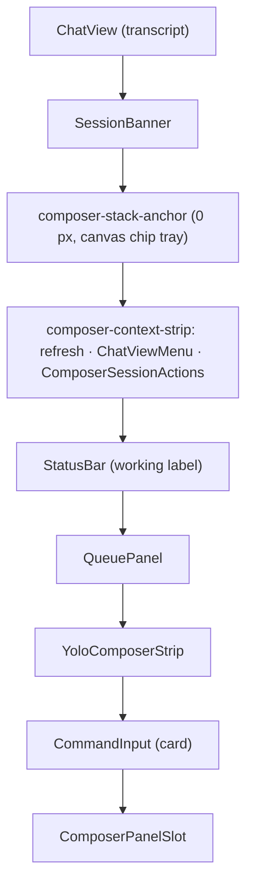
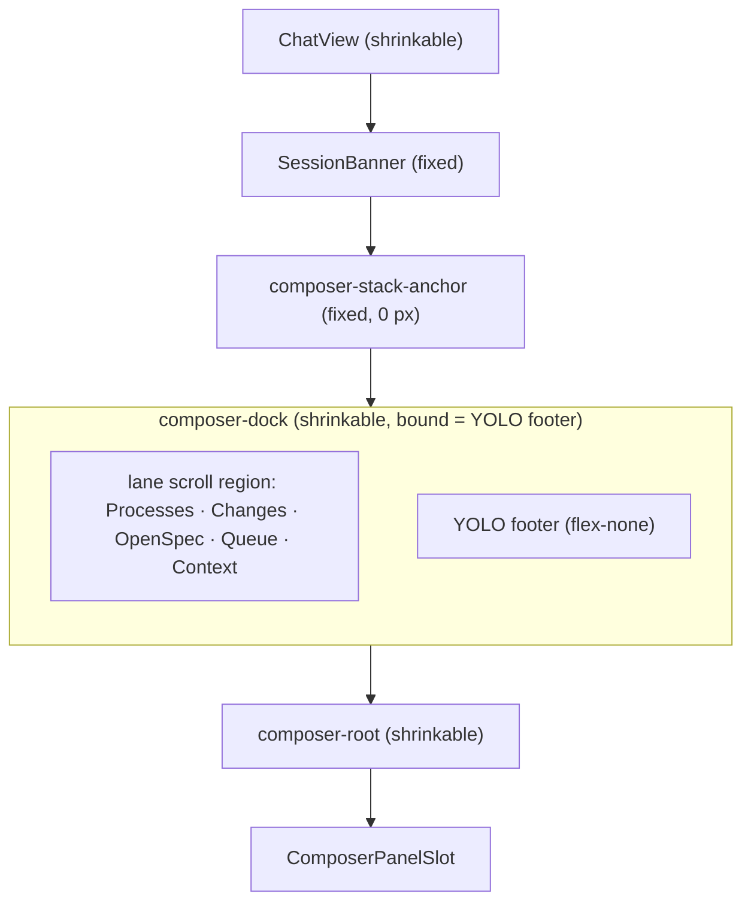

# Design

## Context

See proposal.md for the motivation. The approved direction is the board in `mockups/composer-dock/` (S1–S8, decisions D1–D24 in its `ui-plan.md`), amended by the planning review: no composer context ring (`reorganize-session-header` D8-R2).

Current wiring is in `App.tsx` around the `CommandInput` mount (`packages/client/src/App.tsx:2615-2765`):

The whole stack sits inside `!readOnly` (archived read-only views show none of it).

Data the dock needs already reaches the client:

| Need | Source today |
|---|---|
| Background processes | `DashboardSession.processes` (`packages/shared/src/types.ts:474`; `kind`, `label`, `sessionRef` = the dashboard session id of a matching child, `packages/server/src/spawn-process/process-classifier.ts:87`); kill via `handleKillProcess` → `kill_process { pgid }` → SIGTERM to the group (`packages/extension/src/process-scanner.ts:397`) |
| Running commands | `useInflightBashTools(state)` (`packages/client/src/hooks/useInflightBashTools.ts:63`) / `inflightBashMap` (`App.tsx:2091`) |
| Subagents | `useSessionSubagents` (`packages/dashboard-plugin-runtime/src/plugin-context.tsx`), consumed by the subagents plugin. Core must not read it (see `decouple-plugins-from-core` Phase 3). |
| Changed files | `useSessionDiff(sessionId)` (`packages/client/src/hooks/useSessionDiff.ts:18`) → `GET /api/session-diff`; it has bare `refresh`, no coalescing |
| OpenSpec | `openspecMap` (readiness, changes) + `fetchTasks(cwd, change)` (`packages/client/src/lib/openspec/openspec-tasks-api.ts:29`) → `/api/openspec/tasks` |
| Git identity / worktree actions | `GitIdentity` + `WorktreeActionsMenu` inside `ComposerSessionActions.tsx:487-516` |
| Show-gate, including traceable attachments | `showTrace` / `showOpenSpec` (`ComposerSessionActions.tsx:343-353`) |
| Queue | `QueuePanel` (cycler: nav, position, edit/promote/remove, clear-all, `queue-chip-followup` cap, attachment count), fed by `normalizeFollowUpEntries` |
| YOLO | `YoloComposerStrip`, `useLiveYoloSession`, `isCwdInYoloScope` (`packages/client/src/components/access-grant/YoloIndicators.tsx`) |

The pane height budget is `CHAT_PANE_ROW_TABLE` in `packages/client/src/lib/layout/chat-pane-row-class.ts:72`. `composer-context-strip`, `status-bar` and `queue-panel` are fixed rows there, and `chat-pane-row-completeness.test.ts` checks every rendered row is in the table.

## Goals / Non-Goals

**Goals:**
- One `ComposerDock` component owns lane layout, accordion state, compact mode and the YOLO footer. Lanes are thin adapters over existing data and components.
- `CommandInput` stays reusable: team-app's `ChatPane` (`packages/team-app/src/agent/ChatPane.tsx`) embeds it without a dock or YOLO strip, as today.
- Test ids of surviving elements are kept.

**Non-Goals:**
- No new server endpoint, protocol message or persisted preference.
- No change to session-card surfaces.
- No change to the follow-up cycler's behaviour or to steering (steering stays as inline ghost bubbles in `ChatView`).

## Decisions

### D1. The dock is a sibling of `CommandInput`, not part of it
The dock mounts in `App.tsx` (and `DirectoryHomeView.tsx`) where the strip, `StatusBar`, `QueuePanel` and `YoloComposerStrip` mount today, inside the same `!readOnly` gate. The visual join is CSS only: the dock is inset by `mx-3`, and its bottom edge tucks under the card with a negative margin.
- *Alternative:* render the dock inside `CommandInput`. Rejected: it would pull session, OpenSpec and plugin data into the input, which team-app embeds bare.

### D2. One lane model, two layouts
`ComposerDock` builds `DockLane[]` (`key`, `label`, `icon`, `title`, `meta`, `summary`, `actions`, `body?`, `expandable`, `live?`) from per-lane hooks.
- It renders rows at ≥ 32.5rem (520 px at the default root) and the compact chip row below that. The width is measured by a `ResizeObserver` on the composer column (the `bottom` stack), whose width the dock's own layout and scrollbars do not change, so a flip cannot feed back into the measurement.
- In compact mode every lane gets a chip, including the non-expandable Context and unattached OpenSpec lanes. Their chip opens a sheet holding the lane's header content.
- The toolbar folds inside `CommandInput` use rem container queries (`@[55rem]`, `@[40rem]`, `@[26.25rem]` = 880/640/420 px at the default root), the existing `CommandInput` convention. Larger root fonts therefore fold earlier and text never outgrows the row. Spec thresholds are stated at the default root.
- While a split divider is dragged, the layout switch is evaluated at most once per animation frame. It flips exactly at 520 px, with no hysteresis, so the spec threshold holds. `openLane` survives a flip. Focus moves to the lane's chip (or header) only when it was inside the open lane, so a flip never loses state.
- *Alternative:* one DOM restyled by container queries. Rejected: a chip row and stacked headers cannot share one accessible structure without duplicate controls.

### D3. Accordion state resets on every bind
One `openLane: LaneKey | null` value lives in App state and is set to `null` whenever `selectedId` changes, so a session always binds collapsed (spec "Lanes start collapsed and open one at a time"). Nothing auto-expands, and nothing is persisted.
- *Alternative:* a per-session map. Rejected: it would restore an old expansion on return, against the spec.

### D4. Processes lane: core rows plus a plugin slot with a summary callback
Core renders the Commands and Background groups. Subagents arrive through the new `composer-dock-process-group` slot.
- The subagents plugin claims it. Its component reads `useSessionSubagents` and renders `ComposerDockRow`s. Open → `/session/:sid/subagent/:aid`; status `created` → `pending`, matching the existing mapping at `packages/subagents-plugin/src/client/SubagentDetailView.tsx:56`. It calls `reportSummary({ count, noun: "subagents" })`.
- The dock keeps summaries in a `Map<claimKey, Summary>`, sums them with the core counts for the header and compact chip, and deletes a claim's entry on unmount.
- Each contribution mounts twice by mode. In `"summary"` mode it is always mounted while a session is bound, renders `null` and only calls `reportSummary`, so it adds no DOM, no focusable content and no ticking timer. In `"rows"` mode it mounts only while the Processes lane body is shown. A plugin-only count can therefore make the lane appear, while "no dock renders" still means no dock element in the document, and the canvas tray anchor keeps a true no-dock case.
- Core Commands rows come from `useInflightBashTools`, which includes bash nested inside other tool calls (`useInflightBashTools.ts:40-52`), including those inside a subagent's `Agent` call. A subagent running `npm test` therefore shows as a subagent row and a command row. This is accepted as useful visibility; core still never reads the `Agent` tool's own state.
- Background rows keep their `kind` icons and the sub-session → session link (`ProcessList.tsx:136`).
- Alternatives:
  - Core reads `SessionState.subagents`. Rejected: Phase 3 of `decouple-plugins-from-core` moves that state into the plugin.
  - Core lists running `Agent` tool calls. Rejected: `Agent` is a plugin-owned tool.
  - A `sessionRefs` dedupe field. Dropped as speculative: `SubagentState` carries no session id (`packages/subagents-plugin/src/client/types.ts`), and in-process subagents never appear in the PGID scan.
- **Planning review outcome:** the contract was reviewed in two adversarial cycles (same-model + `@propose-review-1`). The changes it drove are listed above: `sessionRefs` dropped, `pending` instead of an invented "waiting for a slot", and target sizes enforced by `ComposerDockRow`. Task 1.3 rechecks the contract against the implemented types.
- **Contract recheck (task 1.3, `doubt-driven-review` against the implemented `slot-props.ts` / `ComposerDockRow` / `SubagentDockGroup`): verdict HOLDS — no type change needed; five clarifications recorded and one host API bump.**
  - *Noun agrees with count.* The dock prints `noun` verbatim after `count` (`3 subagents`), so a plural-only noun would read `1 subagents`. The contribution supplies a count-agreed noun (`SubagentDockGroup` reports `"subagent"` for 1, `"subagents"` otherwise, both translated); the dock never inflects or hardcodes a plugin noun.
  - *`null` and `count ≤ 0` both mean "nothing runs".* `reportSummary(null)` clears the claim's entry. The dock treats a `{ count: 0 }` report the same, so a misbehaving claim cannot render an empty lane.
  - *Only the `"summary"` instance reports.* The `"rows"` instance (mounted while the lane body is shown) does not call `reportSummary`, and the dock ignores any report from a rows-mode instance, so a claim is never counted twice (task 3.2).
  - *`reportSummary` identity is not part of the contract.* The dock still passes a per-claim stable callback, but `SubagentDockGroup` reads it through a ref and re-reports only when `count` / `noun` change, so an unstable identity can neither loop nor spam. Unmount needs no cleanup call: the dock drops the entry itself.
  - *Dedupe is the contribution's job.* `useSessionSubagents` indexes a state under both `id` and `agentSessionId`; `SubagentDockGroup` dedupes by `state.id` and lists only `created` / `running`. The dock reads no subagent state (unchanged).
  - *Versioning.* Adding a slot, the `ComposerDockRow` export and `ProcessGroupSummary` is additive, so `PLUGIN_HOST_API_VERSION` goes `1.0.0` → `1.1.0` and `host-api-surface.json` is regenerated (`scripts/host-api-surface.mjs --base origin/develop` passes). A contribution that needs the slot declares `hostApi: "^1.1"`; bundled `subagents` ships with the host.

### D5. Changed files: `useSessionDiff` behind a coalescing hook
A new `useDockDiff(sessionId, { working, dirtyCount, expanded })` wraps `useSessionDiff`. It calls `refresh()` in three cases:
- on the falling edge of the composer working state (`isComposerWorking(composerStatus, retrying)`, the same signal the composer uses);
- on a `gitStatus.dirtyCount` change, but only while idle (mid-turn flapping is ignored, and the falling edge covers it);
- on lane expand.

At most one request is in flight. Any trigger during a request, or within 2 s of the last start, sets one pending flag, and exactly one request runs when the request settles and the window has passed. Triggers are never dropped, and the request rate stays bounded. The header count and totals cover the same set: in-cwd, session-owned entries. `totalAdditions`/`totalDeletions` are summed by the server over that set (`packages/server/src/session/session-diff.ts:889`), with the per-file sum as fallback. Out-of-cwd entries (`previewable: false`) list below without a diff link and outside the count. With no totals (non-git), only the count shows. Client turn deltas are never used. Known limit: the server caps owned files at `MAX_FILES = 200` (`session-diff.ts:25`) with no truncation flag. The header shows `200+` when exactly 200 come back; this needs no protocol change.
- *Alternative:* client-side `turnFileDeltas(messages)`. Rejected: it undercounts on partially loaded history and misses bash-created files.

### D6. OpenSpec and Changes lanes reuse `ComposerSessionActions` internals
`ComposerSessionActions.tsx` is split, not rewritten.
- Its OpenSpec content becomes `OpenSpecLaneContent`: lifecycle bar, primary derivation, `⋯`, attach picker, and the traceable archived / missing / main-checkout header, keeping `showTrace`.
- `GitIdentity` and `WorktreeActionsMenu` become the Changes lane's header actions.
- The file keeps its readiness gate, which `session-card-subcards` cites.
- Refresh (`handleOpenSpecRefresh`, formerly the strip's leading button) moves into `⋯` for both attached and unattached lanes.
- The change chip's menu (Open proposal / Detach) folds into `⋯`.
- Next open tasks come from `fetchTasks(cwd, change)` on expand, cached per change and invalidated when `done/total` changes.
- The Changes lane renders when `session.gitWorktree` is set (today's always-on Git group) or the session diff lists changed files. Only the identity segment and worktree actions are worktree-gated.

### D7. Toolbar restructure and test-id migration
In `CommandInput.tsx`, the input row holds only the textarea. The toolbar row keeps `composer-settings-row`. The action cluster moves to the toolbar row's end with its logic unchanged. The working label logic moves from `StatusBar.tsx` into a new `workingStatusLabel(status, currentTool, streamingText)` helper, and `StatusBar.tsx` is deleted. The focus-revealed footer, including `composer-context-left`, is unchanged.

| Test id | Fate |
|---|---|
| `send-button`, `stop-button`, `force-stop-button`, `killing-button`, `stop-split`, `stop-after-turn-button`, `stop-after-turn-pill`, `composer-card`, `composer-root`, `composer-input-row`, `composer-settings-row`, `composer-footer`, `composer-context-left`, `attach-button`, `attach-menu` | kept |
| `delivery-control` | kept, now the dropdown trigger |
| `delivery-steer`, `delivery-queue` | kept, now `menuitemradio`s |
| `open-inline-terminal-button` | kept, now an `attach-menu` item |
| `composer-openspec-container`, `composer-git-container`, `composer-git-group`, `composer-status-container`, `composer-status-group` | kept on the OpenSpec, Changes and Context lanes |
| `composer-session-actions` | removed (the strip root); the dock root is `composer-dock` |
| `yolo-composer-strip` | kept on the YOLO footer |
| `queue-chip-followup`, `queue-followup-attachments`, `queue-followup-position` | kept (cycler embedded) |
| `overflow-button`, `overflow-menu` (composer) | removed |
| `working-status` | kept, now on the toolbar's working-status word |
| `composer-context-strip`, `status-bar` | removed |

### D8. Merged model chip wraps the existing `ModelSelector`
The chip face renders `model · level`. Its popover is the existing `ModelSelector` dropdown with the `ThinkingLevelSelector` level set, filtered by `supportedThinkingLevels`, appended as a radio group. This keeps the selector's open-time refresh, keyboard grid, favorites and empty/error states intact. The chip face is the existing `ModelSelector` trigger with the thinking level appended. The role-display rules ("Session model pickers SHALL resolve a role once": `from @<role>` after a role pick; "Role refs render through one shared display": `RoleRef`) therefore apply unchanged. The id truncates with an ellipsis before any other toolbar control folds.
- *Alternative:* a new combined component. Rejected: it would duplicate behaviour that about 20 model-selector requirements cover.

### D9. Tokens only
The action cluster's raw palette classes (`bg-blue-600`, `bg-red-600`, `bg-orange-600`/`-800`, `text-red-300`, `bg-red-600/15`, `border-red-900/60`, at `CommandInput.tsx:810-896`) are replaced:
- send/stop: `--text-primary` fill with a `--bg-primary` glyph;
- disabled: `--bg-surface` / `--text-muted`;
- force-stop: `--severity-warning-{bg,fg,border}` plus `AlertOctagon`.

`scripts/theme-token-guard.mjs` must report no new violations.

### D10. Pane budget
`CHAT_PANE_ROW_TABLE` drops `composer-context-strip`, `status-bar` and `queue-panel`, and adds `composer-dock`:
- shrinkable, floor 41 (one lane header plus a hairline), weight 1;
- The YOLO footer has a fixed one-line height, `YOLO_FOOTER_HEIGHT` = `h-8` (32 px). `whitespace-nowrap` + `overflow-hidden` with the sentence ellipsized keep it one line in every locale. That satisfies access-grant-yolo's "one line box plus padding and border" without runtime measurement, so there is no first-paint gap and no feedback loop.
- The table declares two static shapes in one place: `composer-dock` (lanes; bound = `YOLO_FOOTER_HEIGHT` or 0, floor = bound + 41) and `composer-dock:footer-only` (bound = floor − 1 = `YOLO_FOOTER_HEIGHT`). App picks the key by state. `chat-pane-row-completeness.test.ts` asserts `floor > bound` for every entry.

Inside the dock, the lanes live in a `min-h-0 overflow-y-auto` scroll region, and the YOLO footer is `flex-none` outside it. `composer-stack-anchor` stays directly above the dock.

### D11. Elapsed ticking stays in leaves
`ComposerDockRow` owns elapsed rendering from `startedAt`, so core and plugin rows share one implementation. Inside it, `useNow(active)` (`packages/client/src/lib/time/use-now.ts:8`) runs once per mounted row group, active only while rows exist, and the text renders in a leaf outside the live region. When `decouple-plugins-from-core` ships `ui:elapsed-badge`, `ComposerDockRow` switches to it internally, and no caller changes. The dock's one sr-only `role="status"` region is a sibling of the lanes, never an ancestor of the YOLO footer, and announces only count strings. If `decouple-plugins-from-core` has shipped `ui:elapsed-badge` by implementation time, use it.

### D12. Header coordination
The context ring lives in the session header (`reorganize-session-header` D8-R2); the composer renders no context gauge. `ChatViewMenu` moves into `SessionHeader.tsx` after the layout switch. Both changes carry the byte-identical `chat-display-preferences` delta; whichever archives second deletes its copy first.

### D13. Queue lane embeds the cycler
`QueuePanel` gains an `embedded` prop. It hides its own subtitle and clear-all, which move into the lane header, and keeps everything else. `mid-turn-prompt-queue` requirements on the cycler (height cap, attachment indicator) therefore stay true unchanged.

### D14. Name-only references to the strip
`worktree-lifecycle`, `openspec-frontend-actions`, `session-card-subcards` and `auto-canvas` mention "the composer strip" only as a location. `composer-dock` "Dock replaces the composer strip in other capabilities" maps those names. They are not copied into MODIFIED blocks: their behaviour does not change, and the copies would collide with concurrent changes. `app-decomposition` "Session detail view extraction" names a `SessionDetailView` that does not exist in the code. That is pre-existing staleness, left untouched.

## Risks / Trade-offs

- **Diff refetch cost on big repos.** Each refetch runs `git diff --numstat` in the session-load worker. → Mitigation: coalescing (D5), no refetch while the dock is unmounted, and a `performance-optimization` task that measures p95 on this repo and adds back-off if it exceeds 300 ms.
  - **Measurement (task 4.3, `performance-optimization`).** Core of `GET /api/session-diff` = `buildSessionDiff` + git enrichment, measured over 20 sequential runs after a warm-up, on a shared dev machine (load average 9–17, 3 users).
    - *200 changed files, real temp git repo* (the server cap and the committed budget test `packages/server/src/__tests__/session-diff.perf.test.ts`, test-plan #P1): median 138–144 ms, p95 149 / 215 / 236 / 278 ms over four runs, max ≤ 295 ms. Budget p95 < 300 ms holds, with thin headroom under load.
    - *This repo* (22.8k tracked files, 59 dirty paths, run as a `GET`-equivalent through `buildSessionDiffCached` with no owned events): uncached median 473–501 ms, p95 622–664 ms; a cache hit still pays the key computation (`git rev-parse HEAD` + `git status --porcelain`): median 344–388 ms, p95 551–733 ms. Over budget. The cost is dominated by `git status` (about 260–730 ms by load), not by per-file work.
    - *Outcome:* over 300 ms on a large repo, so the back-off is added. `useDockDiff` times each request; a request slower than `DOCK_DIFF_SLOW_MS` (300 ms) doubles the minimum gap between request starts (2 s → 4 → 8 … capped at 30 s) and a fast request resets it. Triggers still coalesce into one pending refetch and are never dropped. Covered by the `back-off (4.3)` case in `useDockDiff.test.ts`. A server-side fix (skipping untracked scanning, `--untracked-files=normal`) is out of scope here.
    - *Settle delay:* turn-end and dirty-count triggers wait 1 s (`DOCK_DIFF_SETTLE_MS`) so the two same-second signals of a turn end send one request (spec "Refetches are coalesced"); expand, Retry and the first load are immediate subject to the window.
- **Slot contract churn.** `reportSummary` is new public API. → Mitigation: keep it to `{ count, noun }` | `null`, and recheck it against the implemented types (task 1.3).
- **Height budget regressions.** Three fixed rows become one shrinkable row. → Mitigation: update `chat-pane-row-completeness.test.ts` and `chat-pane-below-floor-allocation.spec.ts`, and add a short-pane hu-locale case with YOLO on.
- **Validator-kept stale scenario names.** `model-selector` keeps a scenario named "StatusBar and SessionCard update together…" because a MODIFIED block may not drop scenarios; its body now names the merged chip. → Accepted.
- **E2E churn.** These e2e specs touch moved or removed ids: `canvas-chip-tray-overlay`, `chat-pane-below-floor-allocation`, `quota-context-strip`, `route-backed-overlay`, `composer-liveness-reload`, `change-summary-table`, `composer-session-strip`, `inline-terminal-transcript`, `popover-container-clip`, `split-composer-overflow`, `terminal`, `team-skills`, `yolo-indicator-layout`, `access-grant-dialog`, plus `helpers/index.ts`. → Mitigation: the D7 table, and one task covering all of them.
- **team-app composer.** It gets the new toolbar but no dock. `team-skills.spec.ts` reads `composer-input-row`, which no longer holds the action button. → Mitigation: a team-app task verifies that spec and the `invalid` border.
- **Nested commands under a subagent.** A subagent's own bash shows as a command row too, and the header counts both. → Accepted: both are running work, and excluding them would make core match on the plugin-owned `Agent` tool name.
- **Concurrent changes.**
  - `add-voice-assistant-dashboard-plugin` specifies its slot "in the input row before terminal and send/stop", in its spec and in tasks 9c.3 and 10.92.
  - `add-supervised-tool-approval` folds its chip into `⋯` below `@[44rem]` (its proposal, its task, and test 8.96).
  - `reorganize-session-header`'s `play-stop-controls` delta names the "session-actions strip", "the activity line above the composer" and "the composer status line's working label (`StatusBar`)".
  - → Mitigation: these are contradictions between unarchived changes. Gate tasks 0.1–0.3 resolve each before implementation, by editing the not-yet-archived change's artifacts, or, if it archived first, by adding a delta here (the same gate pattern `reorganize-session-header` uses for the ring). Accepted as a trade-off over editing other changes during this planning.

## Migration Plan

One release. No data migration.
- **Rollback:** revert this change's commits together (client, shared slot declarations, runtime, subagents plugin). The old strip, StatusBar, QueuePanel and YOLO rows come back unchanged because their data sources are untouched.
- **Plugin compatibility:** the `composer-context-group` API is unchanged. `composer-dock-process-group` is additive, so a third-party plugin that does not claim it is unaffected.
