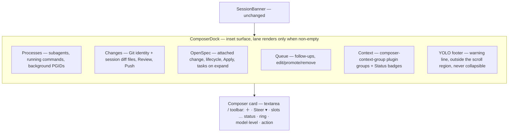

# UI plan — Composer Dock (option C)

Explore-mode board. No change dir yet. Mode `preserve` (anti-slop-redesign), profile `product-ui`, contract root `ui-contract.md`. Image direction off.

## Surface

Chat pane bottom stack. Today (App.tsx ~2615-2765): `SessionBanner` → `composer-context-strip` (refresh · `ChatViewMenu` · `ComposerSessionActions` OpenSpec/Git/plugin/Status `ToolbarGroup`s) → `StatusBar` → `QueuePanel` → `YoloComposerStrip` → `CommandInput` card. Background processes live on sidebar `SessionCard` PROCESS subcard; changed files on `/diff` route.

Proposed: `SessionBanner` unchanged → **ComposerDock** (lanes + YOLO footer) tucked under → composer card.

## Lane → source → actions

| Lane | Source (exists) | Header | Body | Actions |
|---|---|---|---|---|
| Processes | subagents: `SubagentState` (`type`,`description`,`status`,`modelName`,`entries`) via subagents-plugin contribution; commands: `useInflightBashTools`; background: `ProcessEntry` (`pid`,`pgid`,`command`,`elapsedMs`,`kind`,`label`,`sessionRef`) | one kind: `N background processes · running · longest <el>`; mixed: `N running · 3 subagents · 1 command · 2 background · longest <el>` | grouped sections Subagents / Commands / Background. Subagent `name task role·steps elapsed Open`, `created` → `waiting for a slot`; command `command elapsed Show`; background `kind-icon pid command elapsed Kill` | Open → `/session/:sid/subagent/:aid`; Show → scroll to tool card; Kill → `force_kill` PGID. No per-subagent / per-command stop (composer Stop aborts the turn) |
| Changes | `session.gitWorktree` + `gitStatus`; files from `/api/session/:id/diff` (`additions`,`deletions`,`origin`,`otherChanges`) | worktree: `branch ← base · N files +A −D · ↑ahead`; else `N files changed +A −D` | file rows → open that file's diff; footer `N other changes … Show` | Review (diff view), Push, ⋯ worktree menu |
| OpenSpec | openspec poller (counts) + `tasks.md` via `onReadArtifact` (on expand) | attached: change name · `done/total tasks` + lifecycle letters; unattached: `OpenSpec` | next open tasks + last done, `N more · Open tasks.md` | Apply (single filled primary), ⋯ (open proposal, workflow items, refresh, detach); unattached: Attach change…, Explore, ⋯ |
| Queue | `pendingQueues.followUp` (`FollowUpEntryView[]`) | `N queued follow-ups · sent when this turn ends` | rows `n text edit promote remove` | Clear all (N>1) |
| Context | `composer-context-group` claims, `session-card-badge` | plugin groups inline | — | plugin-owned; never working-gated |
| YOLO (footer) | `useLiveYoloSession`, `isCwdInYoloScope`, `yolo.coverage*` copy, `yoloRemainingLabel` | `⚠ <full description>` link → `/settings/access` + time sibling (`12m left` / `∞` + sr `no expiry`) | — | the link; never dismissible |

## Tokens

| Element | Tokens |
|---|---|
| dock surface | `--bg-secondary`, border `--border-secondary`, rim `--elevation-rim`, lane hairline `--border-subtle` |
| card | `--bg-tertiary`, border `--border-secondary` → `--accent` on focus-within, raised elevation (`--elevation-rim`, `--shadow-card`) |
| text | title `--text-primary` 600 12px; meta/elapsed/pid `--text-secondary`; nothing below 11 px, 12 px inside interactive |
| +/− | `--accent-green-text` / `--accent-red-text` + sign glyph |
| lifecycle | track `--accent-green` done, `--accent-primary` current, `--border-secondary` todo |
| primary (Apply) | `--accent-solid` + `#fff` (contract-sanctioned 5.17:1); disabled → `--bg-tertiary`/`--text-secondary` |
| action button | inverted neutral `--text-primary` fill / `--bg-primary` glyph; disabled `--bg-surface`/`--text-muted` (WCAG 1.4.3 exempt); force-stop `--severity-warning-{bg,fg,border}` + AlertOctagon |
| Kill hover | `--tint-red-{bg,fg,border}` |
| status word | `--text-secondary` text + `--status-working` dot (status on shape, not text) |
| next pill | `--severity-info-{bg,fg,border}` |
| waiting pill (subagent `created`) | `--severity-neutral-{bg,fg,border}` + TimerSandEmpty |
| YOLO footer | `--severity-warning-{bg,fg,border}`; unscoped = 2 px border + bold (still warning, never error) |
| focus | `--focus-ring` 2px everywhere |

No raw colour literal in `dock.css` / `board.css` except `#fff` on `--accent-solid`. `asbuilt.css` reproduces shipped raw palette (`bg-red-600`, `bg-blue-600`, `text-orange-400`) on purpose — debt replica, probe-exempt.

## States

S1 streaming everything (at rest all collapsed + Processes opened) · S2 OpenSpec open + draft · S3 Changes open main checkout · S4 quiet (one row / no dock) · S5 480 compact + 375 phone · S6 YOLO footer (scoped, unscoped no-expiry, compact, YOLO-only) · S7 ＋ / delivery / model·thinking popovers · S8 action states (send-disabled, send, stop + after turn, stopping-after-turn, force, killing, cancel).

## Decisions (D-ids match the board)

- D1 one dock surface, five lane kinds; Gestalt common region.
- D2 stretched disclosure toggle per lane header; actions are siblings above it (no nested interactive).
- D3 accordion, one lane open; lane body max 200 px scroll; dock `flex-shrink` + scroll so the transcript keeps space.
- D4 `StatusBar` folds into the toolbar as status word; `ChatViewMenu` moves to pane header.
- D5 process `Kill` ≠ composer `Stop` (Nielsen #4).
- D6 no ticking text in live regions; one sr-only `role=status` announces count changes.
- D7 task list reads `tasks.md` on expand (poller ships counts only).
- D8 Apply = single filled primary; working → `aria-disabled` + focusable + reason.
- D9 changed-files source = server session diff, refetch on `turn_end` + expand; client `turnFileDeltas` rejected (undercounts on partial history, misses bash files).
- D10 +/− sign + colour.
- D11 no Undo until `add-workspace-checkpointing`.
- D12 resting footprint ≤ one 40 px row.
- D13 container folds: `<880` hide slot labels + after-turn label; `<640` hide access slot, status word, Steer label, ring %; `<520` compact chip row; `<420` Steer into ＋ menu, model level hidden from chip face. Ring stays at every width (arc only below 640): `mockups/session-header-reorg` D8-R1 drops the header gauge. Ring = non-focusable `role=meter` + `aria-valuetext` (token count), so it costs no 44 px target on phones.
- D14 phone targets 44 px.
- D15 toolbar 6 visible controls → 4 + plugin slots; Terminal into ＋.
- D16 dashed placeholders = slots owned by `add-supervised-tool-approval` (access mode) and voice plugin `composer-toolbar-action` (mic).
- D17 action fill = inverted neutral; retires `bg-blue-600`/`bg-red-600` debt.
- D18 action button moves into toolbar row → MODIFIED chat-view requirement.
- D19 every lane collapsed by default; nothing auto-expands.
- D20 Processes lane = subagents (several) + running commands + background, grouped; subagent Open, command Show, background Kill.
- D21 subagent rows come from a subagents-plugin contribution (survives `decouple-plugins-from-core` Phase 3); background row whose `sessionRef` matches a listed subagent is dropped.
- D22 SessionCard PROCESS subcard kept (hideable per folder via configurable-session-card-sections; cross-session glance).
- D23 YOLO strip → dock footer. access-grant-yolo invariants kept: directly above the composer; link text + title = full description; time sibling outside link; no live-region role on it or any ancestor (dock `role=status` is a sibling); one line, sentence clips first; outside the dock scroll region so it never scrolls away; never a compact chip.
- D24 DirectoryHomeView renders the same dock, so the folder-home composer shows the YOLO footer in the same place.

## Spec impact (for the proposal)

- MODIFIED chat-view "Composer is a unified container…": strip → dock; action button in toolbar row; Terminal chip → ＋ menu; model + thinking one chip; Tasks segment shows letter (count in lane meta); change-chip menu folds into ⋯.
- MODIFIED chat-view "Mobile composer adaptation": new fold thresholds (D13).
- MODIFIED session-activity-bar / session-process-tracking: bash in flight + PGID processes also render in the dock Processes lane (card PROCESS subcard kept).
- MODIFIED access-grant-yolo: "a strip placed directly above the composer" becomes the dock's YOLO footer (same invariants; verified set unchanged).
- ADDED subagents-plugin contribution: running subagent rows for the dock Processes lane (coordinate with `decouple-plugins-from-core` Phase 3).
- MODIFIED dashboard-shell-slots `composer-context-group`: renders in dock Context lane.
- ADDED composer-dock capability: lanes, accordion, compact mode, live-region rule.
- Keep testids: `send-button`, `stop-button`, `force-stop-button`, `killing-button`, `stop-split`, `stop-after-turn-button`, `delivery-control`, `composer-card`, `composer-openspec-container`, `composer-git-container`.

## Probe + rubric

Probe (`probe.js`, computed-contrast rules + 24 px target check): **0 failures** — base dark, base light, nord dark × widths 1000/768/480/375 × S1–S8. YOLO invariant probe (S1/S5/S6): no live-region ancestor, one line, time visible, outside scroll region. Console: no errors.

| Rubric | Result | Reason |
|---|---|---|
| Contrast AA, both themes | PASS | probe clean in 3 palettes |
| Responsive | PASS | compact <520, phone 44 px targets; model id truncates on phone (full name in `aria-label`/`title`) |
| Hierarchy | PASS | one filled primary in dock; action button sole round fill in card |
| Spacing | PASS | 2/4/6/8/10/12 steps; within-lane gap < between-lane hairline |
| Token fidelity | PASS | tokens only, one sanctioned `#fff` |
| Anti-slop | PASS | system font, no gradient/glow, real session data |
| Console | PASS | no errors |

## Amended in planning (add-composer-dock doubt review)

- Context ring REMOVED from the composer: `reorganize-session-header` D8-R2 (user-approved) puts the one ring in the session header. Supersedes D13's ring clause and resolved answer 1.
- Subagent `created` shows `pending` (existing mapping), not "waiting for a slot" (no admission state exists in the plugin).
- Kill terminates the process group (SIGTERM via `kill_process`), not a force-kill.
- Queue lane embeds the existing cycler (`QueuePanel` embedded) instead of one-line rows.
- Status group keeps its working gate; only `composer-context-group` contributions stay ungated.
- `＋` is the toolbar's only fold host; no `⋯`.

## Resolved (user, 2026-10-21)

1. Ring vs header gauge → owned by session "Reorganize header" (`mockups/session-header-reorg` D8). This board keeps the ring at every width so R1 holds.
2. Lanes default collapsed → D19.
3. Running subagents (several) + commands appear in Processes → D20, D21.
4. SessionCard PROCESS subcard kept (hideable) → D22.
5. YOLO becomes a dock lane → D23, D24.

## Open (cross-board)

- `mockups/session-header-reorg` D10: the header "Changed files" chip overlaps the dock Changes lane (`N files +A −D`, Review). One of them should own the count.
- `mockups/session-header-reorg` D5: Attach removed from the header; the dock OpenSpec lane keeps Attach change… (consistent).
