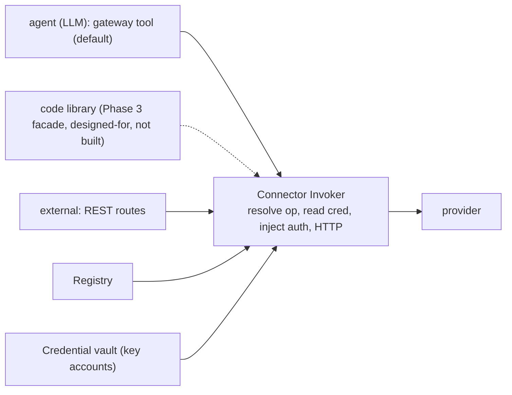
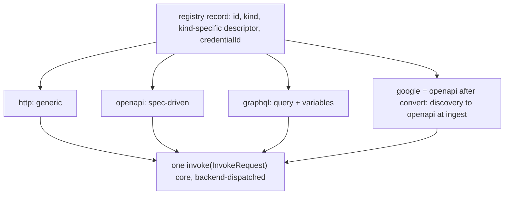

# Design — connector layer

## Context

Two non-negotiable constraints drive every decision here:

1. **Bundle-able ⇒ permissive license only.** The engine ships inside pi-dashboard. That excludes n8n (fair-code) and Nango (ELv2). It forces either Composio (MIT, but a heavyweight platform with weak self-host) or roll-your-own from MIT/Apache parts. We choose **roll-your-own**, because the requirement decomposes into small pieces and the connector *catalog* — the only expensive part — is solvable with OpenAPI specs rather than vendored connector code.

2. **Token budget is a first-class constraint.** One MCP tool per operation is disqualified by measurement (200+ tools ≈ 150K tokens at session start). The design must hold per-turn tool context flat as the catalog grows.

## Goals / Non-goals

**Goals**
- Managed, encrypted credential storage manageable from settings.
- Connectors callable by pi-flows agents (LLM) AND by external REST callers, sharing one core.
- Flat per-turn token cost regardless of catalog size.
- Catalog grows by adding OpenAPI specs, not code.

**Non-goals (this change)**
- OAuth flows / token refresh (Phase 2).
- Code-execution façade (Phase 3).
- A large connector catalog (3 seed connectors prove the pipe).

## Key decision 1 — one core, three façades

The Invoker is the single execution path. Façades are thin adapters that translate their input shape into an `InvokeRequest { connectorId, params }` and render the `InvokeResult`. This guarantees the LLM seam, the REST seam, and the future code seam can never diverge in behavior or auth handling.

## Key decision 2 — gateway tool, not N tools (the token invariant)

Expose exactly three tools, forever:

| Tool | Returns | Token cost |
|---|---|---|
| `search_connectors(query)` | ranked list of `{id, summary}` (top ~5) | tiny, on demand |
| `get_connector_schema(id)` | one operation's param JSON-schema | one op, on demand |
| `call_connector(id, params)` | invocation result | result only |

Per-turn tool context = three schemas, constant. The catalog can hold 3 or 3,000 operations; the model never sees them until it searches. This is **progressive disclosure**, the same principle as Anthropic's MCP code-execution and tool-search work.

Rejected alternative — *register every operation as an MCP tool*: simplest to wire, but violates the token invariant catastrophically. Not viable.

Rejected alternative — *static enabled-subset only*: load the user's enabled connectors as real tools. Fine for ≤ ~10 hot connectors, but cannot offer "discover any of N on demand." Kept as a **future** per-connector "pin" optimization layered on top of the gateway, not as the base seam.

## Key decision 7 — connector *kind* is a pluggable dimension

Stakeholder wants full reach: Tier-1 OpenAPI services, the Google suite (Discovery Documents, not OpenAPI), GraphQL-only services (Linear, Shopify Admin), and a generic-HTTP escape hatch. These cannot all be served by one ingestion path or one invoke path. So the registry record carries a **`kind` discriminator** and the Invoker dispatches on it:

- `http` and `openapi` share most of the invoke path (openapi = http + a schema). MVP ships both.
- `google` is **not a new invoke kind** — it is `openapi` produced by a Discovery→OpenAPI converter at ingest time. Adds an ingest adapter, reuses the openapi invoke path.
- `graphql` is a genuinely separate invoke backend (query/mutation string + variables, schema via introspection). It is the only kind needing a new invoke path.

This discriminator is the seam that lets later phases land without reworking the core. `search_connectors`/`get_connector_schema`/`call_connector` and the REST routes stay identical across kinds.

## Catalog roadmap (committed, phased)

| Phase | Reach added | New code |
|---|---|---|
| **MVP (this change)** | generic-HTTP + Tier-1 OpenAPI (3 seeds) | http+openapi invoke, OpenAPI loader, `kind` discriminator |
| **Phase A** | Tier-1 OpenAPI scale-out (GitHub, Stripe, Twilio, Slack, Notion, … APIs.guru ~2,500) | no new invoke code; per-provider **curation manifests** (allowlist + auth map + server vars). Mandatory: specs are huge (Stripe ≈587 ops/1.5M tok) and MUST be curated to ~6–15 ops each. All first-wave providers use pasted tokens (`api_key`), so Phase A does NOT depend on Phase 2 (OAuth). |
| **Phase B** | Google suite (Gmail/Calendar/Drive/Sheets) | Discovery→OpenAPI ingest converter (reuses openapi invoke) |
| **Phase C** | GraphQL services (Linear, Shopify Admin) | new `graphql` invoke backend + introspection-based registry |

OAuth (Key decision 5, Phase 2) is orthogonal and overlaps these — most Tier-1/Google/GraphQL targets need OAuth, so the `ProviderHandler` reuse work pairs with Phase A/B/C as each provider is onboarded.

## Key decision 3 — OpenAPI-driven catalog

A connector is data, not code: `{ openapi_spec_ref, operation_id, credential_id }`. The loader (pattern of `mcp-from-openapi`, Apache-2.0) reads a provider's OpenAPI document and exposes each operation's id, summary (feeds `search_connectors`), and parameter schema (feeds `get_connector_schema`). Invocation builds the request from the operation + caller params + injected credential.

- **Why OpenAPI, not vendored connector code:** specs are publishable and license-clean; vendoring Pipedream components is out (relicensed to Source-Available) and vendoring n8n nodes is out (fair-code). One loader scales to any provider with a spec.
- **Escape hatch:** provider specs vary in quality. The registry supports a per-spec *overrides* file (patch a path, fix an auth descriptor, hide noisy operations) so a bad spec never blocks a connector.

## Key decision 4 — Credential store: the credential vault, not a connector-specific file

The dashboard now has one hub-owned credential store: the vault (`add-credential-vault`, `~/.pi/dashboard/vault.json`). It is locked, 0600, corrupt-safe (byte-exact backup, writes refused), keeps unknown fields on update, rejects short values, and never returns a stored value through any management surface. A second plaintext file (`connector-auth.json`) would duplicate all of that and split rotation and revocation across two places.

Decision: **an API-key connector references a vault `key` account.** `credential_id` is the vault account id. The invoker reads the value server-side through the vault's delivery-only reader (`VaultStore.getKeyValue`), injects it as auth, and never returns it.

- **MVP credential type:** vault `key` account (kind `key`, namespace `user`). A connector needs no vault binding or grant: bindings and grants decide which *sessions* receive an env variable, and connector calls run in the server.
- **Revocation:** revoking the account makes `get` fail, so every connector that references it becomes non-invocable (unchanged requirement).
- **OAuth:** a later phase, after the vault gains OAuth accounts (`add-vault-llm-delivery`). No schema change to connectors: the account `kind` already discriminates.

## Key decision 5 — OAuth is NOT a spike: reuse the existing handler registry (Phase 2)

The repo already runs a full authcode+PKCE OAuth flow for LLM providers: `provider-auth-handlers.ts` defines a `ProviderHandler` interface (`generatePKCE`, `generateState`, `callbackPort`, `callbackPath`, `buildAuthUrl`, `exchangeCode`), `oauth-callback-server.ts` listens on `127.0.0.1`, `buildRedirectUri` supports a tunnel URL for remote/exposed dashboards, and refresh is handled in `internal-auth-storage.ts`.

Phase 2 therefore is **"implement `ProviderHandler` for each OAuth connector provider (Slack, Google, …) and register them alongside the LLM handlers"** — standard authcode+PKCE, which these providers all support. The earlier "Electron redirect spike" is dissolved: the loopback-callback mechanism already works in the Electron-bundled server. **Arctic (MIT) is downgraded to optional** — it would only supply provider config presets; the dance itself already exists.

## Key decision 6 — REST authZ: reuse `networkGuard`, not a new scheme

The dashboard's auth is layered: `auth-plugin.ts` global `onRequest` hook bypasses loopback (zero-friction single-user), gates everything else behind a JWT cookie when the dashboard is exposed beyond localhost; `localhost-guard.ts` exports `createNetworkGuard(trustedNetworks)` used as a `preHandler` on sensitive routes (e.g. `openspec-group-routes.ts`). Connector invoke routes SHALL reuse `networkGuard` as a `preHandler`, identical to the openspec routes. No new auth surface.

## Threat model (store holds live third-party secrets)

- Secrets live in the credential vault (`~/.pi/dashboard/vault.json`): 0600 and encrypted at rest (AES-256-GCM whole-file envelope, data key in the OS keychain or an explicit key file) by `encrypt-credentials-at-rest`, which lands first. Protection is file permissions, at-rest encryption against copies, backups and sync, and the layered request auth above. A same-user process that can read the keychain entry is NOT stopped (see that change's threat model).
- The vault is a separate file from `auth.json` (smaller blast radius if one store leaks), and it is dashboard-owned, so it is outside the pi-session single-writer space.
- `search_connectors` / `get_connector_schema` / REST list endpoints **never** return secret material.
- Invoke routes gated by `networkGuard`; loopback bypass means local single-user has no friction, remote/exposed use is gated.
- Tool/REST results are passed through; connector definitions may mark fields redactable so obvious secret echoes are masked. (Best-effort, documented limitation.)

## Open questions

- `search_connectors` ranking: lexical over operation id+summary is enough for MVP; revisit if the catalog grows large.
- Where the registry's specs live: bundled seed specs in-repo vs user-importable spec files in `~/.pi/`. MVP: bundled seeds + a directory for user-added specs.
- Whether connector OAuth should reuse the vault's OAuth accounts or the model-proxy's `InternalAuthStorage` refresh scheduler. Decided when the vault's OAuth phase lands.
