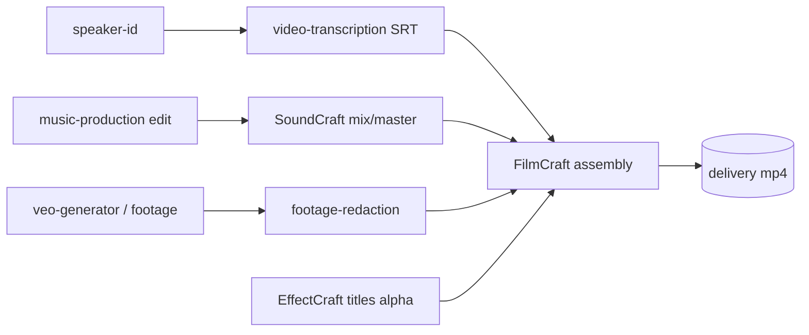

## Context

Builds on `add-craft-apps-core` (router `craft-studio`, 13 app skills, `pi-craft verify`). Spike evidence and per-app dialects are in that change's design.md.

## Decisions

### D1. Hand-off contract (shared by all four workflows)

| Edge | Format | Verify |
|---|---|---|
| audio mix → video | wav 48 kHz stereo 24-bit | `--duration`, `--loudness`, `--max-peak` |
| graphics → video | mov ProRes 4444 with alpha | `--alpha`, `--size`, `--duration` |
| captions → video | srt (from `video-transcription`) | line count > 0 (skill-level check) |
| delivery | mp4 h264 + aac | `--duration`, `--has-video`, `--has-audio`, `--frame-diff` sample |

### D2. FilmCraft vs HyperFrames
FilmCraft = footage timeline editing (cuts, tracks, audio, export presets). HyperFrames = HTML/code-driven motion composition. `craft-video-post` never re-implements HyperFrames; when motion design is code-driven it renders HyperFrames to an alpha mov and overlays it in FilmCraft. The router's table states this split.

### D3. Soft references
Workflow skills reference sibling skills by name. Step 0 of each workflow checks availability (`pi` skill list or the sibling CLI on PATH, e.g. `pi-transcribe`); if absent, the skill names the package to install and the degraded path (e.g. skip captions). No package dependency is added.

### D4. Resumability
Each step writes its project file (`.fcproj`, `.scraft`, `.ecproj`) and outputs into a per-job directory `craft-jobs/<slug>/NN-<step>/`; a `job.json` records completed steps + verify reports so a re-run resumes at the first unverified step.

## Risks / Trade-offs

- Caption import/burn-in support in FilmCraft is unverified → gating task.
- Loudness targets (e.g. −16 LUFS podcast, −14 LUFS web) need SoundCraft loudness/limiter commands → gating task; fallback: ffmpeg `loudnorm` documented as degraded path.
- `job.json` is a convention inside skills, not code — drift risk; covered by skill lint (presence of the resume step).

## Open Questions

- Does FilmCraft import SRT as a caption track, or must captions be rendered by EffectCraft as alpha overlays?
- SoundCraft per-speaker split: from speaker-id timestamps via `edit` commands, or import pre-split stems?
