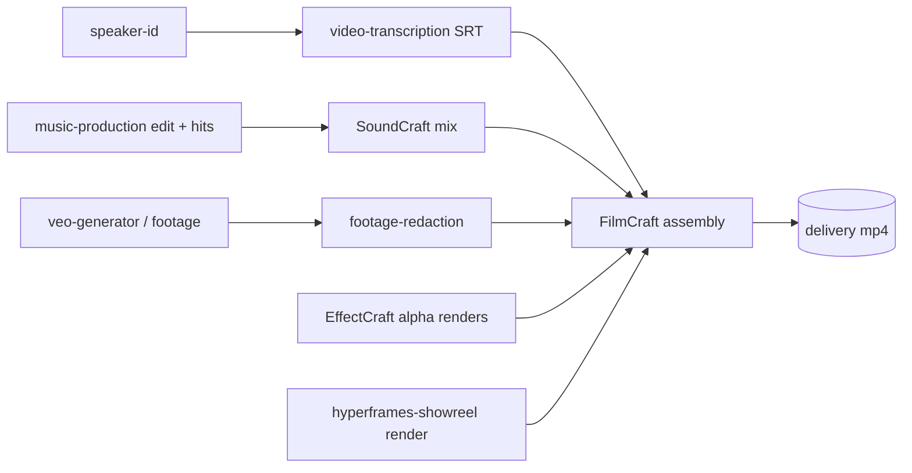

## Context

Builds on `add-craft-apps-core` (landed): router `craft-studio`, 13 app skills, `pi-craft verify` (`packages/craft-apps/src/verify.ts`). Spike evidence and per-app dialects: `openspec/changes/archive/2026-10-14-add-craft-apps-core/design.md`.

## Decisions

### D1. Hand-off contract (shared by all four workflows)

| Edge | Format | Gate |
|---|---|---|
| audio mix → video | wav PCM 24-bit 48 kHz: bounce, then `pi-craft soundcraft exec convert MIX OUT --bit-depth 24 --rate 48000` (`soundcraft/SKILL.md:30`; bounce itself sets only `bit_depth`, `:14`) | `pi-craft verify --codec audio=pcm_s24le --duration … --max-peak …` (+ `--loudness` when a target applies) |
| graphics → video | mov ProRes 4444 with alpha | `pi-craft verify --alpha --size … --duration …` |
| captions → video | srt (from `video-transcription`) | skill-level check `test "$(grep -cE '^[0-9:,.]+ --> [0-9:,.]+' cues.srt)" -ge 1`; the captioned render is gated with `--frame-diff <cue-t>:<ref>><pct>` (pct = % of pixels whose luma differs > 40/255, `verify.ts:25`; value calibrated in probe 0.1) against the retained uncaptioned render `NN-assembly/ref.mp4` (kept for the job's lifetime) |
| beat hits → edit | `music-hits/1` json (`beat-sync-video`) | skill-level check `jq -e '.schema=="music-hits/1" and (.hits\|length>0)' hits.json` |
| delivery | mp4 h264 + aac | `pi-craft verify --codec video=h264 --codec audio=aac --duration … --has-video --has-audio --frame-diff …` |

`pi-craft verify` gates bit depth through `--codec audio=pcm_s24le` (`verify.ts:308-310`) but has no sample-rate / channel assertion and no srt/json assertion; rate is fixed by the explicit `convert --rate 48000` step and channels by the session layout, neither gated (trade-off; a verify extension is out of scope). Skill-level checks sit in labelled `check:` fences (not `recipe:` fences, so the existing rule "every recipe ends with `pi-craft verify`" still holds) and the workflow lint requires one after each text-artefact step. `jq` is already a skill-level dependency (vectorcraft/cadcraft/designcraft skills). Duration tolerance: intermediate edges use the verify default ±0.05 s against the picture length; delivery ±0.1 s. A failed gate allows at most 2 re-discover-and-retry attempts, then the workflow stops and reports. Any `--frame-diff` reference file is a retained output of an earlier step in the job dir, so a resumed run still has it. This narrows the router's general "wav or aiff" audio row (`craft-studio/SKILL.md:49`) for workflows only; the router row is unchanged.

### D2. FilmCraft vs HyperFrames
FilmCraft = footage timeline editing (cuts, tracks, captions, audio, export presets). HyperFrames (`packages/video-production/.pi/skills/hyperframes-showreel/`) = HTML/code-driven motion composition; its documented render is `npx hyperframes render . -o …mp4` (`hyperframes-showreel/SKILL.md:32`) — an alpha mov output is **unverified** → probe 0.5. `craft-video-post` never re-implements HyperFrames: with alpha it overlays the render on V2+; without alpha it places the render as a full-frame segment. Beat-synced cuts: `craft-beat-cut` = footage timeline in FilmCraft; `hyperframes-showreel` = composition-driven showreel. The router's workflow table states both splits.

### D3. Soft references
Workflow skills reference sibling skills by name. Step 0 checks availability with what actually exists:
- skills: the agent's loaded skill list (pi injects available skills into the session) — the only signal for `music-analysis`, `music-edit-to-length`, `beat-sync-video` (`packages/music-production/package.json` has no `bin`) and `hyperframes-showreel` / `footage-redaction`;
- CLIs on PATH where a sibling ships one: `pi-transcribe` (`video-transcription`), `pi-voiceid` (`speaker-id`), `pi-veo` (`veo-generator`).
"Loaded skill list" = the available-skills list pi injects into the agent's own system prompt (with each skill's location, which also resolves a sibling's package dir). A loaded skill does not prove its runtime works, so step 0 also runs a cheap runtime probe where the sibling needs one: the music venv interpreter used by `beat-sync-video` (`beat-sync-video/SKILL.md:25`) and `npx hyperframes --version` (`hyperframes-showreel/SKILL.md:32`); a failed probe counts as absent.
When absent, the skill names the package to install and the degraded path (e.g. skip captions), or stops when the sibling is essential to the requested job. No package dependency is added.

### D4. Craft jobs (resumability) — one convention, owned by the router
The convention is written once, in a "Craft jobs" section of `craft-studio/SKILL.md`, and linked from every workflow skill (media and, later, office): per-job dir `craft-jobs/<slug>/NN-<step>/` holding the step's project file (`.fcproj`, `.scraft`, `.ecproj`) and outputs; `craft-jobs/<slug>/job.json` records completed steps with their verify reports (`pi-craft verify --json`); each step entry also records its inputs (path, size, mtime) and upstream step ids; a re-run resumes at the first step that has no passing report OR whose recorded inputs no longer match, and every step downstream of it is re-run. Re-using an existing slug resumes only after the agent confirms the job name recorded in `job.json` matches the request; on mismatch (two names mapping to one slug) it picks a new slug with a numeric suffix. `<slug>` = job name lower-cased, every char outside `[a-z0-9-]` mapped to `-`; never a raw path. `job.json` is read back as data only (paths are re-validated to sit under `craft-jobs/<slug>/` before use). Workflows use the bash route (`pi-craft <app> exec`); on the MCP route the job dir must sit inside the confined server's `--root`, and FilmCraft is unconfined (`craft-studio/SKILL.md:94-97`). `job.json` is a skill convention, not code: enforced by the workflow lint (resume step + router link present).

### D5. Hits → edits
FilmCraft offers `sequence.addEdit` / `sequence.addEditAllTracks` (`packages/craft-apps/src/__tests__/fixtures/commands/filmcraft.json`) but `filmcraft/SKILL.md` documents only `source.*` + `playhead.set` placement. `hits[].t` is video time (`beat-sync-video/SKILL.md:40-41`); probe 0.3 fixes only the offset onto the FilmCraft sequence. If a `music-hits/1` → command-list translation is reliable as a skill recipe (jq/inline), no code; otherwise one helper script ships inside the skill dir (`.pi/skills/craft-beat-cut/scripts/`, already in the package `files` via `.pi/skills/`) and emits a FilmCraft `run` jsonl from a hits file.

## Risks / Trade-offs

- FilmCraft `captions.import` exists in the command list but is untaught and untested → probe 0.1; fallback EffectCraft caption overlays.
- SoundCraft normalises to peak only (`soundcraft/SKILL.md:70`), no LUFS target → two-pass ffmpeg `loudnorm` (measure, then apply with the measured values) is the loudness path; without ffmpeg, `pi-craft verify --loudness` exits 3 naming ffmpeg and W3 stops after the un-normalised bounce. Probe 0.2 only upgrades the path if a SoundCraft command is found.
- EffectCraft template path (`templates.*`, `file.newFromTemplate`, `essential.importTemplate`) is untaught → probe 0.4 fixes the W4 recipe; degraded W4 path = plain text layers (`comp.new`, `layer.newText`, `layer.applyTextPreset`, proven in the core spike) rendered the same way.
- W3 chapter markers: FilmCraft/SoundCraft chapter command untaught → probe 0.6; if absent, chapters ship as a sidecar text file only.
- `job.json` resume correctness (input comparison, downstream invalidation) is agent-executed convention, checked only for presence by the lint — accepted (contract non-goal: no orchestration engine).
- The FilmCraft/HyperFrames and beat-cut/showreel splits are stated in this package's router only; `hyperframes-showreel` is not edited (it never claims footage-timeline editing).
- Spike timings are single-machine figures, cited for feasibility only.
- Sample rate/channels not mechanically gated (D1).
- `job.json` drift between media and office workflows — mitigated by the single router section (D4).

## Open Questions

- SoundCraft per-speaker split: from speaker-id timestamps via edit commands, or import pre-split stems? Decided while authoring W3 (both satisfy the step contract).
