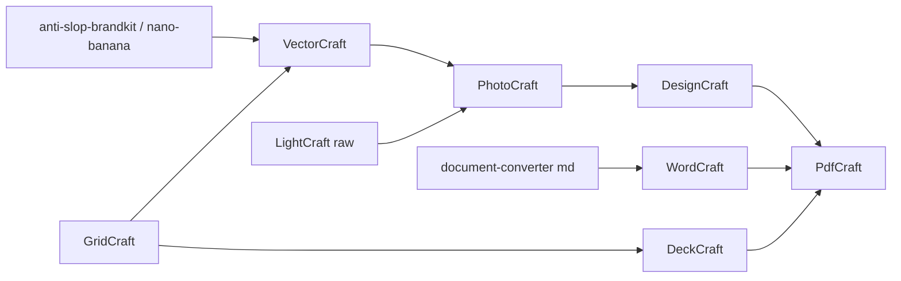

## Context

Builds on `add-craft-apps-core`. Shares the step-contract / verify-gate / resumable-job conventions with `add-craft-media-workflows`.

## Decisions

### D1. Hand-off formats

| Edge | Format | Verify |
|---|---|---|
| vector → raster/layout | svg (+ pdf for print) | `--size` on rasterised preview |
| raster sets | png (alpha where needed), tiff for print | `--size`, `--alpha` |
| layout/doc → distribution | pdf | `--pages`, `--text-contains` |
| data → chart | svg / png | `--size` |

### D2. Doc publishing positioning
`craft-doc-publish` is offered when the user wants editable layout or when the doc-engine PDF path fails; `document-converter` remains the default for Markdown → DOCX/PDF with templates.

## Open Questions

- VectorCraft raster→vector tracing availability (W5 depends on it for generated logos).
- WordCraft DOCX fidelity vs `document-converter` templates — which is the default for W6?
- LightCraft raw formats supported headless (W8).
