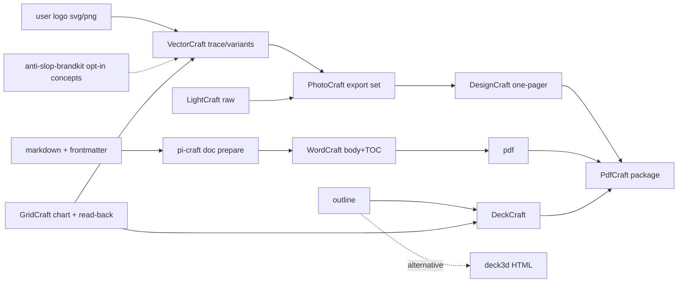

## Context

Builds on `add-craft-apps-core`, archived 2026-10-14 (`openspec/changes/archive/2026-10-14-add-craft-apps-core/`), which ships the router `craft-studio`, 13 app skills and `pi-craft verify`.

It also builds on `add-craft-media-workflows` (planned in c9fca3d97). That change lands **first** and already provides:
- a `craft-app-skills` MODIFIED delta: the router owns the "Craft jobs" convention and the workflow table; the manifest goes from 14 to 18; the app-skill lint is scoped to app skills only; drift checks run against the union of the driven apps' command lists;
- a separate workflow lint set (`WORKFLOW_SKILL_NAMES`).

This change extends that baseline. It does not redefine it.

Relevant existing facts:
- `pi-craft verify`:
  - `--size` / `--alpha` probe via ffprobe on still images only (`packages/craft-apps/src/verify.ts:266`, `isStill` = image2/png/jpeg/webp/tiff/bmp — no svg).
  - `--pages` / `--text-contains` are PDF-only, backed by PdfCraft (`verify.ts:354,360`).
  - Exit codes: `0` pass, `1` fail, `2` usage, `3` probe tool unavailable (`openspec/specs/craft-verify/spec.md`).
- The skill lint treats every non-router skill as an app skill. It calls `getApp(name)`, which throws for non-app ids, asserts `toHaveLength(14)` (`packages/craft-apps/src/__tests__/skills.test.ts:22-24`, `packaging.test.ts:59,71`), and applies the app-skill headings (dialect/state/discovery/traps).
- `@blackbelt-technology/pi-dashboard-nano-banana` is already a hard dependency of craft-apps (`packages/craft-apps/package.json` `dependencies`). The skill is `nano-banana-imagegen` and the bin is `pi-nano-banana`.
- `anti-slop-brandkit` is opt-in, new-site only, behind a paid-plan confirm gate, and produces concepts only (`openspec/specs/anti-slop-skill-suite/spec.md:139-147`).
- deck3d is a one-way md→HTML deck (+ pptx import) (`openspec/specs/deck3d-skill/spec.md`). `render-transition` is a `deckcraft-cli` subcommand (`packages/craft-apps/.pi/skills/deckcraft/SKILL.md`).
- Command availability, from the recorded fixtures (`src/__tests__/fixtures/commands/*.json`):
  - VectorCraft 0.11.0: `imageTrace.make` / `imageTrace.makeAndExpand`.
  - LightCraft 0.8.0: `denoise.*` (needs a downloaded model: `denoise.models.install`).
  - GridCraft 0.7.0: `insert.chart`, `chart.*`.
  - DeckCraft 0.7.0: `insert.picture`.
  - PdfCraft 0.8.0: `doc_combine`, `doc_audit_*`, `doc_protect`.

## Decisions

### D1. Hand-off formats and gates

| Edge | Format | Gate |
|---|---|---|
| vector → raster/layout | svg (+ pdf for print) | gate the **preview only**: `vectorcraft-cli convert in.svg preview.png --scale N` then `pi-craft verify preview.png --size WxH`. The `.svg` itself is never passed to verify (`isStill` excludes svg) |
| raster sets | png (alpha where needed); tiff for print | `--size` on png and tiff; `--alpha` on **png only**. tiff alpha is not asserted until probe 0.5 confirms ffprobe reports it |
| layout/doc → distribution | pdf | `--pages`, `--text-contains` (native-text PDFs only) |
| data → chart | svg / png | **cell read-back** first: the CLI subcommand `gridcraft-cli cat <file> --range <src>` (`gridcraft/SKILL.md:28`) contains none of `#NAME?` `#DIV/0!` `#REF!` `#VALUE!` `#N/A` `#NUM!` `#NULL!` (GridCraft prints errors with exit 0). Then the chart preview `--size` |
| md → template (W6 prepare) | docx + md | `pi-craft doc prepare` exit `0`, and `prepare.json` with `unresolved: []`, `mermaid.unrendered: 0`, `images.skipped: []`, `images.remote: []` (WordCraft does not fetch remote images; unverified, so they are treated as missing), and every `defaulted` variable confirmed by the user. Any exception needs the user's explicit acceptance |
| template → docx → pdf (W6 render) | pdf (docx kept) | one step: WordCraft builds the docx and `convert` exports the pdf; gate `pi-craft verify out.pdf --pages N --text-contains "<title>"` (the docx is verified through its pdf) |

Gate semantics for every workflow:
- Exit `1` → re-discover the commands used (`commands`/`describe`/`tools`), repeat the step (at most 2 retries, then stop, as in media), and do not advance.
- Exit `3` → stop and report the missing probe tool. This is never treated as a pass.



### D2. W6: WordCraft is the default Markdown → DOCX/PDF path (spike evidence)

Live spike, 2026-10-15. WordCraft 0.7.0 was run against the real doc-engine template `~/Documents/templates/default/template.docx`, which carries a textbox cover, three header/footer variants and logo media. Commands and observations are recorded in `spike-wordcraft.md` in this change. Probe 0.2 re-runs them as the implementation's first step.

| doc-engine feature | WordCraft | Evidence |
|---|---|---|
| template styles/fonts, headers/footers, cover graphics | ✅ with `run --file <copy of template.docx>` | rendered pages: orange H1, Source Sans body, footer logo. `run --template` **drops** header/footer parts |
| Markdown body → styled docx | ✅ `insert.textFromFile {"path": body.md}` at `caret.docEnd` | Heading1/2, ListParagraph, tables |
| TOC with page numbers | ✅ `references.toc {"levels":N}` + `references.updateToc` | correct page numbers on a 13-page doc |
| document properties | ✅ `file.properties {title, custom}` | `info` shows title |
| PDF export | ✅ `convert out.docx out.pdf` | |
| frontmatter → variables | ❌ frontmatter is rendered as body text | → `doc prepare` |
| `{{ var }}` in body + default header/footer | ⚠️ `edit.replaceAll` (headers only between `insert.editHeader` and `insert.closeHeader`) | |
| `{{ var }}` in cover **textboxes** and the **first-page** header/footer | ❌ not reached | → `doc prepare` |
| images | ⚠️ only `data:` URIs embed; relative and `file://` paths are dropped | → `doc prepare` |
| Mermaid / PlantUML | ❌ | → `doc prepare` (Mermaid only; PlantUML stays a doc-engine feature) |
| round-trip extract/merge, OCR ingest, `table_profiles` | ❌ | stays in `document-converter` |

Hence a helper fills the template *before* WordCraft opens it, and WordCraft only appends the body, builds the TOC and exports. `edit.replaceAll` is not needed.

Positioning:
- `craft-doc-publish` is the default for "make a DOCX/PDF from this Markdown with our template".
- `document-converter` stays the default for ingest/OCR, round-trip editing, PlantUML, and table-width profiles. It is also the fallback when WordCraft cannot be provisioned.
- No `document-converter` requirement changes; the router and skill descriptions state the split.

### D3. `pi-craft doc prepare`

```
pi-craft doc prepare <in.md> --out <dir> [--template <name>] [--templates-dir <dir>] [--var k=v]… [--allow-path <dir>]… [--allow-missing] [--json]
```

`pi-craft doc --help` / `doc prepare --help` print usage and exit `0`, like `pi-craft --help` and `verify --help` today. `pi-craft doc` with no or an unknown subcommand prints usage and exits `1`. `doc prepare` argument errors exit `2`, like `verify`.

1. **Frontmatter.** Parse YAML (`yaml`). Keys honoured, using the doc-engine names (`packages/document-converter/engine/document_converter/frontmatter_parser.py` `KNOWN_OPTION_KEYS`, plus `nano_banana` from the TS unified schema `packages/document-converter/src/schema.ts:23-28`):
   - `template`, `templates_dir`, `language`;
   - `document_title`, `document_name`;
   - `enable_toc`, `toc_heading` (TOC levels: this helper's own default of 3, not a doc-engine value);
   - `nano_banana: {enabled, style}`, the document-converter frontmatter opt-in (`openspec/specs/document-converter/spec.md`).

   Every other scalar key is a template variable. Unknown structured keys (`table_style`, `code_style`, …) are reported under `ignored` (doc-engine-only features).
2. **Template.** Resolve `<templates-dir>/<name>/template.docx`.
   - The name comes from `--template`, else `template:`, else `default`, and must match `^[A-Za-z0-9_-]+$`.
   - The templates dir comes from `--templates-dir`, else `templates_dir:`, else `$PI_DOC_TEMPLATES_DIR`, else the first existing of `./templates` and `~/Documents/templates`.
     - Frontmatter `templates_dir:` resolves relative to the md file. After `realpath` it must lie inside the md file's directory or an `--allow-path` dir, because a downloaded md must not point at arbitrary templates.
     - This chain is a deliberate superset of doc-engine's, which uses only the project-root `templates/` (`template_manager.py:_find_project_root`).
   - The resolved absolute path is always reported, and the skill echoes it to the user.
3. **Variables.** Precedence, lowest first: template `variables.xml` defaults < system variables < frontmatter < `--var`.
   - System variables: `$date`, `$fileName`, `$year`, `$month`, `$day`. `$date` uses the **same en/hu/de/fr month tables as doc-engine** (`system_variables.py`, ASCII-folded), for output parity.
   - Names match `[A-Za-z_$][A-Za-z0-9_.:-]*`.
   - `logo:*` names are image slots handled by doc-engine's `logo_manager`. They are out of scope here: left untouched and listed under `ignored`.
   - `prepare.json` records the source of every variable. The W6 gate lists every variable whose source is `default` (a template default such as `client_name` = "a GySEV részére") and asks the user to confirm before rendering.
4. **Fill (docx parts).** `fflate` unzips **in memory**. Entry names are never used as filesystem paths, so there is no zip-slip surface.
   - Parts: `word/document.xml`, including `w:txbxContent` (VML and `wps` textboxes), and every `word/header*.xml` / `word/footer*.xml`.
   - Matching runs on the **decoded text of `w:t` nodes only**, never on tags or attributes. Values are re-escaped on write, so a `<name>` stored as `&lt;name&gt;` matches.
   - Placeholders: `{{ name }}` with optional inner whitespace for any name. `<name>` is accepted only for names the template `manifest.xml` marks `syntax="both"`, or names declared in `variables.xml` without a manifest syntax entry. `syntax="mustache"` names (e.g. `$date`, `$fileName`) match only as `{{ }}`. Any other `<…>` text is left alone.
   - Placeholders split across runs are handled by merging runs **within one paragraph**, only in paragraphs that contain a placeholder. Placeholders spanning paragraphs or table cells are not supported and are reported as unresolved.
   - Values are XML-escaped. Parts without a change are copied byte-for-byte, and `[Content_Types].xml` and rels are untouched, so no rIds change.
5. **Body.**
   - Strip the frontmatter.
   - Process images and diagrams on the **original** text, before substitution. Then substitute `{{ name }}` in the text outside the already-processed blocks. Image or diagram syntax that arrives via a variable value is therefore never inlined or rendered; it stays literal and is reported under `warnings`. `<name>` is **not** substituted in the body, because it would collide with HTML.
   - Image and diagram handling:
     - **Images.** Local images are inlined as `data:` URIs. Paths are resolved with `realpath` and must lie inside the md file's directory (or an `--allow-path` dir). Absolute and `file://` paths are refused unless they are covered by `--allow-path`. Only png/jpg/gif/webp/bmp up to 20 MB are inlined; anything else is skipped with a reason. Remote `http(s)` images are left as-is and listed under `images.remote`, because WordCraft does not fetch them.
     - **Picture markers (probe 0.2 drift).** WordCraft 0.7.0 maps a Markdown-imported image onto `rId1`, which a template with a cover image already uses. When the template's `word/_rels/document.xml.rels` has an image relationship, every body image and rendered diagram is therefore written to `<dir>/images/<NNNN>.<ext>` and replaced in `body.md` by the token `CRAFTIMG<NNNN>`; `prepare.json.pictures` lists `{marker, file, alt}`. The render step puts each in with `edit.find` + `insert.picture` + `edit.replaceAll`. Without template images the `data:` form stays.
     - **Mermaid** blocks are rendered as follows:
       - with nano-banana (paid API) when `nano_banana.enabled`, using the template's `nano-banana-styles.yaml` and the cache `.mermaid-cache/<md5(style + source)>.png` next to the md, falling back to mmdc. Including the style in the key avoids stale reuse when the style changes, at the cost of file names that differ from doc-engine's `md5(source)`. Pinned by probe 0.6: `pi-nano-banana "Diagram:\n<source>\n\n<style prompt>\n\nAVOID: <negative>" --output <cache png>` (the label keeps a source that starts with `-` from being read as an option);
       - otherwise with host `mmdc`, spawned with argv and no shell;
       - with no `mmdc`, the block stays code and `mermaid.unrendered` counts it.

     Host `mmdc` is a deliberate deviation from doc-engine's Dockerized chrome-headless-shell, which exists to avoid host-Chrome conflicts. The `document-converter` requirement governs only that package. Mitigation: `mmdc` uses its own puppeteer-managed browser (`PUPPETEER_EXECUTABLE_PATH` is inherited when it has none); a failed render counts as unrendered, never as a pass.
     - **PlantUML** blocks are not rendered. They are counted in `warnings`, and the skill routes PlantUML-heavy documents to `document-converter`.
6. **Output.**
   - `<dir>/template.filled.docx` and `<dir>/body.md`.
   - `<dir>/prepare.json`: `{ template, templatePath, vars: {name: source}, defaulted: [], unresolved: [], ignored: [], warnings: [], toc: {enabled, heading, levels}, title, mermaid: {style, rendered, cached, fallback, unrendered}, images: {inlined, skipped: [{path, reason}], remote: []} }`.
   - Existing output files are overwritten; other files in `<dir>` (including `.mermaid-cache`) are left alone. `--json` also prints the report to stdout.
   - Exit codes: `0` ok; `1` failed operation, or unresolved placeholders remain without `--allow-missing`; `2` usage.

W6 render step (in the skill; one step, one gate):

```
pi-craft wordcraft exec run --file <dir>/template.filled.docx \
  --cmd 'caret.docEnd={}' --cmd 'text.pageBreak={}' \
  [--cmd 'references.toc={"levels":N,"title":"<toc_heading>"}' --cmd 'caret.docEnd={}' --cmd 'text.pageBreak={}'] \
  --cmd 'insert.textFromFile={"path":"<abs dir>/body.md"}' \
  [--cmd 'edit.find={"text":"CRAFTIMG0001"}' --cmd 'insert.picture={"path":"<abs dir>/images/0001.png"}' --cmd 'edit.replaceAll={"text":"CRAFTIMG0001","with":""}'] \
  --cmd 'file.properties={"title":"<title>"}' [--cmd 'references.updateToc={}'] --save 02-render/out.docx
pi-craft wordcraft exec convert 02-render/out.docx 02-render/out.pdf
pi-craft verify 02-render/out.pdf --pages N --text-contains "<title>"
```

`run --file` is required: `run --template` drops the template's header/footer parts (spike). `caret.docEnd` after `references.toc` is required: the TOC command leaves the caret above the TOC (probe 0.2).

### D4. Resumability: reuse the media Craft-jobs convention

There is no new schema. Every office workflow links the router's "Craft jobs" section defined by `add-craft-media-workflows` design D4:
- `craft-jobs/<slug>/NN-<step>/`;
- the slug is lower-cased, with every character outside `[a-z0-9-]` mapped to `-`, and is never a raw path;
- `job.json` records steps, verify reports, inputs (path, size, mtime) and upstream ids;
- resume happens at the first step without a passing report or with changed inputs, and every downstream step is re-run;
- reusing a slug requires confirmation.

Office additions, stated in each office skill:
- The W6 prepare step stores the `prepare.json` summary as its report.
- Secrets (protect passwords, API keys) are never written to `job.json` or reports.

### D5. Soft references

Step 0 of each workflow probes each sibling: the skill appears in the agent's loaded skill list (media D3 rule), or the CLI is on PATH. For each missing sibling, it states the providing package and the degraded path.

| Sibling | Probe | Package | Degraded path |
|---|---|---|---|
| `nano-banana-imagegen` | `pi-nano-banana` usable credentials | already a hard dependency of craft-apps (not a soft reference; only credentials are probed) | no credentials → user-supplied logo (W5); mmdc diagrams (W6); W8 skips generative `replace-region` |
| `anti-slop-brandkit` | skill listed | `@blackbelt-technology/anti-slop-frontend` | user-supplied logo |
| `document-converter` | skill listed | `@blackbelt-technology/pi-dashboard-document-converter` | needed only for ingest/round-trip/PlantUML; W6 runs without it |
| `deck3d` | skill listed | `@blackbelt-technology/pi-dashboard-deck3d` | DeckCraft only |
| `mmdc` | on PATH | `@mermaid-js/mermaid-cli` (host) | diagrams left as code; the W6 gate asks the user to accept or install |

"No new sibling dependency" means that no **new** sibling package is added. The existing nano-banana dependency is unchanged.

### D6. Brand kit and brandkit

- W5 starts from a user-supplied logo by default.
- `anti-slop-brandkit` runs **unchanged under its own spec**: new-site work, explicit request, confirmed paid plan, outputs in its mockup folder, logos labelled as concepts, no adoption without approval.
- W5 consumes a brandkit concept only after the user approves it as the logo input. The derived assets keep the "concept" label until the user approves the brand.

### D7. Lint and counts

The office change extends the media baseline:
- Five names are added to `WORKFLOW_SKILL_NAMES`.
- The manifest goes from 18 to **23** (`packaging.test.ts`).
- The router workflow table gains five rows.

The existing workflow lint, scoped by media, applies unchanged. Drift ids in office skills are checked against the union of the driven apps' fixtures (VectorCraft, PhotoCraft, DesignCraft, PdfCraft, WordCraft, DeckCraft, LightCraft, GridCraft).

## Risks / Trade-offs

- **Ordering.** The `craft-app-skills` MODIFIED requirements are rebased on the media delta. If media is not archived first, this change's delta must be re-rebased (task 0.0).
- **Run merging.** Merging runs within a placeholder paragraph can drop per-run formatting inside that paragraph. This is accepted: placeholders are template-authored lines.
- **Diagram output.** Host `mmdc` output may differ slightly from the Dockerized renderer.
- **Template path.** `./templates` is searched before the home directory, so a repo-local template is used without asking. Mitigation: the resolved path is reported and echoed.
- **Passwords in argv.** PdfCraft/WordCraft protect passwords are passed as argv and are visible in the local process list during the call. The skill warns about this; the password is never persisted.
- **Paid diagrams.** nano-banana diagrams are a paid API call, enabled only by the explicit frontmatter opt-in. The skill states the cost before running.
- **New runtime code.** This change ships code in craft-apps. It is unit-tested with a fixture docx that has a VML/`wps` textbox, a first-page header and a split-run placeholder.
- **New package dependencies.** `yaml` and `fflate` are new runtime dependencies of `@blackbelt-technology/pi-dashboard-craft-apps`. The versions already exist in the workspace (root `yaml`, `deck3d` `fflate`). `scripts/build.mjs` bundles them into `dist/craft.js`; `yaml` is CommonJS, so the bundle banner defines a `require` (`createRequire`).
- **No chart image command in GridCraft (probe 0.4).** `craft-data-visual` takes the chart from the sheet's pdf export and trims the rendered page; the chart must be anchored at `A1` so the page shows the chart alone.

## Open Questions

None blocking. The gating probes are in tasks §0.
