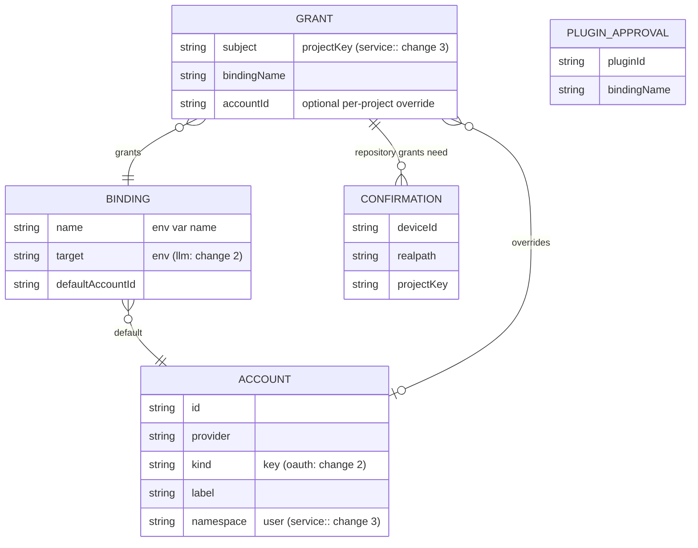
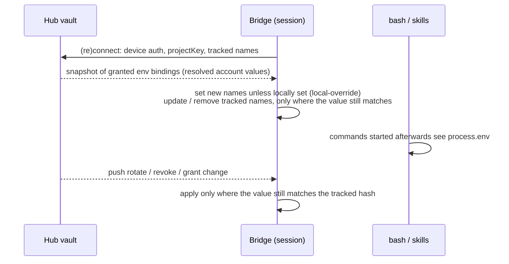

## Context

See proposal.md, section Why. This is part 1 of 3. The LLM credential and OAuth decisions live in `add-vault-llm-delivery/design.md`; the service-secrets migration lives in `absorb-service-secrets-into-vault/design.md`.

**pi version.** The repo pins `@earendil-works/pi-coding-agent` and `pi-ai` to **1.0.0** (`pnpm-workspace.yaml:55-56`). Line citations below are for the pinned 1.0.0. Where a seam differs in 1.1.0, that is noted. Task T0 re-runs the live checks on 1.0.0.

### Key sinks this change addresses

| Sink | Consumer | Reads env first? |
|---|---|---|
| `.env` chains | `packages/nano-banana/src/env.ts:7`, `packages/video-production/src/env.ts`, `packages/video-transcription/src/config.ts`; global skills | yes |
| `~/.pi/agent/system-one/auth.json` | `packages/system-one/src/keys.ts:32` | yes |
| bare env | deck3d `POLY_PIZZA_KEY` (`src/props/search.ts:107`) | yes |
| pi auth, then env | quota `SYNTHETIC_API_KEY` (`packages/quota-plugin/src/server/quotas/fetchers.ts:190`) | **no**: pi's credential wins, env is the fallback |
| `docker run -e` passthrough | document-converter (`packages/document-converter/src/engine.ts:115`) | only for names listed in `passEnv` (default `GEMINI_API_KEY`) |

"No code change" therefore holds for every consumer that reads env first. It holds for quota when pi holds no `synthetic` credential, and for document-converter only for names in `passEnv`.

### Verified pi seams (pinned 1.0.0)

- **Env is read live.** The bash tool builds its env per command from the live `process.env` (`dist/core/tools/bash.js:136`, `dist/utils/shell.js:115-123`). A child process keeps the copy it got when it started.
- **Tool-result rewriting.** `tool_result` handlers may replace `content`, `details` and `structuredContent` (`dist/core/extensions/types.d.ts:1071-1077`). Replacing `content` without `structuredContent` drops `structuredContent` (`:954`). pi applies the handler result before the tool result is recorded (`dist/core/agent-session.js:336-357`). Truncated bash output carries its tail text in `details.truncation.content` (`dist/core/tools/output-accumulator.js:79-93`).
- **User `!` commands.** `user_bash` handlers may return `operations` (`types.d.ts:856`, `:1056-1065`). The package exports `createLocalBashOperations` (`dist/index.d.ts:26`).
- **Spill files.** The bash tool and `bash-executor` write long output to a full-output file in `tmpdir()` *while the command runs* (`dist/core/tools/output-accumulator.js:9,213`, `dist/core/bash-executor.js:34-35,102`).
  - On 1.0.0 these files get the default mode (umask, typically `0644`).
  - 1.1.0 writes them `0600` (`dist/utils/output-files.js:13,28`).
- **Reload and replacement.** `session_shutdown` fires with `reason: "reload"` on extension reload, and with `new`, `resume` or `fork` when the session is replaced inside the same process (`types.d.ts:611`). `session_start` carries the matching reasons (`:550`).
- **cwd.** On replacement sessions the guarded `ctx.cwd` getter can throw. The bridge's `safeCwd` then falls back to `process.cwd()`, which is still the launch directory, because pi never calls `chdir` (`packages/extension/src/bridge-context.ts:300-322`). That fallback is unusable for keying grants. The vault takes the cwd from `ctx.sessionManager.getCwd()` instead (`types.d.ts:223`, `session-manager.d.ts:178`). If that cwd cannot be read, delivery fails closed (spike T3).
- **Event forwarding.** The bridge forwards `tool_execution_update`, `tool_execution_end` (inlining `result`), `tool_result`, message events and EventBus channels (`packages/extension/src/bridge-handlers/forwarders.ts:33-44`, `:493-520`; spec `catch-all-event-forwarding`).

"Public pi APIs" in this change means the `ExtensionAPI` surface plus documented package exports such as `createLocalBashOperations`.

## Goals / Non-Goals

**Goals:**
- One store for static keys.
- Per-project least-privilege delivery to trusted sessions, with a per-project choice of account.
- Zero code change for consumers that read env first.
- Live rotation and revocation for processes started after the change.
- A schema that changes 2 and 3 extend without migration.

**Non-Goals:**
- LLM credentials (change 2).
- Service secrets (change 3).
- Encryption beyond owner-only file permissions.
- Spawn-time delivery.
- Migrating `plugin-credentials.json` or `mcp-auth.json`.
- A CLI that prints secrets.
- Isolating the vault from in-process plugins and other pi extensions; both are trusted code.
- Redacting encoded or transformed forms of a value.
- Guaranteeing masking on the session user's own local terminal (TUI). Whether the `user_bash` wrapper also masks it is incidental.
- Removing a value from the original files it was imported from. Import is non-destructive, and those copies stay readable by their consumers outside the vault's control. Settings suggests deleting them after import.
- Withdrawing a value from processes that are already running.

## Decisions

### D1: Store and data model

- **Bindings name an exposure; grants choose the account per project.** A binding is `GEMINI_API_KEY` with a default account. A grant gives that binding to one project and may name a different account of the same provider and kind. This lets project A use the "personal" Gemini key and project B the "work" one under the same variable name.
  - Change 2 adds `target: llm` bindings keyed by provider id, without changing this shape.
- **File.** `~/.pi/dashboard/vault.json` is dashboard-owned, next to `services-secrets.json`.
  - It uses `locked-json-file` primitives with `createIfMissing: false`; the default is `true` (`packages/server/src/auth/locked-json-file.ts:117-130`).
  - Mode is `0600` on POSIX.
  - On Windows it follows the `pi-gateway-auth` convention for secret files: the owner-only guarantee is checked against the platform's access control (an observed read attempt) rather than assumed. A task covers it.
- **Forward compatibility.** Read-modify-write preserves unknown fields and unknown account kinds or namespaces. A downgraded dashboard therefore never strips change-2 or change-3 data.
- **Corrupt file.**
  - A byte-exact backup is kept and every write is refused, the same rule as `service-secrets`.
  - Parse errors are reported as "vault file is corrupt (backup: <path>)", never with the `JSON.parse` message, which can echo file content.
- **Minimum length.** Values shorter than 8 characters are rejected on entry *and* on import, so redaction never masks trivial strings.
- **Kind guard.** Delivery uses only accounts of kind `key`. A grant or default that points at any other kind, such as data written by a newer version, delivers nothing.
- **Broken references.** Revoking an account removes it as a default, but grants that named it as an override are kept and marked `no-account`. They deliver nothing and never fall back to the binding's default, which would widen access. The UI lists them for repair. A grant with no override on a binding with no default is likewise `no-account`.

### D2: Env delivery

- **Timing.** The project key is resolved at every `session_start`, for all five reasons: `startup`, `reload`, `new`, `resume` and `fork` (`types.d.ts:550`).
  - It is resolved from the session manager's cwd. If that cwd cannot be read, the bridge withdraws everything it delivered and delivers nothing to that session.
  - A replacement session in the same process is reconciled under its own key, and values not granted to it are removed.
  - On **every** bridge (re)connect, the bridge sends its tracked names only, never hashes, and the hub answers with the complete snapshot of granted bindings.
  - The bridge applies the difference under the same hash check as pushes:
    - A tracked name whose value still matches is updated if it rotated, and removed if it is no longer granted.
    - A tracked name the user has overwritten is dropped from tracking and left alone.
  - A missed push is therefore reconciled.
  - Pushes between connects are incremental.
  - There is no spawn-time delivery: the spawn-env contributor receives only `{ mechanism }` (`packages/server/src/spawn-process/spawn-env-contributors.ts:26`).
- **Offline grace.** While the hub is unreachable, delivered values are kept for `vault.offlineGraceHours`:
  - The default is 24 h. The value is set on the hub, clamped to 1 h–7 d, and delivered with the snapshot.
  - The clock is the elapsed time since the last successful snapshot, taken as the **larger** of monotonic and wall-clock elapsed time. A machine that sleeps therefore cannot extend retention. The timestamps are held in the `process` registry.
  - After the grace period the bridge withdraws the values, so revocation is bounded for sessions that stay offline.
  - The dashboard shows each session's last vault contact time. `hub-unreachable` is reported when the session reconnects.
- **Downgraded hub.** The hub advertises `vault-delivery` in `dashboard_identity.features`, the existing capability channel. When a bridge that holds delivered values connects to a hub whose identity lacks the feature, the bridge withdraws everything it delivered. Downgrading the dashboard therefore never leaves values live without a revocation path.
- **Corrupt vault.** The hub answers with "vault unavailable", not with an empty snapshot. The bridge treats that answer like an unreachable hub, so it keeps values within the grace period.
- **Emergency off.** The "disable delivery" switch lives in the dashboard config (`config.json`), not in the vault. It therefore still works, and withdraws from every session, while the vault file is corrupt.
- **Env-name validation.** The vault keeps its own deny list; the spawn-env contributor's lists and spec are untouched.
  - The `PYTHON`, `PERL` and `RUBY` prefixes deliberately over-block, which fails safe.
  - The regex and the deny list apply to `target: env` bindings only. Change 2's `llm` bindings are keyed by provider id under their own rule.
  - Matching is case-insensitive, because Windows env names are.
  - Names are checked at creation **and again at delivery**, so a hand-edited or restored `vault.json` cannot deliver a reserved name.
  - A name must match `^[A-Z_][A-Z0-9_]*$` and must not be any of the following.
  - Exact names:
    - `PATH`, `PATHEXT`, `HOME`, `USERPROFILE`, `SHELL`, `COMSPEC`, `SYSTEMROOT`
    - `PS4`, `SSH_AUTH_SOCK`, `SSH_ASKPASS`, `LOCPATH`, `GCONV_PATH`
    - `JAVA_TOOL_OPTIONS`, `_JAVA_OPTIONS`, `JDK_JAVA_OPTIONS`, `CLASSPATH`, `DOTNET_STARTUP_HOOKS`, `LESSOPEN`, `LESSCLOSE`, `OPENSSL_CONF`
    - `ENV`, `BASH_ENV`, `BASHOPTS`, `SHELLOPTS`, `PROMPT_COMMAND`, `IFS`, `CDPATH`, `ZDOTDIR`
    - `TMPDIR`, `EDITOR`, `VISUAL`, `PAGER`
    - `HTTP_PROXY`, `HTTPS_PROXY`, `ALL_PROXY`, `NO_PROXY`
    - `SSL_CERT_FILE`, `SSL_CERT_DIR`, `CURL_CA_BUNDLE`, `REQUESTS_CA_BUNDLE`
  - Prefixes: `LD_`, `DYLD_`, `NODE_`, `NPM_CONFIG_`, `PI_`, `PYTHON`, `PERL`, `RUBY`, `GIT_`, `BASH_FUNC_`, `ELECTRON_`, `CONTEXT_MODE_`, `XDG_`.
- **Delivery registry** lives on `process` under a fixed key. This follows the bridge convention that `process` state survives jiti cache invalidation and vm-isolated extension contexts (`packages/extension/src/bridge.ts:103-108`). It holds two sets:
  - the **tracked set**: each name mapped to the SHA-256 of its delivered value;
  - the **redaction set**: plaintext values kept in memory.

  Other pi extensions in the same process can read it, as they can read `process.env`. That is an accepted part of the trusted-code posture.
- **Inheritance by nested pi.** Delivery also sets `PI_DASHBOARD_VAULT_DELIVERED`, a comma-separated list of names only, with no values and no hashes.
  - A nested pi process, such as a subagent or flow agent, inherits the environment, as every child process does. Its bridge reads the marker.
  - For each listed name present in its environment, the nested bridge adds the current value to its redaction set and does not report `local-override`.
  - If the user had overwritten the value in the parent, the nested bridge masks the user's value too. That over-masks, which is harmless.
  - The nested bridge never updates or removes inherited variables. The parent owns them, so they live as long as that child process. A nested pi therefore carries its parent's values even if it works in another project. This is ordinary env inheritance, stated as a trade-off.
  - Rotation, revocation, reconciliation and offline grace therefore do not reach inherited copies during the child's lifetime. The spec states this exception.
- **Precedence.**
  - A name that was present before delivery and is neither tracked nor in the inherited marker is skipped and reported as `local-override`. That includes a name a spawn-env contributor set. On Windows the presence check is case-insensitive.
  - Delivered env outranks a consumer's own file fallbacks (`.env`, `system-one/auth.json`), because those consumers read env first. The allowlist controls this.
- **Running processes.** A process keeps the env copy it started with, so rotation and revocation reach only processes started afterwards. For a revoked binding, the per-session state view shows a hint that long-running processes may still hold the old value.

### D3: Trust boundary and project key

- **Trust boundary.** The bridge connection must be authenticated in one of two ways:
  - remote: as a paired device (specs `qr-device-pairing`, `pi-gateway-auth`), over TLS;
  - hub-local: by the hub's local credential proof (archive `2026-10-11-harden-credential-proof-binding`).
- **Device id.** For a remote session this is the authenticated pairing id. For a hub-local session it is the constant `hub`.
- **Remote transport.**
  - Remote bridges authenticate as paired devices through the bearer-to-ticket exchange (spec `pi-gateway-auth`, "Remote bridges authenticate as paired devices"). That exchange is not a per-connection proof, so this design does not claim one.
  - Delivery to a remote device requires both:
    - an authenticated paired-device connection;
    - **TLS (`wss://`)**, because remote bridges otherwise accept `ws://` (`packages/extension/src/connect-target.ts:43`).
  - Spike T5 confirms the ticket scope and the transport check.
  - Hub-local sessions use the existing local credential proof.
- **`projectKey`.**
  - **Primary: the normalised `origin` URL.**
    - scp form `git@host:path` and `ssh://user@host[:port]/path` become `host/path`.
    - The scheme and userinfo are stripped. A default port (22 for ssh, 443 for https) is dropped; any other port is kept.
    - The host is lower-cased. Path case is kept.
    - A trailing `/` is removed first, then a trailing `.git`.
  - **Fallback: `(deviceId, realpath(cwd))`**, which matches that exact directory only.
  - Both are resolved at each `session_start` from the bridge's cwd resolution (spike T3). A `cd` inside commands does not re-scope the session: commands that move to another directory still see the session's values. The allowlist scopes sessions, not directories.
  - Any git failure falls back to the directory key.
  - `file://` and local-path origins give no repository key. They use the directory key.
  - Default ports are 22 for ssh, 443 for https and 80 for http, and are dropped. A non-default port is kept as `host:port`.
  - Path case is kept, so `Acme/App` and `acme/app` do not match. That fails closed.
- **Checkout confirmation, against `origin` spoofing.** `origin` lives in the checkout's own `.git/config`, so a malicious clone could claim a granted repository.
  - A repository-key grant is therefore honoured on a given (device, directory) only after the user confirms that checkout once in the dashboard ("Deliver GEMINI_API_KEY to github.com/acme/app at ~/src/app on laptop?").
  - A confirmation is bound to the triple (device, directory, repository key). Re-pointing that directory's `origin` changes the key, and the new key needs a new confirmation.
  - The hub cannot verify `origin`. Confirmation stops clones the user never approved, but not a confirmed checkout whose contents are later replaced under the same origin. That case is accepted.
  - An unconfirmed checkout receives nothing and shows a pending confirmation in its session view.
- **The allowlist is scoping, not authentication.** After confirmation, any process in that checkout on that device receives the granted values.

### D4: Plugin access

- `ServerPluginContext` (`packages/dashboard-plugin-runtime/src/server/server-context.ts`) gains reads of the bindings its manifest declares (`vaultBindings: string[]`).
- Settings shows each declared binding per plugin, and the user approves or revokes it. Approvals are stored in the vault as `PLUGIN_APPROVAL` records.
- A plugin update that adds a declaration needs a new approval for that binding. Existing approvals stay.
- Plugin reads are not project-scoped: a plugin is a server-wide component. The value returned is the binding's default account. This is a deliberate exception to per-project least privilege, and needs explicit per-plugin approval.
- If a plugin echoes the value into session output, only the session-side redaction catches it.
- This is a capability contract, not isolation. Plugins are trusted code.
- `ctx.credentials`, `plugin-credentials.json` and `ctx.providerAuth` are unchanged.

### D5: Redaction (exact occurrences)

**Redaction set lifecycle.** A value enters the set when it is delivered or inherited. It stays for the life of the process, even after rotation or revocation, because already-running processes may still print it.

**Masking points.**

1. **`tool_result` handler.**
   - It deep-masks every string in `content`, `details` (including `details.truncation.content`) and `structuredContent`, and returns all three.
   - Before the result is returned, it rewrites the full-output file named in `details.fullOutputPath`.
   - pi applies the result before recording (`agent-session.js:336-357`). The transcript and the model therefore see masked text whatever the forwarder does.
   - The vault handler registers at bridge activation. A later-registered `tool_result` handler from another extension can still see raw text, which falls under the trusted-code posture.
1b. **`message_end` handler.** It returns a replacement message with every text and tool-call argument string deep-masked. Every other field, including `role` and `usage`, is kept unchanged, as `token-stats-pipeline` requires (`MessageEndEventResult`, `types.d.ts:1078-1081`). pi persists the replacement (`agent-session.js:902-912`), so assistant text is masked in the transcript as well.
2. **User `!` commands.**
   - A `user_bash` handler returns wrapped `createLocalBashOperations`.
   - The wrapper masks streamed `onData` chunks with the same hold-back as point 3. It decodes with a streaming UTF-8 decoder, so multi-byte characters never split, and it flushes the held tail, masked, when the command exits.
   - The executor writes its full-output file from those masked chunks (`bash-executor.js:34-48`). No separate rewrite is needed.
   - pi takes the first `user_bash` result (`runner.js:969-980`). If another extension handles `user_bash` first, its output is masked only on the forwarded copy (point 3). That is an accepted residual.
3. **Bridge forwarder.**
   - Every forwarded event is deep-copied and masked before it is sent to the server. This follows the `redactCompactionEntry` precedent (`packages/extension/src/event-forwarder.ts:61`), extended to a deep copy because `result` and `details` are nested; pi's event objects are never mutated. Masking covers:
     - `tool_execution_update`;
     - `tool_execution_end`, including its inlined `result`;
     - `tool_result`;
     - message events;
     - EventBus channel payloads.
   - **Hold-back, per stream.** Streams are keyed by `toolCallId`, or by message id for `message_update`. The forwarder delays the trailing *(L − 1)* characters, where L is the longest value currently in the redaction set, and sends them masked with the next update or the end event.
     - For cumulative snapshots, it forwards each masked snapshot minus that tail.
     - For deltas, it keeps only the tail buffer, never the whole message. That respects the `pi-api-feature-detection` rule against delta accumulation.
     - Spike T4 confirms which shape each event has.
     - **Ordering.** Before forwarding any other event of the session, the forwarder flushes every held tail, masked. This keeps the wire order that `event-reducer` ("Streaming text flushed at tool_execution_start") and `provider-retry-state` (wire-ordering invariant) rely on.
   - **Spec delta.** This is a fourth forwarding exception, which `catch-all-event-forwarding` forbids unless listed. The change adds a MODIFIED delta for "Subscribe to all pi core event types": masking is value-scoped, and characters are delayed, never dropped.
   - **Scope.** The forwarder protects the dashboard copy. Points 1 and 1b protect the transcript and model copy.
4. **Reload.** On extension reload, the redaction set is read back from the `process` registry before any output is produced.

**Accepted residual.**
- On pinned pi 1.0.0, full-output files are written in plaintext with the default file mode while the command runs, and are rewritten only when it finishes; pi 1.1.0 writes them `0600`.
- Aborted commands are rewritten at `tool_execution_end`.
- A command cut off by a pi crash leaves its file unredacted in `tmpdir()`.

The spec states these windows. Spike T4 confirms that the rewrite happens before the dashboard can fetch the file.

### D6: Routes and authority

- **Management routes.** Accounts, bindings, grants, confirmations, approvals and import all require `operate` authority, or a locally trusted caller honouring strict local-proof mode. That covers reads as well as writes.
  - This is stricter than `service-secrets`, whose reads sit behind the network guard only (`packages/server/src/services/routes.ts:72-80`). Vault listings reveal which secrets exist and where they go.
- **Session binding state.** Names and states only, for the session view. This follows ordinary session-read authority, since it is part of the session's own status.
- **No values out.** Listings and the import proposal never carry values. The proposal shows names only. Known locations are offered as opaque server-side ids; the client sends an id, never a path.
- **Upload.** The upload travels over the same authenticated dashboard connection as other management calls. It is capped at 64 KiB and parsed with the existing `.env` parser (`packages/nano-banana/src/env.ts` `parseEnvFile`).

### D7: Import

The import keeps to the `file-read-containment` rule: the server never reads a client-supplied path. There are two sources.
- **Known locations.** A fixed server-side list: skill package `.env` files under the installed skills directories, and `~/.pi/agent/system-one/auth.json`. The server checks only that each exists. It reads one only when the user selects it.
- **Upload.** The user picks any file in the browser. The client reads it and sends its contents.

In both cases the user confirms each proposed key. Values shorter than 8 characters are skipped with a notice. Sources are never modified.

### D8: Collateral dispositions

| Candidate | Disposition |
|---|---|
| `plugin-spawn-env-contributor` | unaffected: not used, lists untouched. A contributor-set name wins as `local-override` (D2) |
| `catch-all-event-forwarding` | **MODIFIED**: a fourth, value-scoped exception covering masking and tail delay (D5.3) |
| `minimal-chat-view` | honoured: renders the forwarded, masked output; the marker is plain text |
| `file-read-containment` | honoured: no client-supplied paths are read (D7) |
| `nano-banana-gemini-key-resolution`, `system-one-config` | requirements unaffected; delivered env outranks their file fallbacks (D2) |
| `dashboard-plugin-loader` | unaffected: D4 is a separate read |
| `spawn-correlation` | unaffected: `PI_DASHBOARD_VAULT_DELIVERED` holds no secret; `PI_` names are not deliverable |
| `pi-api-feature-detection` | honoured: no delta accumulation; only a bounded tail buffer (D5.3) |
| `event-reducer`, `provider-retry-state` | honoured: held tails flush before any later event (D5.3) |
| `token-stats-pipeline` | honoured: the `message_end` replacement keeps `usage` (D5.1b) |
| `replay-stream-compaction`, `in-memory-event-buffer`, `event-status-extraction`, `bridge-retry-observability` | unaffected: end events carry the full masked text; classification does not read payload text |
| `pi-gateway-auth` | honoured: remote delivery rides the paired-device ticket and adds a TLS requirement (D3) |
| `mid-turn-prompt-queue`, `jiti-cjs-transpile-safety`, `markdown-knowledge-base`, `bridge-decomposition`, `platform-primitives`, `terminal-emulator` | unaffected: no shared surface |
| `deck3d-effects`, `deck3d-mermaid-harvest` | unaffected requirements; deck3d itself is a consumer (`POLY_PIZZA_KEY`, read from env first) |
| `provider-auth-*`, `model-proxy-*`, `service-secrets` | untouched here; changes 2 and 3 |

### D9: Sibling sequencing

`add-connector-layer` mandates `connector-auth.json` in its own spec (`openspec/changes/add-connector-layer/specs/connector-layer/spec.md:6`). This change does not edit that spec. A task updates `add-connector-layer`'s own artifacts to use vault `key` accounts for API-key connectors. Its OAuth phase follows change 2.

## Risks / Trade-offs

- **Spill files on pi 1.0.0 hold plaintext at default mode while a command runs** → stated in the spec; closed by pi 1.1.0 (`0600`); spike T4.
- **Running processes keep revoked values** → stated; the session view hints this; offline grace bounds disconnected sessions.
- **Imported source files keep their copies** → non-destructive by design; Settings suggests deleting them.
- **Nested pi inherits its parent's values** → ordinary env inheritance; masked there through the marker.
- **A first-registered foreign `user_bash` handler bypasses the wrapper** → the forwarded copy is still masked.
- **A crash mid-command leaves an unredacted spill file on pi 1.0** → stated; pi 1.1 writes `0600`.
- **Confirmed checkout replaced under the same origin** → the hub cannot verify `origin`; accepted.
- **Other in-process pi extensions and plugins can read delivered values** → trusted-code posture, as with `process.env`.
- **A confirmed checkout's processes all receive the grant** → the allowlist is scoping; confirmation stops spoofed clones.
- **Delivered env outranks project `.env` and `system-one` files** → documented; the allowlist controls it.
- **Redaction is exact-match only; the local TUI is unmasked** → stated.
- **The hold-back delays forwarded output by a few characters** → bounded by the longest delivered value.

## Migration Plan

1. Ship with an empty vault: no behaviour change.
2. Users import or add keys, grant them to projects and confirm checkouts. Nothing is delivered before then.
3. Re-scope `add-connector-layer` (task).

**Rollback.**
- Disable delivery first. That pushes withdrawal to connected sessions.
- Then deleting `vault.json` affects nothing else.
- If the dashboard is downgraded without that step, bridges withdraw everything when they reconnect to a hub that lacks the `vault-delivery/1` capability (D2).
- Downgrading keeps unknown fields intact (D1).

## Open Questions

The spikes below are tasks. Each can narrow a spec statement; none can widen one.
- **T0**: re-run the live checks on pi 1.0.0.
- **T3**: cwd at `session_start`.
- **T4**: rewrite timing for full-output files.
- **T5**: the paired-device ticket scope and the TLS check for remote bridges. Remote delivery ships only once both are confirmed.

Follow-up, out of scope: `mcp.json` `${NAME}` resolution from the vault.
