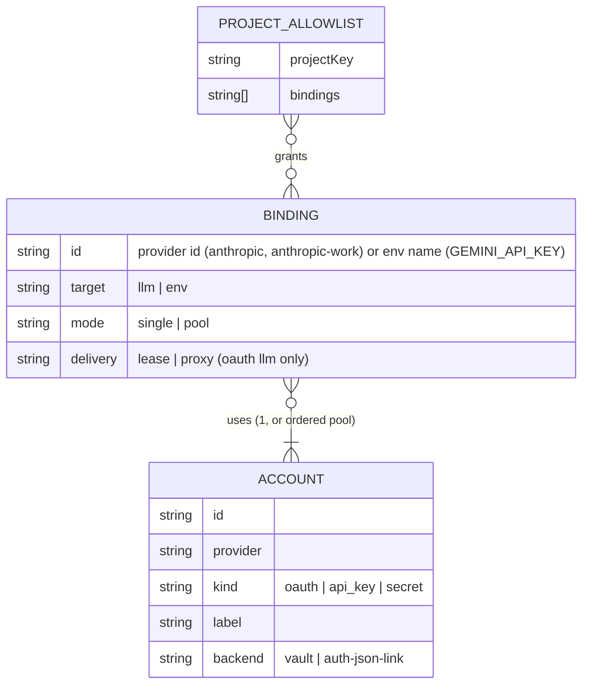
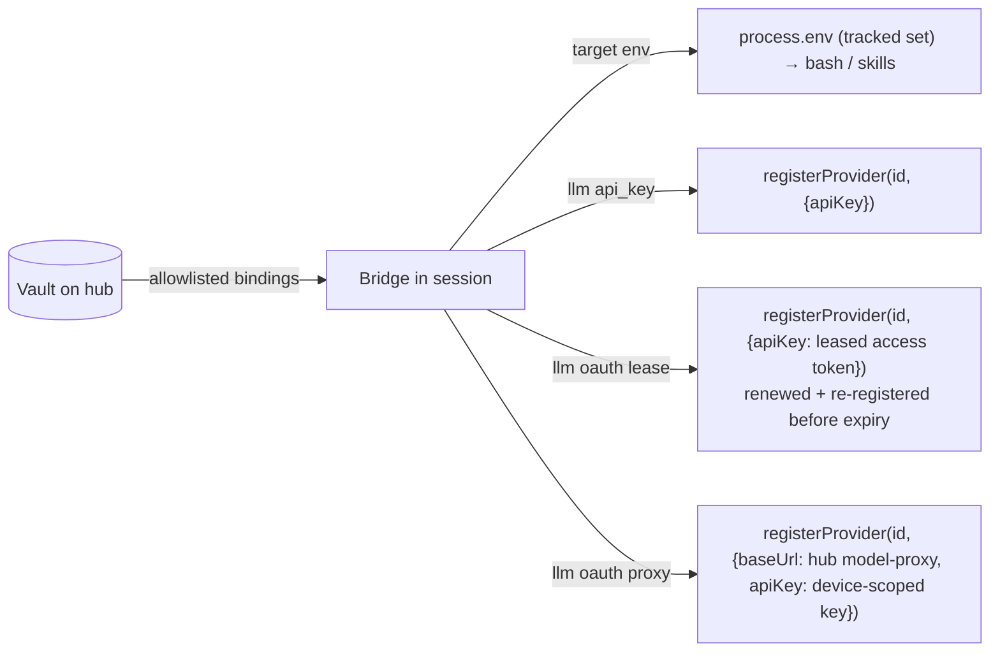

## Context

See proposal.md — Why. This section records the current credential landscape and the pi seams verified by experiment, because the design rests on them. pi version under test: `@earendil-works/pi-coding-agent` 1.1.0.

### Credential sinks today

| Sink | Consumers | Notes |
|---|---|---|
| `~/.pi/agent/auth.json` | pi core; server `packages/server/src/auth/provider-auth-storage.ts`, `dashboard-credential-store.ts`; quota/grammar via `ctx.providerAuth` / `ctx.modelRuntime` | keyed **by provider id** — one credential per provider; `key` supports `$ENV` / `!cmd` (`resolveConfigValue`), OAuth fields do not |
| `~/.pi/agent/plugin-credentials.json` | gmail, demo (`ctx.credentials`, `packages/server/src/auth/plugin-credential-store.ts`) | per-plugin namespace, `locked-json-file` |
| `~/.pi/agent/mcp.json`, `mcp-auth.json` | mcp-client-plugin | `${NAME}` / `!cmd` references |
| `~/.pi/agent/system-one/auth.json` | `packages/system-one/src/keys.ts` | env → file by `keyRef` (env wins) |
| `.env` chains (env → cwd/.env ×3 → package/.env) | `packages/nano-banana/src/env.ts`, `packages/video-production/src/env.ts`, `packages/video-transcription/src/config.ts`; global skills | env wins over every `.env` |
| bare `process.env` | deck3d `POLY_PIZZA_KEY`, quota `SYNTHETIC_API_KEY` (`packages/quota-plugin/src/server/quotas/fetchers.ts:190`), document-converter `docker run -e` (`packages/document-converter/src/engine.ts:115`), browser-plugin | — |
| docker entrypoint `seed-auth.js` | docker image | writes provider env keys into `auth.json` on first run (spec `docker-packaging`) |

### Verified pi seams (scratch `PI_CODING_AGENT_DIR`, fake upstream on loopback)

- **Env is live.** `dist/core/tools/bash.js` `resolveSpawnContext` builds `{ ...getShellEnv() }` per command, and `getShellEnv` spreads the live `process.env` (`dist/utils/shell.js:115-123`). A variable the bridge sets mid-session reaches the next bash command and its children.
- **Provider override is public.** `pi.registerProvider(name, config)` (`dist/core/extensions/types.d.ts:1334-1349`) applies immediately after load and can override a built-in provider. `ModelRuntime.setRuntimeApiKey` is not reachable from extensions.
- **OAuth access token as `apiKey` (spike P1–P4).** `registerProvider("anthropic", { apiKey: <OAuth access token> })` with no `auth.json` entry sends `Bearer <token>` with the Claude-Code OAuth betas and UA. pi-ai selects OAuth mode by `apiKey.includes("sk-ant-oat")` (`pi-ai/dist/api/anthropic-messages.js:748-749`), not by provider id.
  Precedence observed:
  1. a local `auth.json` entry, oauth or api_key (P2, P3);
  2. the registered `apiKey`;
  3. the provider env var, e.g. `ANTHROPIC_API_KEY` (P4: the registered key beat the env var).
- **Clone provider ids.** `registerProvider("anthropic-work", { api: "anthropic-messages", models, apiKey|oauth })` coexists with `anthropic`. Each sent its own account's token with full OAuth behaviour.
- **OAuth hook override (spike S6 A–E), used only as a fallback.**
  - `registerProvider(id, { oauth: { refreshToken, getApiKey } })` replaces the built-in refresh.
  - The hook receives whatever `auth.json` holds, including a user's real refresh token (A).
  - pi refreshes only after expiry (C, D), never on an upstream 401 (E).
  - With no `auth.json` entry pi asks for `/login` (B).
- pi re-reads `auth.json` on a file-revision change (`dist/core/auth-storage.js:322-339`).

## Goals / Non-Goals

**Goals:**
- One store, account-keyed, with exactly one refresher per OAuth account.
- Deliver to local and remote sessions using public pi extension APIs only.
- Zero code change for env-reading consumers.
- Live rotation without session restart.

**Non-Goals:**
- Encrypting the local vault beyond owner-only file permissions (repo convention). Keysync's envelope encryption applies only to its standalone deployment.
- Changing pi's `auth.json` format or patching pi core.
- Multi-user identity in the embedded vault (owned by the keysync deployment).
- Migrating `plugin-credentials.json` or `mcp-auth.json`.
- A `!cmd` secret-printing CLI. It would bypass allowlist, redaction and device trust (review finding).

## Decisions

### D1 — Accounts, bindings, two storage backends

- **Accounts hold secrets. Bindings decide how a secret is exposed.** One account may back several bindings. For example, a Gemini key account can back both env binding `GEMINI_API_KEY` and LLM binding `google`.
- Binding id namespace: `target: env` ids are environment-variable names; `target: llm` ids are provider ids. This removes the ambiguity of `GEMINI_API_KEY` being both a provider credential and a service key.
- **`auth-json-link` backend.** A vault account may *link* the hub's existing `auth.json` entry for a provider instead of copying it. Its tokens stay in `auth.json`. Every refresher on the hub machine is then one of:
  - pi sessions, through pi's file lock;
  - the server runtime, through `dashboard-credential-store.ts` (per-provider mutex + locked compare-and-swap).

  These already coordinate today, so linking adds no second refresher. This is how the user's existing login becomes deliverable without a destructive move.
  *Rejected:* copy-on-import. It leaves the local copy refreshing, which gives two refreshers and revokes the token family (review blocker).
- **`vault` backend.** Accounts enrolled into the vault (e.g. a second Anthropic account) live only in `~/.pi/agent/vault.json`. The vault is their sole refresher, under a **vault-owned per-account lock**: an in-process mutex plus a lock on `vault.json`, persisted with compare-and-swap. The existing refresh machinery is not re-keyed.
- `vault.json` uses `locked-json-file` primitives with `createIfMissing: false` (the default is `true`, `packages/server/src/auth/locked-json-file.ts:117-130`). It is mode 0600 on POSIX. On Windows it follows the existing best-effort convention, as `system-one-config` does.

### D2 — Delivery by binding target

Delivery happens at bridge connect (`session_start`) and on every push. There is **no spawn-time delivery**: the spawn-env contributor seam receives only `{ mechanism }` (`packages/server/src/spawn-process/spawn-env-contributors.ts:26`), with no cwd or session, so it cannot enforce the allowlist (review blocker). Dashboard-spawned sessions run the bridge, so nothing is lost beyond the interval before the bridge connects.

**Precedence (the bridge skips a binding and reports `local-override` when):**
- `target env`: the variable was set before delivery began. Only variables in the bridge's tracked set are ever updated or removed.
- `target llm`: `auth.json` holds an entry for the provider id (pi already prefers it, per P2 and P3), **or** pi's documented env var for that provider is set (P4 shows the registered key would otherwise win).
- Project `.env` files and `system-one/auth.json` are **below** delivered env vars, because those consumers read env first. This is accepted: the allowlist is the control, so a project with its own `.env` key should not be granted that binding.

### D3 — OAuth lease = short-lived access token delivered as `apiKey`

- The hub obtains a fresh access token for the account. For `auth-json-link` accounts it uses the server runtime's refresh-on-demand; for `vault` accounts it uses the vault refresher.
- The hub sends the access token and its upstream expiry to the bridge. The bridge registers it as the provider's `apiKey` and renews it shortly before expiry by re-registering.
- **Nothing is written to `auth.json`.** No placeholder, no handle, no refresh token on the session machine; the token lives in bridge memory only. This removes several review findings:
  - lease tokens readable via `cat auth.json`;
  - a handle being parsed as a refresh token;
  - the hook receiving and forwarding a local refresh token;
  - co-location clobbering the hub's own `auth.json`.
- **Revocation in lease mode** stops renewal and unregisters the override at once. A token already issued remains valid upstream until its own expiry. Lease mode is therefore restricted to the user's **own trusted devices**; immediate revocation needs `proxy`.
- **Applicability.** The `apiKey` path is verified for `anthropic`. Spike T1 decides, per OAuth provider (`openai-codex`, `github-copilot`), whether the access token works as `apiKey`. A provider that fails falls back to the S6 hook path with guards:
  - the hook acts only on an entry the bridge created;
  - it throws, without transmitting anything, on any other credential;
  - the bridge removes its entries on unload.

  A provider that fits neither path supports only `proxy`.

### D4 — OAuth proxy = hub in the data path

- The bridge registers `{ baseUrl: <hub model-proxy>, apiKey: <device-scoped proxy key> }`. Proxy keys are `packages/server/src/model-proxy/api-key-store.ts` keys bound to the paired device id.
- No provider token reaches the session machine. Revoking the device key takes effect at the next request.
- Required for pools (D5) and for keysync's team deployment (D13).

### D5 — Pools are proxy-only and opt-in

- Failover requires observing the upstream 429. Only the proxy observes it first-hand; in lease mode the hub would have to trust a client report. Keysync's analysis applies (`openspec/changes/add-oauth-key-sync-service/proposal.md`, "Why the proxy shape").
- So a `pool` binding requires `delivery: proxy`. The proxy marks the account cooling, retries the same request on the next healthy account, and returns to the primary afterwards.
- Pools are off by default and need an explicit acknowledgement of the provider-terms notice.

### D6 — Clone provider ids

- A binding may declare a clone id (`anthropic-work`) of a base provider.
- The bridge registers clones **after** capturing `ctx.modelRegistry` at `session_start`, because the first registration pass at activation has no registry (spec `provider-auth-bridge`, model metadata enrichment). It copies the base's `api`, `baseUrl` and model list, then pushes `models_list` so the dropdown updates (spec `model-refresh`).
- Provider-keyed dashboard surfaces resolve a clone to its base for capability lookups: `packages/server/src/model-proxy/oauth-compat.ts` OAuth-unroutable filtering, and quota provider contracts.

### D7 — Enrolling an additional OAuth account

- Reuse the server-side provider OAuth flow with the vault as the persist target and a user-supplied label. The `auth.json` entry is untouched.
- **Duplicate detection** compares the account's provider identity when the provider exposes one, e.g. Anthropic's OAuth profile/account id; the source is spike T2. When none is available, the user confirms whether the account is new or replaces an existing one.

### D8 — Allowlist key and trust boundary

- **Trust boundary = device trust.** Credentials go only to sessions whose bridge connection is authenticated by a paired, proof-bound device credential: specs `qr-device-pairing`, `pi-gateway-auth` local credential proofs, and the archived `harden-credential-proof-binding`.
- **The allowlist is least-privilege scoping, not authentication.** A trusted device can claim any project.
- `projectKey` resolution:
  1. normalised `origin` remote URL — scheme stripped, `.git` removed, host lower-cased;
  2. otherwise `(deviceId, cwd)`. `deviceId` is the authenticated pairing id, not self-reported.
- The bridge reads `ctx.cwd` and runs `git remote get-url origin` once at `session_start` (spike T3).

### D9 — Plugin access

- `ServerPluginContext` (`packages/dashboard-plugin-runtime/src/server/server-context.ts`) gains read access to **vault bindings** that the plugin manifest declares and the user approves.
- `ctx.credentials` and `plugin-credentials.json` are unchanged.
- **Out of scope:** `ctx.providerAuth.getCredential` already returns raw `auth.json` records to first-party plugins (`server-context.ts:730-743`). That is pre-existing, and the vault does not widen it: `auth-json-link` accounts are the same records.

### D10 — Redaction

- The bridge keeps the set of every value it has delivered: secrets, lease access tokens, proxy keys.
- In pi's `tool_result` handler it masks the set in `content` **and** `structuredContent`; pi requires both (`dist/core/extensions/types.d.ts:969-973`). This is the same seam `packages/untrusted-content-guard` uses.
- Bash spill files (`details.fullOutputPath`, `dist/core/tools/bash.js:190,238`) are rewritten with the same masking.
- No length threshold. Instead, the vault rejects secrets shorter than 8 characters at write time, so masking never hits trivial strings.
- The bridge rebuilds the set from the hub on reload before re-applying delivery.

### D11 — Reuse seams without forking them

- Vault overrides are tracked **separately** from the providers.json `lastRegistered` map (`packages/extension/src/provider-register.ts`):
  - `reloadProviders` unregisters names that are absent from providers.json, so shared tracking would drop vault overrides;
  - `lastRegistered` defines `custom: true` in the catalogue (spec `provider-auth-bridge`, payload shape).
- A name present in both providers.json and a vault binding is skipped as `local-override`.
- The catalogue reports vault-delivered providers through the delivery status surface (credential-delivery spec), not through `custom`.

### D12 — Collateral dispositions (spec-collateral candidates)

| Candidate | Disposition |
|---|---|
| `provider-auth-bridge` — payload shape / `lastRegistered` | unaffected: separate tracking (D11) |
| `provider-auth-server` — API key provider registry | unaffected: vault does not write `auth.json`; status of vault accounts is a new surface |
| `model-proxy-credential-routing` | unaffected for `auth.json`; proxy delivery of vault accounts is new behaviour in `credential-delivery` |
| `dashboard-plugin-loader` — model runtime exposure | unaffected: D9 adds a separate declared-binding read |
| `docker-packaging` — entrypoint seeds API keys | interaction: seeded `auth.json` keys make matching LLM bindings `local-override` (documented) |
| `system-one-config`, `nano-banana-gemini-key-resolution`, `nano-banana-pi-backend` | unaffected requirements; delivered env outranks their file fallbacks (D2 precedence, documented). The nano-banana pi backend builds its own runtime from `auth.json`, so it sees `OPENROUTER_API_KEY` only as an env binding |
| `model-refresh` | honoured: clone registration pushes `models_list` (D6) |
| `landing-page-onboarding` — providers-ready | unaffected: the hub keeps its `auth.json` (link backend, no move) |
| `plugin-spawn-env-contributor` | unaffected: not used (D2) |

### D13 — Keysync merge shape

Keysync's standalone deployment equals the vault with better-auth, multi-member and shared pools, and is **proxy-only**. Keysync's rejection of distributing credentials to members' disks stands for teams. Lease mode exists only in the embedded single-user hub for the user's own devices, and holds tokens in memory, not on disk. Keysync's "not built by extending `model-proxy`" decision is reopened in its own artifacts (task), since the proxy-mode code is shared.

## Risks / Trade-offs

- [A lease token stays valid upstream until expiry after revocation] → lease mode is restricted to the user's own devices; use proxy for immediate revocation; renewal stops at once.
- [The allowlist is not a security boundary against a trusted device] → stated explicitly (D8); device trust is the boundary.
- [Delivered env outranks project `.env` and `system-one` files] → documented; controlled by the allowlist.
- [Redaction misses encoded forms (base64, URL-encoded) and screenshots] → accepted residual; exact-match masking only.
- [Clone ids double the model list] → opt-in.
- [Hub outage] → lease tokens keep working until upstream expiry; proxy sessions stop; local `auth.json` and env still win.
- [Pool failover may breach provider terms] → opt-in, proxy-only, off by default.
- [`openai-codex` / `github-copilot` may not accept an access token as `apiKey`] → spike T1; hook fallback with guards, or proxy-only.

## Migration Plan

1. Ship the vault and delivery with an empty vault: no behaviour change.
2. "Link existing login" turns the hub's `auth.json` entries into `auth-json-link` accounts without modifying `auth.json`. "Import" copies `.env` / `system-one` service keys into `vault` accounts, leaving the sources untouched.
3. Nothing is delivered until a project is granted bindings.
4. Sibling artifacts (`add-connector-layer`, `add-oauth-key-sync-service`, `add-cloud-sync-connector`) are re-scoped by tasks in this change.

**Rollback:** disable delivery, and the bridge unregisters its overrides and removes the env vars it set. Sessions fall back to `auth.json` and env. Deleting `vault.json` does not affect pi.

## Open Questions

- Default renewal margin before lease expiry (proposed: renew at 80% of lifetime). Tunable later without a spec change.
- Whether `mcp.json` `${NAME}` references should resolve from the vault directly or only through env delivery.
