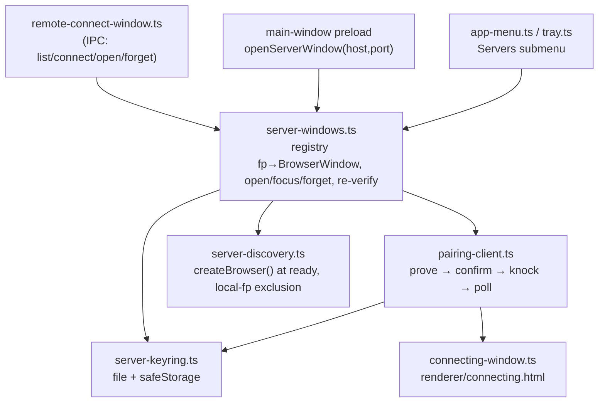

## Context

See proposal.md — Why. Pieces already in place:

- `packages/shared/src/mdns-discovery.ts:648` — `createBrowser()` (continuous browse + 60 s refresh sweep); `DiscoveredServer` (`:15`) carries `fingerprint`, `name`, `addresses`, `instance` (change `stabilize-mdns-server-identity`). The advert carries no TLS signal (`openspec/specs/mdns-discovery/spec.md` TXT `{version,pid,piPort,fp,name}`).
- `packages/shared/src/server-pinning.ts:197` — `proveServerIdentity(baseUrl)` (no prior pin; `redirect: "manual"`, 4 KiB cap, timeout). `challengePinnedServer` (`:138`) needs a pin. Both Node-crypto, usable from Electron main.
- `packages/client/src/lib/pairing/knock.ts:96` — `knockServer(baseUrl, expectedFp, name, hooks)` (challenge → knock → verify response fp → poll), built for native consumers (archived `add-lan-knock-pairing` D11); only its test uses it today. Its challenge uses `pair-protocol.ts` `challengeIdentity` (WebCrypto).
- Server: `POST /api/device-session` (`packages/server/src/auth/bearer-auth.ts:118-131`) exchanges `Authorization: Bearer` for httpOnly `pi_dash_device` whose **value is the bearer** (`:124`), `Path=/api/`, `SameSite=Strict`, 400-day max-age (`:43`). The route itself answers `401` for a bad bearer, but it is NOT a network-guard public exception, so for a peer outside `trustedNetworks` an unauthenticated (revoked) request is refused earlier with `403 network_not_allowed` (`packages/server/src/auth/localhost-guard.ts:694-735`, denial shape `:366-374`). Conversely, from a trusted network ordinary `/api/*` calls pass without any credential.
- Electron: `lib/remote-connect-window.ts` (+ `preload/remote-connect-preload.ts`, `renderer/remote-connect.html`). Shell settings + MRU live in `~/.pi-dashboard/dashboard-settings.json` (`lib/wizard-state.ts:17`, `lib/managed-paths.ts:11`). One bundled `preload.ts` side-effect-imports every bridge (`preload.ts:9-12`) and is attached to the main window (`main.ts:505`). `createMainWindow` wires `setWindowOpenHandler` + `decideWillNavigate` (`main.ts:512-526`); `decideWillNavigate` returns `"allow"` for any target once the current page is off-origin (`lib/link-handling.ts:93-104`, OAuth-aware by design). Electron `43.4.1` (`packages/electron/package.json:33`).
- In flight: `harden-electron-renderer-boundary` (0/22 tasks) specifies a minimal main-window preload, `event.senderFrame` validation and a `http`/`https`/`mailto` `openExternal` allowlist (`openspec/changes/harden-electron-renderer-boundary/specs/electron-renderer-hardening/spec.md`).
- Client: `packages/client/src/components/connectivity/ServerSelector.tsx` `onSwitch(host, port)` → `performServerSwitch` (`lib/api/server-switch.ts`); load-time reconnect reads `pi-dashboard-last-server` (`packages/client/src/App.tsx:267-275`); Electron capability is feature-detected via `window.piDashboard` (`components/packages/RuntimeUpdatesSection.tsx:153`).

## Goals / Non-Goals

**Goals:**
- Main process owns discovery, identity, pairing, credential storage and window lifecycle; renderers only send intents.
- Remote dashboard runs its own client on its own origin; zero changes to server auth.
- Within the Electron app, the keyring is the single source of a server's identity + credential.

**Non-Goals:**
- QR/deep-link pairing from Electron (knock only; manual URL uses TOFU knock).
- Self-revocation on the remote server ("Forget" is local-only).
- Changing remote mode, the in-page switch in browsers, or the neutral `packages/shell` IndexedDB keyring (a separate app with its own credentials).
- Multi-account per server (one device entry per fingerprint).
- Detecting revocation inside an open window when the remote admits this machine's network without a credential (detected at next open).
- HTTPS for discovered servers (no TLS signal in the advert); a manual `https://` URL keeps its scheme.
- Pairing a dashboard reachable only through a tunnel or VPN (knock admission is on-link only; `knock_not_lan` is explained in the connecting window). Remote mode remains the path for those.
- Making a server window's own ServerSelector Electron-aware: that window is a plain browser context on the remote's origin, so its in-page switch keeps browser behaviour.
- `/live/` and `/editor/` in server windows from networks the remote does not trust: the device cookie is `Path=/api/` and read only for `/api/*` (`packages/server/src/auth/bearer-auth.ts:86-90`); widening it is a server change, out of scope.
- Sender validation of the existing `remote-connect:*` handlers (`lib/remote-connect-window.ts:73-109`) — owned by `harden-electron-renderer-boundary`.

## Decisions

### D0 — Hard predecessor: `harden-electron-renderer-boundary`
This change builds on its `safeOpenExternal` allowlist and minimal main-window preload rather than adding parallel helpers. Sender validation for this change's channels is its own standalone check (D9) because hardening's rule ("frame URL is the expected origin") admits same-origin subframes. Task 1.1 blocks until hardening is merged. Coordination note for hardening: its "Reachability probe rejects internal targets" would also refuse the existing remote-connect LAN probe (`lib/remote-connect-window.ts:82-86`); that is hardening's scope to resolve, but this change's knock flows do not use `probeRemote`. The spec (`electron-server-windows` "Server window requests are validated in the main process") states the trusted-sender set itself, so it does not depend on hardening's wording. Alternative — add our own `lib/ipc-trust.ts` and let hardening adopt it — rejected: inverts ownership of a security boundary already specified elsewhere. `electron-platform-extraction` is not a predecessor; if it lands first the Servers submenu goes through `platform/menu.ts` instead of `lib/app-menu.ts`.

### D1 — Module layout in `packages/electron/src/lib/`

Pure decision helpers (`resolveExpectedFingerprint`, `pickVerifiedHost`, `partitionFor`, `serverOrigin`, `decideServerWindowNavigation`, `classifyExchange`, keyring (de)serialisation, display-name sanitiser) are separate exported functions so they are unit-testable without Electron. Alternative — one big module — rejected: untestable.

### D2 — Move `knockServer` to shared with injectable identity proof
Move `knock.ts` to `packages/shared/src/pairing-knock-client.ts`; the challenge step becomes a `prove(baseUrl) => Promise<{proven}|{refused}>` hook, and the knock step is split so the caller can pause between prove and knock (needed for the user's "Send request" confirmation). Electron passes `proveServerIdentity`; the client keeps a thin re-export passing its WebCrypto `challengeIdentity`. `knock.test.ts` moves with it. The refusal-code → message table is extracted to shared so the browser landing and the connecting window share wording; the browser landing's behaviour is unchanged (refactor only). Alternatives — Electron importing `packages/client` (browser bundle) or a second knock state machine — rejected.

### D3 — Expected-identity rule
`expected = pin ?? advertFp`; when both exist and differ ⇒ mismatch (never knock). Undefined ⇒ prove, show short proven fp + editable device name, knock only after the user chooses "Send request", pin on approval. TOFU is thus an explicit user step plus the remote operator's typed-code approval. The pin never changes silently; a different identity requires Forget then re-pair. Prove failure (non-200, timeout, unreachable, too-old server without `/api/pair/challenge`) is "identity unverifiable", a separate message from mismatch. Over plain http this defeats an impostor at the address, not an on-path relay (same limit as `lan-knock-pairing` D8).

### D4 — Keyring file
`~/.pi-dashboard/server-keyring.json` (the managed dir, `lib/managed-paths.ts:11`, alongside `dashboard-settings.json`; same location in dev and packaged builds). Shape:
```json
{ "version": 1, "servers": { "<fp>": { "label": "home-imac", "pinnedPubkey": "<b64url SPKI>", "lastHosts": [{"host":"192.168.16.204","port":8000,"scheme":"http"}], "bearer": {"enc":"safeStorage","data":"<base64>"}, "remembered": true, "needsPairing": false, "pairedAt": "<iso>" } } }
```
Write: temp file in the same dir opened `wx` with mode `0600`, write, `fsync`, `rename`. Load: `chmod 0600` if broader (POSIX; on Windows the file inherits the user-profile ACL, documented). `lastHosts` MRU capped at 5. Unknown `version` or parse failure ⇒ rename to `server-keyring.corrupt-<ts>.json`, start empty, log. A `safeStorage.decryptString` failure (keychain reset, DPAPI change, backend switch) discards the blob and sets `needsPairing` (pin/label/hosts kept). When `safeStorage.isEncryptionAvailable()` is false, or on Linux `safeStorage.getSelectedStorageBackend()` is `basic_text`, the bearer lives in an in-memory map only; the entry is written with `"bearer": null, "remembered": false` and is shown as "needs pairing" on the next launch. Window bounds live in a separate `server-windows-state.json` (keyed by fp) so window moves never rewrite the credential file. Alternative — native OS-keychain module — rejected (new native dependency).

### D5 — Partition + cookie bootstrap
Partition name = `server-` + first 32 hex chars of `sha256(fp)` (filesystem-safe, derived only from the proven fp), prefixed `persist:` only when the entry is remembered; the non-persistent partition for not-remembered entries keeps the cookie (= the bearer) off disk. Bootstrap: `session.fetch(origin + "/api/device-session", {method:"POST", redirect:"manual", headers:{Authorization:"Bearer …"}})` so the `Set-Cookie` lands in that partition's jar exactly as for a knock-paired browser — A's client needs no change; then `loadURL(origin + "/")`. **Spike result (task 1.2, Electron 43.4.1, macOS arm64):** `session.fromPartition(p).fetch(origin + "/api/device-session", {method:"POST", redirect:"manual", headers:{Authorization}})` DOES store the `Set-Cookie` in that partition's jar — for both `persist:` and non-persistent partitions — with the server's attributes intact (`pi_dash_device`, `Path=/api/`, `httpOnly`, `SameSite=Strict`, expiry), sends it on a following `ses.fetch` to `/api/*`, and leaves `session.defaultSession` untouched (0 cookies). The `ses.cookies.set` fallback is therefore NOT needed. Not measured here: Chromium's cookie-store encryption at rest on Windows/Linux (depends on DPAPI / the same backend `safeStorage` reports; `basic_text` ⇒ non-persistent partition per D4, which keeps the cookie off disk regardless). **Platform note:** on macOS an unsigned build blocks the main thread on a Keychain authorisation prompt at the first `safeStorage` use; the keyring therefore touches `safeStorage` only when it has something to encrypt/decrypt, and the Electron-E2E harness passes Chromium's `--use-mock-keychain`. A persistent partition keeps A's UI state across runs. Chromium's cookie-store encryption at rest is OS-dependent (Keychain/DPAPI; on Linux it depends on the same backend `safeStorage` reports) — the spike records the posture per OS; on `basic_text` the partition is non-persistent anyway (D4). Forget calls `ses.clearStorageData()`. Alternative — always non-persistent — rejected: loses A's UI state every launch.

### D6 — Origins, host selection and heal
`serverOrigin({scheme, host, port})` brackets IPv6 literals (mdns-discovery rule). Discovered and selector targets are `http`; a manual URL from the remote-connect window keeps its scheme (path dropped). Candidates = `lastHosts` (stored order, `https` first) ∪ discovery hosts/addresses whose advert fp equals the pin — discovery candidates are appended only after every stored `https` host. Discovery candidates capped at 3. All candidates are challenged concurrently with `challengePinnedServer` (overall deadline 5 s); the most-preferred accepting candidate wins (stored `https` → stored `http` → discovered). An accepted discovery host is inserted into `lastHosts` after any `https` host (heal, logged); it never replaces or precedes an `https` host. None ⇒ refuse. Two machines sharing one identity (cloned key) both prove the pin; the first candidate wins — accepted trade-off, logged with host.

### D7 — Credential refusal and revocation
`classifyExchange(status, body)` runs only on the `/api/device-session` exchange (whose body main reads via `session.fetch`): `200` ⇒ ok; `401`, or `403` with `error === "network_not_allowed"` ⇒ refused; anything else ⇒ transport error (load nothing, change nothing, "unreachable"). Before load: refused ⇒ needs-pairing, no load. While open: `ses.webRequest.onCompleted({urls:[origin + "/api/*"]})` only *triggers* a re-check on `401`/`403` (it cannot read bodies, and `403` also means tier / host-gate / origin refusals — `packages/server/src/auth/route-tier-gate.ts:95-97`, `host-gate.ts:376-378`, `mutation-origin-gate.ts:53`). The re-check is the exchange itself, rate-limited to once per 5 min per window; refused ⇒ needs-pairing, clear bearer + cookie, one main-owned dialog (Pair again / Forget / Close); ok ⇒ nothing (no reload, so no loop). From a trusted network the remote answers `/api/*` without a credential, so mid-session revocation is invisible there; detection happens at the next open (stated in the spec).

### D8 — Server window hardening
`webPreferences: { partition, sandbox: true, contextIsolation: true, nodeIntegration: false, webviewTag: false }`, no `preload`. A dedicated pure `decideServerWindowNavigation(origin, target) → "allow" | "external" | "drop"` (same-origin ⇒ allow; otherwise external when `safeOpenExternal` admits the scheme, else drop) — **not** `decideWillNavigate`, whose off-origin "allow" branch exists for OAuth on the main window and would let a server window wander once off-origin. Wired to `will-navigate`, `will-redirect` (main frame) and `setWindowOpenHandler` (always deny). Permissions (`ses.setPermissionRequestHandler`) allow `clipboard-sanitized-write`, `notifications` and `fullscreen` only. `will-download` sets an explicit save dialog. Title: handle `page-title-updated` (preventDefault) and set `‹label› — ‹page title›`, both through the display-name sanitiser. Subframes are not origin-restricted: they run inside the remote page, which already controls its own iframes, and no credential crosses partitions.

### D9 — IPC trust and the main-window entry point
Own channel family (not the loading page's `dashboard:` server-control family in `electron-shell`): `servers:list`, `servers:changed` (push, sent only to trusted windows), `servers:connect`, `servers:send-request`, `servers:open`, `servers:forget`, `servers:pair-again`, `servers:stop-waiting`, `servers:open-from-dashboard`. One check `isServerWindowsSender(event)`: `event.senderFrame === event.sender.mainFrame` AND `event.sender` is one of the held `BrowserWindow` references (remote-connect, connecting, main) AND the frame URL is that window's expected document (bundled `file://` page, or for the main window an origin equal to the local dashboard origin). It is standalone (no conditional composition), so it never fails open. The main-window minimal preload exposes `piDashboard.openServerWindow({host, port}) → {ok:true} | {ok:false, reason}` only when `location.origin` equals the local dashboard origin passed to the preload by main (`additionalArguments`), so a remote-mode document never sees it, even on a loopback tunnel; the handler re-checks the same predicate. Targets named by host and port must match a discovered server or a keyring host (no arbitrary host from a renderer); manual URLs come only from the remote-connect window and refuse loopback hosts. The client feature-detects it. Payloads are shape-validated (host ≤ 253 chars, port 1–65535, manual URL only from remote-connect, `http`/`https` only); fingerprints match `^sha256:[A-Za-z0-9_-]{43}$`. Short fingerprint display = `sha256:` + first 16 base64url chars (96 bits), one shared helper.

### D10 — Local dashboard exclusion and discovery lifetime
`server-discovery.ts` starts `createBrowser()` at `app.whenReady` and stops it at quit (spec: browse for the app's lifetime). Adverts with `isLocal` are dropped (the local server). After the local server is healthy main runs `proveServerIdentity(localOrigin)` once and stores `localFp` (skipped in remote mode, where no local server runs); a non-local advert carrying `localFp` (a cloned identity, which `mdns-discovery` lists) stays visible, labelled "same identity as this dashboard".

### D11 — Connecting window
Bundled `renderer/connecting.html` + `preload/connecting-preload.ts` (receives `{label, host, shortFp, phase, deviceName, confirmCode?, expiresAt?, unencrypted, error?}`; sends `send-request(name)` / `stop-waiting` / `close` / `pair-again`). Phases: `proving → confirm → waiting → approved|rejected|expired|refused|mismatch|unverifiable|stopped`. Only this window ever sees the code. Device name prefilled from `os.hostname()`, editable, normalised like the server does; never logged.

### D12 — Identity re-verification while open
Every 60 s, on `focus` (≥ 60 s since last) and on `powerMonitor` `resume`, re-run `challengePinnedServer` at the window's host. Proven mismatch ⇒ `loadURL("about:blank")`, remove the partition's `pi_dash_device` cookie, log, report. Transport failure ⇒ keep the page, title suffix "— not reachable", retry next trigger (a rebooting server or roaming laptop is not an attack). This bounds — does not eliminate — the window where a host takeover receives the cookie (the cookie is the bearer); the same exposure applies to any knock-paired browser (`lan-knock-pairing` D8).

### D13 — Electron local window ignores a saved remote
In `App.tsx` (`getInitialWsUrl`), when `window.piDashboard?.openServerWindow` exists and the origin is loopback, skip the `pi-dashboard-last-server` reconnect without deleting the key (revert-safe), so an upgrade from an earlier in-page switch cannot pull the local window onto a remote.

### D14 — Open of an unpaired target starts pairing
`servers:open` / `servers:open-from-dashboard` for a target with no keyring entry, or an entry that needs pairing, opens the connecting window (D11) instead of failing; on approval the server window opens. The selector's in-flight indicator resolves when the connecting window is shown.

## Risks / Trade-offs

- [Cookie value is the bearer; a host takeover between re-verifications receives it] → D12 re-verification on focus/resume; operator revocation on the remote; same exposure as knock-paired browsers.
- [Plain-http LAN: on-path attacker relaying the challenge sees cookie/bearer] → accepted limit (`lan-knock-pairing` D8); connecting window labels unencrypted targets.
- [Mid-session revocation invisible from a trusted network] → detected at the next open; documented in spec.
- [Server windows run the remote's own client with no bridge, so its ServerSelector does the browser in-page switch] → accepted: that window is a plain browser context on the remote's origin; the local window is where Electron-native switching lives.
- [Opt-in CDP debug surface (`--debug-cdp`, 127.0.0.1:9222) lets any local process read partition cookies (= bearers) and drive trusted frames] → accepted: opt-in developer mode, and a local process can already read the keyring file; the Electron log warns at startup when CDP is active and server windows exist.
- [A downgrade or uninstall leaves a valid 400-day credential at rest] → documented manual cleanup + remote revocation; no automatic purge (an older build cannot know the new files).
- [Two mDNS browsers on one machine (server + Electron main)] → cheap multicast; acceptable for the spec's app-lifetime discovery.
- [Persistent partition keeps a cookie copy on disk] → OS-encrypted Chromium cookie store; non-persistent partition when not remembered; Forget clears it.
- [Keyring format is persistent] → `version` field; unknown version set aside, not overwritten.
- [Cloned identity across machines] → first proving candidate wins; logged with host.
- [Identity is proven with Node `fetch` while the credential exchange and the page use Chromium (`session.fetch`/`loadURL`): for a hostname host or a configured proxy/PAC the two resolutions can differ (prove/use gap beyond the documented on-path-relay limit)] → accepted and recorded: discovered hosts are IP literals, `https` manual hosts are certificate-verified by Chromium, and the 60 s re-verification bounds the window; routing the challenge through the partition session would close it at the cost of a second fetch stack in `server-pinning` — deferred.
- [Hostile or compromised paired server] → server-window posture (D8) + per-window rate limit (1/s) on system-browser hand-offs; a proven mismatch blanks the window once and stops its timers (no repeating prompts); the runtime credential re-check re-proves identity BEFORE it re-sends the bearer.
- [Hostile LAN peer during pairing] → knock/poll answers are size-capped (8 KiB), `confirmCode` must be 8 digits, `expiresAt` is clamped to 30 min, the bearer must be a bounded string; mDNS lists are capped (200 entries, 8 addresses) and a malformed advertised fingerprint is treated as "not advertised".

## Migration Plan

- No server change; no data migration. `server-keyring.json` / `server-windows-state.json` are created on first pairing.
- Rollback: revert the change. Remote mode and the browser in-page switch are untouched. **Credentials are not erased by a revert**: the keyring (encrypted bearer) and `persist:server-*` partitions (device cookie) remain valid until the remote operator revokes the device. Release notes instruct: Forget servers before downgrading, or revoke the device on each remote; after a downgrade, delete `~/.pi-dashboard/server-keyring.json`, `~/.pi-dashboard/server-windows-state.json` and the `Partitions/server-*` directories under Electron `userData` by hand. D13 never deletes `pi-dashboard-last-server`, so a revert restores the previous load behaviour.
- Compatibility: a remote without `/api/pair/challenge` is "identity unverifiable"; one with the challenge but without `/api/pair/request` refuses the knock (generic refusal message). Remote mode still works with both.
