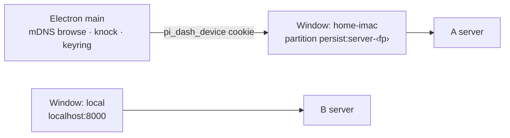

## Why

Electron can only reach another dashboard in two unsatisfying ways:

1. **In-page switch** (`ServerSelector` → `performServerSwitch`). The window stays on `http://localhost:<port>` and B's **own client code** drives A's server. That invites version skew between B's client and A's server, and makes every cross-origin gap a bug: relative `/api/` fetches hit the wrong server (`fix-remote-relative-api-fetch`), the device bearer is attached only to same-origin calls (`device-auth.ts`), and ``, downloads, `/live/` iframes and terminals cannot carry an `Authorization` header. Today it works only because `trustedNetworks` admits the LAN by IP.
2. **Remote mode** (`remote-connect-window.ts` → `ensureServer`). The whole app attaches to one remote URL and relaunches; B's local server is not started, so B's own pi sessions lose their dashboard. Right for thin-client/docker installs; wrong for "I also want to look at my other machine".

With fingerprinted discovery (`stabilize-mdns-server-identity`) and device-initiated pairing (`add-lan-knock-pairing`), Electron can pair from the main process and open each remote dashboard **on its own origin**, where same-origin auth already works.

## What Changes

- **Main-process discovery.** Electron main runs the shared `createBrowser` and exposes discovered servers (name, fingerprint, host, paired state) to its own trusted windows only.
- **Main-process pairing client.** On Connect: verify A's identity (`challengePinnedServer`) against the advertised `fp` (TOFU pin on first pairing, mismatch refused thereafter), run `POST /api/pair/request`, show the confirm code in a main-owned "Connecting to ‹name›" window, poll, store the bearer. Node crypto runs in main, so the browser secure-context limit does not apply.
- **Server keyring.** `~/.pi-dashboard/server-keyring.json` keyed by fingerprint: `{label, pinnedPubkey, lastHosts[], bearer}`, bearer encrypted with Electron `safeStorage` (file `0600`). Hosts refresh from mDNS by fingerprint.
- **One window per paired server.** `BrowserWindow` with `partition: persist:server-<fp>`; main installs the device credential (via `POST /api/device-session` in that session, or an equivalent cookie set) and loads A's own origin. A's client code runs against A's server. Identity is re-verified on every open. A `401` marks the entry unpaired and offers re-pairing. Server windows get **no privileged preload** (aligned with `harden-electron-renderer-boundary` VD5).
- **Entry points.** The "Connect to remote" window lists Discovered and Paired servers alongside the manual URL; app menu/tray gain a Servers submenu; in Electron, choosing a remote in `ServerSelector` opens/focuses that server's window instead of switching in-page. Browsers keep the in-page switch.
- **Remote mode kept** unchanged for thin-client/docker installs.

## Capabilities

### New Capabilities
- `electron-server-windows`: main-process discovery, pairing client, fingerprint keyring, per-server window lifecycle and credential bootstrap.

### Modified Capabilities
- `electron-remote-connect`: window lists discovered and paired servers; Connect runs the knock pairing flow; manual URL / remote mode retained.
- `server-selector`: inside Electron, selecting a remote opens its server window instead of an in-page switch.

## Discipline Skills

- `security-hardening` — credential at rest (`safeStorage`), identity pinning/TOFU, untrusted remote content in a window (no privileged preload, `will-navigate`/`setWindowOpenHandler` per window), IPC sender validation.
- `doubt-driven-review` — new persistent keyring format and window model; review before it stands.
- `observability-instrumentation` — log pairing outcome, identity mismatch, keyring heal (fp, host) in the Electron log.
- `review-code` — before commit.

## Impact

- **Electron:** `packages/electron/src/main.ts`, new `packages/electron/src/lib/server-windows.ts`, `server-keyring.ts`, `pairing-client.ts`; `lib/remote-connect-window.ts`, `renderer/remote-connect.html`, `preload/remote-connect-preload.ts`, `lib/app-menu.ts`, `lib/tray.ts`.
- **Shared:** reuse `mdns-discovery.ts`, `server-pinning.ts`; pairing wire helpers shared with `packages/shell/src/lib/protocol.ts` where practical.
- **Client:** `ServerSelector.tsx` Electron branch (open window via preload IPC on the local, trusted window only).
- **Coordination:** `harden-electron-renderer-boundary` (preload split / sender validation) and `electron-platform-extraction` touch `main.ts`/menu/tray — sequence or rebase accordingly.
- **Rollback:** revert removes windows and keyring use; keyring file is inert; remote mode and in-page switch remain.
- **Sequence:** 3 of 4 — depends on `stabilize-mdns-server-identity` and `add-lan-knock-pairing`.
