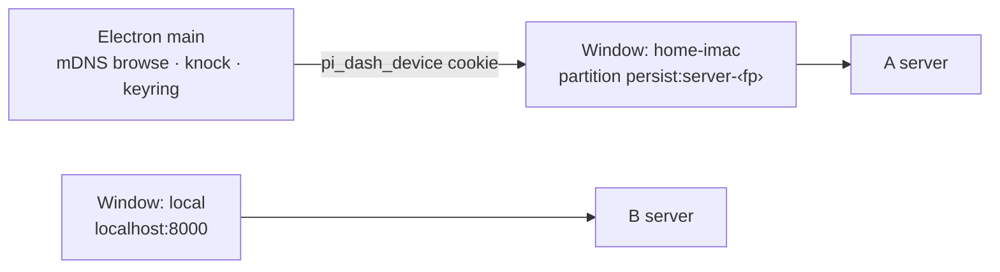

## Why

Electron can only reach another dashboard in two unsatisfying ways:

1. **In-page switch** (`ServerSelector` → `performServerSwitch`). The window stays on `http://localhost:<port>` and B's **own client code** drives A's server. That invites version skew between B's client and A's server, and makes every cross-origin gap a bug: relative `/api/` fetches hit the wrong server (`fix-remote-relative-api-fetch`), the device bearer is attached only to same-origin calls (`device-auth.ts`), and ``, downloads, `/live/` iframes and terminals cannot carry an `Authorization` header. (On its own origin the device cookie covers `/api/`; `/live/` and `/editor/` still follow the remote's network rules — see design Non-Goals.) Today it works only because `trustedNetworks` admits the LAN by IP.
2. **Remote mode** (`remote-connect-window.ts` → `ensureServer`). The whole app attaches to one remote URL and relaunches; B's local server is not started, so B's own pi sessions lose their dashboard. Right for thin-client/docker installs; wrong for "I also want to look at my other machine".

With fingerprinted discovery (`stabilize-mdns-server-identity`) and device-initiated pairing (`add-lan-knock-pairing`), Electron can pair from the main process and open each remote dashboard **on its own origin**, where same-origin auth already works.

## What Changes

- **Main-process discovery.** Electron main runs the shared `createBrowser` and exposes discovered servers (name, fingerprint, host, paired state) to its own trusted windows only.
- **Main-process pairing client** (same local network only — knock admission is on-link). On Connect: prove A's identity (`proveServerIdentity`) and compare it with the keyring pin or the advertised `fp` (a manual URL shows the proven fingerprint and pins it on approval — TOFU; mismatch refused thereafter), run `POST /api/pair/request`, show the confirm code in a main-owned "Connecting to ‹name›" window, poll, store the bearer. Node crypto runs in main, so the browser secure-context limit does not apply.
- **Server keyring.** `~/.pi-dashboard/server-keyring.json` (next to `dashboard-settings.json`) keyed by fingerprint: `{label, pinnedPubkey, lastHosts[], bearer}`, bearer encrypted with Electron `safeStorage` (file `0600`); without OS encryption the bearer and the window's storage stay in memory for the run. Hosts refresh from mDNS by fingerprint.
- **One window per paired server.** `BrowserWindow` with `partition: persist:server-<fp>`; main installs the device credential (via `POST /api/device-session` in that session, or an equivalent cookie set) and loads A's own origin. A's client code runs against A's server. Identity is re-verified on every open. A refused cookie exchange (`401`, or `403 network_not_allowed`) marks the entry "needs pairing" and offers re-pairing. Server windows get **no privileged preload**, same-origin-only top-level navigation, and the `http`/`https`/`mailto` openExternal allowlist (aligned with `harden-electron-renderer-boundary` VD4/VD5).
- **Entry points.** The "Connect to remote" window lists Discovered and Paired servers alongside the manual URL; app menu/tray gain a Servers submenu; in Electron, choosing a remote in `ServerSelector` opens/focuses that server's window instead of switching in-page. Browsers keep the in-page switch.
- **Remote mode kept** unchanged for thin-client/docker installs.

## Capabilities

### New Capabilities
- `electron-server-windows`: main-process discovery, pairing client, fingerprint keyring, per-server window lifecycle and credential bootstrap.

### Modified Capabilities
- `electron-remote-connect`: window lists Paired, Discovered, Enter a URL and Recent remote dashboards; Connect runs the knock pairing flow; the relaunch action is named "Use as remote dashboard" (wording edits in "Remote-connect window" and "Connect, persist, and relaunch"); remote mode retained.
- `lan-knock-pairing`: "Native knocking clients verify the discovered identity first" gains the pin rule and an explicit user-confirmed trust-on-first-use branch for addresses with no advertised fingerprint.
- `server-selector`: inside Electron's local window, selecting an available remote opens its server window instead of an in-page switch; a saved remote last-server is ignored there.
- `electron-shell`: the external-links rule states that app-owned server windows (opened on a validated main-process request) are not "secondary windows spawned by an external URL".

## Discipline Skills

- `security-hardening` — credential at rest (`safeStorage`), identity pinning/TOFU, untrusted remote content in a window (no privileged preload, `will-navigate`/`setWindowOpenHandler` per window), IPC sender validation.
- `doubt-driven-review` — new persistent keyring format and window model; review before it stands.
- `observability-instrumentation` — log pairing outcome, identity mismatch, keyring heal (fp, host) in the Electron log.
- `review-code` — before commit.

## Impact

- **Electron:** `packages/electron/src/main.ts`, new `packages/electron/src/lib/server-windows.ts`, `server-keyring.ts`, `server-discovery.ts`, `pairing-client.ts`, `connecting-window.ts` (+ `renderer/connecting.html`, `preload/connecting-preload.ts`); `lib/link-handling.ts` (server-window navigation helper), `lib/remote-connect-window.ts`, `renderer/remote-connect.html`, `preload/remote-connect-preload.ts`, main-window preload, `lib/app-menu.ts`, `lib/tray.ts` (or `platform/` equivalents if `electron-platform-extraction` lands first).
- **Shared:** reuse `mdns-discovery.ts`, `server-pinning.ts`; pairing wire helpers shared with `packages/shell/src/lib/protocol.ts` where practical.
- **Client:** `packages/client/src/components/connectivity/ServerSelector.tsx` Electron branch (open window via preload IPC on the local, trusted window only); `App.tsx` last-server load path; `knockServer` moves from `packages/client/src/lib/pairing/knock.ts` to `packages/shared` (refactor, no behaviour change).
- **Coordination:** `harden-electron-renderer-boundary` (preload split, sender validation, `safeOpenExternal`) is a **hard predecessor** — this change builds on its helpers. `electron-platform-extraction` touches `main.ts`/menu/tray — rebase onto it if it lands first.
- **Rollback:** revert removes windows and keyring use; remote mode and in-page switch remain. Credentials are NOT erased by a revert: the keyring (encrypted bearer) and `persist:server-*` partitions (device cookie) stay on disk and stay valid until the remote operator revokes the device — Forget servers before downgrading, or revoke them on the remote.
- **Sequence:** 3 of 4 — depends on `stabilize-mdns-server-identity` and `add-lan-knock-pairing`.
