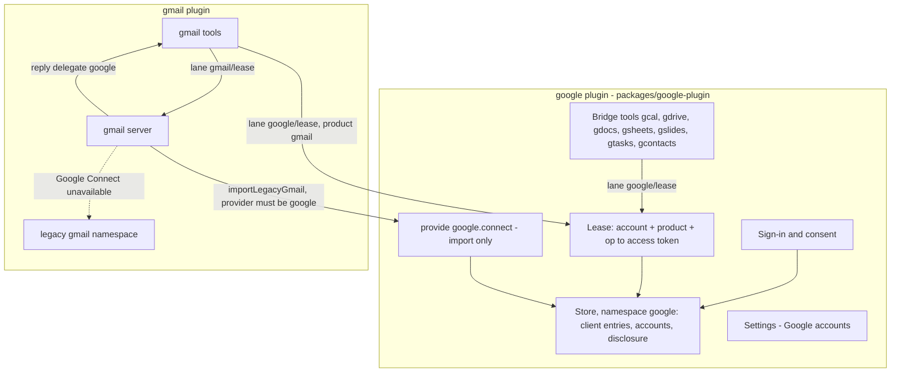
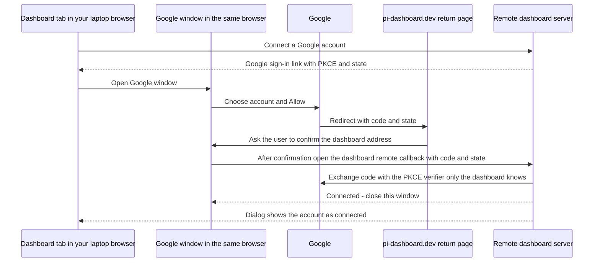

# Design

## Context

See proposal.md — Why. Current state:

- `packages/gmail-plugin` owns everything Google: credential namespace `gmail` with one `client` record and `acct:<sub>` records (`packages/gmail-plugin/src/server/accounts.ts:14-41`); `lease.ts` refreshes every account with that client (`packages/gmail-plugin/src/server/lease.ts:76-88`); `store-client.ts` refuses client swaps while accounts exist (`client_in_use`, `packages/gmail-plugin/src/server/store-client.ts:22-26`); sign-in in `google-oauth.ts` (Desktop client, loopback via `ctx.oauth.startFlow` + `createLoopbackCallback`, PKCE, state, nonce, `email_verified`); it requests the full scope set on every consent and does not send `include_granted_scopes` (`packages/gmail-plugin/src/shared/scopes.ts:20`, `packages/gmail-plugin/src/server/google-oauth.ts:10`). Setup wizard + automatic setup (`src/server/setup/*`, `src/client/wizard.ts`) enable only the Gmail API.
- Plugin seams (`docs/plugin-seams.md:24-25`): `ctx.credentials` is per-plugin namespace only, ≤256 keys, ≤2 MiB, 64 KiB/record; cross-plugin services only via `provide`/`consume` (`docs/plugin-seams.md:474`); `consumeAll` returns the provider plugin id (`packages/dashboard-plugin-runtime/src/server/server-context.ts:858-867`). Manifest `dependsOn` is hard: a dependent's server entry is skipped when the dependency is absent (dashboard-plugin-loader spec).
- Bridge↔server private request lane refuses non-hub-local sessions for credential-bearing handlers (`openspec/specs/plugin-bridge-request-lane/spec.md`).
- Local-browser detection already exists: loopback peer AND no `X-Forwarded-*` / `Forwarded` / `Via` headers (`openspec/specs/gmail-auto-setup/spec.md`, "Entry point and availability").
- Dashboard login already redirects to the dashboard's own public URL (`auth.redirectBaseUrl` → tunnel → localhost, `openspec/specs/oauth-authentication/spec.md`, "OAuth redirect URI resolution").
- Electron sends every `window.open` to the system browser (`openspec/specs/electron-shell/spec.md:193-198`, `packages/electron/src/lib/link-handling.ts`).



## Goals / Non-Goals

**Goals:**
- Zero-setup connect for individuals with several own Google accounts, through one built-in pi-dashboard.dev Desktop app; data stays on the user's machine.
- Server deployments use the operator's own Google Cloud client ("gcloud way"); several own clients side by side with domain auto-pick.
- One account model for all Google products.
- Gmail keeps working with no re-consent; rollback to the previous build keeps Gmail working.
- Tokens never exchanged or stored on pi-dashboard.dev.

**Non-Goals:**
- Folding Gmail tools into the google plugin (later, optional).
- Hosted token broker; runtime-fetched client config.
- Drive sharing changes, Photos, Keep, Admin SDK.
- Google device-code flow (does not allow Gmail/Calendar scopes — unverified, not needed).

## Decisions

### D1 — One `google` plugin owns identity; Gmail consumes it softly
`packages/google-plugin` (id `google`, bundled, enabled by default, manifest `priority: 200` so it registers before Gmail's 210 — the loader orders by priority when no `dependsOn` links them, `packages/dashboard-plugin-runtime/src/dependency-graph.ts:217-224`) holds clients, accounts, grants, leases, settings, setup and the seven new product tool sets. It `provide`s `google.connect` = `{ importLegacyGmail(snapshot) }` only — no token-leasing service in-process.
Gmail keeps its bridge, tools and `gmail/lease` lane, and declares **no** `dependsOn` on `google` (a hard dependency would stop Gmail loading when `google` is disabled). Gmail's server checks at request time (`consumeAll("google.connect")`, entry used only when `provider === "google"`), so load order does not matter; the loader allows consume without `dependsOn` ("Missing provider degrades gracefully", `openspec/specs/dashboard-plugin-loader/spec.md`). When Google Connect is usable and the account was imported, `gmail/lease` replies `{ delegate: "google" }` and the Gmail bridge sends the same request to the `google` plugin's `google/lease` lane with `product: "gmail"` (a bridge may address any plugin id, `openspec/specs/plugin-bridge-request-lane/spec.md` "Request/reply between plugin bridge and plugin server"); the hub-local `origin_denied` gate applies on both lanes. Otherwise Gmail leases from its legacy namespace as today. Enabling or disabling the `google` plugin takes effect after a server restart (loader rule). `docs/plugin-seams.md:474` is updated to describe this soft-consumer pattern.
- *Alt: shared library embedded in each product plugin.* Rejected — per-plugin namespaces would duplicate tokens per product and fragment consent.
- *Alt: move Gmail tools into the google plugin now.* Rejected for this change — churn on a shipped surface.
- *Alt: hard `dependsOn`.* Rejected — breaks Gmail when Google Connect is off and removes the disable-plugin rollback.
- The only in-process surface is `importLegacyGmail`; tokens never cross plugins in-process.

### D2 — Client registry
- **Built-in (pi-dashboard.dev):** `src/shared/default-clients.ts` exports `BUILT_IN: { local: ClientRecord | null; remote: ClientRecord | null }` (both initially `null`). Two Google Cloud projects with the same branding: **`local`** = project "pi-dashboard" with a Desktop client and every product scope (the verified desktop app); **`remote`** = project "pi-dashboard remote" with a Web client whose only redirect URI is `https://pi-dashboard.dev/oauth/return.html` and a consent screen declaring **no restricted scopes**, so a forged request through the public Web client cannot obtain Gmail or full Drive (grants of the local project do not carry over). Each connect uses exactly one of them (one consent window). Secrets ship in the open-source code (Desktop: non-confidential by design; Web: see Risks). Refs `builtin` and `builtin-remote`. **Available for a browser**: local browser (D12a) → `builtin` iff `local` non-null and `PI_GOOGLE_DEFAULT_CLIENTS !== "off"`; remote browser → `builtin-remote` iff `remote` non-null, `PI_GOOGLE_DEFAULT_CLIENTS !== "off"` and `PI_GOOGLE_REMOTE_RETURN !== "off"`; otherwise the built-in app is unavailable for that browser and selection continues (D5). The switches gate new sign-ins only; refresh of an existing grant always uses its recorded client id (`PI_GOOGLE_DEFAULT_CLIENTS=off` also stops refresh, as the operator's hard stop).
- **Own clients (gcloud way):** `client:<id>` → `{ id, label, type: "installed" | "web", clientId, clientSecret, projectId?, ownerAccount?, domains: string[], addedAt }`. `id` slug, stable; `label` editable; `domains` lowercase, exact match, unique across own clients (several domains per client allowed — subdomains/aliases listed explicitly). `installed` = Desktop (loopback + paste); `web` = redirect URI `<dashboard base>/api/plugins/google/oauth/callback`, base resolved like dashboard login (`auth.redirectBaseUrl` → tunnel → localhost). `projectId` / `ownerAccount` are per client (the wizard sets up one client at a time).
- Removing an own client, or replacing its client id, is refused with `client_in_use` while an account references it. An upload with an existing client id updates that client; any other upload adds a client.
- *Alt (earlier draft): two built-in clients split by verification tier.* Rejected — two consent windows per connect and two grants per account; one client, verified once, avoids both.

### D3 — Accounts and grants
`acct:<sub>`:
```ts
interface Account {
  sub: string; email: string; alias?: string; addedAt: number;
  client: "builtin" | `own:${string}`;
  grant: { clientId: string; refresh: string; access: string; expires: number; scopes: string[];
           status: "ok" | "reauth_required"; testingHint?: boolean; grantedAt: number };
  products: Partial<Record<Product, { level: Level; options?: Record<string, boolean> }>>;
}
```
- One grant per account. `grant.clientId` records the exact client that minted the refresh token (built-in `desktop` and `web` are different client ids); refresh always uses that client id and its secret.
- A different `sub` on re-auth or consent → `account_mismatch`, nothing changes.
- A connect for an existing `sub` through a different client (including `builtin` ↔ `builtin-remote`) → `client_mismatch` ("connected with <client>; disconnect it first"), nothing changes. Refresh never depends on where the browser is.
- Consent (product change, sign in again) always runs on the account's own client: `builtin` needs a local browser (else "open the dashboard on its own computer to change Google access"); `builtin-remote` uses the return page from any browser; own clients by type.
- Reconnect of an existing account keeps alias, products and product options (e.g. Gmail filters).
- Size: one grant ~3 KiB ≪ 64 KiB; 256 keys ⇒ documented account+client limit; `too_many_keys` → "remove unused accounts or clients".

### D4 — Products, levels, scopes
Catalogue `src/shared/products.ts` (single source for server, client, tools, kit):

| Product | Levels → scopes | Google class |
|---|---|---|
| gmail | delegated to gmail-plugin `TIER_SCOPES` (+ `settings.basic` option) | restricted |
| calendar | read → `calendar.readonly`; write → `calendar.events` | sensitive |
| drive | files → `drive.file` (+ Google Picker); read → `drive.readonly`; write → `drive` | files: non-sensitive; read/write: restricted |
| docs | read → `documents.readonly`; write → `documents` | sensitive |
| sheets | read → `spreadsheets.readonly`; write → `spreadsheets` | sensitive |
| slides | read → `presentations.readonly`; write → `presentations` | sensitive |
| tasks | read → `tasks.readonly`; write → `tasks` | sensitive |
| contacts | read → `contacts.readonly`; write → `contacts` | sensitive |

Every consent also requests `openid email`. Built-in client offers Drive `files` only (no full-Drive restricted scope in the pi-dashboard.dev app); own clients offer all Drive levels. Classes confirmed in the Cloud Console (task 0.2).

### D5 — Client selection
Order: explicit `client` in the request → own client whose `domains` contains the email domain → the built-in app available **for this browser** (D2) → `400 client_required` (the dialog then lists the clients to pick; no silent fallback to an unrelated own client).
Where the email comes from: the connect dialog shows no email or client field while no own client exists and the built-in app is available. Otherwise it shows "Sign in with" (default: built-in when available) plus an optional "Work email" field; typing an email whose domain is linked selects that client (D5 order). `login_hint` is sent whenever an email is known.

### D6 — Incremental consent (union, not include_granted_scopes)
Enabling a product or raising a level computes the required scopes. Covered by `grant.scopes` → apply immediately. Else start a consent on the account's client with `login_hint=<email>`, scopes = **union** of granted and required (same as Gmail today; no reliance on `include_granted_scopes`, which the existing code treats as unsupported for installed apps), `prompt=consent`. A reply that does not cover every scope the account already relied on (an existing product level or option such as Gmail filters) counts as not granted: the stored account stays unchanged (same rule as Gmail today, `openspec/specs/gmail-plugin/spec.md` "Filter permission survives re-authentication and level raises"). Otherwise the reply replaces `grant.scopes`; the new level applies only if covered, else `scope_missing` and the previous level stays. On a NEW connect, products Google did not grant stay off with `scope_missing`; the account is refused only when no requested product was granted. Lowering a level never re-consents. Disabling a product stops leases; scopes stay granted until disconnect (Google has no per-scope revoke) — stated in UI.

### D7 — Leases
`lease(sub|ref, product, op)` → `{ accessToken, expiresAt, email, level }`; refusals `level_insufficient`, `product_disabled`, `default_client_unavailable`, `no_client`, `reauth_required`. Single-flight refresh per account. `invalid_grant` marks the grant. Lanes `google/lease` + `google/accounts` refuse non-hub-local with `origin_denied`. Gmail's lane maps `product_disabled` → existing `not_found`-style message "Gmail is off for <email> in Settings → Google accounts", `default_client_unavailable`/`no_client` → existing `no_client` text, others unchanged.

### D8 — Disclosure (server-enforced)
One versioned disclosure; three short lines + privacy link in the connect dialog; accepting = "Continue with Google" for built-in. Line 1 depends on the path: local → "Your sign-in stays on this computer. Nothing is sent to pi-dashboard.dev."; return page → "Google returns once through pi-dashboard.dev's return page, which stores nothing; your sign-in is kept only on this dashboard." A version bump shows the dialog's disclosure again; "Continue with Google" re-accepts, also from "Sign in again". `disclosure` record `{ version, acceptedAt }`. Built-in sign-in or consent without acceptance of the current `DISCLOSURE_VERSION` → `409 disclosure_required`. Own clients not gated.

### D9 — Drive with Picker in built-in local mode
`drive.file` sees only files created by the app or picked by the user. The Google Picker needs a browser API key restricted by HTTP referrer (`http://localhost:*`, `http://127.0.0.1:*` for the built-in key) and an OAuth access token in the browser. `gdrive_pick` shows the picker through the session's prompt UI (the tab of the calling session); the browser obtains a short-lived access token from `POST /api/plugins/google/picker-token`, served only to local browsers (D12a rule) carrying the dashboard's local proof (the existing local-proof gate). Preferred token: from a separate Drive-files-only grant on the same client (spike 0.1 checks that a consent requesting only `drive.file` without `include_granted_scopes` yields a token limited to it); fallback: the account's access token, which carries its full grant — accepted only for a same-machine browser. Remote browsers and own clients get no Picker (`picker_unavailable`): Drive `files` sees app-created files only; own clients use `drive.readonly` / `drive` instead.

### D10 — Gmail migration
Gmail server, on its first request after start while Google Connect is usable (D1), when its namespace has a `client` or `acct:*` → `importLegacyGmail(snapshot)`: client → own client `id="gmail-legacy"`, `type: "installed"`, label "Gmail client (migrated)"; each account → `client: own:gmail-legacy`, grant with existing tokens/scopes/status and `clientId`, `products.gmail = { level: tier, options: { filters } }`. Each `sub` is imported **at most once**: Google Connect records imported subs (`imported:gmail`), so a later disconnect is never undone, and an existing Google Connect account is never overwritten. Accounts added to the legacy namespace while Google Connect was off (not yet imported) are imported on the next run. The client is imported once as `gmail-legacy`. Then gmail writes `migrated: { at, version }`. The `gmail` namespace is not deleted.
Rollback to the previous build keeps Gmail working **for accounts whose legacy token is still valid**. It does not cover (documented in CHANGELOG and README): accounts first connected after migration, accounts re-signed after `reauth_required`, accounts whose access was removed at Google, and the case where Google invalidates older refresh tokens when issuing new ones (spike 0.1 records this). Levels/aliases/filters changed after migration are not written back.
While Google Connect is usable, Gmail's account/client/setup REST routes answer `410 { error: "moved" }` — **BREAKING** for REST callers (listed in proposal). While it is not usable (plugin disabled), Gmail runs tools only; its settings say "Turn on Google accounts to manage Gmail accounts" and its management routes answer `503 google_connect_unavailable`.

### D11 — Tool conventions (all products)
- Prefix per product; first argument `account` (alias or email; alias → unique email → `ambiguous` / `not_found`).
- Reads return compact JSON with ids + human fields; large bodies paged.
- Writes go through the host confirm dialog with a product-specific preview; no UI → blocked; deny/dismiss/timeout → no API call. Shared `confirmWrite(summary)`.
- Files written to disk use the Gmail attachment path guard (realpath inside cwd, no overwrite), extracted to a shared helper.
- 403 classification generalized by service (`api_disabled` with numeric project + enable command, `scope_insufficient`, else `<product>_error`).
- 429/5xx → bounded backoff (max 3 tries, honours `Retry-After`).

### D12 — Return paths (no token broker)
Tokens are exchanged and stored only by the dashboard server. Three paths; the server picks per request and the dialog can switch ("Window didn't come back?"):

**D12a — Local (browser on the dashboard host)** — detected with the existing rule (loopback peer AND no forwarding headers). Built-in `desktop` or own `installed` client, loopback redirect, as Gmail today. This is the "desktop app" mode the built-in app is verified for.

**D12b — Remote, built-in remote project (pi-dashboard.dev return page)** — browser elsewhere, `builtin-remote` Web client. Accepted risk (owner decision, see Risks).

Rules: the remote project declares no restricted scopes, so neither the dashboard nor a forged request can get Gmail or full Drive through it — those need a local browser or an own client, keeping the desktop app's "data stays on the user's computer" case for the restricted scopes; `prompt=consent` on the dashboard's own requests (hygiene only — an attacker's URL can omit it); the redirect URI is the exact file URL `https://pi-dashboard.dev/oauth/return.html`; `state` = flow id + dashboard origin only. The return page removes the code from the address bar first, shows the target dashboard origin prominently and, only after the user clicks "Continue to <origin>", navigates the same window to `<origin>/api/plugins/google/oauth/remote-callback?code&state` (no `window.opener`, no `postMessage`: works when Google's pages sever the opener, when Electron opens Google in the system browser, and without trusting other scripts on the shared `pi-dashboard.dev` origin such as the `/app/` pairing shell). Allowed target origins per D14 B3. The remote callback is exempt from the dashboard's login gate like `/auth/callback/*` (the system browser may have no dashboard session) and accepts a code only for a pending flow with matching state. Dashboard address unreachable from this browser → the page offers Copy (paste fallback).
Static delivery on GitHub Pages (no response headers): `<meta http-equiv="Content-Security-Policy" content="default-src 'none'; script-src 'sha256-…'; style-src 'sha256-…'; base-uri 'none'; form-action 'none'">` with the hashes computed by `site/build.mjs` (build fails when a hash does not match), `<meta name="referrer" content="no-referrer">`, and the page refuses to act when framed (`window.top !== window`) because `frame-ancestors` cannot be set by meta.

**D12c — Remote, own Web client (gcloud way)** — the operator registers `<dashboard base>/api/plugins/google/oauth/callback` in their own Web client; Google returns straight to the dashboard; secret stays on the operator's server. Own `installed` clients use paste remotely.
- *Alt: Electron loopback catcher on the laptop.* Not in this change (owner chose the return page); can follow.
- *Alt: hosted broker.* Rejected.

### D13 — Observability
Logs: `[google] signin client=<ref> path=<local|return|web|paste> products=<list> result=<code>`, `[google] refresh client=<ref> result=<code>`, `[google] lease product=<p> op=<o> result=<code>`. Never secrets, tokens, codes, emails at info level.

### D14 — Scenario-gate decisions are normative
Concrete values the specs leave open (error codes, timeouts, retry limits, paging, preview sizes, upload limit, return-page edge cases) are fixed in `scenario-gate-decisions.md` (accepted by the owner at the scenario-design gate). Tests and implementation follow it; a change to it is a planning change.

## Risks / Trade-offs

- **[Accepted by owner] Return page is a public code relay (D12b).** The `builtin-remote` Web client id + secret are public, so any website can start Google sign-in with its own PKCE and a `state` naming its own origin; a user who clicks "Continue to <evil origin>" hands it a code it can redeem → tokens of that user. The confirm click showing the origin is the only real defence (an attacker can omit `prompt=consent`, so a previously granted user may see no Google consent screen). Blast radius limited: the remote project declares no restricted scopes and shares no grants with the local project, so a relayed code can carry at most Calendar, Docs, Sheets, Slides, Tasks, Contacts and Drive app files (Google's handling of a request for an undeclared scope is checked in spike 0.3). Further: operator switch `PI_GOOGLE_REMOTE_RETURN=off`, code removed from the address bar after load (server-side access logs of the static host may still record it, see next risk). Google may also object to a public Web secret (spike 0.3).
- [Code transits pi-dashboard.dev hosting on D12b] → static host access logs may record the query; spike 0.3 checks fragment delivery; the privacy page states it (marketing-site delta).
- [Google's pages sever `window.opener`] → not relied on: the return page navigates to the dashboard callback instead.
- [Google reviewer requires CASA despite local architecture] → content the agent reads goes to the user's chosen LLM provider; submission describes it as user-initiated with explicit consent; if CASA is required anyway, built-in Gmail waits for it, other products ship.
- [Public built-in client id reused for phishing] → Google-accepted for installed apps; monitor consent metrics; rotation = new constant + reconnect of built-in accounts.
- [Verification lapses] → built-in sign-in fails with "built-in connection unavailable, use your own client"; operator switch; own clients unaffected.
- [Disconnect revokes at Google for every install of the same Google account on the built-in client] → Disconnect deletes locally by default; "Also remove access at Google" is an explicit option stating this.
- [Shared per-project quotas across all users] → backoff; request quota raises before launch.
- [In-process plugin calls `importLegacyGmail`] → it could inject accounts into the `google` namespace (not read any); accepted for trusted in-process plugins; tokens never cross plugins in-process.
- [Header-less port forwards (`ssh -L`, IDE forwarding) look local] → a server dashboard reached that way gets the local desktop app; cannot be detected; server deployments should set `PI_GOOGLE_DEFAULT_CLIENTS=off` (README + docker docs).
- [Migration bug] → source namespace untouched; import idempotent; Gmail falls back to legacy data when Google Connect is unusable.
- [Local-detection misclassifies a same-host reverse proxy] → existing forwarding-header rule; dialog switch to another path.
- [256-key namespace limit] → documented.

## Migration Plan

1. Ship with `BUILT_IN = null` → own clients only; Gmail migrates to `own:gmail-legacy`; Settings → Google accounts appears.
2. Verify project "pi-dashboard" (desktop app, every scope; desktop-app data flow) → set `BUILT_IN.local`. Verify project "pi-dashboard remote" (sensitive scopes only, no CASA) and publish the return page → set `BUILT_IN.remote`.
3. Rollback: previous build (Gmail from the untouched namespace), disable the google plugin (Gmail falls back), or `PI_GOOGLE_DEFAULT_CLIENTS=off` / `PI_GOOGLE_REMOTE_RETURN=off`.

## Open Questions

- Fragment delivery and Google's stance on a public Web secret (spike 0.3) — the paste fallback keeps the specs valid either way.
- Whether Google issues additional refresh tokens without invalidating older ones for the same user and client (spike 0.1) — affects only the rollback note.
