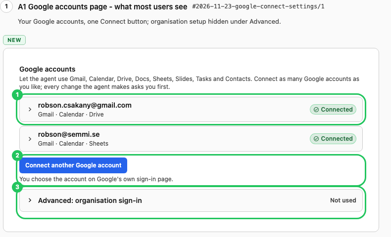
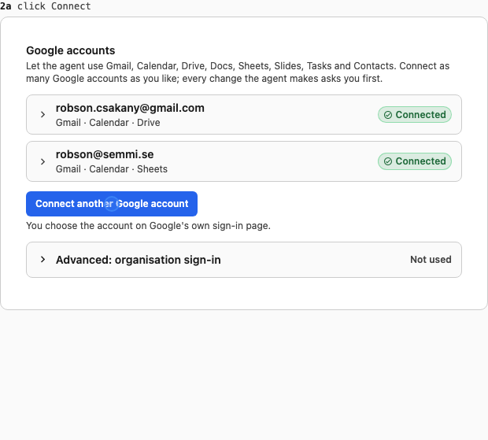
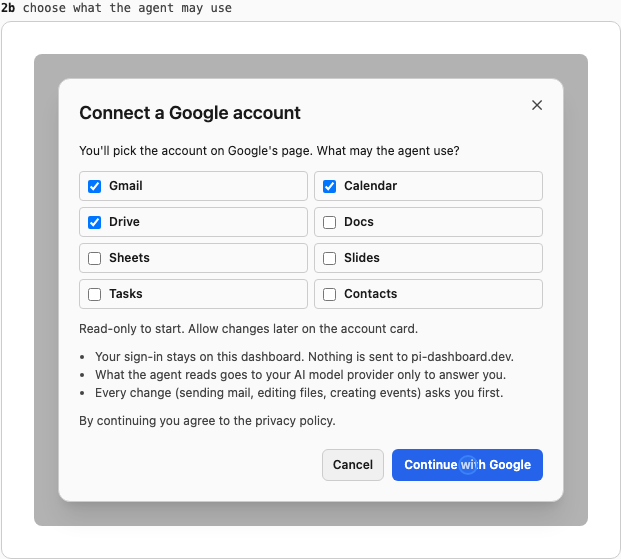
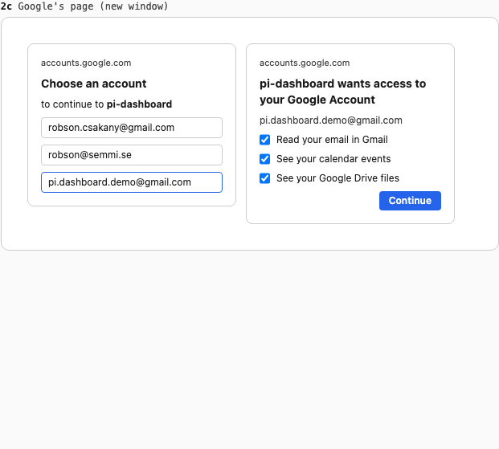
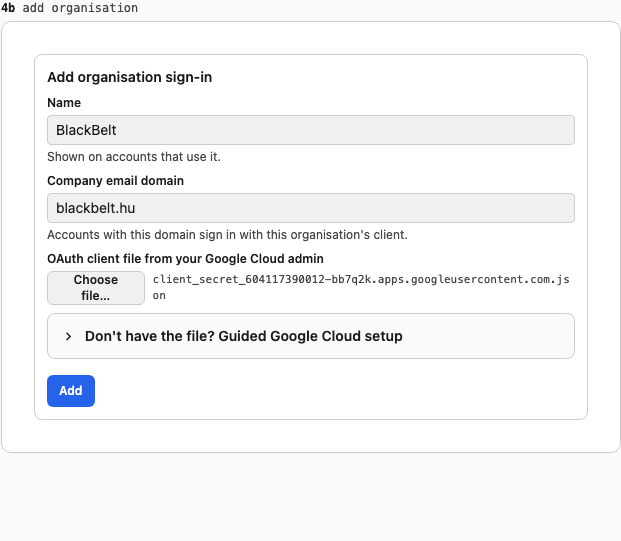
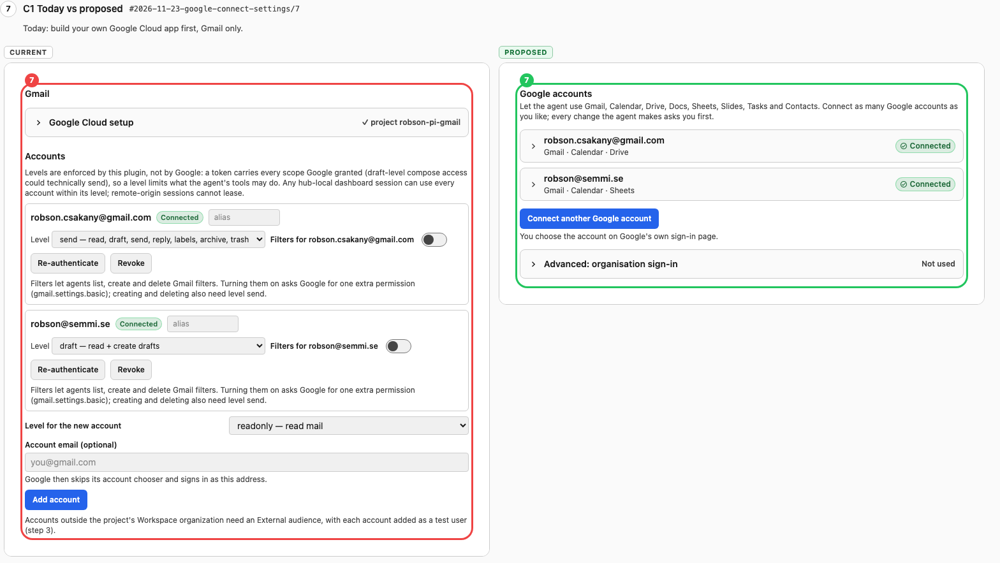
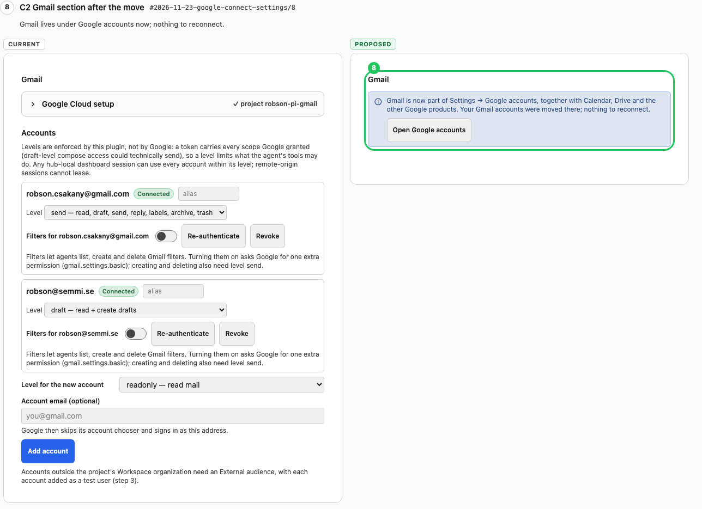
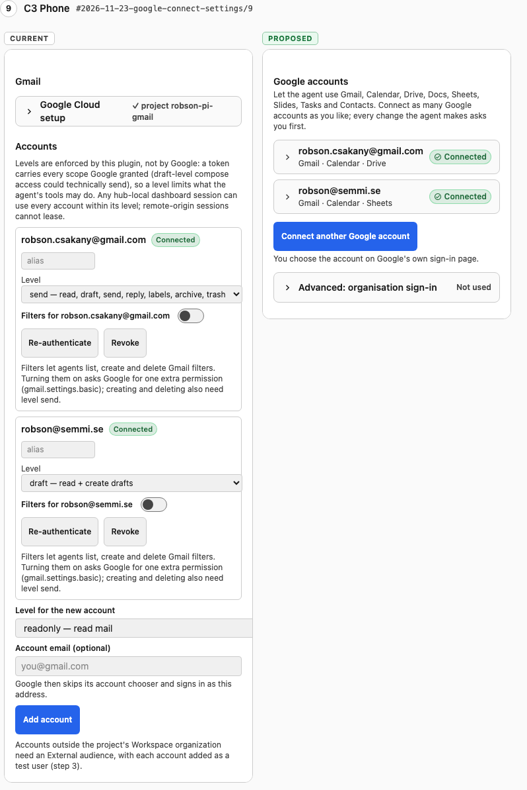
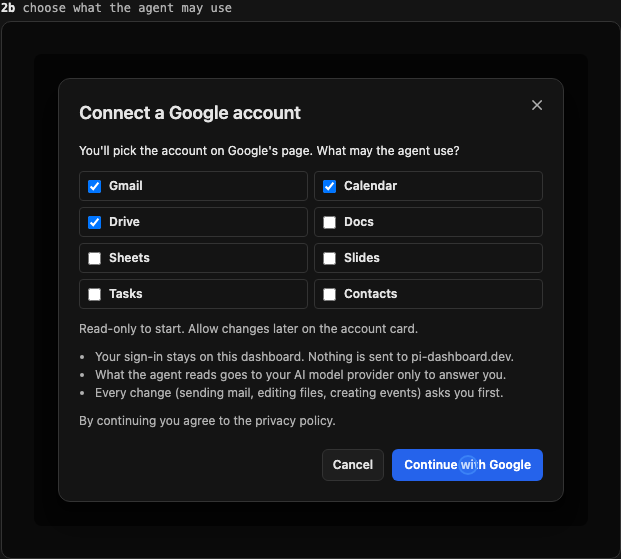
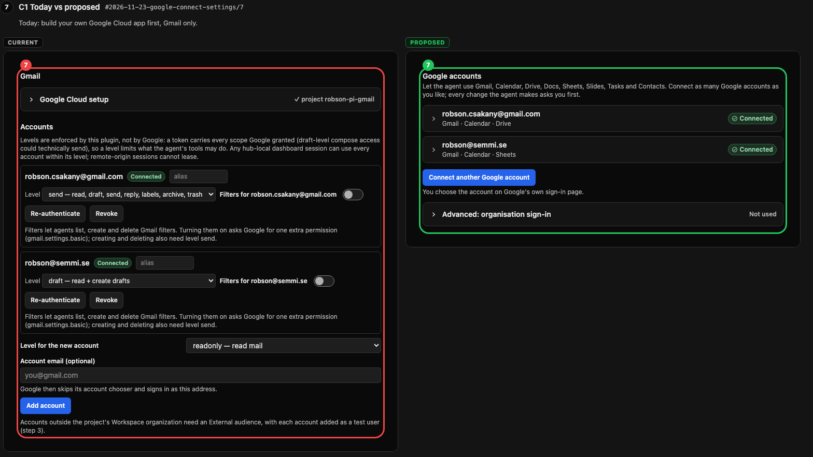

# Google accounts — mockup

How connecting Google works for a pi-dashboard user. Read top to bottom: **A** is what almost everyone sees, **B** only matters for companies whose Google admin requires their own sign-in, **C** compares with today.

Green numbered rings mark what is new. Google's own pages in A2 are drawn only for orientation — Google shows them, not the dashboard.

---

## A. What most users see

### A1 · The Google accounts page
Your own Google accounts (as many as you like), one **Connect another Google account** button. Organisation setup is folded away under *Advanced*.

### A2 · Connect another Google account
Same as connecting Google Drive or Gmail in other apps.

**Step 1.** Click **Connect another Google account**.

**Step 2.** Tick what the agent may use (read-only to start) → **Continue with Google**.

**Step 3.** Google opens its own page: pick any of your Google accounts and allow access.

**Step 4.** The dashboard waits. The Google window closes and you come back here automatically — also when the dashboard runs on another computer (via the pi-dashboard.dev return page). A fold-out keeps the paste fallback.

**Step 5.** Done.

**Step 6.** The new account appears in the list.

### A3 · Change what the agent may use
Open an account card and pick a level per Google product. Turning something new on asks Google once, only for that.

**Step 1.** Open the card, set Slides to *Read*.

**Step 2.** Google needs your OK for Slides → **Continue with Google**.

**Step 3.** Slides is on; everything else unchanged.

---

## B. Organisations only (most users never open this)

### B1 · Organisation sign-in
For a company whose Google Workspace admin requires its own Google Cloud sign-in: open *Advanced*, add the organisation's file and email domain.

**Step 1.** Open *Advanced: organisation sign-in*.

**Step 2.** Add the organisation (name, company domain, client file from the admin).

**Step 3.** Accounts of that domain now show “organisation sign-in: BlackBelt”.

### B2 · Connecting when an organisation is set up
Only then does the dialog show a *Sign in with* choice.

### B3 · A company blocks pi-dashboard.dev
Plain message: ask the admin, or set up organisation sign-in.

---

## C. Compared with today

### C1 · Today vs proposed
Left (red): today you first build your own Google Cloud app, and only Gmail works. Right (green): connect any Google account.

### C2 · The Gmail section after the update
Gmail moved into Google accounts; nothing to reconnect.

### C3 · Phone

---

## Dark theme

