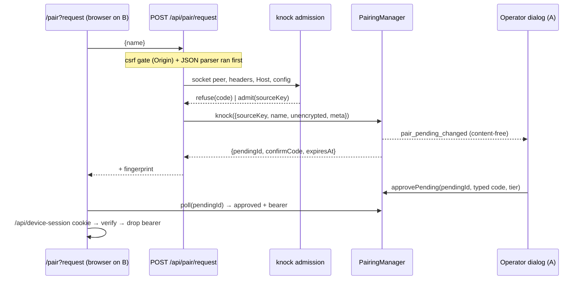

## Context

See proposal.md for motivation. Current state that shapes the approach:

- `PairingManager` (`packages/server/src/pairing/pairing.ts:173`) keys every pending device off a one-time **code entry** (`codes: Map<code, PairingCodeEntry>`, one pending slot per entry). Approve/deny/lockout/expiry/poll and the content-free `pair_pending_changed` hint all hang off that entry. There is no global pending cap today: entries are minted only by an operator (`GET /api/pair/payload`, `pairing.ts:289-295`), which bounds them. The lockout budget (`MAX_APPROVE_ATTEMPTS = 5`, `pairing.ts:55`) is per pending entry.
- Public device routes are listed in `PUBLIC_PAIRING_PREFIXES` (`routes/pairing-routes.ts:40-44`) and skipped by the auth hook (`auth-plugin.ts:444`) and the network guard (`server.ts:2924` `getPairingPrefixes`).
- A global `onRequest` mutation-origin gate (`auth/mutation-origin-gate.ts:34-54`) already refuses every non-GET `/api/*` request with an untrusted `Origin` (`403 untrusted origin`); an absent `Origin` passes. In host-gate report mode, same-origin-by-Host skips Host admission (`auth/cors-origin.ts:230-236`), which is why operator pairing routes re-check Host admission in enforce semantics (`pairing-routes.ts:90-127`, error `host_not_admitted`).
- Peer-address helpers live in `auth/localhost-guard.ts` (`isRelayedLoopback`, `hasProxyForwardingHeaders`, `isTrustedSource`, `matchCidr`, `ipToNum`, `netmaskToCidrBits`, `networkAddress`). `matchCidr`/`ipToNum` are IPv4-only (`localhost-guard.ts:265-290`). No private-range or IPv6 predicate exists.
- QR approval defaults the bearer tier to `defaultTierForSource("pairing")` = `operate` (`shared/src/tiers.ts:45`). `/api/pair/approve-pending` takes no tier (`pairing-routes.ts:316-340`); `/api/pair/approve` does.
- Browser pairing (`PairLanding.tsx`) verifies the server identity via `challengeIdentity` (WebCrypto), which is unavailable in a non-secure context (`http://192.168.x.y`).
- Browser bearer storage exchanges the bearer for the httpOnly `pi_dash_device` cookie (`lib/pairing/device-auth.ts:66-90` → `POST /api/device-session`) and clears the bearer on a 200. The cookie's `Secure` flag comes from a global, request-independent `isSecure()` (`server.ts:1967` → `auth/bearer-auth.ts:102-108`). `poll()` serves the bearer exactly once (`pairing.ts:488-492`).
- `surface-operate-required-remedy` (active, not archived) owns the `operate-required-remedy` capability; its main spec does not exist yet.

## Goals / Non-Goals

**Goals:**
- One pending-device lifecycle for QR and knock; the knock adds only an entry point, admission gates, provenance and a tier choice.
- Admission is decided by socket peer, Host admission, forwarding headers and server state, never by requester-supplied text.
- Default posture unchanged for existing installs (`acceptLanRequests` off).

**Non-Goals:**
- The Electron "connect to discovered server" window (owned by `add-electron-server-windows`; this change ships the client helper it consumes).
- The `request-access` remedy on `operate_required` refusals (deferred, see D10).
- Encrypting the LAN channel, or LAN-scoping knock-issued bearers (offered during doubt review, declined).
- A device-side withdraw route (user decision: no Cancel on the waiting page).
- New health counters (none exist for pairing; logs only).

## Decisions

### D1 — A knock is an internal code entry with provenance
`PairingManager.knock({ sourceKey, name, unencrypted, meta })` mints a random code entry exactly like `createPayload()` (never returned to anyone), marks it `provenance: "knock"`, and immediately fills its pending slot like `redeem()`. Approve/deny/lockout/expiry/poll and the change hint are reused. New manager state: `sourceKey` per knock entry, `liveKnocks()`, and the resolution callback (D12). `PendingDeviceView` gains additive `provenance`, `requesterName?`, `unencrypted?`.
*Alternative:* a separate knock store with its own lifecycle. Rejected: it would duplicate the compare-code, lockout and expiry logic the spec requires to be shared.

### D2 — Admission is a pure function plus a small limiter
`pairing/knock-admission.ts` exports `admitKnock(input, state) → { ok, sourceKey } | { ok:false, error, status, retryAfter? }` evaluating gates in the spec's order, and `KnockLimiter`: per-source sliding window (5 admitted / 10 min), deny/lockout cooldown (10 min), a **global** window (10 admitted / 10 min, so address rotation cannot sustain prompts), bounded map with LRU eviction. Only admitted knocks enter the windows; refusals are bounded by the throttled logger. The rate gate runs before the pending gate, so a re-knock right after a deny reports `knock_rate_limited`, not `knock_pending`. "Live" = admitted and not yet approved/denied/locked out/expired — `liveKnocks()` compares `expiresAt` itself (the existing `isLive`, `pairing.ts:205-206`, ignores expiry until `sweep()` runs); the 30 s post-resolution poll window (`RESOLVED_POLL_WINDOW_MS`, `pairing.ts:414-417, 473-476`) is not live. Live-per-source and global-live counts are read from the manager (`liveKnocks()`) on every call, so live state cannot drift from the manager. Only the window and cooldown live in the limiter. Gate order: Host admission, `knock_not_lan`, `knock_disabled`, rate, pending, busy — an off-link caller never learns the toggle state.

### D3 — Any forwarding header refuses the knock; header-less forwarders are out of reach
This is stricter than `isTrustedSource`, which only distrusts *relayed loopback*. Without it, a LAN reverse proxy (`peer 192.168.16.5`, `X-Forwarded-For: 203.0.113.9`) would launder an internet caller into a private source. Reuses `hasProxyForwardingHeaders` (core list). Loopback peers are refused too: a genuinely local caller is already trusted and has no use for a knock. The e2e harness therefore knocks from the docker bridge address, not loopback.
**Limit (accepted):** a header-less forwarder on the LAN (`socat`, `ssh -L`, NAT hairpin, nginx without `proxy_set_header`) is indistinguishable from a LAN device. Whoever runs one has already bridged the LAN. The operator still sees the forwarder's address and must type the code.

### D4 — On-link private predicate, IPv6 parsing and source key in `localhost-guard.ts`
Add `isOnLinkPrivate(ip, interfaces)`: private range (spec list) **and** inside the subnet of an address of a non-internal interface (`os.networkInterfaces()`) that the server's bind address covers (`resolveBindHost`; a wildcard bind covers all). IPv4 reuses `networkAddress`/`netmaskToCidrBits`; IPv6 uses a new prefix compare. Also add `knockSourceKey(ip)` and a minimal IPv6 parser (expand `::`, unwrap `::ffff:a.b.c.d`, strip `%zone`).
- **On-link** excludes point-to-point VPN/tailnet peers (`100.64/10` on a `/32` utun) and CGNAT neighbours. It does **not** exclude peers on any other served subnet: docker/VM bridges (`172.17/16`) and VPN interfaces with a real prefix (WireGuard `10.8.0.1/24`) are on-link. Accepted (Risks); the landing copy says "same local network" as the closest plain-language approximation.
- **Source key** = full address (IPv6 without zone). A `/64` key would make every device behind one router collide on `knock_pending`. IPv6 privacy-address rotation is bounded by the global cap instead.
- A missing `remoteAddress` fails closed (`knock_not_lan`).
- The route uses `request.socket.remoteAddress` for admission **and** records that same value as the pending device's remote address, so admission and the dialog agree. `trustProxy` stays off by convention; this keeps the knock immune if it is ever enabled.

### D5 — Reuse the CSRF gate; add Host admission in enforce semantics
There is no knock-specific Origin gate. The global mutation-origin gate already refuses foreign-origin browser POSTs before the handler runs, so a bespoke `knock_cross_origin` check would be dead code. The remaining drive-by path is DNS rebinding in host-gate report mode (Origin == Host == `evil.test`). Calling `isHostAdmitted(host, hostAdmission())` directly — the check `createOperatorGuard` performs at `pairing-routes.ts:121`, not the guard itself, which 401s every non-operator — closes it (`host_not_admitted`). Non-JSON bodies get Fastify's `415`. The landing maps all three to a generic refusal message.

### D6 — Unencrypted flag from the socket
`unencrypted = !(request.raw.socket as TLSSocket).encrypted`. Forwarded requests are already refused (D3), so no proxy can claim TLS on the knock's behalf.

### D7 — Operator picks the tier; default `operate`
`/api/pair/approve-pending` gains an optional, validated `tier`, using the same `isTier` check as `/api/pair/approve`. The knock dialog shows a radio group with the `TIER_OPTIONS` copy (`components/connectivity/PairedDevicesSection.tsx:46-50`), preselecting `operate`. That default serves the motivating case (Vault on a second machine), and tiers are fixed at pairing; least privilege stays one click away. The QR dialog is unchanged. Decided with the user during doubt review.

### D8 — Cleartext threat model (doubt-driven review)
Over plain http, a passive LAN observer can capture the bearer from the poll response or any later request. An active MITM can relay the knock and race the poll; the compare code does not stop a faithful relay. The captured bearer is long-lived (cookie ~400 days) and accepted from any network, including through the tunnel.
Accepted (user decision, doubt review cycle 1), because:
- the feature is opt-in (default off);
- the dialog and the landing label it;
- the operator can pick a lower tier (D7);
- bearers are individually revocable in Paired devices;
- it replaces `trustedNetworks` bypass, which gives the same LAN position access with no credential at all.
LAN-scoping unencrypted-knock bearers was offered and declined. TLS (or a tunnel) remains the recommended path, and the QR payload stays TLS-only (D14 of `add-server-keypair-pairing` unchanged).

### D9 — Browser landing skips the identity challenge (TOFU)
`/pair?request` runs same-origin: the page and the routes come from one server, so pinning a fingerprint proves nothing. WebCrypto is also unavailable on `http://<lan-ip>`. Request mode must avoid the other secure-context-only APIs too (`crypto.randomUUID`, `navigator.clipboard`).
Consequence (accepted): a browser that reaches an impostor at that address pairs with the impostor, and an on-path relay over http is not detectable either. The impostor could come from a spoofed mDNS answer behind Connect, or from a typed address. This is trust on first use, the same as typing any LAN URL. Native/cross-origin clients use `knockServer()` (D11), which verifies the advertised fingerprint. That defeats an impostor answering at the discovered address; it does not defeat an on-path relay over plain http, which forwards the challenge to the genuine server (D8).

### D10 — `request-access` remedy on `operate_required` deferred; presence rule fixed now
Scope note: the network-denied banner's Request access action ships in THIS change (`connection-status-banner` delta), unconditionally — the client cannot evaluate the peer gate, so a tunnel/internet caller sees it and gets `knock_not_lan` with a pointer to QR. It targets the server that denied (same origin → navigate; another active server → open that server's `/pair?request`). Only the `operate_required` remedy is deferred, because a MODIFIED delta against `operate-required-remedy` cannot validate until `surface-operate-required-remedy` archives.
Rule for that follow-up: include `request-access` iff the caller presents **no credential** AND its peer passes the `knock_not_lan` gate. The rule does not depend on `acceptLanRequests` or knock state, so the remedy reveals only the caller's own network position. This is a deliberate **exception** to `canDiscloseAccessPosture` (authenticated or genuinely local only, `localhost-guard.ts:106-112`), not an application of it; the follow-up must carry a MODIFIED delta against `trust-and-credential-boundaries` ("Access-posture disclosure keeps its existing predicate") to record it.
Separately, the knock's refusal codes do disclose posture (toggle state, waiting/busy) to on-link callers; that is accepted, see Risks. Until the follow-up, the Vault-case user reaches the knock via the banner, Network Discovery ▸ Connect, or `/pair?request`.

### D11 — `knockServer()` client helper for native consumers
`lib/pairing/knock.ts` exports `knockServer(baseUrl, expectedFingerprint, name, hooks)`. Flow: challenge → compare to the discovered `fp` → knock → poll → verify the response `fingerprint` → return the bearer. It uses `pair-protocol.ts` primitives, is unit-tested here, and is wired into Electron by `add-electron-server-windows`.

### D12 — Cooldown via manager callbacks on every resolving path
Knock entries store their `sourceKey`. The manager emits `onKnockResolved(sourceKey, outcome)` from each resolving path:

| Path | Outcome |
|---|---|
| `deny()` | `denied` |
| lockout branch inside `approve()` | `locked_out` |
| match branch inside `approve()` | `approved` |
| `sweep()` expiry | `expired` |

The limiter starts the 10-min cooldown on `denied`/`locked_out` and ignores `approved` and `expired`; approved knocks stay in the 5-per-10-min window, exactly as the spec's gate counts admitted knocks. Live-slot accounting needs no callback (D2 reads it from the manager).

### D13 — Throttled refusal logging
`[pairing] knock admitted id=<8>` per admission. Refusals go through a per-reason throttle: first line immediately, the rest of the 60 s window suppressed, and an unref'd timer at the window's end logs `suppressed=<n>` when n > 0. The interface list for the on-link check is cached (30 s TTL) so a refusal flood does no per-request syscall. Lines never carry an address, name, UA or code (existing D7 rule). The pre-existing `[csrf-gate]` log for foreign-origin POSTs is unchanged and out of scope.

### D14 — Toggle in Gateway, live config
`pairing.acceptLanRequests` is added to `PairingConfig` (default `false` in the loader). The Gateway "Connect a device" surface writes it through the existing config write route (`PUT /api/config`, `system-routes.ts:519`) with that route's existing authority (network guard + route-tier gate) — the same authority that already governs `trustedNetworks`; this change adds no per-field guard. The route reads the live config snapshot per request, so no restart is needed. The request-page URLs are the `kind: "lan"` endpoints the Gateway already lists (`tunnel/tunnel-endpoints.ts:20-30`, non-internal IPv4 only, plain http) plus `/pair?request`; tunnel, `localhost` and public entries are excluded. IPv6 knocks stay admitted but get no listed URL (typed URL or Connect).

### D15 — Device cookie `Secure` follows the request's transport
Specified as an ADDED requirement of `bearer-device-auth` (the capability that owns the cookie), not of `lan-knock-pairing`. The exchange drops `Secure` only for a direct plain-http connection from a peer outside `isLoopbackRange` (`auth/loopback.ts`); every other case keeps the global `isSecure()` (resolved base), so the tunnel / TLS-reverse-proxy path (plain http on the loopback hop) still gets a `Secure` cookie, consistent with `oauth-authentication` "Session cookie `Secure` flag derives from the resolved base" (which governs the session cookie and stays unchanged; `trustProxy` stays off). Without this, on an https-configured install a browser paired over `http://<lan-ip>` receives a `Secure` cookie it silently drops. The client then wipes the single-use bearer, and the device is locked out. Belt and braces on the client, in the shared `finishDevicePairing` (`lib/pairing/device-auth.ts:63-90`) so QR and knock follow one policy: discard the stored bearer only after a cookie-only authenticated `/api/` request succeeds; otherwise keep it and say so.

### D16 — Requester name: strip, then truncate
Remove Unicode `Cc`/`Cf` characters (bidi overrides, zero-width) — and, from the implementation audit, also `Cs`/`Co`, line/paragraph separators (`Zl`/`Zp`) and the blank-rendering Hangul fillers (U+115F, U+1160, U+3164, U+FFA0), a superset that stops an invisible or multi-line name — trim, and truncate to ≤64 UTF-8 bytes on a character boundary. Truncating rather than dropping matches the sibling UA/host fields. The result always passes approve-pending's 1..64-byte label rule, so the prefill can never make approval fail.

### D17 — Non-secure-context audit of the client
A knock pairs the whole SPA onto `http://<lan-ip>`, a non-secure context. Scope: `packages/client` and `packages/client-utils` (plugin client bundles — e.g. `gmail-plugin`, `kb-plugin`, `deck3d` — are a known follow-up). `client-utils/src/identity/dpop.ts:31,35,63` uses `crypto.subtle` unguarded; DPoP needs a secure context, so it gains a capability check that reports DPoP unavailable instead of throwing (the sibling `pkce.ts:110` already guards). About 20 client call sites use secure-context APIs directly today (e.g. `components/settings/SettingsPanel.tsx:596` `crypto.randomUUID()`; `components/settings/ModelProxySection.tsx:241`, `components/packages/plugin-row-parts.tsx:94`, `components/Gateway/GatewayPairQR.tsx:262` `navigator.clipboard.writeText`); `lib/util/clipboard.ts` is the guarded helper and `lib/pairing/pair-protocol.ts` legitimately uses `crypto.subtle` for QR pairing, which only runs in a secure context. Route them through one helper each (a `randomUuid()` helper: `crypto.randomUUID` when present, else an RFC 4122 v4 UUID from `crypto.getRandomValues`, which non-secure contexts keep — so `spawn-correlation`'s "client SHALL generate a UUIDv4" holds; the existing guarded `lib/util/clipboard.ts`, which still calls `navigator.clipboard.writeText` when present, as `dashboard-plugin-loader` and `doctor-diagnostic` expect) and add a source-scan test that forbids new bare uses outside those helpers. The same bugs already hit trusted-network LAN users; this change makes the path first-class, so it fixes them.

## Risks / Trade-offs

- [Cleartext bearer on LAN, long-lived and usable anywhere] → opt-in, labelled in dialog + landing, tier choice, revocable; TLS recommended; LAN-scoping declined by the user (D8).
- [Header-less LAN forwarder bridges outsiders in] → undetectable server-side; the operator sees the forwarder's address and must type the code (D3).
- [Operator habituation to prompts] → typed compare-code unchanged; global cap 3, per-source 1 live, 5 per 10 min, 10-min deny/lockout cooldown.
- [Address aliasing evades the per-source cooldown; 3 squatted slots block the feature for others for ≤300 s] → global concurrency cap (3) **and** global rate (10 admitted / 10 min) bound prompts regardless of source; the operator can turn the switch off in Gateway at once. Accepted for an opt-in LAN feature.
- [On-link admits docker/VM bridges and real-prefix VPN subnets] → a container or VPN peer on a served subnet can knock; the operator still sees its address and must type the code; binding the server to one interface narrows it (D4).
- [An operate-tier paired device can flip `acceptLanRequests`] → same authority as `trustedNetworks` today; an operate device already has full control (D14).
- [Refusal codes disclose posture to on-link callers: the toggle state, and that someone is waiting (`knock_busy`)] → only after Host admission + `knock_not_lan`; mDNS already advertises the server to the same audience; the requester needs the reason to act.
- [Browser landing is TOFU] → the same as typing any LAN URL; native clients verify (D9, D11).
- [Connect opens the peer's LAN URL with `http://`, built from server-side discovery] → a browser not on that LAN (e.g. a phone via tunnel), or a TLS-only peer, gets an unreachable tab. Accepted: discovery rows describe the server's LAN.
- [Server in a bridge-networked container (the shipped `docker/compose.yml`; Docker Desktop / userland proxy)] → every request arrives from the bridge gateway address: the on-link gate admits anyone who can reach the published port, the dialog shows one address for all requesters, and per-source limits act as one global lock. Accepted (user decision, doubt review cycle 3): documented only (`docs/` + FAQ, task 9.4), no UI change; host networking or a TLS tunnel restores real addresses.
- [Lost request page] → the landing keeps `pendingId`/`confirmCode` in session storage, so a reload resumes; a closed tab leaves the slot until expiry (≤300 s).
- [Refusal flood costs CPU on a public route] → admission is cheap (cached interface list, no crypto); throughput is bounded by the server, as for the existing public `challenge` route.
- [No device-side withdraw] → a mistaken knock holds its slot for ≤300 s (user decision: no Cancel).
- [Request-mode regressions in an insecure context] → unit test with `crypto.subtle`/`randomUUID` undefined.

## Migration Plan

- Additive: new route, new optional config field (absent = `false`), additive pending-view fields (absent `provenance` = `qr`), additive optional `tier` on approve-pending. Existing QR clients unchanged.
- Behaviour change: a direct plain-http, non-loopback device-session exchange now gets a non-`Secure` cookie (D15); https and tunnel exchanges are unchanged. QR browsers now keep their bearer until the cookie is proven (D15) — invisible when the cookie works.
- Behaviour change: secure-context-only API calls in the client gain fallbacks (D17); no change in secure contexts.
- Deploy: server restart (`/api/restart`) + client build. No data migration.
- Rollback: turn the switch off (immediate) or revert the change. Already-issued knock bearers remain valid and revocable from Paired devices.
