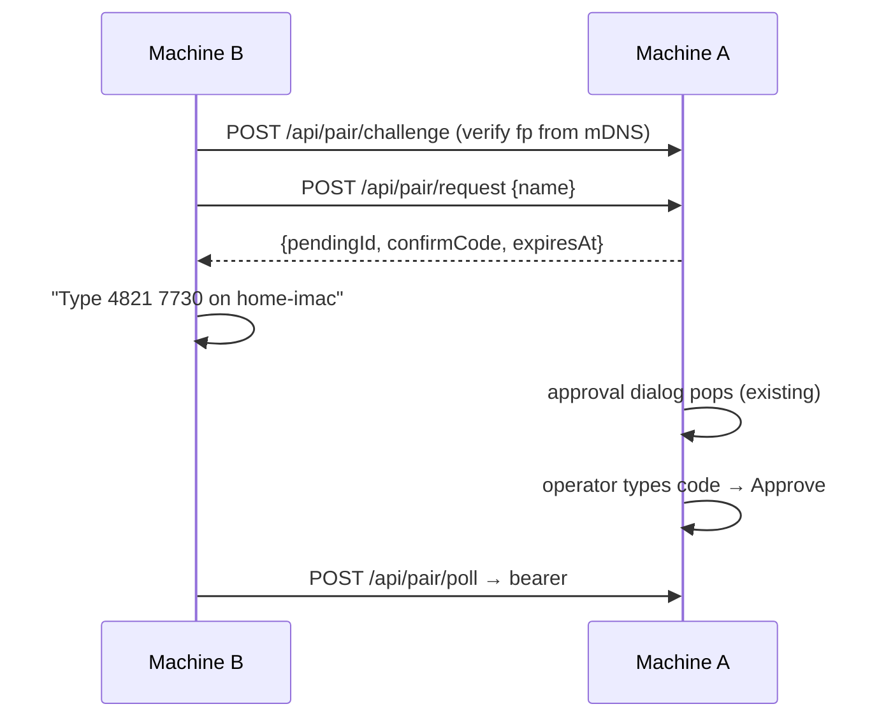

## Why

Pairing a device with a dashboard is backwards for the LAN case. Today machine A's operator must open Gateway, mint a QR / deep link (`GET /api/pair/payload`), and carry it to machine B, which redeems it. And the payload admits only `https`/`wss` endpoints (`add-server-keypair-pairing` D4/D14), so a server discovered on the LAN at plain `http://192.168.x.y` yields "No reachable endpoint" — LAN pairing is impossible without a tunnel or a publicly-trusted certificate.

The user's mental model is the reverse: **B discovers A → clicks Connect → A shows an Allow dialog → B shows a PIN to type on A.** The approval half already exists (`add-pairing-approval-dialog`: app-wide dialog, typed 8-digit compare-code, deny, lockout, pending feed, `poll`). Only the device-initiated entry point and the LAN transport are missing.

## What Changes

- **Knock route `POST /api/pair/request`.** Unauthenticated, code-less. Creates a pending device directly (internally a single-use code bound to that pending entry), records redeemer metadata plus an untrusted requester `name`, and returns `{pendingId, confirmCode, expiresAt, fingerprint}`. From there the existing flow applies unchanged: app-wide dialog, typed compare-code, deny, lockout budget, pushed expiry, `poll` → bearer.
- **Admission gates for knocks** (an unsolicited prompt is a nuisance/phishing vector):
  - setting `pairing.acceptLanRequests` (operator-toggleable in Gateway/Access settings);
  - peer address in a private range (RFC 1918, CGNAT/Tailscale `100.64/10`, link-local, IPv6 ULA) and **not** relayed loopback (reuse `isTrustedSource` rules from `fix-trusted-network-tunnel-bypass`);
  - one live knock per source address; knocks count against the existing pending cap; per-address rate limit with backoff.
  Each refusal returns a distinct error code so B can explain it.
- **Plain-http LAN transport for this entry point only.** The QR/deep-link payload keeps D14 (TLS-only). The approval dialog and B's waiting screen label a knock over plain http as **unencrypted on this network**.
- **Dialog provenance.** The approval dialog distinguishes a knock ("Roberts-MacBook-Pro on 192.168.16.31 asks to connect") from a QR redemption; requester name is display text only, never an authorization input.
- **Browser "Request access".** When a browser on a private-range address hits A without credentials (network denied), A's page offers **Request access**: it runs the knock same-origin, shows the PIN, polls, then exchanges the bearer for the httpOnly `pi_dash_device` cookie (`POST /api/device-session`). Settings ▸ Network Discovery gains **Connect** on a discovered server, which opens that server's own origin on this landing.

- **Request access from an `operate_required` refusal.** Depends on `surface-operate-required-remedy`, which gives `operate_required` 403s an extensible `remedies` list and a Vault callout, deliberately without a knock remedy. This change MAY add `request-access` (and a callout row whose action starts the knock) through a MODIFIED delta of `operate-required-remedy`. Open: its presence rule must not disclose `pairing.acceptLanRequests` or per-address knock state to a credential-less caller (`canDiscloseAccessPosture`); decide the rule and its disclosure analysis when this change is planned.

## Capabilities

### New Capabilities
- `lan-knock-pairing`: device-initiated pairing request — route contract, admission gates, plain-http LAN labelling, "Request access" landing.

### Modified Capabilities
- `qr-device-pairing`: pending devices gain a provenance (`qr` | `knock`); the app-wide approval dialog and pending feed render knock provenance; the transport rule for the knock entry point is scoped separately from the payload's TLS-only rule.
- `known-servers`: Network Discovery rows gain a Connect action that opens the peer's pairing landing.

## Discipline Skills

- `security-hardening` — new unauthenticated endpoint that raises an operator prompt (flooding, social-engineering via requester name), bearer issued over cleartext LAN, admission by peer address (relayed-loopback/forwarded headers).
- `doubt-driven-review` — relaxes the TLS-only stance (D4/D14) for one entry point; review the threat model before it stands.
- `observability-instrumentation` — log knock admitted/refused (reason) without codes; extend pairing health counters.
- `review-code` — before commit.

## Impact

- **Server:** `packages/server/src/pairing/pairing.ts` (knock entry, provenance, per-address slot), `packages/server/src/routes/pairing-routes.ts` (`/api/pair/request`, admission gates), `packages/server/src/auth/localhost-guard.ts` (private-range + relayed-loopback predicate reuse), config field `pairing.acceptLanRequests` in `packages/shared/src/config.ts`.
- **Client:** `components/pairing-approval/` (provenance + unencrypted label), `components/connectivity/PairLanding.tsx` (Request access mode), network-denied surface, `NetworkDiscoverySection.tsx` (Connect).
- **Protocol:** additive route + additive `provenance` field on pending views; existing QR flow and its clients unchanged.
- **Rollback:** disable `pairing.acceptLanRequests` or revert the route; issued bearers stay valid and revocable from Paired devices.
- **Sequence:** 2 of 4 — depends on `stabilize-mdns-server-identity` (fingerprint in TXT for B's identity check); consumed by `add-electron-server-windows`; prerequisite for `retire-trusted-networks-bypass`.
