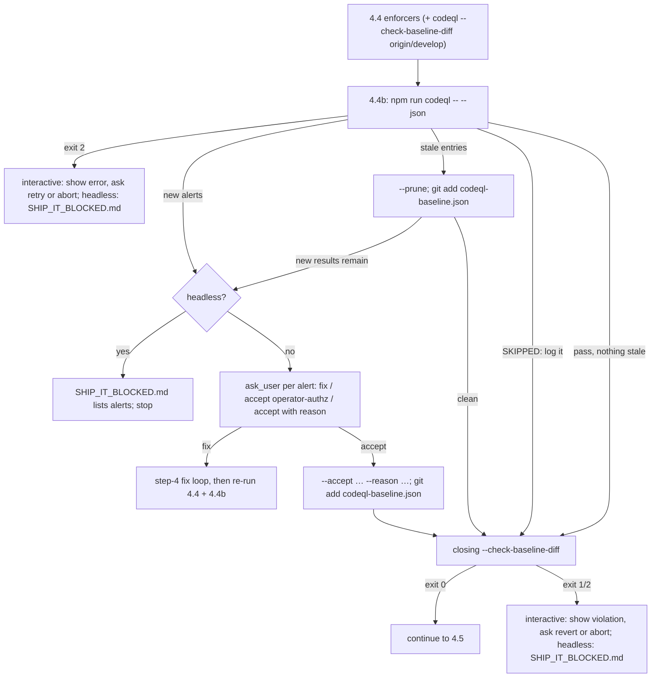

## Context

- GitHub default setup (queried via `gh api …/code-scanning/default-setup`):
  configured languages `actions`, `javascript`, `javascript-typescript`,
  `python`, `typescript` (analyses use three categories); suite `default`;
  threat model `remote`; weekly. Analyses carry categories
  `/language:actions`, `/language:javascript-typescript`, `/language:python`,
  tool CodeQL 2.27.2, and run on `refs/heads/develop` (default branch) and PR
  refs. GitHub rejects advanced-setup SARIF uploads while default setup is
  enabled.
- `develop` alert states (re-derived at implementation): ~190 open, 38
  dismissed, ~110 fixed; analyses span CLI 2.26.2–2.27.2.
- Local vs GitHub on the same commit: the spike matched 221/222 local results
  to GitHub alerts; a later review run at `aa451c6e9` found 28 local results
  with no GitHub alert and GitHub path-injection results in
  `packages/automation-plugin` with none locally. Cause unknown (candidate: the
  query-pack versions bundled with GitHub's CLI, which the API does not expose).
  Seeding is gated on measuring this (D9).
- Spike (`/tmp/cq`, CLI 2.27.2 at `/opt/homebrew/bin/codeql`): suites
  `codeql/javascript-queries:codeql-suites/javascript-code-scanning.qls` and
  `codeql/actions-queries:codeql-suites/actions-code-scanning.qls`; the query
  packs were downloaded into `~/.codeql/packages` on first `--download`
  (javascript-queries 2.4.7, actions-queries 0.6.37), so a first run needs
  network. A plain re-analyze of an existing database returns cached results.
  With the network blocked, `analyze --download` exits 2 even when the packs are
  cached; without `--download`, pinned refs (`codeql/javascript-queries@2.4.7`)
  analyze offline. Pack versions appear in SARIF
  `runs[0].tool.extensions[].semanticVersion` as `2.4.7+<sha>`; the CLI version
  in `codeql version --format=json`.
- `primaryLocationLineHash` is `<hex>:<n>` (hex length varies). Probe (fresh
  databases): inserting a blank line or new code above a flagged line, or
  appending code far below it, leaves the hash unchanged; it covers the flagged
  line plus roughly the following 100 characters, so editing those changes it.
  The spike shifted a 23-alert file by 5 lines and all 23 hashes held.
- Existing alerts carry `analysis_key` `dynamic/github-code-scanning/codeql:analyze`;
  advanced setup will use a workflow-based key. Whether dismissals carry over
  across that change cannot be tested before the switch (GitHub rejects advanced
  uploads while default setup is on).
- `codeql database create --codescanning-config` contacts the package registry
  even with packs cached (offline: exit 2, "Could not get tags"), and so does
  `codeql pack download`. Offline-safe (probed with the network blocked): the
  JavaScript extractor's `LGTM_INDEX_FILTERS` env var — the mechanism
  codeql-action uses for `paths-ignore` on interpreted languages — with
  `exclude:<glob>` lines (a trailing `/**` is rejected and must be dropped);
  `codeql resolve queries <pack@ver:suite>` (exit 0 when cached, 2 when not);
  `database analyze` with a pinned suite and no `--download`.
- The CLI's default threat model is `default`, whose group contains `remote`
  (`threat-models` pack `threat-model-grouping.model.yml`), i.e. the same as
  default setup's `remote`; the script passes `--threat-model=remote` anyway.
- ship-change commits with `git add -A` (`.pi/skills/ship-change/SKILL.md:100`),
  so untracked-unignored files in the worktree reach the PR and CI.
- `ci.yml` installs dependencies, but code scanning does not: default setup and
  the advanced workflow below run with `build-mode: none` and no install step.
- `scripts/` holds ~80 non-test JS/TS files (re-derived at implementation),
  some run by `publish.yml` / `nightly.yml` with publish-scope tokens.
- `.github/codeql/extensions/cwd-guard.model.yml` exists; spike runs with and
  without it produced identical results on `develop`.
- Precedent: `scripts/knip-ratchet.mjs` + root `knip-baseline.json`
  (debt ceiling; `--check-baseline-diff <ref>`; missing or malformed baseline is
  a hard error; pure decision functions exported for tests), invoked in ship-it
  step 4.4. Step 4.4 is specified as cheap, offline and near-instant
  (`ship-it-orchestrator`, `code-quality-loop` "The owned enforcers gate where a
  gate actually runs"); a ~3-minute analysis does not fit it.
- Universal network guard: `createNetworkGuardHook`
  (`packages/server/src/auth/localhost-guard.ts`) is one deny-by-default root
  `onRequest` hook over `/api/`; trusted-CIDR callers are admitted without
  login.

## Goals / Non-Goals

**Goals:** one CodeQL configuration shared by CI and local runs; a local gate
that blocks new alerts at ship time; accepted debt recorded with reasons and
only ever shrinking unless a reason is given; dismissal history preserved.

**Non-Goals:** see proposal (Python locally, CI baseline gating, model
extensions, git hooks, GitHub dismissals, `quality:changed`).

## Decisions

### D1 — Advanced setup, categories identical to default setup

`.github/workflows/codeql.yml`: triggers `push` (branches `develop`),
`pull_request` (branches `develop`), `schedule` (weekly); `permissions:
{contents: read, security-events: write, actions: read}`; matrix
`language: [actions, javascript-typescript, python]`, `build-mode: none`;
`github/codeql-action/init` with `config-file: ./.github/codeql/codeql-config.yml`
and `github/codeql-action/analyze` with `category: /language:${{ matrix.language }}`;
action major version taken from GitHub's current advanced-setup template at
implementation time; `actions/checkout@v4` as in every other workflow. No
cache step (avoids a new `actions/cache-poisoning` site).

`.github/codeql/codeql-config.yml`:
```yaml
name: pi-dashboard
queries: []            # suite defaults: code-scanning (local) / default (CI)
paths-ignore:
  - "**/__tests__/**"
  - "**/*.test.ts"
  - "**/*.test.tsx"
  - "**/*.test.mjs"
  - "**/*.spec.ts"
  - tests/**
  - qa/**
  - "scripts/**/__tests__/**"
  - mockups/**
  - "**/mockups/**"
  - "openspec/changes/**/mockup*"
  - site/design-scratch/**
  - "**/e2e/**"
```
Real scripts stay analyzed (user decision: they run in CI with secrets). The
exact glob list is re-derived at implementation from the then-open alerts
(every ignored path must hold only test, e2e, QA or mockup / design-scratch
code; spikes and prototypes stay analyzed, as the user's exclusion list names
none; `**/*.test.*` already covers script tests). Every
glob must be expressible as an `LGTM_INDEX_FILTERS` line (D3). Threat model `remote` in both: the action's default for advanced setup and
`--threat-model=remote` locally (D3).
Fork pull requests on this public repository may lack upload permission; the
workflow is not a required check, so such a failure blocks nothing. Alternative:
keep default setup and filter locally. Rejected: CI and local would disagree
about what counts, and location noise would stay in the GitHub alert list.

### D2 — Content-addressed snapshot

The script copies the worktree's index (`git rev-parse --git-path index`,
resolved relative to `git rev-parse --show-toplevel`; it is relative in the main
worktree and absolute in a linked one) to a temp file and, with
`GIT_INDEX_FILE` pointing at it, runs `git add -A`, then
`git rm --cached -q --ignore-unmatch codeql-baseline.json`, then
`git write-tree` (an index with unmerged entries fails here → exit 2, "resolve
conflicts first"). The tree id is the **snapshot id**: it changes with any
content (or mode) edit to a tracked or untracked-unignored file, ignores
git-ignored files (`node_modules`, `dist`, `packages/electron/out`), excludes
deleted files, and does not change when only the baseline changes. The snapshot
is materialized with `git checkout-index -a --prefix=<run>/src/` from the temp
index (not `git archive`, which would honour `export-ignore`). The real index
and worktree are not modified. Including untracked-unignored files matches CI
because ship-change commits with `git add -A`. No hooks run (`git add` invokes
none); the repo has no LFS, submodules or clean filters (a future clean filter
would change snapshot bytes — documented assumption). Side effect: blob objects
for untracked files are written to the object store (reclaimed by `git gc`).

Directories: worktree state lives in `$TMPDIR/pi-codeql/<sha1(git rev-parse
--show-toplevel)>/`. A lock directory there (`mkdir`, atomic create-or-fail) holds the owner PID and
the process start time; a run acquires it first (a lock whose PID is not alive,
or whose PID now belongs to a process with a different start time, is taken
over), then deletes
older `run-*` directories, then works in `run-<pid>`; the lock is released on
exit, including on signals. A live lock makes a second analysis — or a
`--prune`/`--accept` — in the same worktree exit 2. Analysis needs roughly the
repository's size again in temp space (clone probe: 287 MB, 2 s to
materialize).

### D3 — Commands

1. Preflight (offline-safe; it may record pack references under `~/.codeql`):
   `codeql resolve queries <suite>` for both pinned
   suites, `codeql/javascript-queries@<v>:codeql-suites/javascript-code-scanning.qls`
   and `codeql/actions-queries@<v>:codeql-suites/actions-code-scanning.qls`
   (versions from the baseline header). Only if that fails, `codeql pack download
   <pack>@<v>` with a 60-second timeout per pack; if that also fails or times
   out → `SKIPPED` (D6).
2. Per language `l` in `javascript-typescript`, `actions`: `codeql database
   create <run>/db-<l> --language=<l> --build-mode=none --source-root=<run>/src
   --overwrite --threads=0` with `LGTM_INDEX_FILTERS` built from the shared
   config's `paths-ignore`: each glob → one `exclude:<glob>` line with a trailing
   `/**` removed, lines joined with `\n` (space-joining silently disables every
   exclusion; a remaining illegal `**` makes the extractor exit non-zero → exit
   2). After analysis, any result whose file matches a `paths-ignore` glob is an
   error (exit 2, "exclusion not applied"). The `actions` extractor passes the
   same variable to its JavaScript-based extractor (verified). The config is parsed by the script; `--codescanning-config` is not
   used because it needs the network.
3. `codeql database analyze <run>/db-<l> <suite> --threat-model=remote
   --format=sarif-latest --output=<run>/<l>.sarif --threads=0` (no `--download`).
   Paths are absolute; run directories are created with `mkdir -p`.

`codeql` is `$CODEQL_BIN` if set (a set but non-executable path is an error,
exit 2), else `codeql` on `PATH`. `CODEQL_BIN` is also the test seam (a fake
binary that writes fixture SARIF). Bumping the pinned pack versions is an
explicit header edit in its own change; new alerts it surfaces go through the
ratchet like any other.

### D4 — Baseline and ratchet

Root `codeql-baseline.json`:
```json
{ "_comment": "...", "version": 1,
  "codeql": "2.27.2",
  "packs": { "codeql/javascript-queries": "2.4.7", "codeql/actions-queries": "0.6.37" },
  "entries": [ { "ruleId": "js/path-injection", "file": "packages/server/src/…",
                 "lineHash": "…:1", "count": 2, "reason": "operator-authz: …" } ] }
```
Key = `ruleId` + `file` (result `locations[0].physicalLocation.artifactLocation.uri`,
percent-decoded)
+ `lineHash` (`partialFingerprints.primaryLocationLineHash`). Entries are sorted
by file, then ruleId, then lineHash, each compared by UTF-16 code units
(`a < b`); header keys are written in a fixed order; output is two-space
indented JSON with a trailing newline, so diffs are reviewable and stable. Validation (hard error, exit 2): missing file; `version ≠ 1`;
entry missing a field; `count` not a positive integer; empty `reason`;
duplicate key; a `lineHash` matching neither `^[0-9a-f]+:[0-9]+$` nor `^-@[0-9]+$`; a
`reason` that is not exactly `untriaged` and matches neither
`^(operator-authz|false-positive|accepted-risk): \S` nor
`^github-dismissed \(#[0-9]+, [^)]+\): \S`. An `operator-authz:` reason is valid only on `js/path-injection`,
`js/command-line-injection` and `js/shell-command-constructed-from-input`; a
`file` with leading or trailing whitespace is invalid. A result without
`primaryLocationLineHash` is keyed with `lineHash` `-@<startLine>` plus a
`CODEQL WARNING:` line: line-sensitive, so such a result is re-asked whenever
it moves (fail-closed rather than collapsing several results into one key).

Pack versions for the header are read from the SARIF
`tool.extensions[].semanticVersion` with the `+<sha>` suffix removed; a run
whose SARIF pack versions differ from the header is an error (exit 2), which
cannot happen while the suites are pinned.

Ratchet: for each key, `current > baseline` (absent = 0) → the excess results
are **new**. Any new → exit 1, listing rule, file, start line and message for
each. Exit codes: 0 pass / skipped, 1 new alerts or growth violation, 2 error.

`--json` prints one object on stdout: `{ status: "pass"|"new"|"skipped"|"error",
message?, versions: {codeql, packs}, newResults: [{ruleId, file, lineHash,
startLine, message}], staleEntries: [{ruleId, file, lineHash, baseline,
current}], warnings: [string] }`; human-readable lines go to stderr. Results of
keys at or below baseline (the same rule, file and line hash as accepted
entries) are by definition not new; if a fix removes one occurrence and an
identical-looking one appears (same rule, file, line content and following
context), the count is unchanged and the run passes — accepted, since the
key says the code is the same.
Pure exports for tests: `resultKeys`, `validateBaseline`, `ratchetDecision`,
`baselineGrowth`, `pruneBaseline`, `acceptEntry`.

### D5 — Growth only with a reason

`--check-baseline-diff <ref>` (static, no analysis — runs in step 4.4):
compares the working-tree baseline with `git show <ref>:codeql-baseline.json`.
`<ref>` is first resolved with `git rev-parse --verify <ref>^{commit}`; an
unresolvable ref is a hard error (exit 2), never a pass. Only when the ref
resolves and `git cat-file -e <ref>:codeql-baseline.json` fails (the change that
introduces the file) does the check pass. Both baselines are validated (D4) first; an invalid one is exit 2. Rules,
evaluated per `(ruleId, file)` group so that changing a key (an edited flagged
line, a moved file) cannot evade them:

- **Untriaged never grows.** In each group the summed count of `untriaged`
  entries SHALL NOT exceed the ref's, and a key SHALL carry `untriaged` only if
  it carried `untriaged` at the ref with an equal or higher count. Re-labelling
  an entry to `untriaged`, or a new `untriaged` key, fails.
- **Growth with a real reason is allowed** (new keys, raised counts, triage of
  `untriaged` followed by an accept in the same branch). It is not checked for
  reason quality; it is printed.
- **`--no-growth`** (used by headless ship-it): any new key or raised count
  fails, whatever its reason. A headless run therefore never grows the
  baseline; growth happens only interactively, after a user answer.
- **Seed exactness.** When `<ref>` resolves but has no baseline (the
  introducing change), the working-tree key set and every count SHALL equal the
  recorded last run's for the current snapshot; reasons may already be triaged
  in the same change. Without a matching last run the check prints `SEED:
  verification deferred to the analysis run` and exits 0 in step 4.4; step
  4.4b's closing check then has the run and enforces it.
- **Visibility.** Every entry whose count or reason changed, including removals
  (old count → 0, old reason), is printed with rule, file, old → new count and
  old → new reason.

Reason **quality** is a human-review control on the PR; the script enforces
only the vocabulary (D4) and the rules above. A hand-added entry with a valid
reason is indistinguishable from `--accept` output in a diff: in an interactive
run the printed diff and PR review are the control; in a headless run
`--no-growth` makes any such entry fail. Step 4.4b changes the baseline only
through `--prune` and `--accept`; seeding and `--triage` are implementation /
maintenance steps outside 4.4b. A deleted working-tree baseline is a hard
error (D4), so deleting the file is not a bypass.

### D6 — Skip vs warn vs error

- `codeql` not found, or query-pack resolution/download fails → print
  `CODEQL SKIPPED: <cause>` on stderr, exit 0. (User decision: a machine
  without CodeQL must not block shipping; the PR's GitHub analysis is the
  backstop.)
- CLI version ≠ baseline header → `CODEQL WARNING: version mismatch …`,
  continue (pack versions cannot drift: the suites are pinned).
- Any other failure (extractor crash, unreadable SARIF, invalid baseline) →
  exit 2 with the command's stderr tail.

### D7 — Last-run record, prune and accept

Each analysis atomically writes `last-run.json` (worktree-level directory) =
`{ snapshotId, counts, results }`. `--prune` and `--accept` read it (no
re-analysis) and refuse when the current snapshot id (D2) differs ("re-run
first"); because the snapshot excludes the baseline, any number of prunes and
accepts can follow one run. A missing `last-run.json` is the same refusal.
- `--prune`: lowers each entry to the current count, removes entries at 0;
  never raises; never touches reasons; prints every removed or lowered entry
  whose reason is not `untriaged` (e.g. a `github-dismissed` citation lost to a
  line edit), so 4.4b can show it when asking about the replacement alert.
- `--accept <ruleId> <file> <lineHash> --reason <text>`: the key must have
  results in excess of its baseline count in the last run; it is set to its
  current count with the given reason, which must satisfy D4 and, for an
  existing entry, differ from its current reason (the old text stays in git
  history).
- Both print the ratchet verdict recomputed from the last run against the
  updated baseline. Exit 0: operation done and no new results remain; exit 1:
  operation done, new results remain; exit 2: refused or failed, baseline
  unchanged.
- `last-run.json` is written only by a completed analysis; an exit-2 run leaves
  the previous one in place (its snapshot id then no longer matches).
- `--triage <ruleId> <file> <lineHash> --reason <text>`: replaces the reason of
  an existing entry whose reason is `untriaged`, at its unchanged count, with a
  valid non-`untriaged` reason; needs no analysis run; takes the lock; a missing
  key or a non-`untriaged` entry is exit 2.
- `--write-baseline`: seed mode; refuses if the file exists; runs the analysis
  itself with the script's built-in default pack versions (the constant
  `SEED_PACKS`, the only place pack versions are written down besides recorded
  headers; bumping packs later edits both), then
  writes the header from that run (CLI version, pack versions from SARIF) and
  every current key with reason `untriaged`, and records the run. Outside seed
  mode a missing baseline is exit 2.

### D8 — ship-it step 4.4b


Prune runs before the questions; exit 1 from prune (new results remain) is
expected and leads to the questions. Many alerts (> 5) are asked in one `ask_user`
batch, one sub-question each. Within one batch of answers, accepts are applied before fixes (a fix changes
the snapshot and would make later accepts refuse); fixes then route to the
step-4 fix loop and 4.4/4.4b run again. 4.4b ends with a closing
`--check-baseline-diff origin/develop` (with `--no-growth` when headless). It is
a gate: on exit 0 the run continues to 4.5 (also when the analysis reported
`SKIPPED`, where the closing check is static only); on exit 1/2 an interactive
run shows the violation and asks revert-or-abort, a headless run writes
`SHIP_IT_BLOCKED.md`. A step-4.4 baseline-diff failure (a committed baseline
violation) is handled the same way, never by the red-test fix loop. The skill
forbids editing `codeql-baseline.json` other than through `--prune` and
`--accept`. The `operator-authz`
preset is offered only for `js/path-injection`, `js/command-line-injection` and
`js/shell-command-constructed-from-input` — rules where the argument "an
admitted caller can already run commands and read files" holds (it does not
for request forgery) — and reads: "Operator API behind the universal network
guard (createNetworkGuardHook); an admitted caller can already spawn
shell-capable sessions. Caveat: trusted-CIDR callers are admitted without
login." Step 4.4b never runs a model call; 4.5 runs only after it passes or
skips. The headless `SHIP_IT_BLOCKED.md` lists each new alert (rule, file,
line, message) and how to resolve it: resume `ship-it` interactively (the entry
gate asks resume/abort and 4.4b then asks per alert), or re-run the analysis, then
fix / `--accept` by hand, and delete the report.

### D9 — Seeding (one-time, at implementation)

First gate: run the script on the commit of the latest GitHub `develop`
analysis and compare keys by (rule, path, start line) with that analysis's
alerts; record matched / local-only / GitHub-only counts and their rules in the
change's `evidence/`, and stop for a decision when the unmatched share exceeds
5 %. Then, on a clean checkout of `develop` (no untracked work; evidence
files written before the run) after the predecessor changes that have landed:
`--write-baseline`; then set reasons with `--triage`, joining each key's local result with
`gh api repos/{owner}/{repo}/code-scanning/alerts` on (rule, path, start line):
dismissed → `github-dismissed (#<n>, <dismissed_reason>): <dismissed_comment, or
"no comment">` (a dismissal is someone's past decision, cited by number, not a
fresh review);
`js/path-injection` with a source inside `/api/` → the `operator-authz` reason;
the measured false positives → `false-positive: <measurement>`; the rest stay
`untriaged`. The join runs once from the task; no permanent code.

### D10 — Rollout order

Before the switch, the 38 dismissed alerts are exported
(`gh api …/code-scanning/alerts?state=dismissed --paginate` → saved with the
change's evidence). After the first advanced analysis on `develop`, any of them
that reappears open is re-dismissed with its original reason and comment
(`PATCH …/alerts/<n>`), matched by (rule, path, start line).


Default setup must be off before any advanced upload, or the PR's CodeQL jobs
fail. ship-change pushes the PR only after a repo admin runs `gh api -X PATCH
repos/{owner}/{repo}/code-scanning/default-setup -f state=not-configured`. Between
that and the merge, `develop` pushes are not scanned (accepted: the window is
one PR's lifetime and the PR itself is analyzed). Scanning of other open PRs
also pauses in that window.

## Risks / Trade-offs

- [Category drift orphans 38 dismissals] → categories pinned literally; first
  advanced analysis checked for dismissal count unchanged (task).
- [Local suite ≠ CI suite] → the `default` suite of the query pack is its
  code-scanning suite (`qlpack.yml` `defaultSuiteFile`), and the advanced
  workflow runs it; the first CI analysis's rule set is compared with a local
  run (task).
- [Fingerprint churn] → editing a flagged line or the ~100 characters after it
  changes `lineHash`: one new + one stale. Prune removes the stale entry (and its
  reason); the new one is asked about, and the old reason is not carried over
  automatically. Edits elsewhere, including above, keep the key (probed).
- [Dismissals do not carry over] → D10 export and re-dismiss.
- [Reason quality] → only the prefix vocabulary is mechanical; content is
  reviewed on the PR, where every grown entry is printed and diffed.
- [1–3 min per ship-it pass] → only with `codeql` installed; the fix loop re-runs
  it after fixes, as it does 4.4.
- [Skip hides regressions on machines without CodeQL] → loud `SKIPPED` line;
  GitHub PR analysis still reports.

## Migration Plan

1. Land workflow, config, script, seeded baseline and ship-it/doc edits in one
   PR; disable default setup just before the PR is pushed (D10).
2. Verify first advanced analysis: categories, dismissals still 38, ignored-path
   alerts closed.
Rollback: delete (or disable) `.github/workflows/codeql.yml` **first** — GitHub
refuses to enable default setup while an active advanced workflow exists — then
`gh api -X PATCH repos/{owner}/{repo}/code-scanning/default-setup -f
state=configured -f query_suite=default -f threat_model=remote -f
'languages[]=actions' -f 'languages[]=javascript-typescript' -f
'languages[]=python'` (array syntax verified at rollback; GitHub expands
`javascript-typescript` to the five configured names); revert the skill edit. Alerts in
formerly ignored paths reopen. The script and baseline have no other callers.
