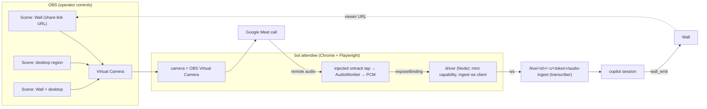

## Context

Explore session outcome. The meeting copilot needs the meeting's audio, and the call needs to see the Wall, even when the operator is not on the dashboard host. Three ways to put a bot in a call were compared:

| | 1. Self-hosted browser (chosen) | 2. Managed meeting-bot API | 3. Platform SDKs |
|---|---|---|---|
| Audio stays local | yes | no (vendor) | partly (Azure / Google) |
| Fragility | high (platform page changes, admit flow) | low | low, but heavy stack (.NET/Windows/Azure for Teams; Meet Media API preview, receive-only) |
| Repo fit | Playwright, dedicated agent Chrome, ingest WebSocket already exist | needs a public webhook and a publicly reachable Wall | foreign runtimes |

Option 1 is spiked first. A later `MeetingBotDriver` abstraction (join / audio / chat / leave) keeps option 2 open as a fallback without touching the voice or Wall side.

## Goals / Non-Goals

**Goals:** a visible bot attendee in Google Meet whose camera is the OBS Virtual Camera and whose received audio feeds the meeting transcriber.

**Non-goals (v1):**
- chat relay into Wall input;
- Teams web;
- platform speaker identity;
- managed-vendor driver;
- the bot composing or screen-sharing anything itself.

## Decisions

### D1. Video out is the OBS Virtual Camera, chosen by the operator in OBS
The bot selects the `OBS Virtual Camera` device and does nothing else with video. What the call sees is an OBS scene, switched by the operator in OBS, in the `obs-studio` panel, or by `pi-obs scene` verbs.

The rejected alternative was the bot screen-sharing a Wall tab. It needs automatic share-source picking and gives the operator no say over the composition.

Trade-off: Meet treats camera video as a face tile (around 720p, low bitrate). The text-optimised path is to present an OBS **windowed projector** instead. Spike S0 measures both and records the choice here. Default: camera.

### D2. Broadcast scenes load the Wall as a viewer, never as the operator
A Browser Source on the dashboard host requests the Wall from loopback. Under `voice-wall-access`, a loopback caller is the **local operator**, and operators may receive private-zone events. A broadcast scene therefore SHALL load the Wall **share-link URL** (viewer class).

Open gap in `add-voice-wall-plugin`: its spec does not say which class wins for a loopback request that carries a share token. That change must state "a share token forces viewer class" (or add an explicit broadcast audience) before this change ships. Tracked in § Dependencies.

### D3. Audio in is the remote WebRTC tracks, never a device loopback
A script injected at page load (Playwright `addInitScript`) wraps `RTCPeerConnection`, collects remote audio tracks from `ontrack`, mixes them in an `AudioContext`, and emits PCM through an `AudioWorklet` in the format the browser-mic ingest expects.

**Transport: the page never touches the network.** The page hands the PCM chunks to the bot driver (Node) over a Playwright `exposeBinding`, so nothing crosses origins. The driver mints `POST /api/live-server/:id/capability` and streams to `/live/<id>/~c/<token>/audio-ingest`. Why:
- A WebSocket opened from the Meet page is browser-originated (`Origin: https://meet.google.com`, `Sec-Fetch-*`). Under `improve-canvas-html-and-url-ux` D10 it would get 404 without a capability.
- Meet's CSP (`connect-src`) and Chrome's local-network-access prompt would block it before that.
- The driver is not a browser, so the capability path is not strictly required. It is used anyway, to match the browser-mic path the voice-assistant change now takes and to survive future tightening.

Capability lifetime: the viewer re-mints 10 minutes before expiry. Whether an open ingest WebSocket outlives its token, or the driver must reconnect with a fresh one, is measured in S2.

- The bot joins with no microphone. Page audio output is muted, so there is no echo into the host's system-audio tee.
- Meet is believed to deliver a few mixed "loudest speaker" tracks rather than one per participant. So the bot channel carries no speaker identity, and the archive keeps the plan's diarization + `pi-voiceid` step. To verify in S2.

### D4. Bot audio has no voice-command authority
The voice-assistant policy acts on spoken commands only from speaker `mic` (the operator's own microphone). Everything through the bot is remote audio and SHALL be fed as the non-`mic` channel. v1 decision: commands are typed only when the bot is the source. Voiceprint-gated operator commands are a possible follow-up.

### D5. Disclosure by naming
The bot's display name SHALL state that it records, for example `pi copilot (recording)`. A visible attendee is the consent mechanism. The voice-assistant retention rules (`keepAudio` off by default) apply unchanged.

### D6. Browser: Chrome channel, headed first
Use the installed Chrome (`channel: "chrome"`), headed, with a persistent profile signed in to a dedicated Google bot account. A signed-in account means less admit friction, and it is less likely to be refused as an automated guest.
- Use `--use-fake-ui-for-media-stream` (auto-accept with **real** devices). Never `--use-fake-device-for-media-stream`.
- Camera selection must be explicit. The fake-UI flag auto-accepts with the **default** camera (likely `MacBook Pro Camera`), which would break the no-fallback rule. Candidates, measured in S1: Meet's settings UI, a Chrome profile preference, or a `deviceId` constraint injected via `getUserMedia`.
- Any injected code calling `navigator.mediaDevices` lives outside the plugin's client roots (e.g. `src/driver/`), so the secure-context scan (`secure-context-scan.test.ts`, change `audit-plugin-bundles-non-secure-context`) does not apply. If it ever lands in a client root, it needs the scan's allowlist entry, capability check and no-throw test.
- Open: reuse `dedicated-agent-browser` (`~/.pi/dashboard/agent-chrome`, CDP proxy, server-owned lifecycle) or keep a separate bot profile. Reuse would make the bot appear as whatever account the operator signed in there. A separate profile isolates the bot identity but duplicates lifecycle code. Decided after S1, with `doubt-driven-review`.

## Task 0 — Spike plan (gate)

Throwaway scripts live under `/tmp`, never in `packages/`. Findings go to `spike-findings.md` (F-numbered, MEASURED / NOT MEASURED).

| Stage | What | Pass when |
|---|---|---|
| **S0** (no code) | OBS scenes: Wall share URL, desktop region, composite. Start the Virtual Camera and pick it in the operator's own Meet. Also present an OBS windowed projector. | Wall text is readable on a second device. Record camera vs projector legibility and settle D1. |
| **S1** | Playwright, `channel: "chrome"`, headed, persistent bot profile. Join a test Meet and pick OBS Virtual Camera. | Bot is admitted (or auto-joins when signed in) and others see the OBS output, 3 joins out of 3. Record the automation-block behaviour, the admit flow and the camera-selection path. |
| **S2** | `addInitScript` ontrack tap → AudioWorklet → 16 kHz PCM → dummy WebSocket server writing a WAV. | WAV is intelligible with end-to-end latency under 1 s. Record the track count and whether tracks map to speakers. |
| **S3** | `pi-obs scene` switch mid-call (via `service exec`). | The change is visible in Meet within about 1 s. |
| **S4** (optional) | Chat DOM scrape. | Record which sender identity is visible. Decides whether chat input is viable. |

Go/no-go: S1 + S2 must pass for option 1. Failing S1 because of automation blocking routes the decision to option 2 (vendor) and a re-proposal.

## Dependencies

- `add-voice-assistant-dashboard-plugin`:
  - the browser-mic ingest must accept a **meeting** transcriber source (its spec covers dictation; meeting use with a non-host source is not stated);
  - its ingest path is now `/live/<id>/~c/<token>/audio-ingest` (coordination task from `improve-canvas-html-and-url-ux`, D10). The bot driver uses the same path (D3);
  - bot audio must map to the non-`mic` channel (D4).

  Amend that change after the spike.
- `add-voice-wall-plugin`: the share-token-forces-viewer rule (D2).
- `improve-canvas-html-and-url-ux`: capability mint `POST /api/live-server/:id/capability` (`control` tier) and the `~c/<token>` path (`live-server-preview` spec). The bot driver depends on it for ingest.
- Shipped: `obs-studio` plugin (`pi-obs` virtual camera and scenes; presets refuse to bind `OBS Virtual Camera` into a scene, which prevents feedback); `dedicated-agent-browser`.

## Risks / Trade-offs

- **[Risk] Meet blocks automated browsers** → Chrome channel, headed, signed-in bot account. Fallback is option 2.
- **[Risk] Ingest token expiry mid-meeting** → the driver re-mints before `expiresAt` and reconnects. Upstream reconnect-with-replay covers the gap (measured in S2).
- **[Risk] Silent default-camera pick** → explicit OBS camera selection (D6). The bot refuses `camera` rather than fall back.
- **[Risk] Platform page changes break join or audio** → keep the driver small and selector-isolated, and fail loudly with a named stage.
- **[Risk] Camera-tile legibility** → D1 projector alternative.
- **[Risk] Private Wall content broadcast** → D2. Blocked on the Wall spec fix.
- **[Risk] Remote speech steering a tool-capable copilot** → D4.
- **[Trade-off] Headed Chrome window on the host** is visible and could be closed by mistake. Headless is revisited after S1.

## Open Questions

- Q1. Camera vs projector-present as the default (S0).
- Q2. Dedicated agent profile vs separate bot profile (D6).
- Q3. Does the bot run only on the dashboard host, or could a remote operator host run it (cf. `browser-operator-host`)?
- Q4. Teams web: same driver with a different page adapter, or a separate change?
