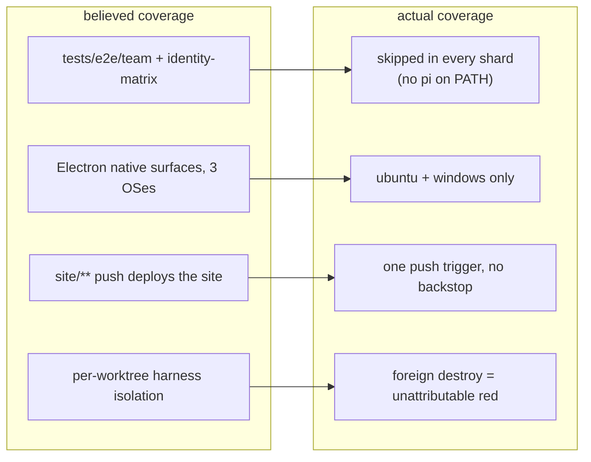
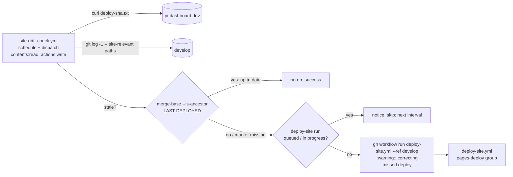
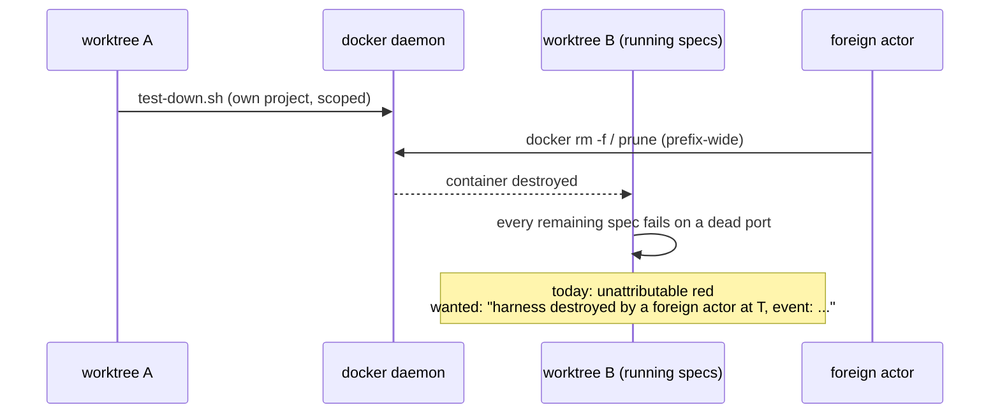

# Design — add-missing-ci-legs

## Context

Four GitHub issues, one failure class: **a gate that nobody runs, and no signal that it is not running.**



Verified ground truth (every claim re-checked against `develop`):

| Claim (from the issue) | Verdict | Evidence |
|---|---|---|
| 5 specs run in no CI leg | **confirmed** | `tests/e2e/team/team-llm.spec.ts:22`, `team-app.spec.ts:23`, `team-skills.spec.ts:29`, `team-standalone.spec.ts:17`, `tests/e2e/identity-matrix/multi-user.spec.ts:44` all file-scope-skip on `!hasPi`; the configs are referenced only by `package.json:105,107`; `.github/workflows/ci-e2e-browser.yml:112` runs the default config, `:224` runs only `browser-relay.spec.ts` |
| Electron matrix lacks macOS | **confirmed** | `.github/workflows/ci-e2e-electron.yml:47` → `os: [ubuntu-latest, windows-latest]` |
| `stubDialog()` races the health fetch | **partly refuted** | the fake server already delays `/api/health` so the stub installs first (`tests/e2e-electron/electron-lifecycle.ts:240` + the harness row in `tests/e2e-electron/AGENTS.md`), and the issue itself notes `--no-zombie-prompt` hangs too — that arm never reaches `dialog.showMessageBox`. The race is at best one of ≥2 causes |
| #579 is a path-filter blind spot | **refuted** (see D6) | the filter matched; the commit produced zero runs of any workflow |
| #451 cross-project destroy comes from the repo | **refuted** | `docker/TESTING.md:93` grep audit, re-run here: the only destructive calls are `docker/test-down.sh:50` (`docker image rm -f pi-dashboard:${project}`, own project) and own-container `docker rm -f` in `scripts/test-standalone-npm-install-docker.sh:70`, `packages/electron/scripts/build-installer.sh:465`, `build-windows-zip.sh:302`. No `system prune` / `container prune` / `--remove-orphans` anywhere in-tree |
| #451 needs an oversubscription guard | **already shipped** | `openspec/specs/docker-test-harness/spec.md:118` + `docker/test-up.sh` guard + `docker/harness-audit.sh`, landed by `stabilize-browser-e2e` |

## Goals

- Every spec under `tests/e2e/` has exactly one leg that runs it, structurally — not "unless the runner lacks a binary".
- The darwin Electron path executes in CI, at a cadence that does not multiply the CI bill.
- A missed site deploy heals automatically and visibly.
- A harness destroyed by a foreign actor produces a named cause, not 80 red specs.

## Non-goals

- Required-check promotion for any leg added here.
- Retroactive root-cause for #579 (data is gone) or identification of the #451 destroyer (it is outside the repo).
- The Doctor version-skew fetcher's hard-coded `http://localhost:8000/api/health` (`tests/e2e-electron/electron-lifecycle.ts:38-42`, `FAKE_PORT = 8000`); #531 mentions it, separate issue.
- Enabling the commented-out browser-E2E nightly cron (`ci-e2e-browser.yml:35-36`).

## Decisions

### D0 — This change SHOULD be split into four. Recommended.

The four issues share a *theme*, not a *blast radius*: #861 touches Playwright config + a browser workflow, #531 touches an Electron workflow + a possibly-unfixable native hang, #579 touches a Pages deploy, #451 touches the Docker harness. They have no shared code, no shared test, no shared rollback. Bundling them means the #531 investigation (open-ended by construction — D5) blocks three landable fixes.

**Recommendation: ship as `add-team-e2e-ci-leg`, `add-macos-electron-e2e-leg`, `fix-site-deploy-trigger-rot`, `attribute-foreign-harness-destroy`.** This change is nevertheless drafted covering all four, with `tasks.md` sections 1-4 mapped one-to-one onto the issues and section 5 (docs) splittable by row, so splitting is a copy of a section plus the matching spec delta. If it ships bundled, the task order is still the ship order: #861 → #579 → #451 → #531 (the open-ended one last).

### D1 — The `pi`-requiring specs get variant legs inside `ci-e2e-browser.yml`, not a new workflow

Two new jobs, `e2e-team` and `e2e-identity-matrix`, each installing `pi` globally and running its own config.

- The file-scope-skip repo-lint guard resolves acceptable job ids **only from `ci-e2e-browser.yml`** (`packages/shared/src/__tests__/e2e-fixme-guard.test.ts:48` declares `BROWSER_WORKFLOW`; `:234` feeds it to `specRunningJobIds`). A leg in any other workflow file cannot be named in a skip reason without also widening that guard.
- The workflow already owns this exact pattern: `e2e-browser-relay` (`.github/workflows/ci-e2e-browser.yml:195`) exists precisely because a spec needing a non-default harness must get its own leg.
- `openspec/specs/ci-cd-pipeline/spec.md:538` already requires "a separate variant-harness leg on its own runner for any spec whose required harness environment cannot be a shared default".

Cadence: the two jobs copy the shard matrix's job-level `if:` label gate AND its `continue-on-error: ${{ github.event_name == 'pull_request' }}` (`ci-e2e-browser.yml:80`) verbatim, so they run exactly when the shards run and are advisory exactly where the shards are — `workflow_dispatch` and an `e2e-browser`-labelled PR today. The nightly cron is commented out (`ci-e2e-browser.yml:32-36`, "land dark" until `stabilize-browser-e2e` task 5.5); this change neither enables it nor claims scheduled runs for the new legs. The `ci-cd-pipeline` delta is therefore an ADDED requirement for the two legs; it does not restate (or MODIFY) the existing browser-E2E trigger requirement, whose `schedule` wording `stabilize-browser-e2e` owns.

Build steps are explicit workflow steps, not npm pre-scripts (pnpm does not run `pre*` scripts by default): both legs run `pnpm run build` (the identity config needs a built client, `playwright.identity-matrix.config.ts:5-8`; the team config spawns the same dashboard), and `e2e-team` additionally runs the `pretest:e2e:team` command `npm run build:app --workspace=@blackbelt-technology/pi-dashboard-team-plugin` (`package.json:106`). Then `pnpm exec playwright test --config <config>`.

**Reports (decision L1).** The two configs declare `reporter: [["list"]]` only (`playwright.team.config.ts:20`, `playwright.identity-matrix.config.ts:19`) and `merge-report` joins `blob-report-*` from `needs: [e2e, e2e-browser-relay]` (`ci-e2e-browser.yml:278`). The variant legs do NOT join the merged report: each runs Playwright with `--reporter=list,html` and uploads its own HTML report (`if: always()`) as `playwright-report-team` / `playwright-report-identity-matrix` — names outside the `blob-report-*` download pattern and distinct from the merged `playwright-report`. `merge-report.needs` is unchanged, so a red variant leg cannot break the merge. The `playwright-e2e-qa` "Merged report covers every shard" scenario is reworded accordingly (verdicts from a shard or the browser-relay leg).

Alternatives rejected: **(a) a new `ci-e2e-pi.yml`** — forces a guard change and splits the browser-E2E cadence across two files; **(b) fold into `ci.yml`** — `ci.yml` is the required check and these legs are advisory, 15-20 min, and spawn real `pi` processes; **(c) teach the default shards** — the two configs set their own `testDir`, serial mode, per-test timeouts and (identity-matrix) a `globalSetup`; the team suite additionally needs the team app built. Merging them into the shared harness is a rewrite of eight spec files to buy nothing.

### D2 — "Exactly once" becomes structural: the default config stops discovering those directories

`playwright.config.ts:32` sets `testDir: "tests/e2e"` and `:37` already carries a `testIgnore`. Add `tests/e2e/team/**` and `tests/e2e/identity-matrix/**` to it.

Today the uniqueness guarantee is *environmental* for the five `pi`-requiring files (4 team specs + `multi-user.spec.ts`): the shards collect and skip them only because the runner has no `pi`. The moment any shard runner grows a `pi` binary (the harness image has one at `docker/Dockerfile:116`), the same spec runs in a shard AND on its leg — the exact double-run the `playwright-e2e-qa` sharding requirement forbids. `testIgnore` makes ownership a property of the configs, not of `$PATH`.

Scope: the two config-owned directories move whole. `tests/e2e/identity-matrix/` holds four spec files: `multi-user.spec.ts` needs `pi`; `browser-login.spec.ts`, `security.spec.ts`, `setup-matrix.spec.ts` do not, and are collected by the default shards today — **but cannot pass there (cycle 3 correction)**. Each lazily calls `readState()` (`tests/e2e/identity-matrix/browser-login.spec.ts:18-27`, same pattern in `security.spec.ts:18-22`, `setup-matrix.spec.ts:10-16`), which reads `test-results/identity-matrix/state.json` (`matrix-lifecycle.ts:21,232-234`); that file is written only by `bootMatrix()` (`matrix-lifecycle.ts:218`), invoked only by the identity config's `globalSetup` (`tests/e2e/identity-matrix/global-setup.ts:4-7`). The default config's `globalSetup` boots the Docker harness and never calls it. On a fresh shard runner those three files therefore throw ENOENT — red (or vacuous), not a preserved pass. Moving the whole directory to the `e2e-identity-matrix` leg is thus a **fix** for those three as well as the ownership change: they run once, under the config that boots the matrix they read. `bootMatrix` spawns `packages/server/src/cli.ts` directly, no global `pi` (`matrix-lifecycle.ts:5`), so those three do not depend on the `pi` headless spike. `tests/e2e/browser-relay.spec.ts` stays in the default config, env-gated by its file-scope skip (`tests/e2e/browser-relay.spec.ts:110-112`) and run by the existing `e2e-browser-relay` leg — unchanged.

Side effect (local): a bare `npx playwright test` used to collect all eight spec files in the two directories (executing the five `pi`-requiring ones only when `pi` is installed); after `testIgnore` none is collected. The supported entry points are the existing scripts `npm run test:e2e:team` (`package.json:107`, with `pretest:e2e:team` building the team app) and `npm run build && npm run test:e2e:identity-matrix` (`package.json:105`). A comment on the `testIgnore` entry names both, and `tests/e2e/AGENTS.md` + `docs/faq.md` record it (tasks 5.2, 5.4).

**Decision L5 (accepted).** Moving `browser-login`, `security` and `setup-matrix` out of the shards onto the identity-matrix leg is accepted: they are red in the shards today, so the move loses no passing coverage.

Consequence: the five `test.skip(!hasPi, ...)` reasons must stop pointing at #861 and start naming their leg (`"runs on \`e2e-team\`"`), which is what the repo-lint guard accepts once the job id exists.

### D3 — The legs pin `pi` to the harness image version; the Dockerfile is the single source of truth

`npm i -g @earendil-works/pi-coding-agent@<version>` where `<version>` is the exact pin in `docker/Dockerfile:116` (`1.1.0` today). The `>=1.1.0` in `package.json:151` (and the workspace packages) is a peer-compatibility *floor*, not a test pin, and is deliberately not consulted. The Dockerfile wins because it is what every other browser-E2E leg already runs against; a repo-lint assertion (task 1.2) fails when the workflow literal and the Dockerfile literal differ. A floating `latest` would make these legs a pi-release canary rather than a dashboard gate.

Headless viability is unproven: these specs have never run on a GitHub runner, and a real `pi` may meet trust prompts, missing credentials or TTY assumptions that a developer machine satisfies implicitly. The configs already point `pi` at a fake OIDC issuer and a fake OpenAI-compatible provider, so the expectation is that it works — but section 1 opens with a **spike** (task 1.1): a dispatch from a throwaway branch carrying only the two jobs. Fallback if `pi` cannot run headless: the `e2e-team` job, the `tests/e2e/team/**` `testIgnore` entry and the team skip-reason rewrites do not land (nothing regresses: those specs skip in shards today), the blocking finding is filed as an issue, and the change is re-scoped. The `e2e-identity-matrix` job and the `tests/e2e/identity-matrix/**` `testIgnore` entry land regardless — keeping that directory in the shards is not a fallback, because three of its specs cannot pass there (D2); only `multi-user.spec.ts` keeps its `!hasPi` skip (reason still citing the blocking issue) on the identity leg — the `playwright-e2e-qa` "produces a verdict" scenario is not claimed met by a leg that skips.

### D4 — The macOS Electron leg: event-dependent matrix, never on the plain PR path

`ci-e2e-electron.yml:18-30` fires `pull_request` on a path filter over `packages/electron/**`, `tests/e2e-electron/**` and friends — a hot path. GitHub-hosted macOS runners bill at **10× Linux**, and the job packages an Electron app (~5-8 min). Adding `macos-latest` to `:47` unconditionally would make the most expensive recurring line in the repo's CI out of an *advisory* suite.

Mechanism (named, so the contract test can pin it) — the matrix depends on `github.event_name` only, which is defined on every event, so no expression dereferences `github.event.pull_request` on `schedule`/`workflow_dispatch`:

```yaml
on:
  workflow_dispatch:
  schedule:
    - cron: '<nightly>'            # NEW — macOS-only, see matrix
  pull_request:                    # UNCHANGED: default types, no `labeled`
    branches: [develop]
    paths: [ ...unchanged... ]
jobs:
  electron-e2e:
    strategy:
      matrix:
        os: ${{ fromJSON(
              github.event_name == 'schedule' && '["macos-latest"]' ||
              github.event_name == 'workflow_dispatch' && '["ubuntu-latest","windows-latest","macos-latest"]' ||
              '["ubuntu-latest","windows-latest"]') }}
    steps:
      # ... existing steps; the Windows run step becomes:
      - name: Run Electron E2E (Windows, macOS)
        if: runner.os != 'Linux'
        run: pnpm run test:e2e:electron
  job-object-windows:
    if: github.event_name != 'schedule'
  runtime-overlay-e2e:              # ungated today (ci-e2e-electron.yml:116-121)
    if: github.event_name != 'schedule'
```

The workflow has exactly three jobs today — `electron-e2e`, `runtime-overlay-e2e`, `job-object-windows` (`ci-e2e-electron.yml:43,116,192`). Adding `schedule` to `on:` triggers every job without a job-level `if:`, so each non-macOS job gets `if: github.event_name != 'schedule'` (cycle 3: `runtime-overlay-e2e` was missed). The contract test enumerates `jobs` and fails if any job other than `electron-e2e` lacks that gate, so a job added later cannot silently join the nightly.

| Event | ubuntu | windows | macOS | job-object-windows | runtime-overlay-e2e |
|---|---|---|---|---|---|
| PR matching the path filter | ✓ | ✓ | — | ✓ | ✓ |
| `workflow_dispatch` (any ref) | ✓ | ✓ | ✓ | ✓ | ✓ |
| `schedule` (nightly, default branch) | — | — | ✓ | — | — |

Notes:
- **No label opt-in (cycle 2).** An earlier draft added `labeled` to `pull_request.types` with a `e2e-electron-macos` label. Dropped: (a) an unrelated `labeled` event still creates a run that joins the per-ref `concurrency` group with `cancel-in-progress: true` (`ci-e2e-electron.yml:32-34`) and cancels the in-flight run even when its jobs are skipped; (b) a label-dependent `fromJSON` needed `github.event.pull_request.labels`, absent on `schedule`/dispatch; (c) the label could not opt in a PR outside the path filter (e.g. an Electron major bump that only touches manifests/lockfile). `workflow_dispatch` against the PR branch covers every case, costs nothing to maintain, and is the single opt-in.
- **The macOS leg must run specs.** Today only `runner.os == 'Linux'` (xvfb) and `runner.os == 'Windows'` run steps exist (`ci-e2e-electron.yml:84-95`); a macOS leg would package the app, run zero specs and go green. The Windows step is widened to `runner.os != 'Linux'` (default shell on Windows is already `pwsh`; `shell: pwsh` is dropped since the command is shell-neutral). The contract test asserts every OS the matrix can produce has an admitting suite-running step. (Playwright itself already exits non-zero on "No tests found", so a step that runs with an empty selection is not silent; the gap was a missing step.)
- **Nightly is macOS-only** so the schedule does not silently add a nightly Linux/Windows run (their cadence is unchanged). Scheduled runs execute on the default branch.
- **Advisory, explicitly.** "Advisory" in this workflow means *not a required status check* (header `:12-13`); the `electron-e2e` matrix has no job-level `continue-on-error` (`:43-48`) — only `job-object-windows` does (`:200`). The macOS entry gets none either: `continue-on-error` would turn a darwin regression green in the run conclusion, which is the exact silence #531 is about.
- **Arch.** `macos-latest` is an arm64 image today. The `electron-qa-coverage` arch-match rule (`openspec/specs/electron-qa-coverage/spec.md:40`) governs the `_electron-build.yml` legs that exec a binary built elsewhere; this leg packages and runs on the same runner, so arch matches by construction and the rule is not applicable. No x64 twin.

macOS runners are *already* in the budget for release builds (`_electron-build.yml` macOS legs), so this is an increment, not a new platform.

Alternatives rejected: **always-on macOS** (cost, for an advisory suite); **macOS only in `_electron-build.yml`** (that workflow builds and smoke-launches; it does not run the `_electron` Playwright suite); **a separate `electron-e2e-macos` job** instead of a computed matrix (duplicates ~120 lines of steps; the `fromJSON` matrix keeps one step list); **a preceding job computing the OS list in shell** (works, but an extra runner hop for what an event-name-only expression already does safely); **label opt-in** (see Notes); **no macOS** (that is the bug).

### D5 — The hang is a product defect against an existing requirement: reproduce → fix, or quarantine with exit criteria

Evidence says the stated cause is incomplete: the `--no-zombie-prompt` arm never reaches `dialog.showMessageBox` yet hangs identically, and the fake health server already delays its response so the stub wins the race (`tests/e2e-electron/electron-lifecycle.ts:240` and its `AGENTS.md` row). A plausible darwin-only cause: on macOS the app has a dock/window lifecycle the other platforms do not, so `app.close()` can block on a window that never closed — a hypothesis to test, not a decision.

Framing: `openspec/specs/electron-shell/spec.md:525-562` requires the adoption modal to be suppressed under `--no-zombie-prompt` "used by QA/test runs", with the app proceeding. A darwin hang in that arm is therefore a **product defect against an existing requirement**, unless attribution places the blocking call inside the test harness (e.g. `electronApp.close()` / fixture teardown). The fix lands where attribution points; this change does NOT add a test-only switch to the zombie arm — that would alter `electron-shell` behaviour for test convenience, and `--no-zombie-prompt` already is the sanctioned QA suppressor.

Order: reproduce locally on darwin with a trace → attribute (which call never returns, app vs harness) → fix if the cause is in our code (app or harness) → otherwise `test.fixme(process.platform === "darwin", "<#531 URL>")`, the sanctioned quarantine (`openspec/specs/playwright-e2e-qa/spec.md:373`), at the narrowest scope (the hanging test(s), not the file).

Honesty about coverage: while the quarantine stands, the macOS leg's green does **not** cover the zombie-adoption spec that motivated #531 — it covers the remaining native-surface specs (Doctor version-skew, tray foreign row). The workflow header and the issue say so. **Exit criteria** for the quarantine: (1) it is removed in the same PR that fixes #531; (2) it is re-tested on every Electron major bump (the bump PR's author dispatches the workflow against the bump branch — `gh workflow run ci-e2e-electron.yml --ref <branch>` — and records the darwin result on #531; dispatch runs all three OSes regardless of the path filter); (3) if attribution proves the defect is in Electron itself, #531 is relabelled upstream-blocked with the upstream issue link, and the `fixme` stays only while that link is open. (Former Q4 resolved: permanent-by-default is not accepted; excluding the file outright is rejected because it would also drop the darwin runs of the file's passing tests.)

### D6 — #579: the stated cause is refuted; buy a backstop instead of a forensic

What the evidence actually shows:

| Check | Result |
|---|---|
| Does `d773f20a5` touch `site/**`? | **yes** — `site/package.json`, `site/src/components/InstallTabs.tsx`, `site/src/lib/github-release.ts`, +2 |
| Did the filter cover it then? | **yes** — `git show d773f20a5:.github/workflows/deploy-site.yml` → `branches: [develop]`, `paths: ["site/**", ".github/workflows/deploy-site.yml"]` |
| Does a documented push-filter limit apply? | **no** — docs: push filters use a two-dot diff of base..head; "always runs" above 1,000 commits; skipped only when matches fall outside the first 3,000 files of a >3,000-file diff. The push range `41ab03185..9d9ce03e8` is 2 commits / 48 files |
| Did Deploy Site run? | **no** |
| Did *anything* run on that SHA? | **no** — `gh api .../actions/runs?head_sha=d773f20a5…` → `total_count: 0`, while the control SHA `afd3f8db2` returns its CI run |
| Did the push produce runs at all? | **yes** — the next commit `9d9ce03e8` has a CI run, i.e. `d773f20a5` was a non-head commit of a multi-commit push |
| Is it a one-off? | **no** — `561771829` (2026-05-26) and `33ccb076a` (2026-05-30) also touch `site/` with no push run, each followed within minutes by a manual `workflow_dispatch` (`gh run list --workflow deploy-site.yml`). A human has been papering over this ≥3 times |

Two hypotheses survive and **neither is testable after the fact** (push payloads and webhook deliveries are long expired): (H1) the push that carried `d773f20a5` was raised with `GITHUB_TOKEN`, whose events create no runs; (H2) a GitHub-side path-filter evaluation miss on a multi-commit push.

H1 is already written down as a known mechanism in this repo: `openspec/specs/marketing-site/spec.md:187` ("sync-release-version has no release-event trigger") states that "a `GITHUB_TOKEN` push cannot start `deploy-site.yml`; the site is therefore never redeployed by the trigger's path", and imposes a standing **manual** obligation — after a hand-published release, dispatch `sync-release-version` and then `deploy-site` by hand. That exactly explains the 2026-05-26 and 2026-05-30 misses (both are `chore(site): sync latest-release.json` commits, each followed by a manual dispatch). It does **not** explain `d773f20a5`, whose push demonstrably produced a CI run. So H1 covers two of the three observed misses and H2 remains open for the third.

The drift check subsumes the manual obligation as a backstop (the hand dispatch stays the fast path, so that requirement stands unmodified) and is the only remedy that also covers H2.

Both have the same remedy, so the decision does not depend on which is true: **stop treating the push filter as the only trigger.** Keep it as the fast path and add a scheduled drift check that *dispatches* a deploy when the live site is behind `develop`.

Design (cheap signal, no content diff):



- **Marker.** `deploy-site.yml`'s build job writes `site/dist/deploy-sha.txt` containing `${{ github.sha }}` before `upload-pages-artifact`. The comparison is a commit SHA, so there is no artifact to normalize and no timestamp/hash noise.
- **develop-only publish.** `deploy-site.yml`'s `workflow_dispatch` has no ref guard today (`deploy-site.yml:17-18`), so a manual dispatch from a feature branch would publish that branch and a non-`develop` marker (which the ancestry check would then read as stale forever, or as current while the site is wrong). The build job gains `if: github.ref == 'refs/heads/develop'` (deploy `needs: build`, so it skips too). Every legitimate dispatcher already targets `develop` (`publish.yml` `site-redeploy`, `marketing-site/spec.md:187` manual recipe, the drift check).
- **Never cancel an in-flight deploy.** Before dispatching, the check queries `gh run list --workflow deploy-site.yml --status queued` and `--status in_progress`; if either is non-empty it logs a notice and exits 0 without dispatching (the dispatched run would join `pages-deploy` with `cancel-in-progress: true`, `deploy-site.yml:29-31`, and cancel it). The in-flight run most likely fixes the drift; if it does not, the next interval dispatches.
- **GitHub API failures (decision L3).** If `gh run list` itself fails (5xx, rate limit), the check cannot tell whether a deploy is in flight, so it emits `::notice::` naming the failure, does NOT dispatch, and exits 0 — the next daily interval retries. If `gh workflow run deploy-site.yml` is rejected, the job fails red: a stale site with a failed correction is exactly the silent rot this check exists to surface.
- **Cadence (decision L4).** Daily `schedule` (one cron entry) plus `workflow_dispatch`. The check is one `curl` + `git log` + at most one `gh` call, so daily cost is negligible; a missed push deploy is therefore corrected within one day.
- **Fetch target.** `https://pi-dashboard.dev/deploy-sha.txt?ts=<epoch>` with `Cache-Control: no-cache`. GitHub Pages' CDN serves with a short `max-age`; a cache-busting query avoids most staleness, and any residual staleness only causes a redundant (harmless) dispatch, never a missed one.
- **Comparison.** `LAST` = `git log -1 --format=%H origin/develop -- site/ ':!site/design-scratch/' packages/shell/ .github/workflows/deploy-site.yml` (the push filter's own path set, `deploy-site.yml:6-13`). Up to date iff `git merge-base --is-ancestor $LAST $DEPLOYED` (ancestry, not equality: a deploy of any later `develop` commit already contains `LAST`). Marker missing / unreachable / unknown SHA → treated as stale, dispatch with a warning (so the first run after landing the marker dispatches once).
- **Separate workflow, dispatch only.** The check lives in its own `.github/workflows/site-drift-check.yml` and never deploys. Reason: `deploy-site.yml` uses `concurrency: { group: pages-deploy, cancel-in-progress: true }` (`:29-31`), which **cancels**, not serializes — a scheduled check job placed in that group could cancel, or be cancelled by, a push deploy. Outside the group, the check cannot interfere; the deploy it dispatches is an ordinary `deploy-site.yml` run. `workflow_dispatch` raised with `GITHUB_TOKEN` does create a run (the documented exception `publish.yml` `site-redeploy` already relies on, `publish.yml:835-857`, header `deploy-site.yml:16-22`).
- **Privilege.** The check job declares job-level `permissions: { contents: read, actions: write }` (needed for `gh workflow run`). `actions: write` makes it **release-privileged** under `ci-cd-pipeline` → "Release-privileged jobs do not restore a dependency cache"; it needs no dependencies (checkout with `fetch-depth: 0`, `curl`, `git`, `gh` are on the runner), so it uses no `setup-node`/`cache` at all and the existing `workflow-token-cache-contract.test.ts` stays green.
- **Visibility.** On drift the check emits `::warning::site drift: live <DEPLOYED> lacks <LAST>; dispatching deploy-site` and the dispatched run is the corrective deploy in the history.

The H1 manual obligation in `marketing-site/spec.md:187` stands unmodified (hand dispatch stays the fast path after a hand-published release); the drift check is its backstop.

Alternatives rejected: **(a) drop the path filter, deploy on every `develop` push** — simple and correct, but a Pages deploy per push on a high-traffic branch, and `pages-deploy`'s `cancel-in-progress` would cancel in-flight deploys constantly; **(b) a contract test over the filter list** — `site-deploy-workflow-contract.test.ts` already pins the filter, and the filter was *correct*; a test cannot catch a trigger that never fires; **(c) normalized content diff of the live site vs a fresh build** — needs a full build in the check job (deps → cache rules), a normalization helper, and a crawl; the SHA marker answers the same question with one `curl`; **(d) keep patching by hand** — the status quo, three times over.

### D7 — #451: the deliverable is attribution, not a fix



No in-repo code can do this (see the Context table). What the repo CAN do is stop losing the evidence:

1. **Capture by default, in the boot scripts.** `docker/harness-audit.sh` exists but must be started by hand in a second shell (`docker/TESTING.md:97`) — i.e. exactly never, before the incident. The recorder moves into the lifecycle scripts every caller already uses: `docker/test-up.sh` starts it (detached) after it has derived the compose project and **before** `compose up` (so the boot's `create`/`start` lines are captured), scoped to *that* project, appending to `${TMPDIR:-/tmp}/pi-dash-test/<project>.events.log`; every event line carries the container ID. The recorder appends `boot <ISO ts> <project> <containerId>` itself when it first observes the project's container (this also covers an attached `test-up.sh` without `-d`, whose `compose up` never returns while the harness runs). After a detached `compose up` returns (managed mode spawns `test-up.sh -d --build`, `tests/e2e/global-setup.ts:249`), `test-up.sh` resolves the container ID (`docker compose -p <project> ps -q`) and records `recorderPid` + `eventsFile` + `containerId` in `.pi-test-harness.json` (the state file is first written before `compose up`, `docker/test-up.sh:163-168`, and again on a retry path at `:231`; it is rewritten once the ID is known, after the `compose up` at `:216`). If `compose up` fails, `test-up.sh` kills the recorder it started. `docker/test-down.sh` reads `containerId` from the state file (or, absent, resolves it with `compose ps -q` before removing anything), appends a `teardown-begin <ISO ts> <project> <containerId>` marker line, runs `compose down`, waits up to 10 s for the `destroy` line of **that container ID** after that marker (the event stream is asynchronous; stopping the recorder immediately could drop the very line that distinguishes own teardown from foreign destroy), then stops the recorder and prints the events-file path. This covers Playwright managed mode (`globalSetup` → `test-up.sh`, unchanged), `ship-it` (calls `test-up.sh`/`test-down.sh` directly, `openspec/specs/ship-it-orchestrator/spec.md:116` — the motivating case) and a developer's manual harness, without touching `globalSetup`.
   - **Outside the worktree.** The state file sits in the worktree (`docker/test-up.sh:21`) and ship-it removes the worktree right after teardown (`ship-it-orchestrator/spec.md:129-131`), which would delete an in-worktree record on exactly the motivating path. The events file therefore lives under `$TMPDIR`, keyed by project (stable per worktree path), appended across boots; retention is the OS temp policy (macOS purges `$TMPDIR` files unused for ~3 days), which is long enough for a same-day post-mortem and needs no cleanup code.
   - **Idempotent re-up.** `test-up.sh` has a reuse branch for an already-running project (`docker/test-up.sh:110-117`) and rewrites the state file with a heredoc (`:164`). When the existing state names a `recorderPid` that is still alive (`kill -0`), `test-up.sh` does not spawn a second recorder and writes the same `recorderPid`/`eventsFile` back; otherwise it starts one. `write_state_file` gains the two fields.
   - **Boot-scoped attribution (cycle 3).** Compose project names are stable per worktree and the events file is appended across boots, while each boot yields a new container ID. Matching by project would let an earlier boot's `teardown-begin` "explain" a foreign destroy of this boot's container. Every match is therefore by container ID: the boot line, the teardown marker and the `destroy` line all carry it, and only a marker with the same ID counts as own teardown.
2. **Self-terminating, armed rule (cycle 3).** An interrupted run never reaches `test-down.sh`. In project-scoped mode the recorder polls `docker ps -q --filter label=com.docker.compose.project=<project>` every 30 s. It is **unarmed** until it has seen its container (a `create`/`start` event for the project, or a non-empty poll); unarmed, an empty poll is expected (it started before `compose up`) and does not exit. Once armed, the first empty poll exits. Leak guard independent of Docker: a hard maximum lifetime of 12 h (plus `test-up.sh` killing it on a failed `compose up`). Bounds: ≤ one poll interval after the container disappears once seen; ≤ 12 h in any case. The unscoped manual mode (`docker/harness-audit.sh <file>`, today's behaviour) keeps running until interrupted.
3. **Best-effort, one warning.** If `docker events` cannot be opened, `test-up.sh` prints exactly one line to stderr — `harness-audit: lifecycle capture unavailable (<reason>); continuing` — and boots normally. In managed mode that line lands in the existing `test-up.log` next to the marker (`tests/e2e/global-setup.ts:176`). **Decision L2:** any "no working recorder" cause — events stream cannot be opened, or `${TMPDIR:-/tmp}/pi-dash-test/` not creatable/writable — yields that same single line; the state file then carries no `recorderPid`. At teardown, when the recorded `recorderPid` is dead (or absent), `test-down.sh` prints one warning line to stderr, still appends the `teardown-begin` marker when the events file is writable, skips the 10 s destroy wait, proceeds with `compose down` and exits 0 — a lost recorder never fails a teardown.
4. **Attribute at the point of pain.** `openspec/specs/playwright-e2e-qa/spec.md:324` already turns a dead harness into one named failure plus skips. Extend that message: in **managed mode** the reporter knows the workspace, reads the events file named by `eventsFile` in its state file, takes `containerId` from the same state file, and when the events file holds a `destroy` for that container ID with no preceding `teardown-begin` marker carrying the same ID, it says the container was destroyed by a foreign actor and quotes the line. In **attach mode** (`PW_E2E_USE_RUNNING=1`) Playwright does not own or locate the workspace, so the message reports the cause as undetermined and points at `${TMPDIR:-/tmp}/pi-dash-test/`.
5. **Local-only.** CI legs do not upload the event file: each GitHub runner has a private daemon and only its own harness, so the cross-worktree destroy cannot happen there. The recorder still runs (harmlessly) on CI because `test-up.sh` does.
6. **Document the known recipes.** The two destroyers observed in session logs are operator commands, not code: `docker ps -aq --filter 'name=pi-dash-test' | xargs -r docker rm -f` (prefix-matches every worktree) and `docker container prune -f`. `docker/TESTING.md` + `docs/faq.md` get the explicit "never, while any harness is up; use `docker/test-down.sh` from the worktree" note.

This is honest about its limits: it cannot stop the destroy, and the issue's part 1 stays open until an occurrence is actually attributed.

## Risks / Trade-offs

| Risk | Mitigation |
|---|---|
| Three identity-matrix specs collected by the shards today (`browser-login`, `security`, `setup-matrix`) cannot pass there — `readState()` ENOENT, `state.json` is written only by the identity config's `bootMatrix` (D2) — and move to the `e2e-identity-matrix` leg | The move is a fix, not a risk to a passing gate; there is no "stay in shards" fallback for them. They need no global `pi`, so the identity leg and its `testIgnore` land even if the `pi` spike fails (D3); a red baseline on the leg is triaged per task 1.10 |
| The `e2e-team` / `e2e-identity-matrix` legs may be red from day one (they have never run in CI) | Advisory like every leg in that workflow; spike first from a throwaway branch (task 1.1); a red baseline is triaged with the existing quarantine rule, not hidden |
| Real `pi` on a GitHub runner may hit trust prompts, credentials or headless gaps | Fake OIDC issuer + fake provider already configured; spike-gated with an explicit stop-and-re-scope fallback (D3) |
| `testIgnore` silently stops a local `npx playwright test` from collecting the two directories' specs | Named npm scripts documented on the `testIgnore` entry, in `tests/e2e/AGENTS.md` and `docs/faq.md` |
| `testIgnore` silently drops a spec if someone later adds a file to `tests/e2e/team/` expecting the default harness | The leg runs the whole directory via its config, so a new file is picked up there; the directories are documented as config-owned |
| The macOS cost line creeps back onto the PR path | Electron workflow contract test pins the `fromJSON` matrix: the `pull_request` fallback must not contain `macos-latest`, `schedule` must yield macOS only, and `pull_request.types` must not include `labeled` |
| A matrix OS with no run step goes green running nothing | Contract test: every OS the matrix can produce has an admitting suite-running step |
| Opt-in for a PR needs a manual dispatch (no label) | Accepted: one `gh workflow run --ref <branch>` covers in-filter and out-of-filter PRs alike, with no concurrency side effects |
| Nightly `schedule` and a `workflow_dispatch` on `develop` share the `ci-e2e-electron-<ref>` concurrency group, so one may cancel the other | Accepted (rare; both are re-runnable). Not worth adding the event name to the group, which would also stop a newer push from superseding a PR run |
| While #531 is quarantined, the macOS leg's green does not cover zombie-adoption on darwin | Stated in the workflow header and on #531; exit criteria in D5 |
| A drift-check-dispatched deploy joins `pages-deploy` (`cancel-in-progress: true`) and could cancel an in-flight push deploy | The check does not dispatch while any `deploy-site` run is queued or in progress; it is itself outside the group. Residual race (a push deploy starting between the query and the dispatch) cancels the older run in favour of a newer build of the same branch — harmless |
| A manual dispatch of `deploy-site.yml` from a feature branch publishes a non-`develop` marker | Build job guarded by `github.ref == 'refs/heads/develop'` |
| CDN staleness of `deploy-sha.txt` right after a deploy | Cache-busting query + `no-cache`; residual staleness yields at most one redundant dispatch per interval, never a missed one |
| The drift check job holds `actions: write` (release-privileged) | No cache, no dependency install, job-level permissions only; pinned by the existing cache-poisoning contract test |
| A background recorder inside `test-up.sh` leaks a process | Stopped by `test-down.sh`; killed by `test-up.sh` on a failed `compose up`; once armed, exits ≤ one poll interval after its container disappears; hard 12 h maximum lifetime otherwise; recorder PID kept in `.pi-test-harness.json`; a re-up reuses a live recorder instead of spawning another |
| A recorder started before `compose up` exits on its first (empty) poll and loses the run's capture | Armed rule: no exit until it has observed its container (D7 item 2) |
| An earlier boot's teardown marker masks a foreign destroy of this boot's container | Boot line, marker and destroy matched by container ID, never by project (D7 item 1) |
| Events file outside the repo is less discoverable | `test-down.sh` prints its path; the harness-down message names it; `docker/TESTING.md` documents the location |
| Bundle keeps growing (13 review items in cycle 2) | D0: tasks sections 1-4 map 1:1 to the four split changes; split is still recommended before apply |

## Open Questions

1. **#579 H1 vs H2.** If H1 (GITHUB_TOKEN push) is true, the drift check is a belt on a known mechanism and we could additionally make `sync-release-version` dispatch the deploy explicitly. Should a reviewer with org audit-log access check who pushed `d773f20a5` before we settle for the backstop?
2. **Team-leg runtime.** The team config sets `globalTimeout: 15 min` and identity-matrix `10 min`; with a cold `pi` install plus a client build the leg may exceed its own budget on a runner. Measured in the spike before pinning `timeout-minutes`.

Resolved at planning (decisions L1–L5): merged report vs variant legs → own HTML report per leg (L1, D1); recorder-absent paths → single warning, dead PID at teardown → warning + marker, no wait, exit 0 (L2, D7); drift-check `gh` failures → `run list` skip with notice, `workflow run` red (L3, D6); former Q2 drift-check cadence → daily (L4, D6); identity non-`pi` specs move to the identity leg (L5, D2).

Resolved in cycle 1: former Q3 (macOS arch → arm64 only, arch rule not applicable, D4), Q4 (quarantine exit criteria, D5), Q6 (recorder in `test-up.sh`/`test-down.sh`, D7).
