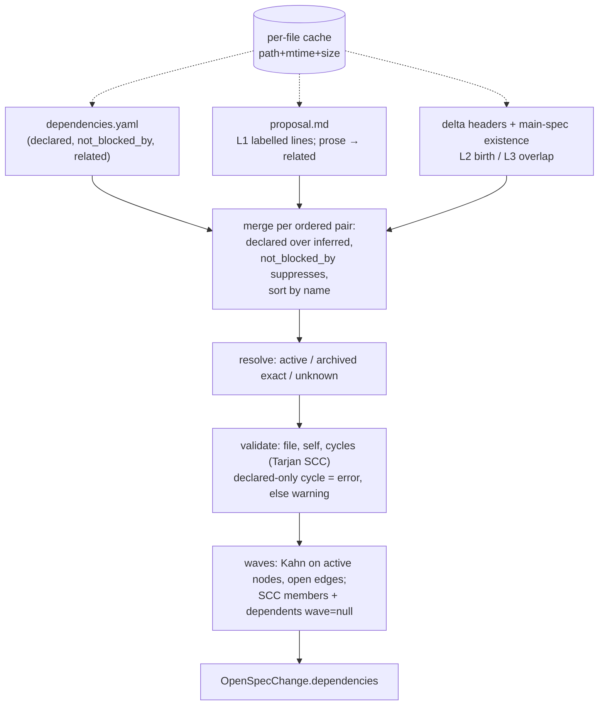

## Context

Exploration measurements on this repo (87 active changes, re-measured after the 2026-10-18 develop sync):

- Proposal text names other changes often, in both directions and in prose ("`x` depends on this change", "Follow-up … on top of this listener", "pin-after-proof"). A keyword classifier over that prose produced false 2-cycles (`add-acme-dns01-certs` ↔ `add-tailscale-cert-tls`, `add-kb-worktree-seed` ↔ `fix-kb-index-integrity`) and false edges. Restricted to labelled lines (`Blocked by` / `Depends on` / `Builds on` / `Blocks`, as list item or paragraph, optional bold and parenthetical, then `:` or a backticked name), the same scan yields 9 distinct open edges and 11 satisfied ones, including paragraph, colon-less and parenthetical forms (`add-web-chat-plugin`, `add-voice-wall-plugin`); 80 prose mentions become `related`; no cycle.
- Unresolved backticked names are mostly capability, component or package names (`pi-core-version-ui`, `anchored-popover`).
- 24 capabilities are touched by more than one active change. The one real "new capability used by another change" case (`dedicated-agent-browser`) has both changes ADDing to it.
- The archive holds `SUPERSEDED` / `OBSOLETE` / `SHELVED` entries named `<date>-<TAG>-<name>`.
- A `pi-spec-driven` schema spike accepted a `dependencies` artifact generating `dependencies.yaml`. OpenSpec treats an artifact as done once the file exists and checks only that the `template` file exists.
- Reading ~100 proposals plus ~260 delta specs takes ~20 ms warm on macOS before any parsing, so a per-file cache is needed for the budget.

## Goals / Non-Goals

**Goals:**
- One committed source of truth per change; computed inverse (`blocks`); the same graph on every machine for the same repository state.
- Inference that is predictable: only structured lines and spec deltas block.
- Board visibility (chips, waves) and a ship-time gate that never hangs.

**Non-Goals:**
- Cross-repo / OpenSpec store dependencies (`initiative` links).
- Cross-worktree resolution: a blocker active only in another worktree is `unknown-change` here.
- Dependencies on the fallback poll path (CLI without `status --all`).
- A CI cycle check and a CLI command (follow-ups).
- Session ↔ change attachment detection.
- Persisting the execution order into `groups.json` `changeOrder`.
- A Dependencies segment in the lifecycle stepper (the hint explains the planning state).

## Decisions

### D1. File format and ownership

```yaml
# openspec/changes/<name>/dependencies.yaml
blocked_by:
  - change: add-tailscale-cert-tls
    reason: TLS listener + CertSource interface   # optional, ≤ 500 chars
not_blocked_by: [add-remote-access-wizard]        # suppress an inferred edge
related: [macos-notarization]                     # no ordering
```

Shorthand `blocked_by: [name]` is accepted. Only `blocked_by` is stored; `blocks` is always computed, so the two cannot drift. Size cap 64 KiB, checked before reading. Parsed with `yaml` `parse` and `maxAliasCount: 0`. Names follow OpenSpec's change-id grammar (`KEBAB_ID_REGEX`, `/^[a-z0-9]+(?:-[a-z0-9]+)*$/`), not the dashboard's stricter slug rule, so ids such as `100-add-feature` work.

### D2. Graph pipeline (pure, in the poll derivation: worker, or in-process when the worker is off)



- **L1:** a line starting (after indentation and an optional `-` / `*` / `<n>.` marker) with `Blocked by` / `Depends on` / `Builds on` / `Blocks` (case-insensitive, optional bold, optional parenthetical like `(land first)`), followed by `:` (inside or outside the bold) or a backticked token, plus its continuation lines and nested items. `Blocks on` is not a label. Fenced code is skipped; self-mentions, unresolved tokens and `Blocks` targets that are archived are ignored silently. Backticked tokens that resolve to an active or archived change produce edges. Anywhere else, a backticked active change name becomes `related`. No prose keyword ever blocks.
- **L2:** capability ids are spec paths relative to `specs/` (nested `area/feature` included, as OpenSpec discovers them); headers match case-insensitively outside fences. `<cap>` is unborn when `openspec/specs/<cap>/spec.md` does not exist. A birther's delta has `## ADDED Requirements` and no MODIFIED/REMOVED/RENAMED header. Exactly one birther A → every other active change whose delta for `<cap>` has a section header (including follow-ups that both add and modify) is blocked by A; a header-less delta is ignored. Several birthers → no L2 edge, `duplicate-capability` warning on each (the author declares the order, e.g. `add-gmail-auto-setup` → `add-dedicated-agent-browser`).
- **L3:** two active changes with deltas for the same capability get an undirected `overlaps` entry, never blocking.
- Edges are keyed by (blocked, blocker). Declared beats inferred for the same pair. `not_blocked_by` in the blocked change's file suppresses the pair, whichever proposal produced it.
- Every edge carries `source: declared | inferred-text | inferred-capability` and a `reason` (matched line ≤ 200 chars, or the capability).

### D3. Name resolution

Resolution reads only this checkout: active (`openspec/changes/<name>/`) → archived (directory named exactly `archive/<YYYY-MM-DD>-<name>`) → unknown. Tagged archive entries (`<date>-SHELVED-<name>`) do not satisfy.

| Resolution | Edge state | Severity |
|---|---|---|
| archived (exact) | satisfied | — |
| active | open | — |
| unknown, in a declared `blocked_by` | ignored for waves | warning `unknown-change` |
| unknown, in `related` / `not_blocked_by` / an inferred token | ignored | — |
| self | — | error `self-reference` |
| cycle, all edges declared (SCC on the declared subgraph) | — | error `cycle` |
| cycle with an inferred edge (SCC on the full graph) | — | warning `cycle` |
| open path to a cycle member | — | warning `blocked-by-cycle` |
| unparseable, bad shape or invalid name | — | error `invalid-file` |
| name in both `blocked_by` and `not_blocked_by` | `not_blocked_by` wins | warning `conflicting-entry` |
| two ADDers of an unborn capability | — | warning `duplicate-capability` |

A blocker active only in another worktree resolves as unknown. Each cycle issue lists one canonical path: the shortest cycle through the SCC's smallest-named member, lexicographic tie-break. `dependencies.yaml` is parsed with the `failsafe` schema (all scalars are strings), and an empty file or an empty key (`blocked_by:`) means no dependencies; a reason over 500 characters or an unknown top-level key makes the file invalid. The file is read only when `lstat` shows a regular, non-symlink file, and at most 64 KiB + 1 byte is read — in the derivation, GET and the gate script alike, so a committed symlink (e.g. to `/dev/zero`) can neither hang a reader nor pull content from outside the repo. Reasons drop `\r` and collapse whitespace, so CRLF checkouts produce the same bytes.

### D4. Waves

Kahn over active changes and open edges. Wave 1 has no open blockers; otherwise wave = 1 + max(blocker waves). SCC members and every change with an open path to one get `wave: null`. Ties by name. `blocks` lists active changes with an open edge to this one. O(V+E).

### D5. Tracked paths and TOCTOU (MODIFIED `server-openspec-polling`)

On top of `use-openspec-status-all`'s set: `dependencies.yaml` joins the legacy fixed set for every change (spec-driven changes don't declare it as an artifact) and the watcher's case (a); the gate also stats `changes/archive/` (archiving satisfies edges), `openspec/specs/`, and `openspec/specs/<cap>/` plus `spec.md` for every capability touched by an active delta (L2 reads its existence; directory mtimes catch deletions). Main specs stay unwatched, so a spec sync is picked up by the next periodic tick. The probe takes the capability ids from the previous build, stored with the gate stamp; when they are missing (cold start, worker restart) the gate does not skip. These paths join the TOCTOU cwd-level stamp, so an archive or sync during the CLI call re-polls next tick. Every build recomputes `dependencies` for all changes from the files it read, including changes whose other fields TOCTOU keeps (stated as an exception in the MODIFIED TOCTOU requirement), so `blocks`/`blockedBy` stay inverse. The TOCTOU cwd-level stamp list also names `config.yml`, which the gate already tracked.

### D6. Schema patch v2 (MODIFIED `openspec-workflow-schema`, `settings-panel`)

`workflow-schema.ts` CURRENT_PATCH becomes 2; the generation requirement now writes patch-added template files into the scratch `templates/`. The `tasks.requires` anchor must be exactly `[specs, design]`, else generation aborts. `workflowSchema` gains `undeclaredChanges` (members of `affectedChanges` without a regular `dependencies.yaml`), which backs the Update count. `affectedChanges` (added to `add-pi-spec-driven-schema`) is derived from `.openspec.yaml` pins and the configured default, not the CLI's `schemaName`, because a change whose schema is missing is reported without one — exactly the case where Update is offered. The patch inserts the `dependencies` artifact before `tasks`, writes `templates/dependencies.yaml` (three empty lists with explaining comments) into the scratch schema, and sets `tasks.requires = [specs, design, dependencies]`, aborting when its anchors are missing. `openspec schema validate` checks the template exists, so the generated schema validates before the swap. Existing v1 stamps report `generated: outdated`; only an explicit Update regenerates (enable never does, per `add-pi-spec-driven-schema`). The Update confirmation counts changes resolving to `pi-spec-driven` (pinned or via the default) and how many of them lack `dependencies.yaml`; those return to `PLANNING` (even if implementing or complete) until they declare dependencies, and the dialog says so. Changes pinned to `spec-driven` are unaffected.

**Planning reason in the UI.** An unfinished `dependencies` artifact keeps a change `PLANNING` (`deriveChangeState`) while the 4-segment stepper shows P/D/S done. The card shows a "Declare dependencies" hint that opens the dialog. `artifactLetter` maps `dependencies` → `L`. `use-openspec-status-all` blocks Continue/Fast-forward only for changes with a CLI `error`, so these changes keep their planning actions (Continue creates the declaration). On the fallback poll path (CLI without `--all`) the graph is not computed: no `dependencies` field, no hint, no chips; GET and PUT answer 409 `status-all-unsupported` (gate 6). This avoids a second, legacy gate that would have to track the dependency inputs.

### D7. REST and editor

- Registration: `route-tiers.ts` GET `observe`, PUT `control`; MCP manifest; HTTP road classification; PUT `preHandler: networkGuard`.
- Both use `networkGuard`. Check order and answers: request validation incl. the whole PUT body (400 `invalid-request`, before any filesystem access) → tracked (403 `cwd-not-tracked`) → enabled (403 `openspec-disabled`) → not opted out (403 `opted-out`) → `openspec/` exists (404 `no-openspec-dir`) → not fallback-classified (409 `status-all-unsupported`) → cached `status --all` result (503 `pending`) → change in list (404 `unknown-change`). PUT, not POST: it replaces the whole file.
- GET returns `{ dependencies, declared, declaredError, file }`: computed entry, the file's own lists (blockers with reasons) read fresh, the invalid-file message if any, and `{ mtimeMs, size }`. The dialog edits `declared` only, so saving never drops `not_blocked_by`, reasons, or writes prose-derived `related`; an invalid file is replaced only after explicit confirmation.
- PUT then: write guard + symlink / regular-file / realpath checks → workflow-schema per-cwd lock (409 `locked`) → precondition `expected` = GET's `file` (`null` → file must not exist; else mtime and size match; 409 `modified`) → `yaml` serializer output (comments not preserved) into a temp file → rename, or `link` (no-replace) when creating, 409 `modified` if the file appeared → one structured log line. A concurrent agent write within one timestamp tick at identical size is the accepted residual.
- The "Dependencies…" card action is available whenever the change has a `dependencies` field, even while dependency UI is hidden, so a `spec-driven` project can opt in from the board.
- The editor is a per-change card dialog. It edits only this change's file: declared blockers (removable), inferred edges where this change is blocked (with "Not a dependency"), `related`, read-only "blocks" with links to the other change's dialog, and a picker over active + archived names.

### D8. Visibility

Dependency UI renders when `workflowSchema.configured` is `pi-spec-driven` or any change has `dependencies.hasFile`. The "Declare dependencies" hint renders whenever the `dependencies` artifact is `ready` (e.g. pinned changes after Disable), regardless of visibility. Otherwise the graph is still computed but nothing new is shown. The Execution-order view disables within-column reorder (MODIFIED drag requirement); moving a card to another column still reassigns its group and appends it.

### D9. ship-it gate

After the existing `SHIP_IT_BLOCKED.md` idempotency check, ship-it runs `npx tsx scripts/openspec-deps-gate.ts --change <name>` (60 s overall; a crash, timeout or unparseable output is recorded as "not checked", never a stop). It prints a JSON verdict `{ status, mode, blockers, issues, notes }`. The script owns all logic, so the LLM-run skill stays deterministic; an interactive "don't continue" writes `SHIP_IT_BLOCKED.md`:
- online: `localhost` with `resolveDashboardPorts` precedence (`PI_DASHBOARD_PORT` / `DASHBOARD_PORT` → config.json → 8000), 5 s per request, 503 `pending` retried ≤ 3× 2 s apart;
- offline (any failure or other non-2xx, e.g. CI or a remote dashboard): the shared parser from `openspec-dependencies.ts`, `not_blocked_by` honoured, resolution against `openspec/changes/<b>/` and exact `archive/<date>-<b>`, unknown names reported; detects `invalid-file` / `self-reference` only and says cycles and inferred edges were not checked;
- `git fetch origin develop` (10 s) and blockers whose archive entry basename appears on `origin/develop` count as satisfied, because implementation precedes the step-2.5 merge.

`plan-proposal` commits `dependencies.yaml` with the other planning artifacts (MODIFIED `plan-proposal-orchestrator`), so the worktree and ship-it see it.
- `error` issues → stop via `SHIP_IT_BLOCKED.md`.
- Open blockers → a warning. Interactive runs confirm via `ask_user`; headless runs continue and record it.
- Warnings never interrupt.

### D10. Cost

Budget is for the realistic path: a rebuild with one changed input, 100 changes, < 20 ms median, worker and in-process alike (in-process it counts toward the post-call build's per-turn budget). The derivation keeps a per-file parse cache (worker, or in-process) (proposal labelled lines + backticked tokens, delta section headers, parsed `dependencies.yaml`) keyed by path, mtime and size; the stat data comes from the gate probe. The graph itself (merge, resolve, SCC, Kahn) is recomputed each rebuild. Cold cost is measured on macOS and Windows and recorded. One debug line per rebuild: edge counts by source, issue counts by severity, compute ms.

## Risks / Trade-offs

- [Prose-only dependencies are missed] → they show as `related`; the schema instruction and the board hint push authors to the structured lines or `dependencies.yaml`.
- [Unborn capability added by two changes gets no automatic order] → `duplicate-capability` warning points at the case; declaring fixes it.
- [Inference changes when other proposals change] → computed every rebuild; deterministic for a given repo state.
- [Spec sync creates a main spec while the change is active] → L2 edge disappears on the next tick; acceptable since the capability now exists.
- [Blocker pending only in a sibling worktree shows as unknown] → accepted for determinism; the author can see it by name in the hover list.
- [Execution-order view vs manual drag order] → view mode only; existing `changeOrder` entries are never reordered; moves to another column append, drops on the own column do nothing.
- [Old CLI shows no dependencies] → upgrade path; the readiness and fallback notices from `use-openspec-status-all` already point at it.
- [TOCTOU keeps a racy change's previous entry] → its `dependencies` field is still recomputed from this build's files, so `blocks`/`blockedBy` stay inverse within one payload.

## Migration Plan

Additive. Existing `spec-driven` changes get edges from their labelled lines immediately (visible only per D8). Projects on `pi-spec-driven` v1 see `generated: outdated` and Update to v2. Rollback: revert; leftover `dependencies.yaml` files are inert.

## Open Questions

_None._
