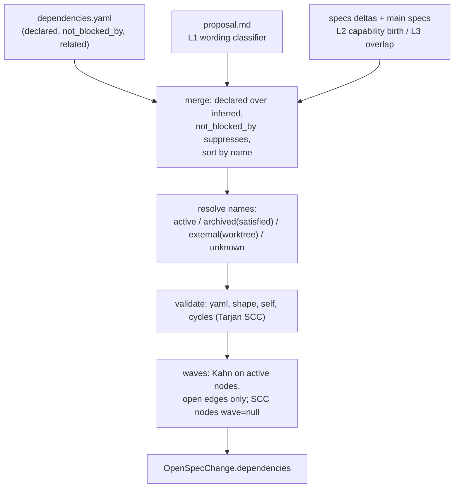

## Context

Exploration measurements on this repo (102 active changes):

- Proposal text names other changes 55 times; wording shows direction ("Depends on" / "Builds on" → blocked by; "Follow-up" / "Consumers" → blocks; "Sibling" / "Out of scope (tracked under)" / "distinct from" → no ordering). Mentions are often mutual (`add-acme-dns01-certs` ↔ `add-tailscale-cert-tls`), so "mention = edge" would fake cycles.
- In dependency-worded sentences, backticked names resolve to: archived 34, active 22, worktree-only 0, unknown 14. The unknown ones are almost all capability, component or package names (`pi-core-version-ui`, `anchored-popover`, `pi-voiceid`).
- 24 capabilities are touched by more than one active change (e.g. `raise-node-floor-to-26` overlaps 6 others).
- A `pi-spec-driven` schema spike accepted a `dependencies` artifact generating `dependencies.yaml`. OpenSpec treats an artifact as done once the file exists, so it does not validate the content.

## Goals / Non-Goals

**Goals:**
- One committed source of truth per change; computed inverse (`blocks`); the same graph on every machine.
- Automatic inference that is useful without being authoritative-on-disk.
- Board visibility (chips, waves) and a ship-time gate.

**Non-Goals:**
- Cross-repo / OpenSpec store dependencies (`initiative` links).
- A CI cycle check and a CLI command (follow-ups).
- Session ↔ change attachment detection.
- Persisting the execution order into `groups.json` `changeOrder`.

## Decisions

### D1. File format and ownership

```yaml
# openspec/changes/<name>/dependencies.yaml
blocked_by:
  - change: add-tailscale-cert-tls
    reason: TLS listener + CertSource interface   # optional
not_blocked_by: [add-remote-access-wizard]        # suppress an inferred edge
related: [macos-notarization]                     # no ordering
```

Shorthand `blocked_by: [name]` is accepted. Only `blocked_by` is stored; `blocks` is always computed as the inverse, so the two cannot drift. Size cap 64 KiB. Parsed with `yaml` `parse` in safe mode, rejecting aliases (`maxAliasCount: 0`).

### D2. Graph pipeline (pure, in the poll worker)



- **L1:** first the proposal's `## Dependencies` section (lines `Blocked by:` / `Blocks:`), then any sentence with a direction keyword. Only backticked tokens that are known change names count. Keywords:
  - `depends on`, `builds on`, `requires`, `blocked by`, `on top of`, `after` → blocked_by;
  - `blocks`, `unblocks`, `follow-up`, `consumers`, `enables` → blocks (stored as the other change's blocked_by);
  - `sibling`, `related`, `tracked under`, `out of scope`, `distinct`, `supersedes`, or no keyword → related.
- **L2:** change A has a spec delta for capability X that has no main spec, with `## ADDED`. Change B has a delta for X with MODIFIED/REMOVED/RENAMED. Then A blocks B. If both only ADD X, that is an L3 overlap with a `duplicate-capability` warning.
- **L3:** two active changes with deltas for the same capability get an undirected `overlaps` entry. They never enter `blockedBy` or the waves.
- Every edge carries `source: declared | inferred-text | inferred-capability` and a `reason` (matched sentence or capability).

### D3. Name resolution

Resolution order: active in this checkout → archived in this checkout (`archive/<date>-<name>`) → active in another known cwd sharing the repo's git common dir (`external`, resolved on the main thread after the worker returns; set lookup only) → unknown.

| Resolution | Edge state | Severity |
|---|---|---|
| archived | satisfied | — |
| active (this checkout) | open | — |
| external | open (pending elsewhere) | info |
| unknown | ignored for waves | warning `unknown-change` |
| self | — | error `self-reference` |
| cycle among open edges | — | error `cycle` (path listed) |
| unparseable or bad shape | — | error `invalid-file` |
| name in both `blocked_by` and `not_blocked_by` | `not_blocked_by` wins | warning `conflicting-entry` |

### D4. Waves

Kahn's algorithm over active changes using open edges. Wave 1 has no open blockers. An `external` blocker counts as one virtual predecessor of wave 0, so the change starts at wave 2 or later and is flagged. Changes in a cycle get `wave: null`. Ties are broken by name. Cost is O(V+E).

### D5. Tracked paths

`dependencies.yaml` is a tracked watcher/gate path for every change, whatever the schema (spec-driven changes don't declare it as an artifact). This builds on the schema-driven tracked set from `use-openspec-status-all`.

### D6. Schema patch v2

`workflow-schema.ts` CURRENT_PATCH becomes 2. The patch inserts the `dependencies` artifact before `tasks` and sets `tasks.requires = [specs, design, dependencies]`. Existing v1 stamps report `schema-stale`, and Update regenerates. Changes pinned to `spec-driven` are unaffected.

### D7. REST and editor

- `GET /api/openspec/dependencies?cwd=&change=` returns the computed entry.
- `PUT /api/openspec/dependencies { cwd, change, blockedBy, notBlockedBy, related }`:
  - applies the `openspec_refresh` admission gates;
  - `change` must be in the cwd's current cached change list;
  - all names must match `isValidOpenSpecChangeSlug`;
  - target path `<root>/openspec/changes/<change>/dependencies.yaml` must pass a containment check;
  - writes atomically.
- The editor is a card-menu dialog. It lists declared edges (removable), inferred edges (each with a "Not a dependency" action that adds the name to `not_blocked_by`), and a picker over active + archived names.

### D8. Visibility

Dependency UI renders when the cwd's default schema is `pi-spec-driven` or any change has `dependencies.yaml`. Otherwise the graph is still computed (cheap) but nothing new is shown.

### D9. ship-it gate

At entry, ship-it calls `GET /api/openspec/dependencies` for the change, or, when the dashboard is unreachable, parses `dependencies.yaml` and checks names against `openspec/changes/` and `archive/`.
- `error` issues → stop via the existing escape hatch (`SHIP_IT_BLOCKED.md`).
- Open blockers → a warning listing them. Interactive runs confirm via `ask_user`; headless runs continue and record the warning in the report.

## Risks / Trade-offs

- [L1 misclassifies prose] → only resolvable backticked names count, unclassified mentions become `related`, and `not_blocked_by` corrects it permanently for everyone.
- [Inference changes when other proposals change] → computed every poll; still deterministic for a given repo state.
- [Per-poll cost] → budget < 20 ms for 100 changes; inputs are proposal files and spec delta headers already near the tracked-path walk; measured in tasks.
- [Execution-order view vs manual drag order] → it is a view mode; `changeOrder` in `groups.json` is untouched.

## Migration Plan

Additive. Existing `spec-driven` changes get inferred edges immediately (visible only per D8). Projects on `pi-spec-driven` v1 see `schema-stale` and update to v2. Rollback: revert; leftover `dependencies.yaml` files are inert.

## Open Questions

_None._
