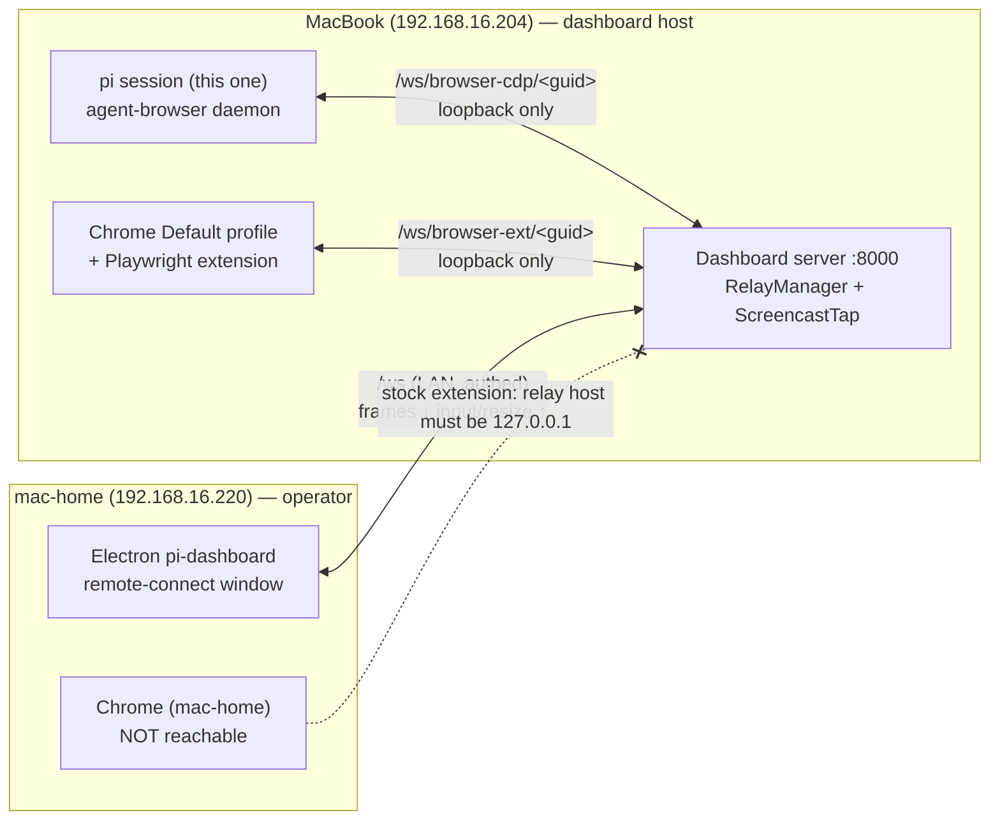
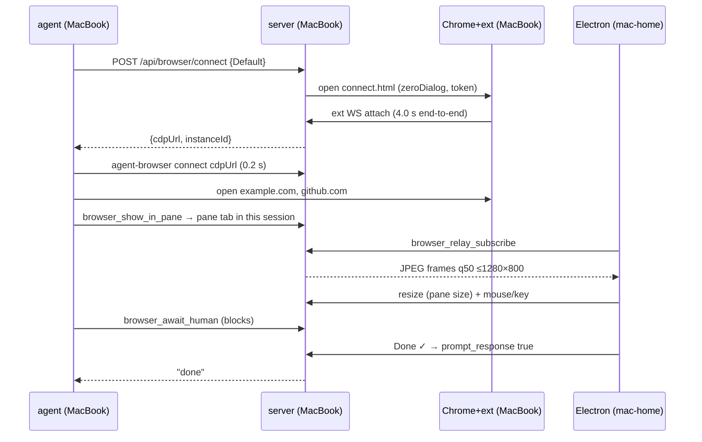
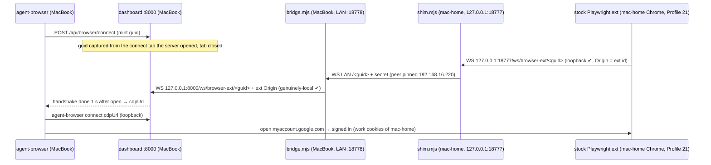

# Spike — browser relay with Electron on mac-home → dashboard on MacBook

Date 2026-10-14. Live run, dashboard 0.9.0 (production), relay instance `inst-0f14ea7be6b2`, profile `Default` ("BlackBelt", token + zeroDialog).

## Topology (as it works today)

The browser that gets driven is always the one **on the dashboard host** (the MacBook). mac-home is only a viewer and input device. Three things pin this:
- the stock extension only dials a loopback relay (`connect.tsx:61`);
- the CDP endpoint is loopback-only;
- the `cdpUrl` is `ws://127.0.0.1:…`.

## Sequence measured

## Numbers

| Metric | Value |
|---|---|
| connect → extension attached | 4029 ms (zero-dialog) |
| `agent-browser connect` | 0.2 s |
| frames during agent scroll, MacBook unattended | 2.5 fps, ~23 KB/frame, ~58 KB/s |
| operator verdict over LAN | "smooth enough"; clicks + typing worked; Done worked |
| audit in ~4 min | 107 mouse accepted, 124 mouse **denied**, 129 resize, 2 navigate, 1 createTarget |

## Findings

1. **Remote viewing works out of the box.** Electron remote-connect gets frames and input over the normal authed `/ws`. No relay endpoint is exposed to the LAN.
2. **"Bring to front" banner blinks (reported by the operator).** `ScreencastTap` flips the tab to `no-frames` after `NO_FRAMES_MS = 2000` ms with no repaint. A static page stops repainting, so the state goes `live` → `no-frames` → `live` on every cursor move. `BrowserPaneTab` shows or hides the idle strip in the layout, so the frame jumps too. Fix direction:
   - add hysteresis (e.g. 10 s before showing, instant hide);
   - render the notice as an overlay chip, not a layout row;
   - only warn when the tab is actually hidden or backgrounded, not just static.
3. **Audit flooded with `denied mouse`, likely from letterboxed pointer moves.** `onPointerMove` sits on the whole frame box but normalizes against the `` rect. In Fit mode, moving over the letterbox gives coordinates outside [0,1], which `buildViewerInputCommands` refuses (`mouse:coords`). That produced 124 "denied" rows: noise in the Activity list that looks like an attack, plus a `warn` line per event in server.log. The refusal reason is also dropped (only `kind` is logged).
   - Fix: the client drops out-of-image moves; the server logs `reason`; mouse-move refusals are rate-limited or not audited.
4. **Instance closed `cdp-closed` right after Done; cause not confirmed.** The agent-browser `default` daemon died with "Connection reset without closing handshake". The next `agent-browser` call started a fresh daemon on its own Chrome for Testing (`about:blank`). That fallback silently drops the login state, which `dashboard-relay.md` forbids.
   - Suspects: the agent-browser `default` session is shared by every pi session on this host (`~/.agent-browser/default.sock`), so another session's agent-browser could have replaced it. An idle timeout is also possible.
   - Mitigation: use `--session <piSessionId>` (or `AGENT_BROWSER_SESSION`) per pi session, and check `get url` before acting.
   - Needs a repro.
5. **The pane resizes the real Chrome viewport on the MacBook.** That's 129 resize events in ~3.5 min, about 0.6/s, within the throttle. Harmless while unattended, but surprising for someone sitting at the MacBook.

## Using mac-home's own Chrome — options

| | Idea | Stock extension? | New code | Risk |
|---|---|---|---|---|
| A | Status quo: drive the MacBook's Chrome, view from mac-home | yes | none | wrong cookies if the logins live on mac-home |
| B | Run the pi session on mac-home's own dashboard (Electron local server) | yes | none | session lives on the other machine |
| C | Fork the extension so it dials a non-loopback relay with a pairing token (research option 2) | no (fork) | ~800 LOC + Web Store upkeep | tunnel/LAN exposure of an ext endpoint |
| **D** | **Electron-side relay shim**: Electron on mac-home listens on `127.0.0.1` as the relay the stock extension dials, and tunnels ext↔server over the existing authed operator WS. The server keeps the loopback `cdpUrl` for the agent and pipes it to the tunnel. | **yes** | Electron main shim + server "remote ext" transport | consent per connect; ext traffic now crosses LAN/zrok — needs per-connect operator approval + audit |

Recommendation for the next spike: **D**. It keeps the stock extension and the loopback-only promise on both ends (extension ↔ Electron, agent ↔ server). The only new path is the operator connection, which already carries frames and input.

Open questions for D:
- Which machine's `Local State` provides the profile list?
- Can `--profile-directory` launch be done from Electron (`systemOpen` on mac-home)?
- Does the 60 s unclaimed-guid timeout survive the extra hop?

---

# Spike D — live proof: MacBook agent drives mac-home's Chrome with the STOCK extension

Run 2026-10-14. No product code changed. Throwaway scripts are in `spike-d/`:
- `shim.mjs` — mac-home, stands in for an Electron-main shim;
- `bridge.mjs` — MacBook, stands in for the server end of the operator WS;
- `pipe.mjs` — shared.

## Result: D works with the unmodified extension

| Metric | Value |
|---|---|
| ext open → handshake through the tunnel | ~1 s (with mac-home pairing token) |
| agent sees mac-home logins | yes — `myaccount.google.com` loads signed in |
| CDP round trip, MacBook agent → mac-home Chrome | `get title` 185 ms, `eval` 355 ms (LAN ping avg 17 ms) |
| pane frames | 1.9 fps, ~18 KB/frame — operator: **laggy** |
| pane clicks and clicks in the real Chrome window | both work |
| relay admission | unchanged: the dashboard still sees a genuinely-local peer with the pinned extension Origin |

## New findings

6. **Keyboard typed into the frame never inserts text (bug, not specific to D).** `BrowserPaneTab` `onKey` sends `{key, code}` and no `text`. `viewer-input.ts keyCommands` forwards it as is. CDP `Input.dispatchKeyEvent keyDown` without `text` inserts nothing.
   - Proven: `a`,`b` without `text` → `""`; `X`,`Y` with `text` → `"XY"`.
   - Typing only works through the text bridge field (it sends `char` with `text`).
   - Fix: on keyDown, set `text` when `key.length === 1` and no Ctrl/Meta, client or server side.
7. **`/api/browser/connect` dies after 10 s when an Allow click is needed (bug).** Fastify `connectionTimeout: 10_000` (`server.ts:1702`) closes the socket and curl gets exit 52 / HTTP 000. `RelayManager` keeps waiting 60 s, so the instance can still connect, but the caller never gets its `cdpUrl`. Zero-dialog hides this (4 s).
   - Fix: disable the per-socket timeout on this route, as `git-routes.ts:482` does.
8. **A stale `connect.html` tab stays open in Chrome after a successful connect.** The first spike's tab was still open, and the first D attempt picked it up (dead guid → bridge 404). Close it, or let the extension close it.
9. **Frames make a needless round trip.** In D, frames go mac-home Chrome → MacBook server → back to Electron on mac-home (research §13 "c1"). That is a big part of the lag. Real D should render frames locally in Electron, taken from the shim's ext stream, and send only CDP to the server.
10. **A token pasted into chat is now in the transcript.** Rotate the mac-home Profile 21 pairing token in the extension.

## What real D needs (from the spike)

- **Electron main:** a loopback relay shim (`127.0.0.1:<ephemeral>`, Origin pinned to the extension id). It opens `connect.html?mcpRelayUrl=…&token=…` in the operator's Chrome with `--profile-directory` (needs `systemOpen` on the operator machine). The ext leg is multiplexed over the existing authed operator WS; it is not a new LAN port.
- **Server:** a "remote extension" attach path. `RelayManager.connect({ profile, target: "operator:<clientId>" })` mints the guid and returns it to that Electron client only; the client never sees the `cdpUrl`. The extension socket is fed from the operator WS. The agent side stays loopback `cdpUrl`, so it's unchanged.
- **Profiles:** profile list and the `installed` probe come from the operator machine's Chrome `Local State` (reported by Electron), not the server host.
- **Consent and audit:** each remote connect needs operator approval in Electron (or a stored pairing token per operator profile). Audit `attach peer=operator:<clientId>`. Kill switch: closing the Electron window closes the instance.
- **Frames:** optional local fast path in Electron (see 9).
