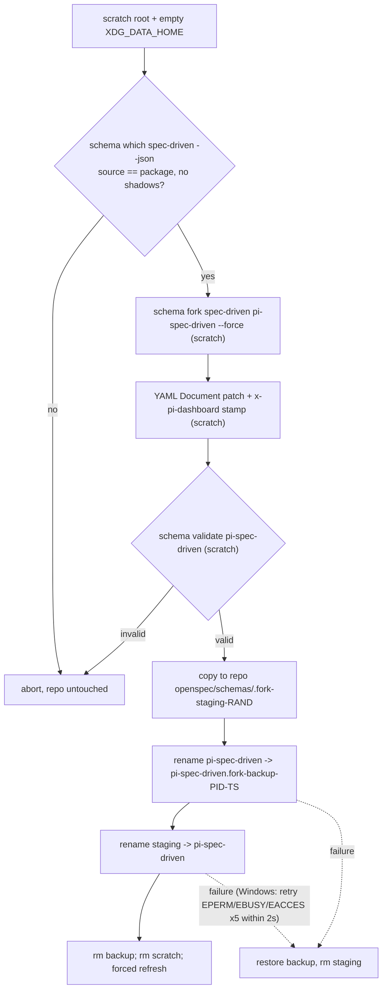

## Context

### How OpenSpec resolves schemas

- **Resolution order** (`dist/core/artifact-graph/resolver.js:114-196`). By name: project `openspec/schemas/<name>/schema.yaml` → user `${XDG_DATA_HOME}/openspec/schemas/<name>/` → package built-in.
- **Fork reads by name, writes into the cwd.** `fork` resolves its source by name in that same order and always writes into `<cwd>/openspec/schemas/<name>`. It does this itself via `.fork-staging-<rand>` and `<name>.fork-backup-<pid>-<ts>`, which discovery ignores (`resolver.js:56-70`; `dist/commands/schema.js:645-721`).
- **Default schema.** `openspec/config.yaml` `schema:` is the default for NEW changes and for any change WITHOUT a `.openspec.yaml`. `openspec new change` pins the default into the new change.
- **Metadata without `schema:`.** A `.openspec.yaml` that exists but has no `schema:` line is already a per-change CLI error.
- **Unknown top-level keys** are stripped, and `schema validate` accepts them.
- **Task-numbering check.** `openspec validate` runs it only for the built-in `spec-driven` (`dist/core/validation/validator.js:399-410`).
- **Experimental.** `openspec schema` commands are labelled experimental.

### Spike results (scratch copy, OpenSpec 1.11.0, 102 active changes)

| Probe | Result |
|---|---|
| `fork` + patch + `schema validate` | valid; a `.yaml` artifact output and template are accepted |
| `x-pi-dashboard` top-level key | accepted everywhere; `fork --force` wipes it (regeneration = fork + re-patch) |
| `openspec update --force`, `openspec init --tools pi --force` | leave `openspec/schemas/` and `config.yaml` untouched |
| switch the default without pinning | 33 changes without `.openspec.yaml` silently moved to the new schema; all became `isComplete:false` |
| pin step (create `.openspec.yaml` where missing) | 33 created in 14 ms; a rerun created 0 in 3 ms; afterwards all 104 kept their schema |
| teammate without `openspec/schemas/` | `status --all`: per-change "schema not found"; `new change`: hard fail |
| `archive` | extra artifacts move with the change; spec deltas sync |

## Goals / Non-Goals

**Goals:**
- A deterministic, regenerable project schema derived from the dashboard's OpenSpec package `spec-driven`, immune to user or project shadows.
- Enable and disable that never change the workflow of a change present in the checkout, whatever the previous default was. (A file-less change merged in later follows the new default; it is reported as unpinned. That is a known limitation of changes without `.openspec.yaml`.)
- Safe for multiple users: committed files, component-wise never-downgrade, per-change degradation when the schema is absent, and no blocking of session controls.
- An explicit design skip replaces R1/R2/R3 for new changes, consistently in the dashboard and in the skills.

**Non-Goals:**
- The dependencies artifact (patch v2, in `add-openspec-change-dependencies`).
- Enabling on this repo, removing `effective-status.sh`, and stepper changes.
- User-level (`XDG_DATA_HOME`) schemas: they are per machine and would break teammates.

## Decisions

### D1. Generate in a scratch root, swap with OpenSpec's transient names



- **Scratch environment for every CLI call.** `--version`, `which`, `fork` and `validate` all run with cwd = scratch root and an empty `XDG_DATA_HOME`; `fork` resolves its source by name (`schema.js:645`), so applying the empty environment only to `which` would still fork a user-level shadow.
- **Swap pre-check** fingerprints the whole existing directory (paths + content hashes), as OpenSpec's own fork does, not just `schema.yaml`.
- **Why a scratch root.** Forking inside the repo would let a project-local `spec-driven` shadow the package base, and an empty `XDG_DATA_HOME` stops a user-level one doing the same. The `which` check makes that guarantee explicit.
- **Copy, not rename.** The result is copied from scratch rather than renamed, which avoids `EXDEV` across volumes such as Docker bind mounts and other Windows drives.
- **Transient names.** OpenSpec's discovery ignores them, so a crash never surfaces a fake schema. The rename gap is not atomic: a poll inside it sees a per-change "schema not found", and the forced refresh afterwards supersedes that.
- **Stamp `previousDefault`** is carried over from an existing stamp on every regeneration (unless it names `pi-spec-driven`), so Update never turns Disable into a no-op.
- **Patch v1** replaces the base instruction line "When to include design.md (create only if any apply):" (`schemas/spec-driven/schema.yaml:144`) rather than appending, so the instruction doesn't contradict itself.
- **Identical output** for teammates assumes the same resolved OpenSpec CLI version (the stamp records it), not merely the same dashboard version.
- **Alternative rejected:** a fixed snapshot shipped in the package. It diverges from the OpenSpec version actually running and still needs re-patching.

### D2. Component-wise stamp comparison

The stamp is `(base = version of the CLI that ran, patch = CURRENT_PATCH)`. Compared with the local `(cliVersion, CURRENT_PATCH)`:

| Stamp vs local | Status | Action |
|---|---|---|
| both equal | `current` | none |
| neither component newer, at least one older | `outdated` | Update offered |
| either newer, none older | `newer` | none, ever |
| one newer, one older | `conflict` | reported; never regenerated by any action (align dashboard/CLI versions) |
| no parseable stamp, or `pi-spec-driven` is a symlink | `unmanaged` | Adopt only after confirmation (never for a symlink) |
| `newer`, but local `schema validate` fails | `incompatible` | notice: update your OpenSpec CLI |

A lexicographic tuple comparison was rejected: a newer base would let a teammate's dashboard silently drop a newer patch.

### D3. Enable order: guard → record → generate → pin → switch

```mermaid
sequenceDiagram
  participant U as User (Settings / init)
  participant S as workflow-schema.ts
  participant FS as repo openspec/
  U->>S: POST enable {cwd}
  S->>S: admission gates (as init), per-cwd lock (or init's held lock)
  S->>S: fresh status --all: root present, source == nearest, realpath(root)==realpath(cwd); no symlinked openspec/, changes/, schemas/; config.yaml|yml exists
  S->>FS: configured == pi-spec-driven? -> return status, write nothing
  S->>FS: read config -> previousDefault (kebab-case, resolvable)
  S->>FS: status none -> generate (D1); current/outdated/newer/conflict -> keep (never regenerate in enable; refuse if stamp previousDefault differs); unmanaged/incompatible -> refuse
  S->>FS: for each active change dir (no archive/, dot-dirs, symlinks) WITHOUT .openspec.yaml: create {schema: previousDefault} via YAML serializer
  S->>FS: config.yaml schema: pi-spec-driven (YAML Document edit)
  S->>S: forced refresh
  S-->>U: {written[], worktree, status}
```

**Pinning.**
- Pinning happens BEFORE the switch, so no poll sees unpinned changes under the new default.
- Pins use exclusive create (no-clobber), so a `.openspec.yaml` that `openspec new change` writes concurrently is never replaced. The standalone `pin` action is create-only too, allowed only while the default is `pi-spec-driven`, and its target must be `pi-spec-driven` or the stamp's `previousDefault` and must resolve.
- `previousDefault` is the config's `schema:` value, or `spec-driven` when the key is absent (the CLI's implicit default). With both `config.yaml` and `config.yml` present, `config.yaml` is used, as the CLI does.
- Pinning only creates missing files, using the previous default; it never assumes `spec-driven`.
- A file present without `schema:` is left alone: it is already a per-change CLI error, and `use-openspec-status-all` surfaces it.
- No `created:` is written. Folder birthtime is the clone time in fresh clones, and the field is optional.

**Writes.** Every write is temp-file + rename, containment-checked against `realpath(<root>)/openspec/`; symlinked `openspec/`, `changes/` and `schemas/` are refused (a realpath check alone would pass for a symlink pointing outside the repo). Schema names are written through the YAML serializer and must be kebab-case ids, because a newline in a hand-edited `config.yaml` default or a request's `pinTo` could otherwise inject metadata keys such as `retire_capabilities: true`.

**Name validation.** Every recorded or written schema name (`previousDefault`, `pinTo`, the config value Disable restores) must be kebab-case, must not be `pi-spec-driven` when it denotes a previous default, and must resolve from the project or package schemas. User-level-only schemas are refused, because teammates cannot resolve them.

**Per-action states.** The endpoint enforces an allowed-state table: `update` re-stamps `previousDefault` (the way out when Enable refuses on a mismatch) and is refused for `conflict`/`newer`/`incompatible`; `adopt` regenerates over an `unmanaged` dir only with `confirm` plus an explicit `previousDefault`; a stamp-less Disable needs an explicit `previousDefault`.

**Partial failure.** A failure after generation leaves the schema dir and any pins in place. They are harmless, because the default has not switched yet, and re-running enable completes the flow.

**Root checks.**
- `root.source` must be `nearest`. A committed store pointer or a declared root would otherwise redirect writes outside the repo (`dist/core/root-selection.js:189-210`).
- `realpath(root.path)` must equal `realpath(cwd)`.
- These root checks run for EVERY writing action (disable, update, adopt, pin, remove), not only enable. The root comes from a fresh `openspec status --all --json` run inside the lock. Right after init no poll is cached, and a CLI without `--all` reports no `root`, so it cannot enable.

### D4. Disable and remove

- **Disable** acts only when the config names `pi-spec-driven`; it restores `previousDefault`, falling back to `spec-driven`. The schema directory stays.
- **Remove** renames the dir to a `.fork-backup-*` name first and then deletes it, so an interrupted delete never leaves a partial schema. It is refused for `unmanaged`/`none`, while the config names the schema, or while an active change pins it. When only archived changes reference it, the user gets a warning and must confirm.

### D5. Schema status separate from readiness

`OpenSpecData.workflowSchema = { configured, generated, missing, unpinnedChanges }` is optional and attached only to successful-poll payloads, so the exact failure shape from `use-openspec-status-all` stays intact. It is computed in the poll worker build, and recomputed when the resolved CLI version changes:
- `configured` and `generated` come from one `config.yaml` read plus a stamp parse, memoized by mtime;
- `missing` comes from resolution checks across the three schema directories;
- `unpinnedChanges` comes from a `stat` of each change dir's `.openspec.yaml`, and only when `configured === "pi-spec-driven"`.

Readiness is deliberately untouched, including when per-change "Unknown schema" errors appear because the schema dir is missing. Readiness `STALE` disables every OpenSpec control on session cards (`openspec/specs/session-card-subcards/spec.md:414`), which is far too strong for an outdated stamp or one merged unpinned change. A new Settings section ("OpenSpec Workflow Schema" on the OpenSpec page `/settings/openspec`, the page `CONFIG_FIELD_PAGE` maps the `openspec` key to, separate from the Workflow Profile section; added to the Save Bar's not-a-source list) holds the `defaultForNewProjects` switch (Save Bar draft) and the per-cwd actions, which write immediately after a confirmation dialog listing the paths. The folder-section chip is only a link to that section, so `openspec-frontend-actions` ("every OpenSpec action button emits a skill command") stays true. The `newer`-stamp `schema validate` runs on the main thread through the spawn semaphore, memoized by (stamp, CLI version); everything else is filesystem work in the poll worker.

### D6. R-rule scoping in both consumers

- `buildOpenSpecData*` skips the design promote override only when `schemaName` is `pi-spec-driven`; every other schema keeps R1/R2/R3 as `use-openspec-status-all` defines, so other custom schemas don't regress. The requirements that state the override (`openspec-detection` "Local design evidence promotes…", `openspec-local-artifact-evidence` "Promote-only reconciliation", and `server-openspec-polling` "Poll paths use one `openspec status --all` spawn…" from `use-openspec-status-all`) are all MODIFIED here, so no archived spec still mandates unconditional promotion.
- `effective-status.sh` reads `.schemaName` from its `openspec status --change` JSON and applies the same gate. The fallback poll path (old CLIs, `openspec list`) carries no `schemaName`, so it keeps promoting; such a CLI cannot enable the schema anyway.
- The existing parity test (`openspec-effective-status-script.test.ts`) gains a `pi-spec-driven` case, so the dashboard and the skills keep agreeing (`openspec-detection` requirement).

### D7. Concurrency and new-project default

- **Lock.** A per-cwd lock, shared with the OpenSpec init endpoint (`inFlightInits`, `openspec-routes.ts:336`), returns 409 on concurrent calls. When init chains into enable, enable runs inside init's held lock instead of re-acquiring it.
- **Route registration.** `preHandler: networkGuard`, a `control`-tier entry in `packages/shared/src/route-tiers.ts` (as `/api/openspec/init`), and the MCP manifest completeness test.
- **New-project default.** On REST init, `defaultForNewProjects` triggers enable inside init's lock, only when `<cwd>/openspec/` did not exist beforehand. project-init runs `openspec init` itself, so the skill owns the "new directory" decision, discloses the step in its Step 3c preview, and calls the endpoint separately (which takes its own lock). It never triggers on repair or overwrite: switching the default of an existing shared project is a team decision.
- **Lock key.** `realpathSync.native(cwd)`, so two spellings of one path share a lock.

## Risks / Trade-offs

- **`openspec schema` is experimental.** Only `which` / `fork` / `validate` are used, their JSON is parsed defensively, and any failure aborts with the previous state intact.
- **`pi-spec-driven` changes lose `validate`'s task-numbering check**, which only runs for the built-in `spec-driven` (`validator.js:399-410`). Accepted and documented; worth raising upstream.
- **Some future CLI path could strip `x-pi-dashboard`.** The status then becomes `unmanaged`, and the explicit Adopt action restores management, so the update path is never permanently cut.
- **A teammate pulls `config.yaml` without the schema dir** (partial checkout): per-change errors plus `workflowSchema.missing`, with an Update action.
- **The non-atomic rename gap** can briefly show per-change errors. The forced refresh afterwards corrects it. Before the destructive rename, the existing `schema.yaml` hash is re-checked against the one read for the stamp, mirroring OpenSpec's own fork. Restores are retried like other renames; if a restore fails, the backup dir stays (ignored by discovery) and is named in the error. A failed backup delete never rolls back a successful swap.
- **Remove only sees the local working tree.** Unmerged branches pinning `pi-spec-driven` break after Remove lands, so the response always warns about this.
- **Patch anchors.** Patch v1 replaces an exact base line. If a future CLI changes it, generation aborts instead of stamping an unapplied patch.

## Migration Plan

Opt-in per project. Rollback: Disable (restores `previousDefault`), then Remove once nothing references the schema. Created pins are harmless to keep.

## Open Questions

_None._
