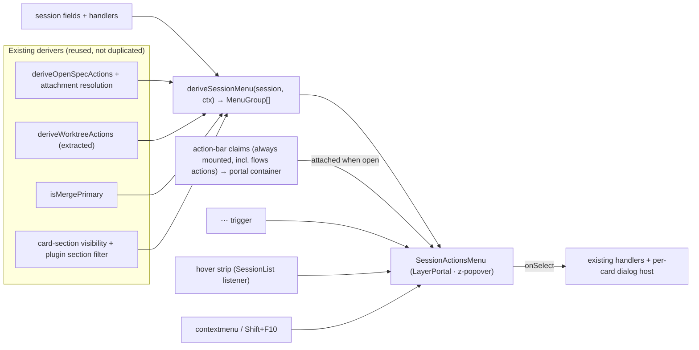

## Context

See proposal.md for motivation; behaviour is specified in `specs/session-actions-menu/spec.md` and the deltas.

Current state that shapes the approach (paths relative to `packages/`):

- **Two branches.** `client/src/components/session/SessionCard.tsx` renders a mobile branch first (`if (isMobile)`, about `:986`). That branch contains none of the controls this change touches.
- **Desktop actions come from six unrelated places:**
  - the chip row in the model line (Resume/Fork/+Session/+Worktree, about `:1298–1370`);
  - `SessionOpenSpecActions` (about `:1460`), a primary plus an `OverflowMenu` on `client-utils` `Popover`, and the unattached combo / + Change / Explore / Bulk Archive;
  - `WorktreeActionsMenu` in the GIT subcard (about `:1907`);
  - `SubcardLegendMenu` on every legend, via `SessionSubcard`;
  - the header Rename pencil (about `:1223`);
  - the `SessionCardActionBarSlot` footer (about `:1544`).
- **Things that stay:** PROCESS row controls (stop per tool, kill per process) live in `ProcessSubcard` / `SessionActivityBar` / `ProcessList`. The card root has no `tabIndex`.
- **Existing derivers:**
  - `deriveOpenSpecActions` (`client/src/components/openspec/openspec-actions.ts`) is shared by the card and `ComposerSessionActions`;
  - `isMergePrimary` (`client/src/lib/git/merge-primary.ts`) is shared by both;
  - `WorktreeActionsMenu` builds its item list inline.
- **Precedent:**
  - `FolderActionsMenu` (`client/src/components/folder/FolderActionsMenu.tsx`): grouped taxonomy, APG menu, `LayerPortal` + `z-popover`, positioning from `usePopoverFlip` (`client/src/hooks/usePopoverFlip.ts`);
  - `SessionList.tsx`'s scope-keyed open state (`folder:<cwd>`, about `:949`);
  - `dashboard-plugin-runtime/src/folder-menu-contributions.tsx`, with `pluginId` from context and `(pluginId, id)` keying.
- **Plugin claims today:**
  - `flows-plugin/package.json:46–50` registers `SessionFlowActionsClaim` on **`session-card-flows`** (the FLOWS subcard), gated by `shouldRenderFlowsSubcard`. Inside it, `SessionFlowActions` renders `FlowActivityBadge` (status + abort) and the Run Flow… / Open flow… / New / Edit… / Delete buttons, each opening a dialog the claim owns (`SessionFlowActions.tsx:~130–260`). The claim also runs the edit-mode reconcile `useEffect` (`:306`).
  - Flows has no `session-card-action-bar` claim; `flows-plugin/src/server/index.ts:183` voids `publishSessionFlowActions`.
  - Goal: `GoalChip` on `session-card-badge` (STATUS) and `GoalControl` (status chip + Pause/Open) on `session-card-action-bar` (`goal-plugin/package.json:52–58`).
- **Layering:**
  - `client-utils/src/Popover.tsx` portals directly to `document.body` at inline `zIndex: 1000` (about `:143`). It is the only inline numeric `zIndex` in `client/src` and `client-utils/src`.
  - `scripts/z-layer-lint.mjs` scans Tailwind classes in `client/src` only, so `Popover` is not in its baseline.
  - **The ratchet already fails on `develop`** (`AgentSpawnPicker.tsx|z-30`, `ChatViewMenu.tsx|z-40/z-50` are new against the baseline). That failure is pre-existing and out of scope here.
  - `client-utils/src/LayerPortal.tsx` honours `LayerHostContext`, so a portal inside a dialog lands in the dialog's host.
- **Mockup:** `mockups/session-card-hover-flyout/index.html` (in this change). It is a tuning lab with the condensed card, the flyout, the hover-intent strip, counters, and layer probes.

## Goals / Non-Goals

**Goals:**
- One menu component and one pure deriver. The card, the composer and the board keep agreeing on availability and disabled state because they share derivers.
- The hover intent costs nothing at React render time: no state updates per `pointermove`.
- Existing plugin claims keep their lifecycle, effects and claim-owned dialogs. No new plugin API.

**Non-Goals:**
- Mobile card, composer strip and board per-session panel layouts (unchanged).
- Nested submenus or hover-opened submenus.
- Changing any server route, ws message or persisted config shape.
- A new positioning library.
- Mirroring controls that act on one running thing (PROCESS rows, `ProcessSafetyChip`, the running-flow abort).

## Decisions

### D1. One pure deriver `deriveSessionMenu` feeding one `SessionActionsMenu`
`client/src/lib/session/session-menu-items.ts` exports `deriveSessionMenu(session, ctx): MenuGroup[]`. Each `MenuGroup` is `{ id, title, subtitle?, items, rare }`. Each item is `{ id, label, icon, onSelect, disabled?, reason?, emphasis?, inert?, testId? }`. The deriver composes the existing derivers and applies these rules:
- the NEXT rule: Merge when `isMergePrimary`, with the OpenSpec primary demoted into OPENSPEC; otherwise the OpenSpec primary;
- de-duplication of the NEXT item from its home group;
- the archived / missing / unresolved / main-checkout branches (letters and Detach only);
- `More…` folding, only when a group has at least 2 rare items.

The `ctx` argument carries the handlers, folder OpenSpec data and attachment resolution, workflow config, section visibility and `working`. Because the deriver is pure, it can be unit-tested without the DOM. Inert lifecycle segments are emitted as `inert`, and the menu renders them as non-focusable status.
- *Alternative:* every subcard keeps its own menu and the flyout aggregates their nodes. Rejected: it cannot enforce the single-primary or folding rules, and it duplicates gating.

### D2. Extract `deriveWorktreeActions` and keep `WorktreeActionsMenu` for the composer
The item list inside `WorktreeActionsMenu`, which holds the per-PR-state rules, the gh gate and the working-disabled rule, moves into a pure `deriveWorktreeActions(session, ctx)`. The composer's segments mode keeps rendering `WorktreeActionsMenu` on top of it, and the session menu consumes the same function. Push/PR toasts and error-code labels stay in the component and are reused through the card's dialog host (D3).

### D3. Dialogs live on a per-card dialog host, not inside the menu
Several items open dialogs: Explore, New change, Propose, Attach picker, archive confirm, Merge/Close worktree, Bulk archive, commit and switch branch. The menu closes on select, so a dialog must outlive it. The card owns `openDialog: DialogKind | null` and renders the existing lazy dialog components (`lazy-openspec-dialogs`, `lazy-worktree-dialogs`) from that state. Menu `onSelect` only sets the state. Dialogs paint at `z-dialog`, above the menu.
- *Alternative:* keep the menu mounted but hidden while a dialog is open. Rejected: focus-return becomes ambiguous.

### D4. Side placement via a small dedicated hook, not `usePopoverFlip`
`usePopoverFlip` places the panel below or above its trigger. `popover-viewport-positioning` governs that trigger-anchored dropdown case. The flyout instead sits beside the card, top-aligned (`left = cardRect.right + 8`), clamped to the viewport, with `max-height: calc(100vh - 16px)`. A `useSideFlyoutPosition(anchor)` hook re-measures on:
- capture-phase `scroll`, ignoring the menu's own scroll target;
- `resize`;
- a `ResizeObserver` on the card, because the card height changes while it streams.

The height rule from that spec still applies: `maxHeight` = available space, and any floor is capped by it.

Point mode, used for right-click, stores the pointer's offset from the card's rect and stays anchored to the card at that offset, so it tracks scroll like anchor mode and never detaches (`overlay-layering`). Repositioning writes `style.left` / `style.top` through a ref. It never sets React state, so re-measuring does not re-render the menu's content.

### D5. Hover intent: one delegated listener at `SessionList`, refs only
A single `pointermove` listener on `document`, installed by `SessionList`, runs only when `matchMedia('(hover: hover) and (pointer: fine)')` matches.
- **Per event:** resolve the card via `closest('[data-session-card]')`, read its rect at most once per animation frame, and test `x >= rect.right - HOVER_STRIP_PX`. Skip when the target is inside `button, a`, while renaming or dragging, or while a click-opened menu or a dialog is open.
- **State:** a ring buffer of the last ~100 ms of samples gives the speed. A dwell timer arms on strip entry and opens once dwell ≥ `HOVER_DWELL_MS` and speed < `HOVER_SPEED_CUTOFF`.
- **Bridge:** the gap between card and menu is a geometric union-rect test in the same handler. The listener sits on `document` because the menu is portaled to `body`; a listener on the sidebar root would never see the pointer while it is over the menu. A hover-opened menu closes after `HOVER_CLOSE_GRACE_MS` outside card ∪ gap ∪ menu.

Only open/close touches React state. The constants live in one module and default to 32 px, 300 ms, 0.4 px/ms and 300 ms. They were measured in the mockup lab.
- *Alternative:* an invisible overlay element per card. Rejected: an element that receives events must sit above ✕, Archive and the stepper, and would steal their clicks.
- *Alternative:* per-card listeners. Rejected: N listeners and N rect reads per frame.

### D6. One open menu across folder and session scopes; the opener is the focused element
`SessionList`'s state generalises to `menuFor: "folder:<cwd>" | "session:<id>" | null`, so opening any menu closes the other. On open, the menu records `document.activeElement` as its opener. Escape refocuses it. A hover open records nothing, so focus is left alone. The keyboard entry (Shift+F10 / ContextMenu) is handled by a `keydown` listener on the card that ignores text inputs. That means the card root needs no `tabIndex`, and no extra tab stop is added per card.

### D7. Plugins: action-bar claims stay mounted and their output is reparented into the menu (no new API)
- **Portal container:** each desktop card renders `SessionCardActionBarSlot` through `createPortal` into a stable per-card container `div` that is not attached to the document. When the menu opens, the PLUGINS group appends that container into its body. On close it detaches the container again.
- **Lifecycle preserved:** claims keep the card's lifecycle. That matters because claims own dialogs (flows' run, open, author and delete dialogs), and those must stay open after the menu closes on select. Claims also run effects (the flows edit-mode reconcile). Claim dialogs render through `DialogPortal` to `body`, so the container being detached does not affect them.
- **Selection:**
  - Inside the portal, the slot is wrapped in an element that stops click propagation, so plugin clicks never reach the card's `onClick` select (`SessionCard.tsx:~1131`).
  - The menu root stops propagation for host items. `FolderActionsMenu` does the same.
- **Activation:** a delegated click listener on the PLUGINS group closes the menu when an enabled `button` or `a` inside plugin output is activated.
- **Intents and accessibility:** the `ui:action-list` primitive (`client-utils/ActionList`, registered in `client/src/main.tsx`) gains a menu context, so intent action lists render as `menuitem`s. Other React claim output sits in a `role="group"` labelled by the plugin name, and its focusable controls join the roving order.
- **Empty-group detection:** the PLUGINS heading renders only when the container has element children. This is checked on open and kept current with a `MutationObserver` while open.
- *Alternative:* mount the slot only while the menu is open. Rejected: claim-owned dialogs would unmount when the menu closes on select.
- *Alternative:* a declarative `useSessionMenuItem` hook, like `useFolderMenuItem`. Dropped by decision. It conflicts with `plugin-intent-protocol` ("emit intents instead of running React code"), and the existing slot plus intents already covers the need.

### D8. Card-section visibility maps onto the menu
- `spawn` gates the New session and New worktree session items.
- `actionbar-<pluginId>` gates that plugin's PLUGINS output and contributions.
- The legend option menus are removed. VIEW carries `Card sections…`, which targets the group folder via the existing `folderKeyForSession` (`gitWorktree.mainPath` for worktrees), and `Card section defaults…`, which targets global Settings and replaces "Hide everywhere".

Ids and persisted config are unchanged.

### D9. Layering fix and ratchet extension
- **Popover:** `Popover.tsx` renders through `LayerPortal`, so inside a dialog it lands in the dialog host, and uses `zIndex: "var(--z-popover)"`.
- **Spec:** the `overlay-layering` portal requirement is MODIFIED to record the dialog layer host.
- **Ratchet:** `z-layer-lint.mjs` adds an inline-numeric-`zIndex` extractor for `.ts`/`.tsx` style objects across `client/src` and `client-utils/src`. The utility-class scan keeps its scope, so in-flow `z-10` decorations in `client-utils` (`Dialog.tsx`, `ZoomControls.tsx`) are not pulled in. The only inline occurrence (`Popover`) is fixed in the same change, so the baseline gains nothing.
- **Pre-existing failure:** the ratchet already fails on `develop`. Verification for this change is therefore "no new occurrence attributable to this change", not a green exit. That failure is reported, not fixed here.
- **Consumers to re-check:** `ui:popover` consumers in `automation-plugin` and `team-app`.

### D10. Test hooks are preserved
`session-card-spawn-sibling` and `session-card-spawn-worktree` move onto the menu items. New hooks: `session-actions-trigger-<id>`, `session-actions-menu-<id>`, `session-menu-item-<id>` and `session-menu-more-<group>`. Every card has `data-session-card` for the hover listener.

### D11. Right-click and native menus
`contextmenu` is intercepted only when all of these hold: the target is not inside `a[href]`, `input` or `textarea`; `getSelection()` is empty or outside the card; and no drag is in progress. Otherwise the native menu is left alone, so copy, open-link and spell-check keep working.

### D12. Flows: actions to the action bar, status stays in the FLOWS subcard
`flows-plugin` adds a `session-card-action-bar` claim (for example `SessionFlowMenuClaim`) that renders Run Flow… / Open flow… / New / Edit… / Delete through `ui:action-list` in menu context, and owns their dialogs.
- **Gate:** the claim uses the presence gate (a `flows` / `flows:*` command or any flow event).
- **Reconcile:** it hosts the edit-mode reconcile, which moves out of `SessionFlowActionsClaim`.
- **FLOWS subcard:** the `session-card-flows` claim keeps only `FlowActivityBadge` (status + abort), and its predicate becomes "any flow event".
- **Manifest and shell:** the manifest gains the action-bar claim. `dashboard-shell-slots`, `flow-pre-run-attach` and `flows-plugin` are modified accordingly. The shell still imports no `Flow*` component.

### D13. Readiness, scope boundary, and event containment
- **Readiness:** the OPENSPEC group reuses the subcard's readiness gate (`SessionCard.tsx:~1421–1435`). Hidden states omit the group; BROKEN and STALE keep only Detach; a legacy payload degrades the same way.
- **Scope boundary:** controls inside other plugin-owned sections are out of scope: the blackhole MEMORY "Details", the KB worktree card re-index, and the browser relay badge popover. Only the action-bar slot and the flows actions move.
- **Event containment:** the menu root stops `click`, `contextmenu` and `keydown` propagation. The portaled menu is a React descendant of the card, so without this, a right-click or Shift+F10 inside the menu would re-trigger the card's handlers.

## Risks / Trade-offs

- **Lost discoverability of the next step.** → The lifecycle bar still shows state, NEXT is the first and emphasised item, and the selected session's composer strip still shows its primary.
- **The flyout sits in the exit path to the chat.** Measured in the mockup: diagonal exits pass through the open menu. → Default 300 ms dwell plus the speed cutoff; the lab's accidental-open counter gives the evidence when tuning.
- **Long menu (550–740 px measured).** → `More…` folding, a viewport-capped height with internal scroll, and sticky group headings.
- **The hover strip overlaps right-edge controls** (✕ or `⋯` by about 23 px, the Archive stepper segment by about 14 px at a 300–500 px sidebar). → No arming over `button, a`; detection is geometric.
- **Reparented plugin output:** measuring code inside a claim reads zero size while it is detached. → Acceptable, because no known claim measures. The note goes in the plugin-author doc.
- **Third-party claims inside `role="menu"`** are groups of plain buttons, not `menuitem`s. → They join the arrow-key order; new plugins should prefer intent `action-list`s, which render as `menuitem`s.
- **Pointer tracking cost.** → One listener, refs only, at most one rect read per frame, and no React state per move.
- **Test churn.** → Update card tests to open the menu. The deriver unit tests carry most of the coverage.

## Migration Plan

Client-only. No server, protocol or persisted-config change. No flag: the change is a layout move with parity-tested gating. Rollback means reverting the client commit, together with the `Popover` and lint change.

## Open Questions

- Final hover timings. Dwell, close grace and the speed cutoff start at 300 ms, 300 ms and 0.4 px/ms. They are constants, and they can be retuned from the lab's accidental-open rate without changing specs or tasks.
