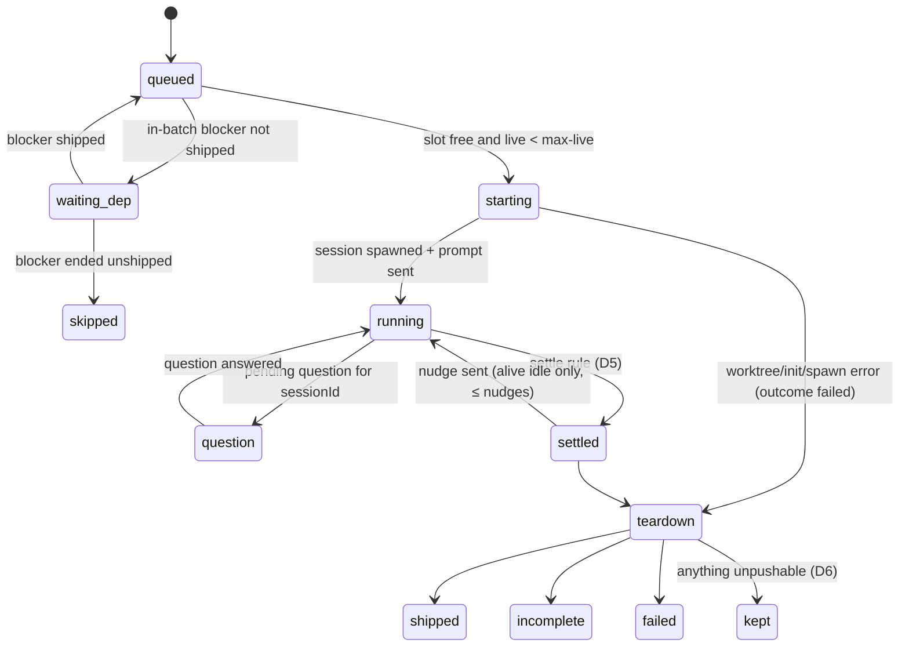

## Context

`ship-it` (`.pi/skills/ship-it/SKILL.md`) ships one change from inside
`.worktrees/os-<change>` (branch `os/<change>`). It is interactive exactly when
`ask_user` is available (§1 entry gate) — true for dashboard-spawned sessions,
so its questions land on the pending-question stack. It ends either merged +
archived via inline `ship-change` (whose §10 removes the worktree itself,
`.pi/skills/ship-change/SKILL.md:207`) or by writing `SHIP_IT_BLOCKED.md` and
leaving the worktree intact (§5).

Existing surfaces this design consumes (no changes to any of them):

| Need | Surface | Cite |
|---|---|---|
| Group + order | `GET /api/openspec/groups?cwd=` → `OpenSpecGroupsFile` (`groups`, `assignments`, `changeOrder`) | `packages/server/src/routes/openspec-group-routes.ts:111`, `packages/shared/src/types.ts:1280` |
| Dependencies | `GET /api/openspec/dependencies?cwd=&change=` (computed `blockedBy`, `wave`) | `packages/server/src/routes/openspec-routes.ts:708`, `packages/shared/src/types.ts:1076-1084` |
| Create worktree | `POST /api/git/worktree {cwd, base, newBranch}` → `.worktrees/<slug>`; 409 `branch_exists`/`path_exists` | `packages/server/src/routes/git-routes.ts:695`, `packages/server/src/git-worktree/git-operations.ts:821` |
| Init hook | `POST /api/git/worktree/init {cwd}`; untrusted → `init_untrusted` (TOFU); auto-init is client-driven only | `packages/server/src/routes/git-routes.ts:581`, `packages/client/src/lib/git/auto-init-worktree.ts:53` |
| Spawn + prompt | bus `spawn({cwd, attachProposal, initialPrompt, model})`, `prompt(id, text)`, session stream | `packages/bus-client/src/client.ts:396`, `:452`, `:365` |
| Session status | `"active" \| "idle" \| "streaming" \| "ended"` | `packages/shared/src/types.ts:73` |
| Pending questions | `GET /api/questions` → `QuestionRow[]` keyed by `sessionId` | `packages/server/src/questions/question-routes.ts:76`, `packages/shared/src/question-types.ts` |
| Archive session | `POST /api/session/:id/archive` — idle → terminates process; live → 409 | `packages/extension/.pi/skills/pi-dashboard/SKILL.md:115` |
| Remove worktree | `POST /api/git/worktree/remove {cwd, force, deleteBranch}`; 409 `active_sessions` / `dirty_worktree` | `packages/server/src/routes/git-routes.ts:825` |
| Local auth | `dialHost()` + `proofHeaders()` (X-Pi-Local-Proof) | `packages/extension/.pi/skills/pi-dashboard/scripts/local-proof.ts:27,32` |

## Goals / Non-Goals

**Goals**
- One command ships a whole group, unattended, with a parallelism cap (default 2).
- A question never wastes a slot; a questioned session is never torn down.
- Every finished change is torn down (session archived, worktree removed) without
  ever destroying work that is not on `origin`.
- Restartable: a crashed/stopped runner resumes without double-spawning.

**Non-Goals**
- No UI, no server/plugin code (automation-plugin work-source considered, rejected below).
- Not answering questions automatically; not changing `ship-it`/`ship-change`.
- Not cross-repo; not multiple groups per run.

## Decisions

### D1 — Skill + standalone TS runner (not automation-plugin, not agent loop)
`.pi/skills/ship-batch/` holds `SKILL.md` and `scripts/`:
- `scheduler.ts` — **pure**: `planQueue(groupsFile, groupId, activeChanges, deps)`
  and `nextActions(state, observations, now)` → list of actions
  (`start`, `nudge`, `teardown`, `skip`, `wait`). No I/O.
- `outcome.ts` — **pure**: classify `{archivedOnDevelop, blockedFile, nudgesUsed}`.
- `ship-batch.ts` — thin I/O runner: REST (`fetch` + `proofHeaders`), bus client,
  `git` CLI, state file. Loop: observe → `nextActions` → execute → persist.

Unit-tested as a vitest project, registered in `vitest.config.ts` like
`.pi/skills/ship-it` (`vitest.config.ts:165`).
Rejected: automation-plugin work-source (needs `add-plugin-spawn-worktree`, a
server plugin and UI — heavier than the need); agent-driven loop (context growth
and turn limits over a multi-hour run).

### D2 — Per-change state machine and slot accounting

- **Observation loop** every 10 s: poll `GET /api/questions`, refresh the lock
  heartbeat, read the bus session snapshot, run `nextActions`, execute, persist.
  A freed slot is therefore refilled within one interval.
- **Active** = `starting | running | settled | teardown`; **live** = active +
  `question`. A new change starts only while `active < N` **and**
  `live < --max-live` (default `2 × N`) and an eligible `queued` item exists.
  `question` does not count toward `N` (the user rule); `--max-live` bounds the
  docker harnesses questioned sessions keep up (`docker/test-up.sh:40-81`
  refuses a harness when `(n+1) × 4g ≥ MemTotal`).
- An answered question returns the item to `running` even if `active > N`;
  nothing is pre-empted, new starts wait.
- A `question` item is never torn down, nudged or timed out. The runner exits
  only when every item is terminal (`shipped | incomplete | failed | kept |
  skipped`); a pending question keeps it alive.
- `--parallel` and `--max-live` must be integers with `1 ≤ N < max-live`
  (`max-live = N` would stop a question from ever freeing a slot), else exit
  before any side effect.

### D3 — Queue order and dependency gating
- **Members** = changes listed by `openspec list --json` (active only) with
  `assignments[c] === groupId`, minus changes already archived on `origin/develop`
  at plan time (reported "already shipped — pull develop"). Group is matched by id, then case-insensitive
  name; unknown/ambiguous → exit listing the groups.
- **Order** = `changeOrder[groupId]`; members absent from it follow in the
  board's default order (in-progress → complete → name, `packages/shared/src/types.ts:1287`).
- **Dependencies** per member from `GET /api/openspec/dependencies`; 503
  `pending` → retry, 10 attempts × 3 s; still failing or any other non-200 → **abort before
  any side effect** naming the change (no offline fallback: it would drop
  inferred edges and silently weaken gating; ship-it's `offlineEntry` is not
  exported, `openspec-deps-gate.ts:133`).
  Only **open `blockedBy` edges to other batch members** gate.
- Eligible = no unshipped in-batch blocker. A blocker ending non-`shipped` →
  dependent `skipped` (reason names it). A cycle among batch members (found by
  the scheduler on the in-batch edge set; `wave` is not used — it also nulls
  dependents of out-of-batch cycles) → those members `skipped` at plan time.
- Gating uses the runner's own outcomes, never a server re-poll.
- Out-of-batch open blockers do not gate; `ship-it` §1.5 asks continue/stop
  (a question → slot freed). Dry-run and the report list them as "will ask".

### D4 — Preflight and start
**Preflight (once, before any side effect):** `git` and `openspec` on PATH;
dashboard reachable; `spawnStrategy === "headless"` from `GET /api/config`
(bus spawn correlation needs it, `packages/bus-client/src/client.ts:387-394`);
repo has an `origin` remote; flag validation (D2).

**Start a change** (base is always `develop` — `ship-change` targets it):
1. Worktree `.worktrees/os-<change>`:
   - registered in `git worktree list` → reuse;
   - else local branch `os/<change>` → `POST /api/git/worktree {cwd, base: "os/<change>"}`
     (checkout mode, no `newBranch`);
   - else remote-only → `{cwd, base: "origin/os/<change>"}` (checkout mode
     strips the remote prefix, `packages/shared/src/git-worktree-helpers.ts:57-84`);
   - else `{cwd, base: "develop", newBranch: "os/<change>"}`.
   - `path_exists` on an unregistered dir (husk, ship-change §10) →
     `POST /api/git/worktree/orphan-cleanup` then retry once; `branch_in_use`
     or a second failure → `failed` with the reason.
2. `POST /api/git/worktree/init {cwd: worktree}`. No hook → continue.
   `init_untrusted` → item `failed` and **scheduling halts** (live items finish;
   exit tells the operator to trust the hook once and re-run). Never auto-trust.
   `init_failed` → item `failed`.
   A spawn `choiceWarning` (model/role dropped) is logged and reported; the run continues.
3. Persist `spawnRequestedAt`, then bus `spawn({cwd: worktree, attachProposal:
   change, model: --model (default "@coding"), initialPrompt: "/skill:ship-it"})`;
   persist `sessionId` before any further step.
4. **Adoption** (spawn timeout, or resume of a `starting` item without
   `sessionId`): adopt only when **exactly one** resident, non-ended session
   has `realpath(cwd) === realpath(worktree)` and started at or after
   `spawnRequestedAt`. None → (spawn) `failed` / (resume) spawn again; several →
   `kept` (ambiguous, never guess).

### D5 — Settling and outcome
- **Observation precondition**: no settle or teardown decision is made unless the
  bus has been connected continuously for at least the settle window. A recorded
  session missing from the resident snapshot counts as ended only when the
  archived listing (`GET /api/sessions/archived/:id`) shows it; otherwise the item
  waits (dashboard restart / bridge reconnect).
- **Dashboard unreachable**: on bus disconnect the runner reconnects with
  exponential backoff (1 s doubling, cap 60 s) forever; no decisions while down;
  `--status` shows "dashboard unreachable since <ts>".
- **Settled** when, with no pending question for the session, either:
  (a) it is `ended`; or (b) it is `idle` continuously for the settle window
  (default 30 s) **and** it was observed `streaming` since the last prompt **or**
  the last prompt is older than `--start-timeout` (default 5 min).
- **Outcome** (`outcome.ts`): the plan records the set of archived change names
  on `origin/develop`. At settle, `git fetch origin develop` (runner-serialised,
  3 attempts with backoff), list `openspec/changes/archive/` via `git ls-tree`,
  map names with the shared `archivedChangeName`
  (`packages/shared/src/openspec-dependencies.ts:354`):
  - `shipped` ⇔ `<change>` archived now and not at plan time. Not found on the
    first fetch → one re-fetch after 30 s before deciding (merge propagation).
  - else `blocked` ⇔ `<worktree>/openspec/changes/<change>/SHIP_IT_BLOCKED.md` exists.
  - else `incomplete`; fetch failed → `unknown`.
- **Nudge**: `incomplete` + session alive and `idle` + `nudgesUsed < --nudges`
  (default 1) → `prompt(id, "Continue /skill:ship-it for <change> from where you
  stopped.")`, back to `running`. Ended sessions are never nudged. This also
  covers a ship-change that ended its turn while waiting on CI.

### D6 — Teardown: archive always, remove only what is safe
**Rule (user decision):** push what can be pushed; keep the worktree whenever
anything cannot be pushed. "Pushable work" = commits on `os/<change>` + tracked
changes + untracked non-ignored files. `.pi/settings.json` is worktree-local
config (ship-it §4.5 keeps it unstaged) and never counts as work. Ignored files
(caches, `node_modules`, ship-it's run dir under the worktree git-dir) are not work.

Common prefix, every outcome:
1. **Archive the session** (if resident): `POST /api/session/:id/archive`.
   Idle → archive intent (expires after 60 s, `openspec/specs/session-archive/spec.md:30`);
   wait for `ended`; if ended but not archived (intent expired), archive again
   (ended → immediate). 409 (live) → wait a settle window, retry; total bound
   3 min. Not archived within the bound → `kept`, worktree untouched.
2. **Harness down**: if `<worktree>/.pi-test-harness.json` exists, run
   `docker/test-down.sh` from the worktree (idempotent; ship-it §6 ordering).
3. **Live-session guard**: any resident non-ended session under the worktree
   (`GET /api/sessions`) → `kept`.

Per outcome:

| Outcome | Git action | Worktree | Branch |
|---|---|---|---|
| `shipped`, worktree gone (ship-change §10) | `git worktree prune` | — | `git branch -D os/<change>` if present |
| `shipped`, dirt ⊆ {`.pi/settings.json`} | — | `remove {force:true}` | `git branch -D os/<change>` (squash merge makes `-d` refuse) |
| `shipped`, other dirt | — | **kept** (unpushable) | kept |
| `blocked` | WIP commit + push (below) | **kept** — `SHIP_IT_BLOCKED.md` is gitignored (`.gitignore:71`), so the hand-back is unpushable; matches ship-it §5 "leave the worktree intact" | kept |
| `incomplete` / `failed`, nothing to save | — | `remove {force:true}` | `git branch -D` only if no commits ahead of `develop` |
| `incomplete` / `failed`, work | WIP commit + push | push OK → `remove {force:true}`; push fails → **kept** | kept |
| merge/rebase in progress, detached HEAD | none | **kept** | kept |
| `unknown` | none | **kept** | kept |

**WIP commit + push**: `git add -A -- . ':!.pi/settings.json'`; commit only if
something is staged: `git commit --no-verify -m "wip(ship-batch): <change>
<outcome>"` (rescue commit on a feature branch; a failing hook must not lose
work); `git push -u origin os/<change>`. `force:true` is used only after the
common prefix confirmed no live session, and only where the table allows.

### D7 — Persistence, locking, observability
- State: `<repo>/.worktrees/.ship-batch/<groupId>.json` (`.worktrees/` is
  git-excluded by `addWorktree`, `git-operations.ts:885`) — items, states,
  sessionIds, `spawnRequestedAt`, nudges, plan-time archive set, timestamps.
  Atomic write (tmp + rename) after every transition. Event log: sibling
  `<groupId>.events.jsonl`.
- `<repo>` = the main checkout = parent of the realpath of
  `git rev-parse --git-common-dir`, so a runner started in any worktree resolves
  the same directory.
- Lock: `<repo>/.worktrees/.ship-batch/lock` = `{pid, hostname, groupId,
  heartbeatAt}`, created atomically (`open(..., "wx")`); heartbeat refreshed every
  loop. Existing lock: different host → refuse; same host and pid alive and
  heartbeat < 10 min old → refuse naming the pid; otherwise remove and re-create
  atomically (a lost race refuses).
- **Resume vs fresh**: any non-terminal item → resume (re-attach recorded
  sessions via the bus snapshot; `starting` without `sessionId` → adoption, D4;
  recorded item without a resident session → settle path). All terminal →
  rotate to `<groupId>.<ts>.json` and plan fresh: still-active members are
  re-queued, except a member whose worktree hosts a live resident session
  (`skipped`, "live session present"). A re-queued `kept` blocked change reuses
  its worktree; ship-it's interactive entry gate sees `SHIP_IT_BLOCKED.md` and
  asks resume/abort — the human decision ship-it requires (question → slot freed).
- SIGINT/SIGTERM: stop new starts, persist, release the lock, exit; live
  sessions keep running and are re-attached on resume.
- `--status` prints the state table; `--dry-run` prints order, waits, skips and
  out-of-batch "will ask" blockers with no side effects.
- Final report (stdout + event log): per change outcome, branch, kept path, reason.
- **Exit codes**: `0` every change `shipped`; `2` run completed with any
  `kept | incomplete | failed | skipped`; `1` usage, preflight, lock refusal or
  fatal error (before or instead of a completed run). SIGINT/SIGTERM exit `130`/`143`.

## Risks / Trade-offs

- **Unanswered question pins the run** → by requirement a questioned session is
  kept open indefinitely; the runner waits. `--status`, safe SIGINT, resume.
- **Out-of-batch open blockers** → each raises a ship-it question; the group
  does not ship fully unattended. Surfaced up front by dry-run.
- **Harness memory** → `--max-live` (default `2 × N`) bounds live sessions and so
  harnesses; the runner never sets `PI_HARNESS_ALLOW_OVERSUBSCRIBE`.
- **Kept worktrees** (user decision) → blocked changes and anything unpushable
  stay on disk with an archived session; the report lists every kept path.
- **Parallel merges race on `develop`** → `ship-it` §2.5 merges `origin/develop`
  before its harness; conflicts surface as a question or `SHIP_IT_BLOCKED.md`.
- **`/skill:ship-it` via `initialPrompt`** is unproven → task 1.2 is a gating
  spike before implementation; fallback prompt "Run the ship-it skill for change
  <change>." (ship-it auto-loads on its triggers).
- **More ship-it questions** → interactive ship-it also asks at §4.4b (CodeQL
  alerts, script error) and §4.5 (review cap / hand back); each pins its session
  by design.
- **No per-item timeout** → a ship-it run legitimately spans CI and review for
  hours; a session stuck streaming holds its slot. `--status` shows item age;
  the operator aborts the session, which then settles.
- **Ambiguous adoption** (several sessions in one worktree) → item `kept`
  without archiving any of them; the report names the sessions for the operator.
- **Interrupted sessions** (`live:true`) cannot be archived
  (`openspec/specs/session-archive/spec.md:30`) → item `kept`, reported
  "session not archivable"; the one case where "always archive" cannot hold.
- **Shipped branch deletion** → after a squash merge local-only commits on
  `os/<change>` cannot be told apart by hash; ship-change merges the pushed head,
  so `branch -D` is accepted. Runner-side checks replace the endpoint guards
  that `force:true` and direct `git` calls bypass.
- **Repo conventions** → `develop` base and `origin` remote are this repo's
  ship-change conventions; the skill is project-scoped.
- **Coupling to ship-it/ship-change outputs** (archive dir naming,
  `SHIP_IT_BLOCKED.md`) → shared `archivedChangeName` parser; the hand-back file
  is spec'd in `ship-it-orchestrator`.

## Migration / Rollback

Additive project skill; no data migration, no server change. Rollback = delete
`.pi/skills/ship-batch/` and its `vitest.config.ts` entry. State files under
`.worktrees/.ship-batch/` are disposable; kept worktrees are ordinary worktrees.
