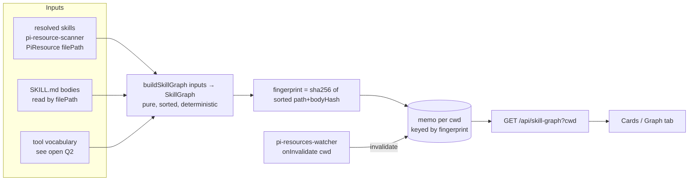

# Exploration notes — add-skill-atlas-screen (handover)

Status: explore-mode output. Not a design decision yet. Feed into `design.md` / proposal revision.

## Branch state

- `feat/add-skill-atlas-screen` = 2 commits on develop: `proposal.md` + vendored `reference/skill-atlas/` (personal CLI snapshot).
- No `design.md`, `specs/`, `tasks.md` yet. No code.

## User intent (verbatim gist)

"Generalize and make part of pi-dashboard. A builder that builds from current state — as a function. When user adds/modifies skills, recreate the map. Maybe automatically?"

## Core reframe: atlas = pure function of resolved state

- Builder = `buildSkillGraph(skills: {id, filePath, description, pkg, body}[]) → { skills: SkillNode[], links: SkillLink[], fingerprint }`. No fs inside → trivially testable; port `selftest.mjs` cases as vitest.
- Recompute is cheap (~90 bodies, O(n²) regex for `references` ≈ 8k regex tests, ms range). No need for incremental graph diffing — just rebuild whole graph when fingerprint moves.
- "Automatic" = ride existing invalidation, not a new subsystem.

## Findings from the codebase

| Fact | Where | Implication |
|---|---|---|
| Scanner already resolves skills via pi's own resolver (shown copy = loaded copy) | `packages/server/src/pi/pi-resource-scanner.ts` (+ `.AGENTS.md`) | Drop atlas's own walk + `pi-resolve.mjs` + dedupe ranking entirely. Huge simplification. |
| `PiResource` has `name, description, filePath, enabled, packageSource` — no body | `packages/shared/src/rest-api.ts:501` | Builder reads bodies by `filePath`; or scanner returns body hash. |
| SWR cache + `fs.watch` invalidation exists | `pi-resources-watcher.ts`, `directory-service.ts`, `openspec-routes.ts` (`GET /api/pi-resources`) | Hook graph memo onto same `onInvalidate(cwd)`. |
| Watcher is **non-recursive**: watches `.pi/`, `skills/` dir entries, `settings.json` | `pi-resources-watcher.ts` header | Adding/removing a skill folder → fires. **Editing `skills/foo/SKILL.md` body → does NOT fire** (nested file). npm-package skills (global node_modules) → not watched. Falls back to 5-min staleness bound. |
| `session-skill-registry` keeps latest `commands_list` per session | `packages/server/src/pi/session-skill-registry.ts` | Possible live signal: a session reload re-sends `commands_list` → cheap trigger to re-fingerprint. |
| Team skill catalog adds skills by path | `openspec/specs/team-skill-catalog/` | If pi resolves them, they appear for free via scanner. |

## What is NOT generic in the reference tool (must change)

1. **`TOOL_VOCAB`** — hardcoded list of this machine's tools (firecrawl_*, vkf_*, research_*). Breaks for any other user.
2. **`categorize()`** — keyword guess tuned to one person's taxonomy (Research/Knowledge/Rigor/Design/Workspace).
3. **Provenance tiers** (Yours / In-house / 3rd-party) — keyed on author/repo heuristics in `provenance()`; "In-house" means BlackBelt.
4. **Summaries layer** (`summaries.json`, stamps, drift) — authored + LLM; proposal already excludes from v1. Good.
5. **Multi-project "Loaded in" matrix** — excluded from v1. Good; dashboard is per-cwd anyway.

## Open questions (decide in the worktree session)

1. **Freshness trigger** — which?
   - (a) watcher only (body edits stale ≤5 min)
   - (b) (a) + fingerprint check on each `GET` (stat mtimes of N SKILL.md files ≈ cheap, ~90 `stat`s) → always correct, no new watchers. ← leaning
   - (c) extend watcher to depth-2 `skills/*/SKILL.md` (more fds, EMFILE risk)
   - (d) also refresh on `commands_list` arrival / `npm run reload`
2. **Tool vocabulary** — source of truth?
   - frontmatter `allowed-tools` only (spec-native, sparse)
   - live session tool names (does bridge forward the registered tool list? unverified — check)
   - heuristic: any backticked `snake_case` token that ≥2 and ≤6 skills share (self-calibrating, no vocab)
   - make `shares-tool` opt-in / drop from v1
3. **Category** — drop keyword guess; group by package / origin (local / global / package name)? Or let user tag?
4. **Provenance** — reuse scanner's scope (local/global/package) instead of author heuristics.
5. **Push vs pull** — client refetch on existing pi-resources change broadcast, or new WS event `skill_graph_changed`? Does pi-resources already push to client? (check `directory-service.ts`).
6. **Scope of "skills"** — include prompts / agents / extensions as nodes later? (agents reference skills; flows reference agents.) Keep `SkillLinkType` open-ended.
7. **Builder location** — `packages/server/src/pi/skill-graph.ts` (proposal) vs `packages/shared` so the personal CLI could import the same function (single implementation, CLI becomes a thin wrapper)?
8. **Graph UI** — hand-rolled SVG force (port `template.html`, ~1000 lines incl. CSS) vs d3-force (dep). Proposal says no dep.

## Suggested next steps

1. Answer Q1, Q2, Q7 (they shape the API).
2. Revise `proposal.md` "What Changes" (builder-as-function + freshness rule), then `openspec instructions` → `design.md`, `specs/skill-atlas-screen/spec.md`, `tasks.md`.
3. Run `plan-proposal` skill (doubt-review + scenario-design) before implementing.

Reference quickstart: `node reference/skill-atlas/scripts/selftest.mjs`; link rules live in `reference/skill-atlas/scripts/lib/scan.mjs` lines ~340–395.

## Decisions (explore session 2)

| # | Decision | Notes |
|---|---|---|
| Form | **Dashboard plugin** `packages/skill-atlas-plugin` (not core) | server + client + shared entries |
| Q1 | Freshness = (b)+(d): mtime fingerprint on every GET + push refresh on `commands_list` arrival / `npm run reload` | plugin `registerPiHandler("commands_list")` → re-fingerprint → `broadcastToSubscribers({type:"skill_atlas_changed", cwd})` |
| Q2 | `shares-tool` vocab = self-calibrating heuristic: backticked `snake_case` tokens shared by 2–6 skills | no `TOOL_VOCAB`, no bridge plumbing |
| Q7 | `buildSkillGraph` pure fn in plugin `src/shared/` (no `node:` imports) | personal CLI may import later |
| Scope | Two atlases: **project** (effective set pi loads in folder: local+global+packages, project-local nodes highlighted) + **global** (`~/.pi/agent` + global packages) | maps to `scanPiResources(cwd)` / `scanGlobalResources()` |
| Data seam | New optional `ServerPluginContext.getPiResources?(cwd?)` — reuses `directoryService` SWR cache + watcher | pattern of `isPiExtensionInstalled?`; plugin owns fallback when absent |
| Slot | New additive slot `resource-page-section` `{resourceType, scope, cwd?}` rendered by `ResourceGridPanel` | minor slot-taxonomy bump. Reason: `settings-section` `tab` field is inert (dashboard-plugin-loader spec) |
| Entry points | Folder actions menu item (`useFolderMenuItem`, group `open`) → project atlas; Settings nav hint → global atlas; `command-route` `/atlas` → global atlas; `resource-page-section` on Folder+Global Skills pages: compact preview + "Open atlas" button | no new nav slot |
| Routes | project: `shell-overlay-route` `/folder/:encodedCwd/atlas/*?` `presentation:"content"` depth 2 parent `/folder/:encodedCwd`; global: `/atlas/*?` depth 1 | per `docs/plugin-apps.md` recipe |
| Follow-up | `app-nav-item` global header/app-menu slot → **separate change** | out of scope here |
| UX | Mockup loop (`frontend-mockup-loop-dashboard`) runs **before** client code; mockups stored under `mockups/` in this change dir | |

### Tentative (user flagged "adjust some" — confirm)

- Q3 Category: group by origin/package (local / global / package name); drop keyword guess.
- Q4 Provenance: reuse scanner origin (`classifyResourceOrigin` kinds), not author heuristics.
- Q6 Node kinds: skills only v1; keep `SkillNodeKind` / `SkillLinkType` unions open.
- Q8 Graph: hand-rolled SVG force, deterministic seed, no dep; >300 nodes → cards-only.

### UX surfaces to mock

1. Compact preview on Skills pages (counts, mini graph?, "Open atlas").
2. Full atlas page: Cards | Graph tabs, filter bar, detail panel (side panel desktop / depth-2 panel mobile).
3. Graph encoding: edge color per type, project-local highlight, 1/2-hop focus, >300 fallback.
4. A11y: keyboard + screen-reader equivalent of graph (cards / adjacency list), contrast across 4 themes.
5. States: empty folder, degraded scan, rebuilding.

## Mockup loop (session 2) → spec-relevant behaviour

Artifacts: [`mockups/ui-plan.md`](mockups/ui-plan.md) (surfaces → tokens → states, cited rules, TEST results), `mockups/index.html` (interactive, real 91-skill snapshot).
Behaviour the specs must carry:
- Focus mode re-fits the graph to the k-hop set.
- Graph labels: greedy priority placement, no overlap; graph dims shapes; Cards/Links **hide** non-matches + "Showing N of M · Clear".
- Mutual `references` render as one `↔` neighbour row.
- Relation = colour + line style (solid+arrow / dashed / dotted) + word; origin = node shape (◆ project + green ring, ● global, ■ package).
- Accessible equivalents: Links table + Cards; graph keyboard: arrows walk nodes by degree, Enter selects, Esc clears.
- Rebuild keeps stale view; header status "Up to date / Updating…" (dot + text).
- `resource-page-section` empty → render nothing.
Found pre-existing debt (not this change): nord-light `--link` 3.49:1, `--tint-green` pair 4.44:1.
