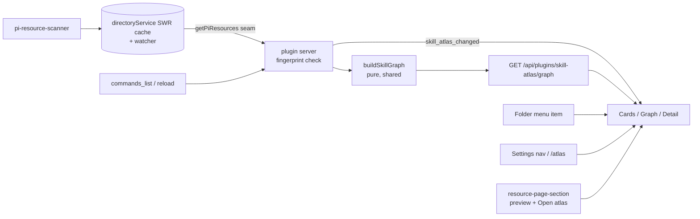

## Why

A typical machine has ~90 pi skills, coming from user installs, global npm packages, project `.pi/skills/`, and the dashboard source. Today the dashboard lists skills as a flat grid: Folder settings → **Skills** (`/api/pi-resources`). It cannot answer:

- Which skills reference each other?
- Which skills ship together in one package?
- Which skills drive the same tools?
- Which copy of a skill pi actually loads?

The personal `skill-atlas` skill (vendored at [`reference/skill-atlas/`](reference/skill-atlas/)) proves the idea, but it is a static, hand-regenerated HTML file tuned to one machine (hardcoded tool vocabulary, personal category and provenance heuristics). This change generalizes it into a **dashboard plugin** whose graph is a pure function of the resolved skill state and rebuilds itself when skills are added or modified. Exploration notes: [`exploration.md`](exploration.md).

## What Changes

- **New plugin `packages/skill-atlas-plugin`** (server + client + shared entries).
- **Pure builder** `buildSkillGraph(skills) → { skills: SkillNode[], links: SkillLink[] }` in the plugin's `src/shared/`. The fingerprint is computed on the plugin server (design D3). No fs and no `node:` imports. Output is sorted and deterministic. Link rules are ported from `reference/skill-atlas/scripts/lib/scan.mjs`:
  | Type | Rule | Direction |
  |---|---|---|
  | `references` | Skill A's SKILL.md names skill B (hyphenated id, or `/skill:x` / `skill: x` / `x skill`) | A → B |
  | `bundle` | Same package, 2–14 skills | undirected |
  | `shares-tool` | Both mention the same backticked `snake_case` tool token, and only 2–6 skills mention it (self-calibrating, no hardcoded vocabulary) | undirected |
- **Two atlases**:
  - **Project atlas**: the effective set pi loads in a folder (local + global + packages), with project-local nodes highlighted.
  - **Global atlas**: `~/.pi/agent` plus global packages.
- **Freshness (automatic rebuild)**:
  - Every GET recomputes a fingerprint from each skill's metadata and SKILL.md `stat` (design D3), and rebuilds only when it changed. This catches body edits that the non-recursive pi-resources watcher misses.
  - The existing pi-resources watcher invalidation still covers skills being added or removed.
  - Push: a new optional host seam `onPiResourcesInvalidated` fires on watcher invalidation and on `commands_list` arrival (session start or `npm run reload`). The plugin re-fingerprints and, if anything changed, broadcasts `skill_atlas_changed`, and the client refetches. Plugin `registerPiHandler` cannot see core `commands_list`, which is why a seam is needed.
- **Server endpoint** (plugin-owned) `GET /api/plugins/skill-atlas/graph?scope=project|global&cwd=…`, behind `networkGuard`.
- **Host seams (small, additive)**:
  - `ServerPluginContext.getPiResources?(cwd?, {fresh?})` is optional and reuses the `directoryService` stale-while-revalidate cache. The plugin degrades gracefully when it is absent.
  - `ServerPluginContext.onPiResourcesInvalidated?(handler)` is optional and fires on watcher invalidation and on `commands_list` arrival.
  - The settings nav promotion allowlist gains `resources`, so first-party plugins can promote into the Resources group.
  - New slot `resource-page-section` `{ resourceType, scope, cwd? }`, rendered by `ResourceGridPanel` on the Folder and Global resource pages. This is a minor slot-taxonomy bump. It is needed because the `settings-section` `tab` field is inert. The manifest claim gains an optional `resourceType` field, which means changes to the manifest validator and to `ClaimEntry`.
- **Entry points**:
  - Folder actions menu item "Skill Atlas" (`useFolderMenuItem`, group `open`) → project atlas.
  - Settings nav entry "Skill Atlas", promoted into the Resources group → global atlas.
  - URL `/atlas` (`shell-overlay-route`) → global atlas.
  - `resource-page-section` on the Skills pages: a compact preview plus an "Open atlas" button.
- **Routes**:
  - Project: `shell-overlay-route` `/folder/:encodedCwd/atlas/*?` (`presentation: "content"`, depth 2, parent `/folder/:encodedCwd`).
  - Global: `/atlas/*?` (depth 1).
- **Views**:
  - **Cards**: grouped by origin/package, filterable.
  - **Graph**: SVG force layout with deterministic seeding, per-relation-type toggles, and 1- or 2-hop focus.
  - **Detail panel**: description, path, origin, neighbours.
  - An accessible non-graph equivalent: a cards/adjacency list.
- **UX first**: a mockup loop (`frontend-mockup-loop-dashboard`) produces design artifacts under `mockups/` before any client code is written.
- **Non-goals (v1)**:
  - No authored summaries layer.
  - No editing of skills.
  - No cross-project "loaded in" matrix.
  - No change to the personal CLI.
  - No global header/app-menu slot. `app-nav-item` is a separate follow-up change.

## Discipline Skills

- `performance-optimization`: the fingerprint costs ~90 `stat` calls per GET, and a body is read only when its fingerprint moved. The full rebuild is O(n²) regex work, in the millisecond range. The client force layout falls back to cards-only above ~300 nodes.
- `security-hardening`: SKILL.md bodies are untrusted text, never sent to the client. Names, descriptions, paths and link reasons are rendered as escaped text. The SKILL.md itself opens in the existing resource file viewer, through the existing restricted `/api/pi-resource-file` route. `filePath` is served only from scanner-resolved resources. The endpoint sits behind `networkGuard`.
- `observability-instrumentation`: a new endpoint and a push event. The server logs rebuild timing and node/link counts through the plugin logger.
- `doubt-driven-review`: before the public plugin API grows (the `getPiResources` seam and the `resource-page-section` slot), because slot-taxonomy additions are hard to remove.
- `review-code`: runs before commit.

## Capabilities

### New Capabilities

- `skill-atlas`: a user can open a project or global Skill Atlas. It shows every skill pi loads in that scope, as cards and as a graph with typed relations (`references`, `bundle`, `shares-tool`). The graph rebuilds automatically when skills change. The user can filter by relation type and focus on one skill's neighbourhood.

### Modified Capabilities

- `dashboard-shell-slots`: adds the `resource-page-section` slot.
- `dashboard-plugin-loader`: adds the optional `getPiResources` and `onPiResourcesInvalidated` server-context seams.
- `pi-resources-view`: the Skills/resource pages render `resource-page-section` claims.
- `settings-panel`: the promotion allowlist gains `resources` (Models nav group requirement modified).

## Impact

- **New package** `packages/skill-atlas-plugin`: `src/shared/` (types, `buildSkillGraph`, fingerprint), `src/server/` (route, fingerprint memo, `commands_list` handler), `src/client/` (preview section, atlas page, cards, graph, detail). Needs every registration listed in the `add-new-plugin-package-checklist` skill.
- **Host**: two `ServerPluginContext` seams in `dashboard-plugin-runtime` + `server.ts` + `event-wiring.ts` + `directory-service.ts`; `PROMOTION_GROUP_ALLOWLIST` in `packages/client/src/lib/settings-promotions.ts` plus rendering of promoted entries in the Resources nav group; `resource-page-section` in `packages/shared/src/dashboard-plugin/slot-types.ts` + `slot-props.ts`; a slot consumer in `ResourceGridPanel`.
- **Tests**: vitest for each link rule (port `selftest.mjs`), for fingerprint invalidation, for the route, and for the slot consumer.
- **Docs**: `docs/` row + directory `AGENTS.md` rows (via DocScribe).
- **Compatibility / rollback**: all additions are additive and optional. Disabling the plugin (after the restart plugin toggles require) removes every surface. No persistence, no migration.
- **Effort estimate**: ~4–5 dev-days (mockup loop ½–1, host seams ½, builder + tests 1, server ½, client 2, docs/a11y ½).
