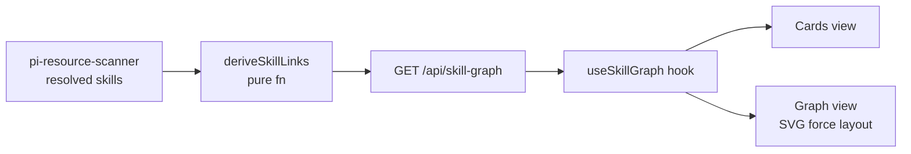

## Why

A typical machine has ~90 pi skills, coming from user installs, global npm packages, project `.pi/skills/`, and the dashboard source. Today the dashboard lists skills as a flat grid: Folder settings → **Skills** (`/api/pi-resources`). It cannot answer:

- Which skills reference each other?
- Which skills ship together in one package?
- Which skills drive the same tools?
- Which copy of a skill pi actually loads?

The personal `skill-atlas` skill (`~/.pi/agent/skills/skill-atlas/`) already proves the idea. It is a zero-dependency Node CLI that scans every skill root and derives typed relations. It renders a self-contained HTML page with a cards view and an interactive force graph. It lives outside the dashboard, though: it is a static file, it must be regenerated by hand, and nobody else on the team can see it. This change brings that view into the dashboard as a first-class screen.

## What Changes

- **New screen "Skill Atlas"**, reachable from Folder settings → Skills as a second tab ("Graph") next to the existing grid. It has two views:
  - **Cards**: one card per skill, grouped by category. Filters for search, provenance (Yours / In-house / 3rd-party), and category.
  - **Graph**: force layout, one node per skill, edges colored by relation type. A checkbox toggles each relation type. Clicking a node opens a side panel with the skill's description, source path, provenance, and its 1-hop neighbours. A "focus" toggle shows only the 1- or 2-hop neighbourhood.
- **Relation types** (ported from `skill-atlas/scripts/lib/scan.mjs`, same rules):
  | Type | Rule | Direction |
  |---|---|---|
  | `references` | Skill A's SKILL.md names skill B (hyphenated id, or `/skill:x` / `skill: x` / `x skill`) | A → B |
  | `bundle` | Same npm package, 2–14 skills | undirected |
  | `shares-tool` | Both drive the same distinctive tool (≤ 6 skills use it) | undirected |
- **New server endpoint** `GET /api/skill-graph?cwd=…` → `{ skills: SkillNode[], links: SkillLink[] }`. Nodes reuse the skill list the existing `pi-resource-scanner.ts` already resolves (pi's own loader, so the graph shows the copy pi actually loads). The server derives edges from the SKILL.md bodies with a pure, deterministic `deriveSkillLinks()` function. The cache is the existing `directoryService` stale-while-revalidate cache for pi-resources: no new watcher, no new persistence.
- **Shared types** `SkillNode`, `SkillLink`, `SkillLinkType` in `packages/shared/src/`.
- **Non-goals (v1)**:
  - No authored summaries layer (`summaries.json`, stamps, drift review). Cards show the frontmatter `description` only.
  - No editing of skills from the screen.
  - No cross-project "loaded in" matrix. The graph is scoped to the selected folder.
  - No change to the personal `skill-atlas` CLI. It keeps working standalone.

## Discipline Skills

- `performance-optimization`: the server reads every SKILL.md body (~90 files) and the client runs a force layout. The body read rides the existing pi-resources cache. The graph caps at ~300 nodes before falling back to cards-only.
- `security-hardening`: SKILL.md bodies are untrusted text. They are rendered as escaped text or markdown through the existing sanitized renderer, never as raw HTML. The endpoint keeps the existing `networkGuard`.
- `review-code`: runs before commit (non-trivial client and server change).

No other discipline skill applies: no auth change, no migration, no new external call.

## Capabilities

### New Capabilities

- `skill-atlas-screen`: a user can open the Skill Atlas for a folder. They see every skill pi loads there as cards and as a graph with typed relations (`references`, `bundle`, `shares-tool`). They can filter by relation type and focus on one skill's neighbourhood.

### Modified Capabilities

(none). The existing Skills grid is unchanged; the atlas is an additional tab.

## Impact

- **Server**: new `packages/server/src/pi/skill-graph.ts` (`deriveSkillLinks`), new route in `packages/server/src/routes/` (`GET /api/skill-graph`), with unit tests for each link rule (ported from `skill-atlas/scripts/selftest.mjs`).
- **Shared**: new skill-graph types.
- **Client**: new `components/resource/skill-atlas/` (`SkillAtlasPanel`, `SkillGraphView`, `SkillCardsView`, `SkillDetailPanel`), new `hooks/useSkillGraph.ts`, one new tab in the Skills settings page. The graph is a small hand-rolled SVG force layout with deterministic seeding, as in the existing atlas template. No new dependency is needed; d3-force is an option if a reviewer prefers it.
- **Docs**: a `docs/` row and directory `AGENTS.md` rows (via DocScribe).
- **Effort estimate**: ~3–4 dev-days: server ½ day, port the link rules + tests ½ day, client views 2 days, polish/a11y/docs ½–1 day.
- **Reference implementation**: `~/.pi/agent/skills/skill-atlas/` (`scripts/lib/scan.mjs` for the link rules, `assets/template.html` for the graph UI and interactions).
