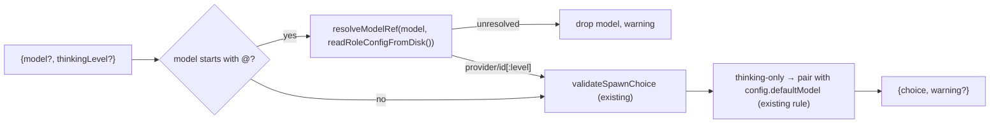

## Context

Spawn roads today and what they carry (verified on `develop`):

| Road | Entry | model | thinking | `@role` |
|---|---|---|---|---|
| Browser WS `spawn_session` | `packages/server/src/browser-handlers/session-action-handler.ts:788` (`handleSpawnSession`), validation at `:881-890` | yes | yes | dropped (`validateSpawnChoice` needs `provider/id`, `spawn-choice.ts:27-35`) |
| REST `POST /api/session/spawn` | `packages/server/src/session/session-api.ts:303` | no (body `{cwd, agent}`) | no | no |
| Plugin hook `ctx.spawnSession` | `packages/server/src/server.ts:4126`, mapper `pluginSpawnToSessionOptions` `packages/dashboard-plugin-runtime/src/server/server-context.ts:546` (`model` at `:552`) | yes (literal) | no | no |
| Bridge `spawn_new_session` | sent `packages/extension/src/bridge.ts:1470`, handled `packages/server/src/event-wiring.ts:2734` | no | no | no |
| MCP `spawn_session` | `packages/mcp-server-plugin/src/server/index.ts:106` → plugin hook with `{cwd}` only (the schema-advertised `agent` is silently dropped) | no | no | no |
| Bus client `spawn` | `packages/bus-client/src/client.ts:389` (`SpawnOptions` `:97`) → WS | no | no | no |

Web-client spawn call sites:
- `handleSpawnSession` (`packages/client/src/hooks/useSessionActions.ts:432`) already forwards `model` / `thinkingLevel`.
- Only `DirectoryHomeView` (`packages/client/src/components/folder/DirectoryHomeView.tsx:171-185`) passes them.
- `WorktreeSpawnDialog.buildOpts` (`packages/client/src/components/worktree/WorktreeSpawnDialog.tsx:259-270`) emits `{gitWorktreeBase, attachProposal, agent}` only.
- The dialog is mounted in four places: `SessionList.tsx:3328` (folder), `SessionList.tsx:3348` (OpenSpec change), `App.tsx:3706` (board) and `DirectoryHomeView.tsx:352`.
- Sibling spawn copies only the agent: `packages/client/src/components/session/SessionList.tsx:2046`, `App.tsx:1993`.
- Initialize project spawns with only `initialPrompt` (`SessionList.tsx:2289,2335`).
- The OpenSpec board wraps its spawns in `useAgentAwareSpawn` (`packages/client/src/components/openspec/OpenSpecBoardView.tsx:218`, `packages/client/src/hooks/useAgentAwareSpawn.ts`), which fills in the remembered agent only.
- `AgentSpawnPicker` (`packages/client/src/components/AgentSpawnPicker.tsx`) renders a plain button when no ACP agents are configured.

Pending registries (`packages/server/src/pending/pending-attach-registry.ts:30-34`, `pending-initial-prompt-registry.ts`) expose only `enqueue` / `consume` / `size`. The plugin hook "withdraws" by `consume(cwd)`, which pops the FIFO head (`server.ts`, initial-prompt consume on failure).

Role data: `readRoleConfigFromDisk()` (`packages/shared/src/role-config-disk.ts`) is Node-only and total. `resolveModelRef(ref, cfg)` (`packages/shared/src/role-schema.ts:207`) is a pure resolve with precedence ref level > role level.

## Goals / Non-Goals

**Goals**
- Every spawn road accepts the same model / thinking / `@role` choice through one resolver.
- Every human spawn surface either offers the choice or inherits it deterministically.
- Programmatic callers learn when their choice was dropped.

**Non-Goals**
- The full unified picker across settings, automation, roles and plugins shown in the adopted mockup. Spawn surfaces only.
- Live role following. A spawned session keeps the model resolved at spawn time; `roleMode: follows` stays with automation.
- Model choice for ACP agents. ACP takes no pi `--model`.
- Changing the resume / fork model rules (`resolveResumeChoice`).

## Decisions

### D1 — One resolver: `resolveSpawnChoice(input, ctx)` in `spawn-choice.ts`

- It returns `{ choice: SpawnChoice; warnings: string[] }`.
- **Literal refs** keep today's `validateSpawnChoice` semantics unchanged, including "an explicit `thinkingLevel` field disables suffix splitting" (`sessionless-composer-context`).
- **`@role` refs**: `resolveModelRef` returns `{model: provider/id, level?}` as SEPARATE fields. The resolver validates `provider/id` with `validateSpawnChoice({model})`, no level, so no suffix ever reaches `--model`. It then picks the thinking level: explicit `thinkingLevel` field > ref `:<level>` > role level. The resolver never re-feeds a `provider/id:level` string.
- Literal-ref validation stays per road. WS, REST and bridge use `validateSpawnChoice`. The plugin hook keeps its `isSafeArgvString` pass-through (`server-context.ts:469-471,552`) because trusted first-party callers pass values verbatim (`team-plugin/src/server/conversations.ts:575` `persona.model`, `automation-plugin/src/server/engine.ts:757`). It gains only `@role` resolution and `thinkingLevel` validation.
- `readRoleConfigFromDisk` runs only when the ref starts with `@`. Literal refs do no file I/O.
- Role names are not interpolated into a path: the file path is fixed and the role is a map key.
- The thinking-only pairing (today inline at `session-action-handler.ts:887-890`) moves into the resolver so all roads share it.
- Rejected alternative: resolving roles client-side only, as `useRolePick` does for the composer. REST, MCP, bus and plugin callers have no client, and duplicating the rule per caller drifts.

### D2 — Invalid choice: REST strict, WS / plugin / MCP lenient + reported, bridge log-only

- REST returns `400 { success:false, error }` when `model` is present but invalid or unresolvable, or when `thinkingLevel` is not a canonical level. Direct HTTP callers are programmatic and should fail loudly rather than silently run the default model.
- WS keeps drop-and-warn, so the existing `directory-home-page` behaviour is unchanged. It adds `choiceWarning` to `spawn_result`. The bus client surfaces it: `spawn()` resolves with the session id, and the CLI prints `warning: <text>`.
- The plugin hook keeps rejecting `agent` + `model` (`acp-spawn.ts:125-132` `validatePluginAcpSpawn`) and adds `thinkingLevel` to that pi-only list. It is NOT lenient for this case.
- WS: `agent` combined with `model`/`thinkingLevel` keeps today's ignore (`session-action-handler.ts:886`), but now also sets `choiceWarning` ("model choice ignored for ACP agent").
- The plugin hook drops and warns via `console.warn`. Its result gains an optional `warning`. `PluginSpawnOptions` callers already receive `{success, message}`.
- MCP binds to the plugin hook (`index.ts:106`), so it inherits the hook's rules: lenient (drop + `warning` in the tool result text) for an unresolvable role or a bad level, and rejected for `agent` + `model`/`thinkingLevel`.
- The web client shows a non-blocking warning toast when a successful `spawn_result` carries `choiceWarning` (`useMessageHandler.ts:1510`, `case "spawn_result"`).
- The bridge is log-only. `SpawnNewSessionMessage` has no correlation id and no reply channel (`protocol.ts:721-725`), so the originating pi cannot be told. Its model comes from a running pi, so it is a valid `provider/id` in practice. It is exempt from the reporting requirement.
- `agent` with `model`/`thinkingLevel`: REST → `400`, matching the plugin hook's existing D14 rejection.

### D3 — REST body parity

- `SpawnSessionRequest` (shared, also the MCP input type) becomes `{cwd, agent?, model?, thinkingLevel?, initialPrompt?}`.
- REST accepts `RestSpawnSessionRequest = SpawnSessionRequest & { attachProposal?: string }`.
- `attachProposal` is REST-only because the plugin-hook road the MCP tool binds to has no attach registry. That keeps the MCP schema honest.
- Order: (1) validate the whole body (types + choice), `400` on any failure; no owner token filed (`session-api.ts:330-336`) and nothing enqueued yet. Pass `choiceToSpawnOptions(choice)` into `spawnPiSession` (today `session-api.ts:340-343` passes only `strategy`/`spawnToken`). (2) Enqueue `initialPrompt` → `pendingInitialPromptRegistry` and `attachProposal` → `pendingAttachRegistry` (already in `SessionApiDeps`, `session-api.ts:66`). (3) Spawn. (4) On failure, `withdraw(cwd, value)` both.
- New registry method `withdraw(cwd, value): boolean` removes the NEWEST entry equal to `value` for `cwd`, so it never pops another spawn's head. The plugin hook's failure path and the WS `handleSpawnSession` failure path (which today never removes its intents, `session-action-handler.ts:818-843`) both switch to `withdraw` as well.
- `pendingInitialPromptRegistry` is newly wired into `SessionApiDeps`.

### D4 — MCP forwards the full input

`index.ts:106` forwards `cwd, agent, model, thinkingLevel, initialPrompt` to `ctx.spawnSession`. The generated schema is regenerated from the widened shared type (`packages/mcp-server-plugin/codegen/generate-tools.ts` → `src/server/generated/tools.ts`; the freshness test enforces this). Forwarding `agent` also fixes the silent drop noted above.

### D5 — Bridge inheritance

- `SpawnNewSessionMessage` gains `model?` and `thinkingLevel?`.
- `bridge.ts spawnNew` (existing at `:1469`) will obtain the bridge context via `syncBc()`, because `bc` is not in scope there. It fills the fields from `getCurrentModelString(bc)` and `(bc.pi as any).getThinkingLevel?.()`, the exact sources `model-tracker.ts:17-18` uses. An `undefined` model (no cached ctx, `bridge-context.ts:323-326`) omits both fields, giving a default spawn. The `syncBc()` + reads are wrapped in try/catch; any throw falls back to today's plain `{type, sessionId, cwd}` send, so `spawnNew` stays infallible.
- `event-wiring.ts` runs them through D1.
- Old server: the fields are ignored and the spawn behaves as today.

### D6 — Per-folder remembered spawn choice (web client)

- A new module `packages/client/src/lib/spawn/spawn-choice-memory.ts` stores `{model?, thinkingLevel?}` under localStorage key `pi-dashboard:spawn-choice:<cwd>`, next to the agent memory (`lib/acp/agent-memory.ts`).
- It is total over unavailable storage.
- The chip offers a `default` entry for model and for thinking level (the adopted mockup's dashed `default` chip). Choosing it clears that field from memory.
- Fallback is per field. `model` = remembered.model ?? Settings `defaultModel` ?? none. `thinkingLevel` = remembered.thinkingLevel ?? Settings `defaultThinkingLevel` ?? none.
- Relation to `model-selector` "Session model pickers SHALL resolve a role once". That rule governs pickers that change a RUNNING session (status bar, composer, run dialog). The folder home composer keeps it (`useRolePick`). The worktree-dialog chip and the folder-menu chip are spawn-choice chips, not session pickers. They store `@role` verbatim, so the folder memory follows later role edits until the next spawn. The server resolves the role once, at spawn time (D1), so the spawned session never follows later edits. This is an intentional divergence.
- A remembered model may be `@role`; the server resolves it at spawn time.
- Effective choice = remembered ?? Settings default (`defaultModel` / `defaultThinkingLevel`) ?? none (pi default).

### D7 — Spawn surfaces

- **`AgentSpawnPicker`**: the chevron always renders. The menu shows the agent radio group (only when agents exist) plus the merged chip. The chip is the existing `ModelSelector` with `allowRoles` and `onSelectLevel`, `tag="default"` while inherited, and it is disabled while an ACP agent is selected.
  - Choosing updates memory; it does not spawn. This matches the existing agent-menu rule.
  - The main button spawns with the agent memory plus the choice memory.
  - The APG menu-button keyboard contract is kept; the chip is a menu item that opens its own popover.
- **`WorktreeSpawnDialog`**: new prop `modelChoice?: "show" | "hidden"`, default `"show"`.
  - It shows one merged chip next to the agent select, preselected per D6 for the dialog's parent `cwd`.
  - `buildOpts` adds `model` / `thinkingLevel`. Changing the chip updates the parent folder's memory, which mirrors the agent memory.
  - `DirectoryHomeView` passes `"hidden"`, because its composer chip already owns the choice and is threaded through `dispatchSpawn`.
- **Effective-agent rule**: every client spawn path that adds a model choice (`AgentSpawnPicker`, `useAgentAwareSpawn`, worktree dialog, Initialize, AND the folder home composer's `dispatchSpawn`, `DirectoryHomeView.tsx:171-185`, which today sends the default model alongside an ACP agent) SHALL add it only when the effective agent is pi. The remembered ACP agent then wins and no spurious `choiceWarning` fires.
- **`AgentSpawnPicker` wiring**: `onSpawn: (agent?: string) => void` (`AgentSpawnPicker.tsx:25`) widens to `(agent?: string, choice?: {model?, thinkingLevel?}) => void`. The picker reads the memory and passes the effective choice. `FolderSpawnButtons.onSpawnSession` (`FolderSpawnButtons.tsx:33`) and the SessionList folder-spawn handler (`SessionList.tsx:2451`) widen likewise and forward the choice into `handleSpawnSession` opts.
- **OpenSpec board spawn** (call sites `packages/client/src/components/openspec/OpenSpecBoardView.tsx:729,1219`, wrapped at `:218` by `useAgentAwareSpawn`). That hook is extended to also fill `model`/`thinkingLevel` from `getEffectiveSpawnChoice(cwd)` when the caller passed none and the effective agent is pi. Generic `handleSpawnSession` is NOT changed, so sibling and other spawns are unaffected.
- **Initialize project**, all three paths: banner `SessionList.tsx:2289,2335` and the "Project setup…" menu item `SessionList.tsx:1923`. Each passes `getEffectiveSpawnChoice(cwd)` explicitly; still pi.
- **Hidden chip note**: `DirectoryHomeView`'s `onSpawn` builds its own options via `dispatchSpawn` and reads only `gitWorktreeBase` from the dialog (`packages/client/src/components/folder/DirectoryHomeView.tsx:366-373`), so there is no merge-order hazard.
- **Folder home composer stays independent**: it keeps its own pick-time `useRolePick` chip, preselected from the Settings default per `directory-home-page`. It neither reads nor writes the folder spawn-choice memory, so `directory-home-page` is unchanged. A folder-menu pick and the composer chip can therefore differ; this is accepted.
- **Memory key**: the worktree dialog reads and writes the PARENT folder's memory, mirroring the agent memory. A later spawn rooted at the worktree path reads that path's own key, falling back to Settings defaults.
- **Sibling** (`SessionList.tsx:2046`, `App.tsx:1993`): passes `model: s.model`, `thinkingLevel: s.thinkingLevel` when the source is pi (not ACP) and each value is a non-empty string, without a picker.

### D8 — Bus client + skills

- Bus `SpawnOptions` gains `model?`, `thinkingLevel?` and `onWarning?: (warning: string) => void`. `spawn()` keeps `Promise<string>`, so it is additive. `onWarning` fires in the success branch after `spawn_result` resolves (`client.ts:407-412`), before awaiting `session_added`.
- `dashboard-bus.ts spawn` gains `--model <ref>` and `--thinking <level>`, and prints `warning: …` via `onWarning`.
- The pre-existing drift in `references/recipes.md` (`const { sessionId } = await bus.spawn(...)`) is corrected to the string return.
- `commands/dashboard-session-spawn.md`, `SKILL.md` (quick table + script example), `references/api-reference.md` (+ `.agent.md`) and `recipes.md` document:
  - the body fields
  - `@role` and its one-shot semantics
  - the REST `400` cases
  - the `choiceWarning` on the bus.

## Risks / Trade-offs

- **REST strict versus WS lenient asymmetry.** Mitigated: it is documented in the API reference, and WS now reports drops through `choiceWarning`.
- **A role edited between pick and spawn**: the server resolves at spawn time, which is the latest value. That is intended.
- **Remembered `@role` later unassigned**: the spawn proceeds on the default model. The browser shows a warning toast; bus/CLI get `choiceWarning`. The chip shows the role as unassigned, per the existing `RoleList` marker.
- **Always-on chevron** changes the no-agent folder button DOM. This is accepted and is what the user asked for. The modified `acp-agent-sessions` requirement records it.
- **Plugin literal pass-through kept**: plugin literal models are not charset-tightened (see D1), so first-party callers (automation, goal, team, chat-gateway) are unaffected. Their `@role` values now resolve instead of reaching pi as a literal `@role` string.
- **Same-cwd concurrency** (pre-existing, widened): the initial-prompt and attach registries are cwd-keyed FIFOs. Two concurrent spawns into the same cwd from different roads can cross-assign their prompts. Accepted as best-effort; spawn-token keying is out of scope.

## Migration Plan

All fields are optional and additive; there is no data migration. One REST behaviour change: a new server now validates `model` / `thinkingLevel` that it previously ignored. A legacy caller already sending an invalid value (e.g. `thinkingLevel:"turbo"`) gets `400` where it used to get `200` plus a default spawn. This is accepted as intended strictness and documented in the API reference. Deploy order doesn't matter: an old server ignores the new fields, and a new server accepts old clients unchanged. Rollback = revert the commit. Leftover `pi-dashboard:spawn-choice:*` localStorage keys are inert.

## Open Questions

None blocking.
