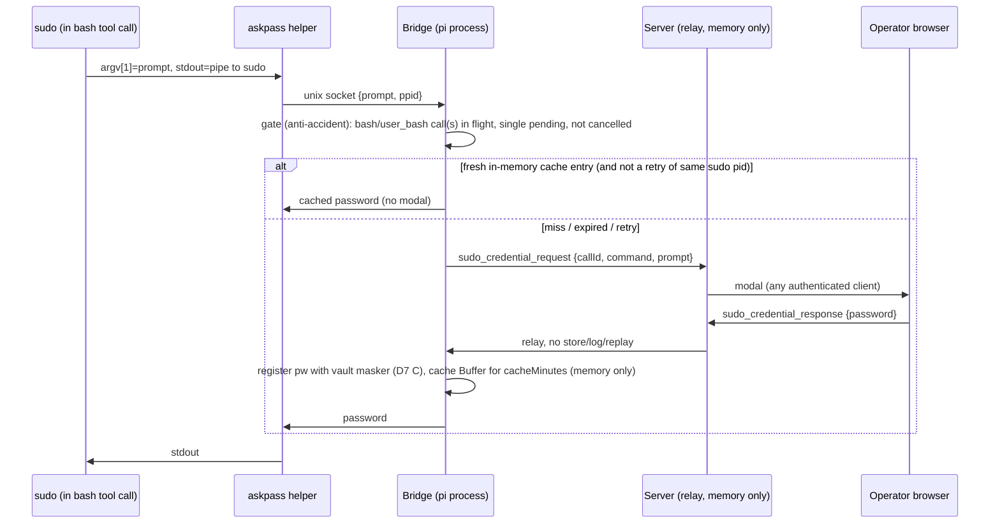

## Context

pi's bash tool has no stdin and no controlling tty. sudo falls back to `SUDO_ASKPASS` automatically in that case (verified, see proposal). The helper's stdout goes straight to sudo's pipe, so the password never enters tool output. Full option analysis + evidence: `/tmp/issue-batch/add-sudo-credential-prompt-DECISIONS.md`. Owner decisions: `/tmp/issue-batch/decisions-final.md`. D1 and D4 confirmed (owner, 2026-11-20); D2, D3, D5 changed by the owner (2026-11-20) and applied below; D6 confirmed (owner, 2026-11-20). D7 revised by the owner (2026-11-20, after review cycle 3): peer-process verification (former mechanism B) is **dropped entirely**; vault-masker registration (C) is kept; the remaining checks are anti-accident only, not security (see D7).

## Decisions

### D1: SUDO_ASKPASS helper (chosen) vs `sudo -S` vs PATH shim vs PTY vs tool_call rewrite — confirmed (owner, 2026-11-20)
- `sudo -S`: the model must supply stdin → password reaches the model. Rejected.
- PATH `sudo` shim / rewriting `tool_call` input: breaks absolute `/usr/bin/sudo`, `command -v`, scripts; regex on commands is bypassable. Rejected.
- PTY bridge: pi's bash tool is non-tty by design; large surface. Rejected.
- **SUDO_ASKPASS via `process.env`**: native sudo contract, zero command rewriting, same env-write pattern as vault delivery, covers `!` commands.
- **Load-bearing assumption (stated here, not only in external DECISIONS.md)**: with no tty, sudo invokes `$SUDO_ASKPASS` *without `-A`* (helper `argv[1]` = prompt, stdout = pipe to sudo, ≤3 same-ppid retries, non-zero exit = abort with no retry). Verified on macOS sudo 1.9.17p2 **only**. Linux classic sudo and `sudo-rs` are **unverified**; the Linux (sudo and sudo-rs) check is part of manual QA 5.2; until it passes Linux is documented as unverified. A sudo flavour that does not honour the fallback is **unsupported**: the helper is simply never invoked and sudo fails as it does today. The fake sudo shim in tests is pinned to the convention above.

### D2: Default on — changed by owner, confirmed (owner, 2026-11-20)
`sudoCredentialPrompt.enabled` defaults to **true** (config default in `packages/shared/src/config.ts`; no toggle needed to get the feature). The Security-tab toggle exists only to disable it. Windows is always a no-op. Consequence: behaviour change for existing installs (sudo now prompts instead of failing); see Accepted risks (1).

### D3: In-memory per-session password cache — changed by owner, confirmed (owner, 2026-11-20)
- Lives in the **bridge** process (the process that already owns the helper socket and receives the relayed password), keyed implicitly by session (one bridge per session). The server and event store never hold it, preserving "relay, never store" on the server.
- Held as a `Buffer`; zeroed on clear (**best-effort**: the password transits as immutable JS strings in the WS JSON parse, `ws` frames and the server relay object, which `Buffer.fill(0)` cannot clear — heap/crash-dump residue is a recorded residual, see below). Mitigation scope is limited to minimizing lifetime: convert to `Buffer` at once, drop parsed-message references, retain no losing answers, never put the password in error objects or logs. The one exception is the masker copy (D7 C): a JS string kept for process life, not zeroable. TTL = `sudoCredentialPrompt.cacheMinutes` (default **5**, = sudo's default `timestamp_timeout`; clamped 0–60; `0` disables caching). Fixed window from the last operator entry: a cached reuse does **not** extend it.
- **Late answers are dropped.** A response arriving after the helper timeout, after the helper's socket closed, after `tool_execution_end`/abort, or whose `callId` is not the single current pending prompt is discarded and **never cached**.
- **Do not cache a presumed-wrong entry.** The cache is written on entry (before sudo judges it). sudo's retry budget (`passwd_tries`, default **3**) counts helper **invocations** per sudo pid, and a **cache hit is an invocation** too. The bridge therefore counts every helper invocation for a sudo pid (cache hits and modal entries alike); an operator entry made on invocation **≥ 3** is the last one sudo will accept, sudo exits without re-invoking the helper and the entry could not be cleared, so it is **not cached**. Example: stale cached password (invocation 1, rejected) → entry A (2) → entry B (3): B is the 2nd *entry* but the final invocation, so it is **not cached**. (Cost accepted: a correct final-invocation entry is not cached; the next sudo prompts.) Otherwise a wrong password would stay cached and burn an extra failed auth (pam_faillock) on the next sudo. The budget is fixed at the sudo default 3; a host that lowers `passwd_tries` (1 or 2) can still cache a wrong final entry, which the next sudo's rejection drops (one extra failed auth) — recorded residual, not detected at runtime.
- A fresh entry answers a verified helper request with **no modal**. The gate (bash/`user_bash` call in flight, single pending, sticky Cancel) still runs before the cache is consulted.
- Cleared on: `session_shutdown` (incl. reload/restart), loss of the server connection (covers server restart), explicit `sudo_credential_forget` from a browser (Forget chip driven by `sudo_credential_cache {expiresAt|null}`), TTL expiry, setting disabled, and when sudo **re-invokes the helper for the same sudo pid** (= the cached/entered password was rejected; evidence: sudo retries up to 3 times, DECISIONS.md) — then the cache is dropped and the operator is prompted.
- Never persisted, never logged (log lines carry type + callId only), never in transcript/JSONL/event store/replay, never sent to the LLM. Cache *hits* are not visible to the model; the model only sees sudo succeed.
- OS note: with no tty, sudo's own timestamp is tied to the parent pid so it can't give a multi-call window; this cache is what provides it.

### D4: Modal shows the command — confirmed (owner, 2026-11-20)
The modal shows the session, the bash command, and sudo's sanitized prompt text so the operator can detect agent phishing. The command text is already in the transcript.

- **Attribution under concurrency.** pi runs tool calls in parallel by default (`node_modules/@earendil-works/pi-agent-core/dist/agent.js:147`, `toolExecution ?? "parallel"`), and the bridge never learns the bash child pid. The bridge therefore does **not** map a sudo pid to one `toolCallId`. The modal lists **every** bash/`user_bash` command in flight at request time; sticky Cancel applies to **all** tool calls in flight at that moment. No process-ancestry mechanism is added.
- **No hidden text.** The command is shown in full (scrollable, not tail-truncated). sudo's prompt text is agent-controlled (`sudo -p`), so it is rendered visually distinct and labelled "text supplied by the command"; if capped, truncation is from the middle with an explicit "N more chars" marker so the `sudo -p`/`SUDO_ASKPASS=` part is never hidden.

### D5: Any authenticated client may answer — changed by owner, confirmed (owner, 2026-11-20)
`sudo_credential_response`/`_cancel`/`_forget` are accepted from any authenticated browser that owns the session (existing session-owner scope via `SESSION_OWNED_MESSAGES`, `packages/server/src/identity/ws-message-scope.ts`), **including plain-HTTP non-loopback LAN**. No loopback/TLS restriction. The WS tier for the three types is `control` (same as sibling `prompt_response`, `packages/shared/src/ws-message-tiers.ts:64`); an unlisted type would fail closed to `operate` and exclude paired `control` users, contradicting "any authenticated client". A response is additionally bound server-side to the `(sessionId, callId)` of the single pending request (`callId` = unguessable per-prompt random, distinct from `toolCallId`); anything else is dropped. The remote-bridge trust predicate (`decideVaultTrust`, `packages/server/src/vault/vault-delivery-hub.ts:67`) is a separate axis (which *bridge* receives the secret) and is retained; it is not a client-transport gate. First answer wins; others get `sudo_credential_dismiss`. See Accepted risks (2).

### D6: Dedicated messages, not `prompt_response`
`prompt_*` answers go through `relayBrowserPromptResponse` → `QuestionStore` and can be replayed. A secret needs a road that structurally skips them. Server holds only `{callId, sessionId, metadata}` in memory.

### D7: Helper→bridge gate (anti-accident) + vault-masker registration (C) — revised by the owner (2026-11-20, after review cycle 3)
**Peer-process verification (former mechanism B: `lsof`/`ss`/`/proc`/`ps` peer and parent-is-sudo checks) is dropped entirely.** Reason: a same-user process cannot be stopped by a peer check, and the cycle-3 reviewers showed the macOS `ps -o comm` oracle both refuses a bare `sudo` and accepts an `exec -a /usr/bin/sudo` spoof. The helper's reported `ppid` is therefore **self-reported and not verified**; it is used only to count sudo's retries (D3). No part of this design depends on identifying the socket peer.

What remains are **cheap anti-accident checks, not security**: a `bash`/`user_bash` call must be in flight, one pending prompt per session, Cancel is sticky for the tool calls in flight, and the operator sees the actual command(s) in the modal (D4). They stop a stray or mistaken request (e.g. a script calling `$SUDO_ASKPASS` with no command running, a double prompt); they do **not** stop a hostile same-user process, which can open the 0700-dir socket and ask. A command that runs `"$SUDO_ASKPASS" "Enter PIN"` directly while a bash call is in flight is served like any other request: the modal shows the command and the labelled prompt text.

- **C — mask the entered password (kept).** An operator answer is registered with the existing vault masker **before** it is written to the helper or cached, so every exact occurrence is replaced with `[REDACTED:SUDO_PASSWORD]` in `tool_result` (content/details/structuredContent and spill files), `message_end` messages, `user_bash` streamed output and forwarded `event_forward` frames, hence in the transcript, session JSONL and the model context.
  - **Verified API (nothing invented).** `createMasker(getState: () => MaskerState)` (`packages/extension/src/vault-masker.ts:163`) takes a pull-based `MaskerState {version, entries:[{name,value}]}` (`:22-25`) and rebuilds when `version` changes (`:81-82`); it has **no** `add`/`register` method. `bridge.ts:1156-1169` builds it from `vaultDelivery.redactionState()` (`vault-delivery.ts:393-396`, backed by `registry.redaction: Map<string, Set<string>>` and `redactionVersion`, `:51-53`); the only writer, `EnvApplier.remember` (`:162-168`), is private to the vault delivery and is not exposed. The same masker instance feeds `createVaultRedaction` (`tool_result`/`message_end`/`user_bash`) and `createVaultForwardFilter` (`bridge.ts:1169`).
  - **Seam.** A tiny append-only registry `packages/extension/src/sudo-askpass/sudo-mask-registry.ts` (`register(value)`, `state()`; state kept on `process` like `REGISTRY_KEY`, `vault-delivery.ts:43`, so a reload keeps masking). `bridge.ts` passes the masker `getState: () => ({ version: vault.version + sudo.version, entries: [...vault.entries, ...sudo.entries] })` (both counters are monotonic, so the sum moves whenever either does). `vault-masker.ts` and `vault-delivery.ts` are **not edited**; `vault-redaction.ts` gets one small optional-parameter change (see "`user_bash` composition"). Entry name is `SUDO_PASSWORD`; the masker's own dedupe (`vault-masker.ts:56`, first name wins on identical values) applies.
  - **When.** Registered on receipt of the operator answer for the *current* `callId`, before delivery and before caching; also when `cacheMinutes=0`; rejected/wrong passwords stay registered (an echo of a mistyped password is still a secret). Late, wrong-`callId` or dropped answers are not registered. A cache hit re-delivers an already-registered value.
  - **Lifetime.** The registered value is **never removed** (cache expiry, Forget, `session_shutdown`, disable do not unmask): the masker's value set deliberately only grows (`vault-masker.ts` header) because a long-running command can echo an old password later. It dies with the process.
  - **String-copy trade-off vs Buffer-only (owner accepted).** The masker compares JS strings (`text.includes`, regex), so it needs the password as an immutable JS string that lives in the V8 heap for the process lifetime and **cannot be zeroed**. This is strictly weaker than the D3 `Buffer` (zeroed on clear) for that one copy. A Buffer-only masker would need a second byte-level scanner (chunk/UTF-8 boundaries, plus `message_end`/JSON paths the existing masker already covers) for a marginal gain, since a heap/crash dump already requires same-user local access. Masking echoes into the transcript was judged more valuable than heap hygiene.
  - **Limits.** Exact occurrence only: base64/hex/split/reversed forms are **not** masked (`vault-masker.ts` header); a process that transforms the password before printing defeats C. Every occurrence of the string is replaced, so a very short password (1-3 chars) garbles unrelated output; no minimum length is imposed (same as the vault). Masking is a safety net for accidental or prompt-injected echo, not a defence against a hostile reader.
- **`user_bash` composition (specified against the existing code; fixes review c3-r1).** pi's `user_bash` is start-only (no end event) and `emitUserBash` returns the **first** non-undefined handler result (`pi-coding-agent/dist/core/extensions/runner.js:973-985`); the bridge already registers a single `user_bash` handler (`packages/extension/src/bridge.ts:1189-1195`) that returns `vaultRedaction.userBash()`. That function returns `undefined` when `masker.active()` is false at command start (`packages/extension/src/vault-redaction.ts:175-179`) — and the sudo password is by construction registered only **mid-command**, after `user_bash` fired, on a process where the vault may be empty. Wrapping "the returned operations" would therefore never track or mask the first `!sudo`. Composition:
  1. `vault-redaction.ts` (not on the not-edited list) gets one optional parameter: `userBash(opts?: { always?: boolean })`. With `always: true` it skips the `masker.active()` early return and still returns `{operations: wrapOperations(local)}` (or `undefined` only when `createLocalBashOperations()` yields nothing). This is safe: the wrapper is lazy per chunk (`vault-redaction.ts:136-156` calls `masker.maskAndHold`/`mask`, and the masker rebuilds when `getState().version` moves, `vault-masker.ts:81-82`), so a value registered mid-command is masked from the next chunk on. Default behaviour (`always` omitted) is unchanged.
  2. The bridge's single `user_bash` handler calls `vaultRedaction.userBash({ always: sudoFeatureInstalled() })`; `sudoFeatureInstalled()` is true while the askpass wrapper is installed (D9). If it returns operations, the handler returns them wrapped once more by the in-flight tracker (tracker increments with the `command` string at `exec` start, decrements in `finally`), so the gate opens for the first `!sudo` of a fresh process with an empty vault registry and closes when the command ends. When the feature is not installed nothing changes.
  3. **Fail closed.** If the feature is installed but no operations could be created, the handler returns `undefined` **without** a tracker: that command is untracked, the gate stays closed for it, and sudo is refused for it (never run unwrapped with the gate open). A `!` command that started before the feature was installed is likewise untracked and unmasked; if a tracked call is in flight at the same time a prompt can still be raised and its echo from the untracked command is not masked — recorded residual.
  A second `user_bash` handler is not registered. `tool_result`/`message_end` already evaluate `masker.active()` at result time, so they pick up the sudo value without change.
- **Residual (owner accepted, 2026-11-20).** A same-user process can obtain the plaintext password: it can open the socket and request it, or run attacker code under a sudo it started. The mitigation is **masking (C)**: a verbatim echo into the LLM context, transcript or session JSONL is replaced with `[REDACTED:SUDO_PASSWORD]`; a transformed echo (base64, split, reversed) is not masked. On a cache hit there is no modal (Accepted risks (3)). This is not a sandbox and no further claim is made.

### D8: Posture
Default **on**; session-owner scope; any authenticated client incl. plain-HTTP LAN; in-memory per-session cache (default 5 min, configurable, 0 = off); per-prompt timeout 120 s, fail closed; password held as `Buffer`, best-effort zeroed on delivery-without-cache and on cache clear (see D3 residual); in-flight/single-pending gate is anti-accident only (D7); entered password registered with the vault masker (D7 C).

### D9: Availability and lifecycle (fail fast, no hangs)
- **Server capability (event-driven, not at `session_start`).** The server advertises `sudo-credential` in `dashboard_identity.features` (precedent: `VAULT_DELIVERY_FEATURE`, `packages/server/src/event-wiring.ts:614`). That frame is sent only **after** the bridge registers, i.e. after `session_start`, so the bridge **observes** it like the vault does (`handleIdentity`, `packages/extension/src/vault-delivery.ts:301-306`): on a `dashboard_identity` whose `features` include `sudo-credential` (and enabled, non-win32, no operator `SUDO_ASKPASS`) it installs the wrapper and sets `SUDO_ASKPASS`; on a later identity without the feature (server downgrade/restart to an old build), on server-connection loss, or on `session_shutdown` it removes what it installed (only if still ours), clears the cache and dismisses any pending prompt (helper exits 1). Between `session_start` and the first identity, and with an old server that never sends one, nothing is installed, so an old server never makes sudo hang for the full timeout.
- **Client capability (stale tabs).** The server-advertised feature does not cover an old browser tab, PWA or bundled Electron client that is subscribed but ignores the unknown `sudo_credential_request`. A subscribed browser therefore counts as able to answer only once it has acknowledged the request: the dialog sends `sudo_credential_shown {callId}` when it renders. If no subscribed browser acks within ~2 s, the server relays `sudo_credential_cancel {callId, reason:"unanswerable"}` to the bridge, which makes the helper exit 1 at once. This refusal is **not** sticky (unlike an operator Cancel), so it never blocks later prompts once a current client connects. An ack from any one browser suffices; later acks and acks with a wrong `callId` are ignored.
- **Refuse immediately** (helper exits 1, no 120 s wait) when: no connected server, no subscribed browser owning the session, a remote bridge refused by `decideVaultTrust`, a TUI-only session with no dashboard connection, or no `bash`/`user_bash` call in flight (D7 gate).
- **Dismiss and clear pending** on helper socket close, `tool_execution_end`/abort, bridge disconnect and server restart (modals dismissed on all browsers).
- The three bridge-bound response types ride `ConnectionManager.IMMEDIATE_TYPES` (`packages/extension/src/connection.ts:375`), because the serialized inbound pump drops the newest message when full (`connection.ts:648-668`) and would otherwise delay or lose a password/Cancel.
- The client never queues these messages in the reconnect outbox (`packages/client/src/hooks/useWebSocket.ts` `send`, which queues non-`send_prompt` messages without expiry): `sudo_credential_*` return `rejected` when the socket is not OPEN and the dialog shows "connection lost, retry".
- Bridge-outbound `sudo_credential_request`/`_cache` take the dedicated server road and are never treated as `event_forward` (catch-all-event-forwarding stays unchanged). They are dispatched by explicit branches in the bridge-message chain of `packages/server/src/event-wiring.ts` (alongside `prompt_request` at ~:2422 and `prompt_dismiss` at ~:2550; without a branch the frames would fall through unhandled): `_request` records the single pending `(sessionId, callId)` slot, starts the ack timer, fans out to the session's owning subscribers via `browserGateway.sendToSubscribers`, and replies refuse-immediately when no subscribed browser owns the session; `_cache` fans out metadata and keeps the latest `{expiresAt|null}` for replay on subscribe. Neither goes through `extractSessionUpdates`, the event store or replay. The existing `piGateway.onDisconnect` hook (`event-wiring.ts:496`) clears the pending slot and the cached metadata and broadcasts `sudo_credential_dismiss`/`_cache {expiresAt:null}` when the bridge socket closes.

### D10: Install hygiene
- Wrapper execs an **absolute** interpreter (`process.execPath`), never `#!/usr/bin/env node`, since the agent controls `PATH`/`NODE_OPTIONS` in the bash call.
- Directory created with `mkdtemp` (unique per session/process, so two concurrent sessions cannot collide), owner/mode re-checked, socket path must fit `sun_path` (104 macOS / 108 Linux); no pre-existing socket accepted.
- A pre-existing operator `SUDO_ASKPASS` is a local override and is **never touched** (same precedence as `vault-delivery.ts:10-12`); the bridge then stays inactive for sudo. A nested pi inherits the parent's `SUDO_ASKPASS`, treats it as a local override and does nothing.
- The helper delivers the password **only** over the accepted socket to stdout — never via argv or env — and writes no secret to stderr (sudo's stderr is tool output); on crash it prints a fixed message only.

## Accepted risks (owner decision)

The owner chose the following explicitly (2026-11-20). **No mitigations are added** by this change; they are recorded so they are not rediscovered as defects.

1. **Default-on lets a prompt-injected agent raise password modals.** A malicious or injected instruction can run `sudo` and pop a modal on the operator's screen, exploiting habit-typing. Only the shown command (D4) and sticky Cancel limit it.
2. **Plain-HTTP LAN answers send the admin password unencrypted.** Any authenticated client may answer over non-TLS LAN HTTP, so the password can be sniffed on the network path.
3. **The in-memory cache lets later commands in the window get sudo with no prompt.** For `cacheMinutes` after one entry, any verified `sudo` in a bash call of that session (including one an injected agent chose) is answered without a modal.

Residual (D7): a same-user process can obtain the plaintext password (owner accepted); mitigation is masking of verbatim echoes into the LLM/transcript/JSONL, a transformed echo is not masked; not a sandbox. Residual (D7 C): the masker holds the password as a non-zeroable string for the process lifetime. Residual (D3): transient immutable-string copies of the password cannot be zeroed.
