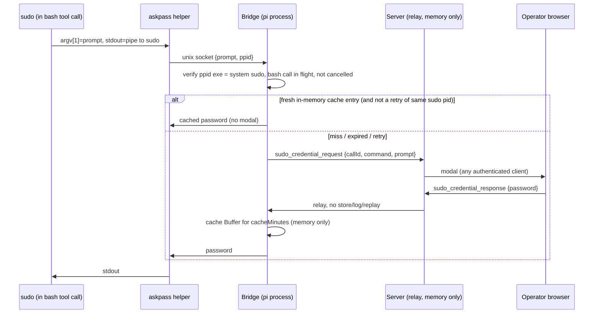

## Context

pi's bash tool has no stdin and no controlling tty. sudo falls back to `SUDO_ASKPASS` automatically in that case (verified, see proposal). The helper's stdout goes straight to sudo's pipe, so the password never enters tool output. Full option analysis + evidence: `/tmp/issue-batch/add-sudo-credential-prompt-DECISIONS.md`. Owner decisions: `/tmp/issue-batch/decisions-final.md`. D1 and D4 confirmed (owner, 2026-11-20); D2, D3, D5 changed by the owner (2026-11-20) and applied below; D6 confirmed (owner, 2026-11-20) with residual risk pending doubt-driven review (task 5.1).

## Decisions

### D1: SUDO_ASKPASS helper (chosen) vs `sudo -S` vs PATH shim vs PTY vs tool_call rewrite — confirmed (owner, 2026-11-20)
- `sudo -S`: the model must supply stdin → password reaches the model. Rejected.
- PATH `sudo` shim / rewriting `tool_call` input: breaks absolute `/usr/bin/sudo`, `command -v`, scripts; regex on commands is bypassable. Rejected.
- PTY bridge: pi's bash tool is non-tty by design; large surface. Rejected.
- **SUDO_ASKPASS via `process.env`**: native sudo contract, zero command rewriting, same env-write pattern as vault delivery, covers `!` commands.

### D2: Default on — changed by owner, confirmed (owner, 2026-11-20)
`sudoCredentialPrompt.enabled` defaults to **true** (config default in `packages/shared/src/config.ts`; no toggle needed to get the feature). The Security-tab toggle exists only to disable it. Windows is always a no-op. Consequence: behaviour change for existing installs (sudo now prompts instead of failing); see Accepted risks (1).

### D3: In-memory per-session password cache — changed by owner, confirmed (owner, 2026-11-20)
- Lives in the **bridge** process (the process that already owns the helper socket and receives the relayed password), keyed implicitly by session (one bridge per session). The server and event store never hold it, preserving "relay, never store" on the server.
- Held as a `Buffer`; zeroed on clear. TTL = `sudoCredentialPrompt.cacheMinutes` (default **5**, = sudo's default `timestamp_timeout`; clamped 0–60; `0` disables caching). Fixed window from the last operator entry: a cached reuse does **not** extend it.
- A fresh entry answers a verified helper request with **no modal**. Verification (system sudo parent, bash call in flight, single pending, sticky Cancel) still runs before the cache is consulted.
- Cleared on: `session_shutdown` (incl. reload/restart), loss of the server connection (covers server restart), explicit `sudo_credential_forget` from a browser (Forget chip driven by `sudo_credential_cache {expiresAt|null}`), TTL expiry, setting disabled, and when sudo **re-invokes the helper for the same sudo pid** (= the cached/entered password was rejected; evidence: sudo retries up to 3 times, DECISIONS.md) — then the cache is dropped and the operator is prompted.
- Never persisted, never logged (log lines carry type + callId only), never in transcript/JSONL/event store/replay, never sent to the LLM. Cache *hits* are not visible to the model; the model only sees sudo succeed.
- OS note: with no tty, sudo's own timestamp is tied to the parent pid so it can't give a multi-call window; this cache is what provides it.

### D4: Modal shows the command — confirmed (owner, 2026-11-20)
The modal shows the session, the bash command, and sudo's sanitized prompt text so the operator can detect agent phishing. The command text is already in the transcript.

### D5: Any authenticated client may answer — changed by owner, confirmed (owner, 2026-11-20)
`sudo_credential_response`/`_cancel`/`_forget` are accepted from any authenticated browser that owns the session (existing session-owner scope via `SESSION_OWNED_MESSAGES`, `packages/server/src/identity/ws-message-scope.ts`), **including plain-HTTP non-loopback LAN**. No loopback/TLS restriction. The remote-bridge trust predicate (`decideVaultTrust`, `packages/server/src/vault/vault-delivery-hub.ts:67`) is a separate axis (which *bridge* receives the secret) and is retained; it is not a client-transport gate. First answer wins; others get `sudo_credential_dismiss`. See Accepted risks (2).

### D6: Dedicated messages, not `prompt_response`
`prompt_*` answers go through `relayBrowserPromptResponse` → `QuestionStore` and can be replayed. A secret needs a road that structurally skips them. Server holds only `{callId, sessionId, metadata}` in memory.

### D7: Helper→bridge authentication (residual accepted) — confirmed (owner, 2026-11-20), pending doubt review
A same-user agent can read the wrapper and open the 0700-dir socket. Layers: parent-is-system-sudo check (exe path, root-owned), a bash tool call must be in flight, single pending per session, Cancel sticky per tool call, the operator sees the actual command in the modal. Documented residual: a same-user process can still talk to the socket; the modal is the control (on a cache hit there is **no** modal, see Accepted risks (3)). Not a sandbox.

### D8: Posture
Default **on**; session-owner scope; any authenticated client incl. plain-HTTP LAN; in-memory per-session cache (default 5 min, configurable, 0 = off); per-prompt timeout 120 s, fail closed; password held as `Buffer`, zeroed on delivery-without-cache and on cache clear.

## Accepted risks (owner decision)

The owner chose the following explicitly (2026-11-20). **No mitigations are added** by this change; they are recorded so they are not rediscovered as defects.

1. **Default-on lets a prompt-injected agent raise password modals.** A malicious or injected instruction can run `sudo` and pop a modal on the operator's screen, exploiting habit-typing. Only the shown command (D4) and sticky Cancel limit it.
2. **Plain-HTTP LAN answers send the admin password unencrypted.** Any authenticated client may answer over non-TLS LAN HTTP, so the password can be sniffed on the network path.
3. **The in-memory cache lets later commands in the window get sudo with no prompt.** For `cacheMinutes` after one entry, any verified `sudo` in a bash call of that session (including one an injected agent chose) is answered without a modal.

Residual (D7): a same-user process can speak to the helper socket; not a sandbox.
