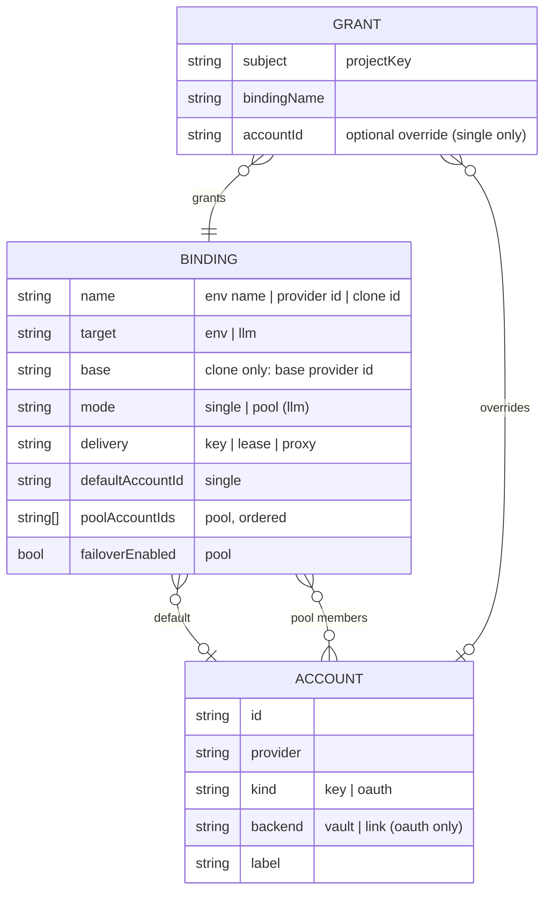
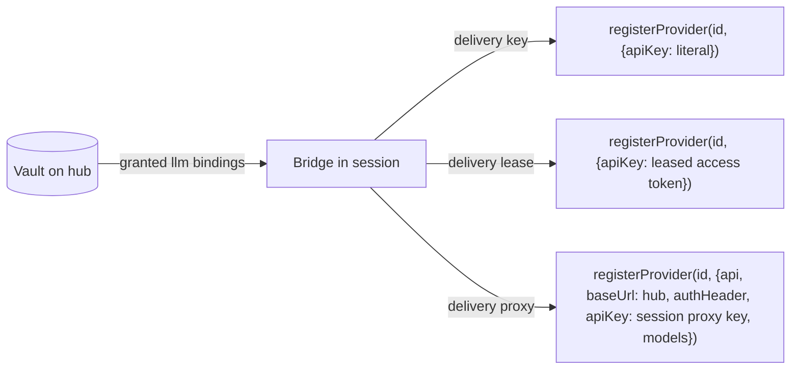

## Context

See proposal.md — Why. This is part 2 of 3. It builds on `add-credential-vault` (the foundation) and reuses these of its decisions without repeating them:

- the store (its D1): file, locking, corrupt handling, 8-character minimum, unknown-field preservation, the binding → grant → override model, `no-account` grants;
- delivery mechanics (D2): `process`-held registry, reconcile on every connect and every `session_start` reason, offline grace, downgraded-hub withdrawal, emergency off in `config.json`;
- trust and project key (D3): paired device + TLS or local proof, repository/directory keys, checkout confirmation;
- plugin approvals (D4);
- redaction (D5): the `[REDACTED:<NAME>]` marker, masking points, forwarder hold-back, accepted residuals such as spill files during a run;
- routes and authority (D6).

This change adds the `oauth` kind, the `llm` binding target, and the LLM delivery modes.

**Paths.** pi paths (`pi-ai/dist/…`, `dist/core/…`) are relative to `node_modules/@earendil-works/` (`pi-ai`, `pi-coding-agent`).

**pi version.** The repo pins pi 1.0.0 (`pnpm-workspace.yaml:55-56`). Seams marked *(1.1.0)* below were observed on global 1.1.0 and are provisional; task T0 re-verifies each on 1.0.0. Seams marked *(1.0.0)* were checked in the pinned tree.

### pi seams

- **Provider registration is public.** `pi.registerProvider` takes `baseUrl`, `apiKey`, `api`, `headers`, `authHeader`, `models`, `oauth` *(1.0.0, `dist/core/extensions/types.d.ts:1372-1405`)*. It applies immediately after load and can override a built-in provider *(1.1.0)*.
  - Re-registration **merges** with the previous config and skips `undefined` fields *(1.0.0, `dist/core/model-runtime.js:656-673`)*. So only `unregisterProvider` clears a field.
  - `ModelRuntime.setRuntimeApiKey` is not exposed to extensions.
- **`apiKey` is a config value.** A literal, `$ENV`/`${ENV}` interpolation, or a leading `!command` *(1.0.0, `types.d.ts:1374`)*.
- **An OAuth access token works as an `apiKey`** *(1.1.0, spike P1–P4)*. `registerProvider("anthropic", { apiKey: <access token> })` sends Claude-Code OAuth requests, because pi-ai selects OAuth mode when the key contains `sk-ant-oat`. The same check exists in 1.0.0 (`pi-ai/dist/api/anthropic-messages.js:749`); T0 re-runs the spike there.
  - Precedence: local `auth.json` entry > registered `apiKey` > provider env var.
  - Provider env vars come from pi-ai's env discovery table (`pi-ai/dist/env-api-keys.js:68-76` *(1.0.0)*): `anthropic` → `ANTHROPIC_AUTH_TOKEN`, `ANTHROPIC_OAUTH_TOKEN`, `ANTHROPIC_API_KEY`; `google` → `GEMINI_API_KEY`. `getEnvApiKey` skips the bearer-only `ANTHROPIC_AUTH_TOKEN` (`:127-130`), but pi still sends it as `Authorization: Bearer` (`pi-ai/dist/providers/anthropic.js:21-25`).
- **Clone provider ids work** *(1.1.0)*. `anthropic-work` with `api: "anthropic-messages"` coexists with `anthropic`, each with its own account.
- **`authHeader` exists.** It adds `Authorization: Bearer <apiKey>` (`dist/core/provider-composer.js:199-206`, `withConfiguredAuth` *(1.0.0)*). For `anthropic-messages` with a non-OAuth key the client also sends `x-api-key` with the same value (`anthropic-messages.js:813-818`); the proxy gate ignores `x-api-key`, so that is harmless. Task T6 verifies the wire end to end.
- **The OAuth hook override (S6) is not used.** It needs an `auth.json` entry on the session machine, and it receives the local refresh token when one exists.

### Model proxy today

- **Authentication.** `auth-gate.ts` accepts only `Authorization: Bearer pi-proxy-…` (`packages/server/src/model-proxy/auth-gate.ts:41-57`); `x-api-key` is not read.
- **Model ids.** Resolution parses `provider/id` on the first `/`; a label with no `/` falls back to `preferredModels` (spec `model-proxy`, "Model ID resolution"). A bare id from pi would therefore route to whatever model is preferred.
- **Listing.** `/v1/models` mirrors `getAvailable()` exactly (spec `model-proxy`, "Model availability mirrors…"), which is derived from `auth.json` (`internal-registry.ts`).
- **Credential resolution.** The `/v1` routes call the runtime's `streamSimple`, which re-reads the credential from the runtime's credential store; an `apiKey` passed by the caller is dropped (`packages/server/src/model-proxy/registry-singleton.ts:142-165`). Before that, the facade `InternalAuthStorage.getApiKeyAndHeaders` requires an `auth.json` (or custom-provider) entry for the provider and single-flights **per provider id** (`internal-auth-storage.ts:85,105-112`).
- **Routes served.** Only `/v1/chat/completions` and `/v1/messages` (`packages/server/src/routes/model-proxy-routes.ts:178-181`). The built-in `openai` provider uses `openai-responses` and `openai-codex` uses `openai-codex-responses` (`pi-ai/dist/providers/openai.js:21`, `openai-codex.js:19`), which the proxy does not serve.
- **Keys.** `ProxyApiKey` (`packages/shared/src/config.ts:413-423`) has no owner; keys are stored hashed in `config.json#modelProxy.apiKeys`.

### Refresh-token rotation

Anthropic and openai-codex rotate the refresh token on use: a refresh invalidates the old token. The dashboard already designs around this: see `openspec/changes/archive/2026-09-27-harden-auth-json-lock-coordination/design.md:79` ("If the provider rotates tokens, the refresh token on disk is already dead"), and keysync's "Constraints carried forward" (`openspec/changes/add-oauth-key-sync-service/proposal.md`). Two independent refreshers of one account therefore lose the token family. This is cited, not independently verified against provider documentation.

## Goals / Non-Goals

**Goals:**
- usable second accounts per provider;
- LLM credentials on trusted devices without a refresh token leaving the hub;
- exactly one refresher per vault-held OAuth account;
- public pi extension APIs only.

**Non-Goals:**
- changing pi's `auth.json` format;
- multi-user identity (keysync);
- encryption beyond owner-only permissions for the embedded vault;
- a hook-based OAuth fallback;
- quota for clone ids.

## Decisions

### D1: Accounts, LLM bindings, backends, refresh

- **Same shape as the foundation.** `llm` bindings sit in the same `bindings` map as `env` bindings and are granted by the same grants, so checkout confirmation, `no-account` and plugin approvals apply unchanged.
  - The binding name space is shared, but env names are upper case (`^[A-Z_][A-Z0-9_]*$`) and `llm` names are lower case, so they never collide.
- **`llm` binding names.**
  - A name must match `^[a-z0-9][a-z0-9-]*$`. T0 confirms that pi 1.0.0 accepts every such name as a provider id.
  - A name must not contain `--`, which is reserved for pool-member ids (D4).
  - A non-clone name must be a provider id known to the hub's runtime.
  - A clone name must not be a built-in provider id or a hub `providers.json` id.
  - A clone stores its `base` explicitly.
- **Account compatibility.** A binding, override or pool member must be an account of the binding's provider (the base provider, for clones).
  - `delivery: key` takes `key` accounts; `lease` takes `oauth` accounts on the lease-verified list (D3); `proxy` takes `key` accounts, or `oauth` accounts on the lease-verified list, of a provider whose API is proxy-capable (D4).
  - `mode: pool` requires `delivery: proxy`. Its members may be `key` or `oauth` accounts but not a mix; a `pool` with `key` or `lease` delivery is rejected.
  - A grant override is allowed only on `single` bindings, and must have the same kind as the default. A pool is chosen by the binding, never per project.
  - Delivery checks all of this again (kind guard), so data written by hand or by a newer version delivers nothing rather than something wrong.
- **`oauth` accounts, `vault` backend.** Tokens are stored in `vault.json`. Refresh (below) is the hub's alone.
- **`oauth` accounts, `link` backend.** Links the hub's existing `auth.json` login for one provider without copying it.
  - **Access tokens.** `issueAccessToken` (below) reads the access token from the `auth.json` entry (never copying it into the vault) and returns it when it has at least the minimum lease lifetime (D3) left. Otherwise it refreshes through the server's existing path — `dashboard-credential-store.ts` with its per-provider serialisation — exactly as an unowned proxy request would. A link's `issueAccessToken` call and a concurrent unowned request for the same provider therefore take the same per-provider lock and share one refresh; the per-account single-flight (below) applies to `vault`-backend accounts.
  - **No new refresher, no removed one.** A linked login is not vault-held: its tokens stay in `auth.json`, refreshed by today's coordinated pair (hub-local pi sessions under the file lock, the server via `dashboard-credential-store.ts`). Linking inherits the accepted residual of `harden-auth-json-lock-coordination` (server refresh runs without the file lock), adds no third refresher, and does not widen the residual. The single-refresher guarantee of this change applies to `vault`-backend accounts.
  - **Re-login behind a link.** A re-login through the provider flow may sign in a different upstream account behind the same link, while grants stay valid. Where the provider exposes an account identity (T2), the vault records it at link time, and `issueAccessToken` compares it with the identity of the current `auth.json` entry on every call. A mismatch marks the link `identity-changed`, and it delivers nothing until the user confirms. Without an identity source the check is unavailable, and the UI states the risk.
  - **Rotate / revoke.** The vault cannot rotate a link; that is a re-login through the existing provider Settings flow. Revoking a link means **unlink**: it is cleared as a default, its overrides become `no-account` (foundation rule), and `auth.json` is untouched.
  - The vault never writes `auth.json`.
- **One access-token path.** `issueAccessToken(accountId)` is the only way any consumer gets an OAuth access token from the vault: lease issuance (D3), proxied requests (D4) and plugin reads (D8). It single-flights **per account**, so a lease request and a proxied request for the same expired account share one refresh.
- **`vault`-backend refresh**, inside `issueAccessToken`. `locked-json-file` cannot hold a lock across network I/O (`packages/server/src/auth/locked-json-file.ts`, synchronous callback), so the protocol mirrors `dashboard-credential-store.ts`:
  1. Take a **per-account** in-process mutex, then re-check freshness. A credential this process persisted within the last 30 s is returned as-is, so concurrent waiters refresh once — but only if it also meets the 5-minute minimum lease lifetime (D3); otherwise it is refreshed.
  2. Refresh over the network with no file lock held, by calling the **base** provider's OAuth refresh from the hub runtime (`runtime.getProvider(base).auth.oauth.refresh`, the public provider object), and propagating a concrete abort signal (spec `model-proxy-credential-routing`). Clones and pool members have no `auth.oauth` of their own (`model-runtime.js:151-158`), so the base is always used.
  3. Persist with a locked compare-and-swap on **that account's record only**. Other accounts' changes merge, so two accounts never conflict.
  4. If the CAS finds the account **revoked**, discard the minted token and fail: no lease, no proxied request. If it finds it **re-enrolled** (D7), discard the minted token and use the new record.
  5. The rotated refresh token is persisted before any access token from it is handed out. A crash between the upstream rotation and the persist leaves the account `needs-reauth` in the UI. That is an accepted residual.
- **Only path.** For a `vault`-backend account, `issueAccessToken` is the only code that calls the provider's refresh. The runtime never refreshes a vault-held credential, because the composite store (D4) gives it only an already-fresh access token as an `api_key`-type credential; pi-ai's resolver refreshes only `oauth`-type credentials inside `modify` (`pi-ai/dist/auth/resolve.js:50-71`).
- **Token material** never appears in management responses, logs or errors; status shows expiry, last refresh outcome and `needs-reauth` only. Refresh errors are logged as `{ accountId, kind, status? }`; the `cause` chain that pi attaches (`pi-ai/dist/auth/resolve.js:74,81`) and any upstream response body are dropped before logging.
- **Change notification.** Every vault change that alters which LLM credential exists for a provider id (enrol, re-enrol, link, unlink, revoke, binding change) broadcasts the existing `credentials_updated`, so sessions refresh `models_list` (spec `provider-auth-server`, "Bridge notification on credential change").

### D2: Delivery and precedence

- **Timing and reconciliation** are the foundation's (D2). The tracked set gains provider ids. Each snapshot entry for `llm` carries `{name, delivery, base?, models?}` and the mode-specific material: a key, a lease `{token, expiresAt}`, or a proxy `{key, baseUrl}`.
  - On every connect and every `session_start` reason, the bridge applies the difference. It unregisters ids no longer granted, and re-registers ids whose shape changed.
- **Reload.** Whether pi 1.0.0 keeps extension-registered providers across `reload` is task T0. Either way, at `session_start(reload)` the bridge re-registers every tracked provider from the `process` registry:
  - `key` and `proxy` while within offline grace;
  - `lease` while the token is unexpired and within grace.

  It then reconciles with the hub when connected.
- **Offline.**
  - `key` bindings follow the foundation's offline grace.
  - A lease stops at its own expiry or at grace, whichever comes first. Then the override is unregistered and the user is told the vault is unreachable for that provider.
  - Proxy registrations stay while the hub is unreachable (requests fail with a connection error); at grace expiry the bridge unregisters them and the hub has revoked their keys.
  - A downgraded hub (no `vault-delivery` feature) withdraws `llm` overrides as well.
- **Precedence.** The bridge skips the binding and reports `local-override` when any of these holds for the binding's name:
  - local `auth.json` has an entry for that provider id;
  - an env var in pi-ai's env discovery table for that provider (the full list, including bearer-only `ANTHROPIC_AUTH_TOKEN`, not just what `getEnvApiKey` returns) is set and is neither tracked nor in the inherited marker;
  - the id is registered from the session machine's `providers.json`;
  - the session machine's `models.json` defines a provider with that id that carries an `apiKey` (an extension-registered key would beat it, `dist/core/provider-composer.js:208-209`).

  Precedence is per provider id. A clone has no env vars and no `auth.json` entry of its own, so `anthropic-work` is delivered even when `anthropic` is local, which is the core multi-account case. On the hub, a linked login *is* the local `auth.json` entry, so hub-local sessions report that binding `local-override` and use the login directly.
- **Re-registration.** On any change of shape (delivery mode, `baseUrl`, base, models), the bridge calls `unregisterProvider` first, because pi merges registrations. Lease renewal changes only `apiKey` and re-registers in place.
- **Literal values.** Delivered keys, lease tokens and proxy keys go through a new `toLiteralApiKey` that escapes **every** `$` (including a leading one) and a leading `!`. The existing `toRegisterApiKey` (`packages/extension/src/provider-register.ts:516-521`) is unchanged: its leading-`$` pass-through is required by `provider-auth-bridge` for `providers.json` env references.
- **Files.** The bridge never writes delivered material to `auth.json`, `settings.json`, `providers.json`, `models.json` or any other pi config file. Output files written by tools follow the foundation's redaction and its spill-file residual.
- **Redaction.** Delivered keys, lease tokens (every token issued, for the process lifetime) and proxy keys join the foundation's redaction set. The marker is `[REDACTED:<binding name>]`, for example `[REDACTED:anthropic-work]`.
- **Snapshots are transient.** On the hub, a snapshot carrying `llm` material is built per send and written only to the bridge connection. It is never persisted, never put in the event store or server log, and never broadcast to browser clients.
- **Nested pi.** A provider override is in-process and not inherited. A nested pi's own bridge connects and receives its own delivery under its own project key.

### D3: OAuth lease

- **What the bridge holds.** The hub issues an access token and its upstream expiry over the bridge connection, which is already authenticated and encrypted (foundation D3). The bridge registers the token as `apiKey` and requests a new one once 80% of the lifetime the token had when issued has elapsed.
  - The minimum lease lifetime is 5 minutes. A token with less left is refreshed before issuing.
  - The token lives in bridge memory and the `process` registry only.
- **Withdrawal.** Anything that withdraws the binding from the session under the foundation's rules (grant, confirmation, binding or account revocation, unlink, a project-key change at `session_start`, pairing revocation, grace expiry, disable) stops renewal and unregisters the override within the foundation's 5-second bound. A token already issued stays valid upstream until its expiry. The Settings UI states this for lease bindings, and lease is for the user's own trusted devices; proxy gives immediate revocation.
- **Re-enrolment.** When an account's tokens are replaced (D7), the hub pushes a fresh lease, so the session's next request uses a token issued after the change.
- **Applicability.** The **lease-verified list** holds providers whose requests work with an OAuth access token passed as `apiKey`. Today it is `anthropic` (P1). Task T1 tests `openai-codex` (account header) and `github-copilot`. A provider is admitted only if its auth hook adds nothing but the key: `github-copilot` derives its `baseUrl` from the token (`pi-ai/dist/providers/github-copilot.js:385-390`), which the `apiKey` path bypasses, so it qualifies only if T1 shows requests still reach the right endpoint. `openai-codex` can never use proxy delivery or pools, whatever T1 shows, because its API has no proxy route (D4). The same list gates OAuth through the proxy (D4), because the proxy passes the token the same way. An OAuth provider not on the list cannot be delivered.

### D4: OAuth proxy

- **Session proxy keys.** `ProxyApiKey` gains an optional `owner: { deviceId, sessionId, bindingName }`, where `deviceId` is the pairing id, or `hub` for sessions on the hub (the foundation's naming). Existing keys have no owner and behave exactly as today.
  - The hub mints one key per (session, `llm` binding) on **every** snapshot that grants the binding, revokes that pair's previous key, stores only the hash (spec "API key management surface"), and sends the cleartext once, to the bridge. A reconnect therefore always yields a fresh key; the hub never needs to re-send one.
  - Owned keys carry `scopes: ["vault-session"]`. That scope matches no route in today's gate (`keyHasScope`, `api-key-store.ts`), so on a downgraded dashboard an owned key is refused (`SCOPE_INSUFFICIENT`) instead of acting as a general key. In the new gate, `vault-session` is a scope that covers exactly the models, messages and chat routes, and an owned key must additionally pass the owner check (binding confinement). That keeps "access only when the route falls within the key's scopes" true.
  - Each minted key is revealed exactly once, to the bridge; a re-mint is a new key. Revoked owned keys are deleted from `config.json#modelProxy.apiKeys` rather than kept with `revokedAt`, so re-minting does not grow the file.
  - Hub-local sessions, whose bridge ticket carries no `deviceId` (`packages/server/src/auth/bridge-ticket-eligibility.ts:69`), get `hub`.
- **Key lifecycle.** The hub revokes a session's owned key when:
  - the session ends;
  - anything withdraws the binding from the session (as listed in D3);
  - its offline grace expires.

  At startup the hub revokes **all** owned keys: every bridge reconnects and receives a fresh one, and proxied requests could not succeed while the hub was down anyway. Owned keys are listed in the API-key settings with their owner, and can be revoked there.
- **Proxy-capable APIs.** `anthropic-messages` (served at `/v1/messages`) and `openai-completions` (served at `/v1/chat/completions`). Other APIs, including `openai-responses` and `openai-codex-responses`, have no proxy route: their providers cannot use `proxy` delivery or pools. T6 may only narrow this list; if it empties it, `proxy` delivery and pools are not shipped (the binding UI does not offer them), and `key` and `lease` delivery ship unchanged.
- **Wire.**
  - The bridge registers the binding's provider id with the base provider's `api`, `authHeader: true`, the session key as `apiKey`, and the binding's model list.
  - `baseUrl` is the hub origin the bridge is connected to (the `https` form of its `wss` endpoint, or loopback for hub-local): the origin itself for `anthropic-messages`, whose SDK appends `/v1/messages` (`node_modules/@anthropic-ai/sdk/resources/messages/messages.js:36`), and `<origin>/v1` for `openai-completions`, whose SDK appends `/chat/completions`.
  - Task T6 verifies on pi 1.0.0 that each proxy-capable API sends `Authorization: Bearer <session key>`, resolves through the owned-key branch, and round-trips tool use, thinking and streaming. An API that fails is removed from the list.
- **Model resolution for owned keys.**
  - A request with an owned key may only address its binding.
  - A label with no `/` resolves as `<bindingName>/<label>`. A label whose provider part differs from `bindingName` is rejected with `403 BINDING_MISMATCH`. The `preferredModels` and `defaultModel` fallbacks are not used.
  - Unowned keys resolve exactly as today. This is a MODIFIED delta on `model-proxy` "Model ID resolution".
- **Routing stays in the server's single model runtime.** Three layers change, because the runtime re-reads credentials itself:
  1. **Runtime credential store → composite.** Inside an owned-key scope, `read` for the scope's provider id returns `{ type: "api_key", key }`, where `key` is the binding account's key or the result of `issueAccessToken` (D1). The runtime therefore never sees refresh material for the scope and never calls refresh or `modify` on it. Outside a scope, and for `list()`, `modify` and `delete` on any id, the store behaves exactly as `dashboard-credential-store.ts` today; vault ids are never listed. A vault-held account is never written to `auth.json` and never gets a second refresher.
  2. **`InternalAuthStorage`.** Inside a scope, presence comes from the binding (not `auth.json`), and the single-flight key is the credential's source — `vault:<accountId>` or `auth:<provider>` — so two accounts of one provider never share a flight, and an `auth.json` login and a vault account under the same provider id never share one either.
  3. **`InternalRegistry`.** Inside a scope, listing and `find` use the binding's model list from the runtime catalogue and the binding's credential, and never read or fill the shared `cachedModels` (`internal-registry.ts:139-150`) or call the runtime's `getAvailable`, whose refresh rewrites the global availability snapshot (`model-runtime.js:318-327`).
  - **No leak through background work.** Runtime work started inside a scope that outlives the request (availability refresh) runs with the scope cleared (`AsyncLocalStorage.exit`), and `list()` never returns vault ids, so the global snapshot never contains them.
  - **Spike T7** verifies on pi 1.0.0 that the scope reaches the composite store's `read` through `runtime.streamSimple`, that no runtime-level availability check rejects a scoped vault-only id, and that an unowned `/v1/models` after an owned request lists no vault model. If T7 fails, proxy delivery of vault-held credentials is not shipped; there is no fallback that resolves vault ids outside a scope.
- **Vault scope.** The scope governs the **model runtime** only. Lease issuance (D3) and plugin reads (D8) are separate paths, authenticated by the trusted bridge connection and by plugin approval respectively, and they call `issueAccessToken` directly.
  - Inside the runtime, vault-owned credentials resolve only inside a request scope set by `auth-gate` for an owned key (async context).
  - Outside that scope — `/api/models`, unowned `/v1/*`, the plugin `ctx.modelRuntime`, provider-auth reads — vault-owned ids have no credential. They are therefore not listed and not routable.
  - **Hub-side registration.** Clone ids and pool members are registered in the hub runtime as providers with the base provider's `api`, `baseUrl` and model list (`registerProvider` requires `baseUrl` and replaces models only when `models` is given, `provider-composer.js:127-128,171-178`). They carry no `apiKey` and no `oauth`; their credential comes only from the composite store inside a scope. Registration happens at startup and on binding changes, never inside a request.
  - **Pool members** get internal ids `<binding>--<n>`, which T0 confirms pi accepts; they are never shown to users or sessions. A request for `<binding>/<model>` resolves to the same model id under the member the failover loop chooses (D5). The binding confinement compares against the binding name, before member selection.
  - **Scope hygiene.** `registerProvider` and `unregisterProvider` start an availability refresh in the caller's async context (`model-runtime.js:673,680`), and that refresh reads every provider's credential (`:184-206`). Every registration call, and every refresh started from inside a request, therefore runs with the scope cleared, so the global snapshot is always computed without vault credentials.
  - **Collisions.** A clone id that later collides with a built-in or hub `providers.json` id (for example after a pi update) is marked `name-conflict` and delivers nothing, so `registry.find` never has two sources for one id.
- **Listing.**
  - For an owned key, `/v1/models` lists the models of that key's binding that its credential can route, using the base provider's `oauthCompatible` flags for clones.
  - Other callers see exactly today's `getAvailable()` set. These are MODIFIED deltas on `model-proxy` "Model availability…" and `model-proxy-credential-routing` "Credential-kind aware model filtering".
  - Excluded models keep the existing diagnostic reasons.

### D5: Pools (proxy-only, opt-in)

- **Why proxy-only.** Only the proxy observes an upstream rate limit first-hand. A lease client would have to report it, and the hub cannot verify that. See keysync, "Why the proxy shape".
- **Failover.** When an upstream rate-limit error (HTTP 429, or the provider's equivalent error type) arrives **before any byte has been forwarded to the session**, the proxy:
  1. marks the account cooling for `retry-after` seconds when present, else 60 s;
  2. retries the same request on the next healthy member, in order;
  3. returns the last member's error when every remaining member also fails before the first byte.

  Cooling members are skipped until their period ends; the primary is used again first.
- **Detecting the rate limit.** pi-ai surfaces the HTTP status and headers only through the `onResponse` stream option (`pi-ai/dist/api/anthropic-messages.js:443`); errors otherwise collapse to a message string (`:685`). `getStreamSimpleFn` (`registry-singleton.ts:153-165`) is extended to forward `onResponse` for pool requests, and the route reads `status` and `retry-after` from it. T6 verifies this for both proxy-capable APIs.
- **First byte.** For pool bindings with failover enabled, the route defers `writeHead` and the first SSE frame until the first upstream content event; today both the 200 and the stream start before the first upstream event (`packages/server/src/routes/model-proxy-routes.ts:395-403`). An upstream error before that point is a pre-first-byte error. Non-streaming requests fail over until the upstream response is accepted.
- **Whole pool cooling.** When every member is cooling, the proxy answers with a rate-limit error at once and makes no upstream request.
- **After the first byte** an upstream error is passed through as today's mid-stream failure ("Mid-stream upstream failure terminates the stream"). Nothing is retried, so the session never sees duplicated output.
- **Default.** Failover is off until the user acknowledges the provider-terms notice. A pool with failover off uses its primary only.

### D6: Clone provider ids

- **Bridge side.** The snapshot carries the base's model list from the hub runtime, so a clone does not depend on the session's own registry having loaded the base. The bridge registers the clone with that list and pushes `models_list` (spec `model-refresh`).
- **Flags.** In the session, clones are providers registered through `pi.registerProvider`, so `list_models` shows them with `custom: true`, as spec `agent-role-model-tools` defines. In the provider catalogue (`providers_list`), `custom` keeps meaning `providers.json` (spec `provider-auth-bridge`), and clones are not listed as custom providers there (D9). A task verifies how `toModelInfo` derives the flag.
- **OAuth compatibility.** A clone's models carry the clone id as `provider`, and its credential is stored under the clone id, so credential matching needs no remap. Only the `oauthCompatible` flag of a clone's model is computed from the binding's stored `base` (`oauth-compat.ts` is keyed by provider id, `:18-30`). That is an explicit per-binding mapping, not prefix or heuristic matching.
- **Quota.** Quota keeps reporting base providers only; a known limitation.

### D7: Enrolling an additional OAuth account

- **Flow.** Reuses the server-side provider OAuth flow, with the vault as persist target and a user label. `auth.json` is untouched.
- **Duplicates.** Detected by provider account identity where the provider exposes one; the source is spike T2.
  - Matching a vault account: its tokens are replaced, its id kept, and a fresh lease pushed (D3).
  - Matching a **linked** login: enrolment is refused, because two token families of one upstream account would mean two refreshers. The user uses the link instead.
  - No identity available: the user chooses "new account" or "replaces <label>". If the provider has a linked login, enrolment also requires confirming a warning that enrolling the linked account creates a second refresher; the confirmation is logged (D13).

### D8: Plugin access

- **OAuth bindings.** On top of the foundation's D4, a declared and approved `llm` binding to an `oauth` account returns a current access token from `issueAccessToken` (D1), never the refresh token. A `key` account returns the key.
- **Not isolation.** This is a capability contract for trusted in-process plugins, which can read `vault.json` from disk.
- **Existing seam, disclosed.** `ctx.providerAuth.getCredential` already returns raw `auth.json` records, including refresh tokens, to first-party plugins (`packages/dashboard-plugin-runtime/src/server/server-context.ts:730-743`). A linked login is such a record, so it stays readable there, unchanged. Vault-backed accounts are not reachable through that seam or through `ctx.modelRuntime` (vault scope, D4).

### D9: Overrides tracked apart from providers.json

- Vault overrides are tracked in the delivery registry, not in `lastRegistered` (`packages/extension/src/provider-register.ts`).
  - `reloadProvidersNow` iterates only `lastRegistered`, so vault overrides survive a `providers.json` reload.
  - `custom` semantics stay `providers.json`-only.
- A `providers.json` provider with the same id wins, and the binding reports `local-override`.

### D10: Routes and authority

- All new management routes (OAuth accounts, link/unlink, enrolment, `llm` bindings, pools, failover acknowledgement) follow the foundation's D6: operate authority or strict local-proof trust.
- Lease issuance and proxy-key minting happen only over an authenticated bridge connection that passes the foundation's trust gate. There is no REST route that returns a lease.

### D11: Collateral dispositions

| Candidate | Disposition |
|---|---|
| `model-proxy-credential-routing`: Credential-kind aware model filtering | **MODIFIED**: owned-key requests count their binding's credential (D4) |
| `model-proxy`: Model availability mirrors the effective catalog | **MODIFIED**: exact mirror for every caller except owned keys, which see their binding (D4) |
| `model-proxy`: Model ID resolution | **MODIFIED**: owned keys resolve within their binding, with no fallback (D4) |
| `model-proxy`: Authentication via proxy API key | honoured: bearer-only; `vault-session` is a new scope that the new `scopeForPath` mapping treats as covering `models:list`, `chat` and `messages`, plus an owner check; an older gate answers `SCOPE_INSUFFICIENT` (`api-key-store.ts:84-90`) (D4) |
| `model-proxy`: API key management surface | honoured: hash-only; each owned key is revealed once (to the bridge); revoked owned keys are deleted (D4) |
| `model-proxy`: Settings UI persists model proxy configuration | unaffected: no new proxy settings; owned keys only appear in the key list |
| `model-proxy`: Tunnel passthrough | honoured: owned keys use the same bearer rules over the tunnel (no tunnel-specific key check exists in `auth-gate.ts`/`api-key-store.ts`); a bridge connected through the tunnel uses the tunnel origin as `baseUrl` (D4) |
| `settings-panel`: Provider save never persists the masked sentinel | unaffected: the vault never writes `providers.json` |
| `model-proxy`: Recursion guard | unaffected: the requirement governs custom providers the dashboard registers (`PUT /api/providers`); a session override pointing at the hub is registered in the session's runtime and is session → hub, not hub → hub |
| `model-proxy`: Settings `preferredModels` / `defaultModel` / aliases | honoured: unowned callers unchanged; owned keys ignore them (D4) |
| `model-proxy`: Mid-stream upstream failure | honoured: post-first-byte errors pass through unchanged; failover pools defer headers until the first upstream event, after which this requirement applies as written (D5) |
| `model-proxy-credential-routing`: Credential writes through the model runtime keep auth.json guarantees | **MODIFIED**: for vault-held credentials the unit of serialisation and single refresh is the vault account, and writes go to the vault (D1, D4) |
| `model-proxy-credential-routing`: single runtime; abort signal; coordination with other auth.json writers | honoured: composite store in the single runtime; links use the existing store; the vault refresher propagates abort (D1, D4) |
| `model-proxy-credential-routing`: newly catalogued model reachable without remap; per-model OAuth flag | honoured: clone credentials are matched under the clone id; only the flag uses the stored base (D6) |
| `credential-vault` (foundation): Per-project grants, default deny ("Only `key` accounts SHALL be delivered") | **MODIFIED** (archives after the foundation): `llm` bindings deliver `key` and `oauth` accounts per their delivery mode; env bindings stay `key`-only |
| `provider-auth-bridge` | honoured: separate tracking; `custom` unchanged (D6, D9) |
| `provider-auth-server`: Bridge notification on credential change | honoured: vault credential changes broadcast `credentials_updated` (D1) |
| `provider-auth-server` (other) | unaffected: the vault never writes `auth.json`; enrolment swaps only the persist target of the existing flow |
| `agent-model-introspection`: Ungated model catalogue endpoint; `custom-provider-model-registry`; `provider-connection-test`; `custom-provider-crud` | unaffected: they read the runtime outside any owned scope, where vault-only ids have no credential (D4) |
| `dashboard-plugin-loader` | unaffected for `auth.json`: `ctx.modelRuntime` is as today; vault-owned ids are outside its scope (D4, D8) |
| `agent-role-model-tools` (`list_models`) | honoured: clones appear with `custom: true`, as registered providers (D6) |
| `model-refresh` | honoured: clones push `models_list` (D6) |
| `docker-packaging` | interaction: seeded `auth.json` keys make matching bindings `local-override`; stated in the vault docs (task) |
| `landing-page-onboarding` ("Providers-ready detection"), `credential-detection`, `doctor-diagnostic` ("API key check inspects both settings.json and auth.json") | unchanged requirements, accepted limitation: they read `settings`/`auth.json`/`/api/providers` only, so a hub whose LLM accounts are all vault-backed reports "no providers" / a missing key. Follow-up change. |
| `provider-auth-bridge`: Provider catalogue payload shape | unaffected: vault overrides and clones are not added to `providers_list`; `configured`/`source` keep their meaning (D9); vault in the catalogue is a follow-up |

### D12: Keysync merge

- **Standalone deployment.** Keysync becomes this vault plus better-auth, members and shared pools, and it is proxy-only.
  - Keysync's rejection of distributing credentials to members' disks stands for teams.
  - Lease exists only in the embedded single-user hub, for the user's own devices, held in memory.
- **Model-proxy reuse.** Keysync's "not built by extending `model-proxy`" decision is reopened in keysync's own artifacts (task).
- **Encryption.** Keysync keeps its envelope encryption (`keysync-vault`) as a storage backend of the standalone deployment. The owner-only non-goal applies to the embedded vault only.

### D13: Observability

- **Events.** The hub records, through the foundation's vault event log, one event per:
  - lease issuance;
  - access-token refresh (vault or link);
  - failover;
  - session-key mint and revocation;
  - LLM `local-override` skip, reported by the bridge;
  - `identity-changed` and `name-conflict`.
- **Event fields.** Every event carries `{ at, kind, accountId, bindingName, sessionId, outcome }` and, for failover, `fromAccountId` and `toAccountId`. No token, key or hash is ever included.
- **Emission points.**
  - `issueAccessToken` emits issuance and refresh.
  - The proxy route emits failover.
  - The key store emits mint and revoke.
  - The bridge's snapshot application emits `local-override`.
- **Session view.** The per-session binding view (foundation) adds, for `llm` bindings:
  - the delivery mode;
  - for leases, `expires in` or `expired`;
  - for proxy bindings, the key's last-used time.

## Risks / Trade-offs

- **A lease token stays valid upstream until expiry after revocation.** Mitigation: lease is for own devices; proxy gives immediate revocation; the UI states it.
- **Linked refresh inherits the server/pi refresh residual.** Mitigation: no new refresher class; lease reuses the stored token while valid.
- **Crash between upstream rotation and vault persist.** Mitigation: the account is marked `needs-reauth` and the user re-enrols.
- **Proxy fidelity (headers, tool use, thinking) through the `/v1` compatibility layer is unverified.** Mitigation: T6 gates proxy capability per `api`; a failing api is lease-only.
- **Async-context scope through the runtime is unverified.** Mitigation: T7; a facade-level fallback is defined (D4).
- **Unlinking or revoking does not cancel a lease token already issued.** Stated in the UI; proxy for immediate revocation.
- **Without a provider identity, the user can enrol the account that is already linked**, which makes two refreshers of one rotating token family. Accepted (user decision): enrolment requires confirming an explicit warning, and the confirmation is logged.
- **Hub-side first-party plugins can read a linked login's refresh token** through the existing `ctx.providerAuth.getCredential` (D8). Accepted (user decision) as a pre-existing, disclosed residual; it never reaches a session machine.
- **A re-login behind a link can change the upstream account.** Identity check where available (D1), otherwise stated.
- **Failover only before the first byte.** Stated; later errors pass through.
- **Spikes ran on pi 1.1.0; the repo pins 1.0.0.** Mitigation: T0 runs first. If clone coexistence or the OAuth-token-as-`apiKey` path fails on 1.0.0, implementation stops (`SHIP_IT_BLOCKED.md`) and planning resumes; the multi-account goal then needs a pi bump or a new design.
- **Proxy and pools are spike-gated (T6, T7).** If either fails, proxy delivery and pools are withheld and the change ships `key` and `lease` delivery only; the proxy scenarios are then not exercised.
- **Owned keys accumulate if sessions vanish.** Mitigation: lifecycle revocation, re-minting per snapshot, and revoking all owned keys at startup (D4).
- **Clone ids bypass their base's local precedence.** Intended (multi-account); documented in D2.
- **The existing `getCredential` exposes linked refresh tokens to first-party plugins.** Pre-existing; vault-backed accounts are excluded (D8).

## Migration Plan

1. Ship with no `llm` bindings: no behaviour change. Unowned proxy keys behave as today.
2. "Link existing login" and "Add account" become available. Nothing is delivered until a project grants an `llm` binding.
3. Re-scope `add-oauth-key-sync-service` and `add-cloud-sync-connector` (tasks).

**Rollback.** Disable delivery: every override is unregistered, and every owned proxy key is revoked. If a dashboard is downgraded without that step, owned keys still fail closed (scope `vault-session`, D4) and the foundation's downgrade withdrawal removes overrides. `auth.json` was never written by the vault, and the foundation preserves unknown fields, so a downgraded dashboard keeps `oauth` accounts and `llm` bindings intact but unused.

## Open Questions

None that change specs. Archive order: after `add-credential-vault`, whose `credential-vault` requirement this change modifies. Follow-ups: quota for clone ids; onboarding and `credential-detection` for hubs whose LLM accounts are all vault-backed; vault delivery in the `providers_list` catalogue `source`.
