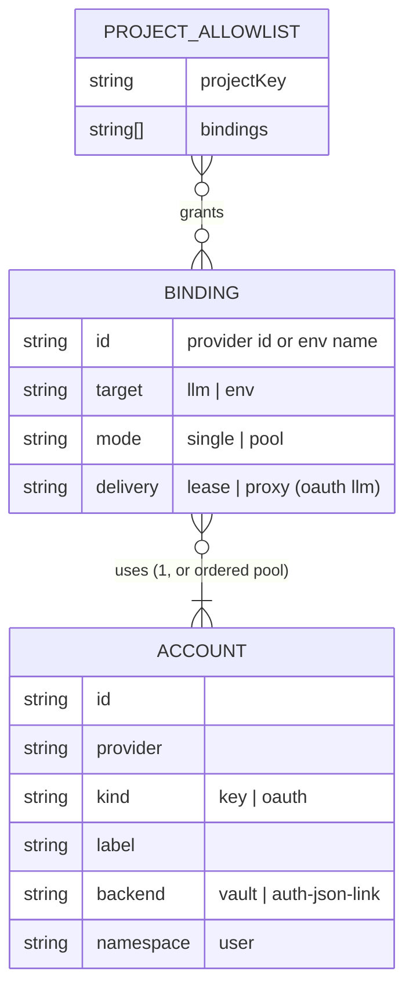
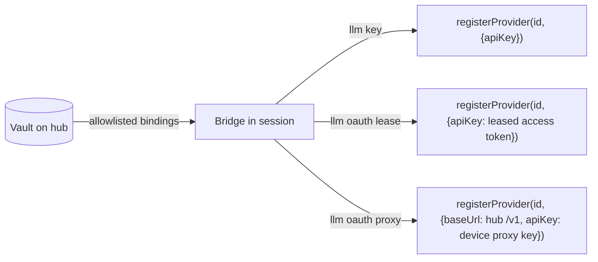

## Context

See proposal.md — Why. Part 2 of 3; depends on `add-credential-vault` (vault store, allowlist, device trust, delivery registry, redaction — its D1–D5). This document was carried over from the reviewed single-change design (three doubt-review cycles) and trimmed to the LLM scope; decision numbers are kept for traceability with the review record. Sections that describe env delivery, the allowlist, redaction points and service-secrets now live in the sibling changes and are referenced, not repeated.

**pi version.** Repo pins 1.0.0 (`pnpm-workspace.yaml:55-56`); spikes ran on global 1.1.0. Task T0 re-runs them on 1.0.0.

### Verified pi seams (1.1.0, scratch `PI_CODING_AGENT_DIR`, fake upstream)

- **Env is read live.** The bash tool builds its env per command from the live `process.env` (`dist/core/tools/bash.js:135-136`, `dist/utils/shell.js:115-123`).
- **Provider registration is public.** `pi.registerProvider` (`dist/core/extensions/types.d.ts:1334-1349`) applies immediately after load and can override a built-in provider.
  - Re-registration **merges** with the previous config and skips `undefined` fields (`dist/core/model-runtime.js:657-670`), so only `unregisterProvider` clears a field.
  - `ModelRuntime.setRuntimeApiKey` is not exposed to extensions.
- **An OAuth access token works as an `apiKey`** (spike P1–P4): `registerProvider("anthropic", { apiKey: <access token> })` sends Claude-Code OAuth requests. pi-ai selects OAuth mode by `apiKey.includes("sk-ant-oat")` (`pi-ai/dist/api/anthropic-messages.js:748-749`).
  - Precedence: local `auth.json` entry > registered `apiKey` > provider env var (`dist/core/provider-composer.js:240-300`).
  - Provider env vars come from pi-ai's table (`pi-ai/dist/env-api-keys.js`). `anthropic` maps to several variables; `google` maps to `GEMINI_API_KEY`.
- **Clone provider ids work.** A clone such as `anthropic-work` with `api: "anthropic-messages"` coexists with `anthropic`, each using its own account.
- **OAuth hook override (S6) is not used.** It needs an `auth.json` entry on the session machine (with none, pi asks for `/login`). It also receives a real local refresh token when one exists.

### Refresh-token rotation

Anthropic and openai-codex rotate the refresh token on use: a refresh invalidates the old token. The dashboard already designs around this. See `openspec/changes/archive/2026-09-27-harden-auth-json-lock-coordination/design.md:79` ("If the provider rotates tokens, the refresh token on disk is already dead") and keysync's constraints (`openspec/changes/add-oauth-key-sync-service/proposal.md`, "Constraints carried forward"). Two independent refreshers of one account therefore lose the token family.

## Goals / Non-Goals

**Goals:** usable second accounts per provider; LLM credentials on paired devices without a refresh token leaving the hub; exactly one refresher per vault-held OAuth account; public pi extension APIs only.

**Non-Goals:** changing pi's `auth.json` format; multi-user identity (keysync); encryption beyond owner-only permissions for the embedded vault; a hook-based OAuth fallback (needs an `auth.json` entry on the session machine).

## Decisions

### D1 — Accounts, bindings, backends, refresh

- **Kinds are `key` (static string) and `oauth`.** A `key` account may back an `env` binding, an `llm` binding, or both: for example `GEMINI_API_KEY` and `google`. The `target` decides how it is exposed.
- **Store.** The file, locking, corrupt handling and minimum length are as in `add-credential-vault` D1. This change adds the `oauth` kind, the `backend` field (`vault` | `auth-json-link`) and the `llm` target. An account shorter than 8 characters never backs an `llm` binding.
- **`auth-json-link` backend.** Links the hub's existing `auth.json` login without copying it.
  - The lease issuer serves the stored access token when it has at least the lease minimum lifetime left.
  - Otherwise it refreshes through the **server's single model runtime and its credential store** (`dashboard-credential-store.ts`). That is the same path a proxy request takes today. No new refresher class appears, and no new lock regime. Linking also does not *remove* a refresher: hub-local pi sessions and the server stay the coordinated pair they are today.
  - **Rotate / revoke for links.** The vault cannot rotate a linked login (that is a re-login through the existing provider Settings flow). Revoking a link = **unlink**: it is removed from every binding, and `auth.json` is untouched.
  - Linking **inherits** the accepted residual of `harden-auth-json-lock-coordination`: the server refresh runs without the file lock, as the spec "Credential writes through the model runtime SHALL keep the dashboard's auth.json guarantees" requires. It does not widen that residual.
  - The vault never writes `auth.json` itself. Refreshed tokens are persisted by that existing path.
- **`vault` backend refresh** (accounts enrolled into the vault). The protocol mirrors `dashboard-credential-store.ts`, because a lock on `withLockedJsonFile` cannot be held across network I/O (`locked-json-file.ts:105-121`, `NotPromise`):
  1. Take a per-account in-process mutex, then re-check freshness. A credential this process persisted within the last 30 s is returned as-is, so concurrent waiters refresh once.
  2. Refresh over the network with **no file lock held**, by calling the provider's pi-ai OAuth refresh function (the same one the runtime uses), propagating a concrete abort signal (`model-proxy-credential-routing`: "OAuth token refresh SHALL propagate a concrete abort signal").
  3. Persist with a locked compare-and-swap on **that account's record only**. Changes to other accounts merge, so refreshes of two accounts never conflict.
  4. If the CAS finds the account **revoked** meanwhile, discard the minted token and fail the request: no lease is issued. If it finds it **rotated**, discard the minted token and serve from the new record, refreshing it if needed.
  5. If the process crashes between the upstream rotation and the persist, the account is left `needs-reauth`, surfaced in the UI. This is an accepted residual.

### D2 — Delivery by binding target

**Timing.** Delivery runs at bridge connect (`session_start`) and on every push. There is no spawn-time delivery: the spawn-env contributor receives only `{ mechanism }` (`packages/server/src/spawn-process/spawn-env-contributors.ts:26`) and cannot enforce the allowlist.

**Delivery registry.** Reuses the `process`-held registry of `add-credential-vault` (its D2). This change adds provider ids to the tracked set and lease tokens / proxy keys to the redaction set; the masking points are that change's D5. Env delivery, env-name validation and env precedence are defined there and not repeated here.

**Precedence.** The bridge skips the binding and reports `local-override` when any of these holds:
- **llm:** `auth.json` has an entry for the provider id.
- **llm:** an env var that pi would actually use as that provider's credential (pi-ai `getEnvApiKey` semantics, so bearer-only `ANTHROPIC_AUTH_TOKEN` does not count) is set and not in the tracked set.

Precedence is per provider id. Clone ids have no env vars and no `auth.json` entry, so `anthropic-work` is delivered even when `anthropic` is local. That is intended: a local `anthropic` login plus a vault `anthropic-work` account is the core multi-account case. On the hub itself, a linked login is the local `auth.json` entry, so hub-local sessions report that binding `local-override` and use it directly.
- **llm:** the provider id is registered from `providers.json`.

**Re-registration.** On any change of shape (mode, `baseUrl`, clone base), the bridge calls `unregisterProvider` before `registerProvider`, because pi merges registrations. Lease renewal changes only `apiKey`, so it re-registers in place.

**Literal keys.** pi resolves a registered `apiKey` as a config value (`!` runs a command, `$NAME` interpolates). Every delivered key goes through the existing `toRegisterApiKey` escaping (`packages/extension/src/provider-register.ts:516-521`), extended so a value beginning with `$` is escaped too: vault values are never references.

### D3 — OAuth lease

- **What the bridge holds.** The hub issues an access token and its upstream expiry. The bridge registers the token as `apiKey` and renews at 80% of its lifetime. The token lives only in bridge memory and is never written to `auth.json` or any other file.
- **Revocation.** Revoking stops renewal and unregisters the override at once. A token already issued stays valid upstream until its expiry. Lease mode is therefore for the user's own trusted devices; proxy gives immediate revocation.
- **Applicability.** Lease is offered only for providers on a verified list. Today that is `anthropic` (P1). Task T1 tests `openai-codex` (account header) and `github-copilot`. A provider that fails is proxy-only. There is no hook fallback, because it would need an `auth.json` entry on the session machine (cycle-1/2 review).

### D4 — OAuth proxy

- **Device proxy keys.** `packages/server/src/model-proxy/api-key-store.ts` `ProxyApiKey` (`packages/shared/src/config.ts:413-423`) gains an optional `owner: { deviceId, bindingIds }`. Existing keys have no owner and behave exactly as today. Route `scopes` are unchanged; binding restriction is a new check.
  - The hub issues one key per (device, binding set) on delivery.
  - Revoking a key rejects the next request through the existing `auth-gate.ts` paths. Revoking a device pairing revokes every key owned by that device.
  - A request for a model outside the key's `bindingIds` is rejected.
- **Routing stays in the server's single model runtime** (spec requirement "The server SHALL use a single model runtime").
  - The runtime's credential store becomes a composite. For provider ids the vault owns (vault-backed bindings, clone ids, pool members), `read` and `modify` route to the **vault store and its refresh protocol (D1)**, never to `dashboard-credential-store.ts`. So a vault-held account is never written to `auth.json`, and it never gets a second refresher.
  - **Vault scope.** Vault-owned credentials resolve only inside a device-proxy request scope (async context set by `auth-gate` for an owned key). Outside that scope — `/api/models`, non-device `/v1/models`, the plugin `ctx.modelRuntime`, provider-auth reads — vault-owned provider ids have no credential and are therefore not listed or routable.
  - Clone ids and pool members are registered in the runtime as provider ids. Pool members get internal ids in a format pi accepts as a provider name; task T0 confirms the format, and `#` is not assumed.
- **Model listing.** For a request carrying a device proxy key, the filtering in "Credential-kind aware model filtering" counts the credentials of that key's bindings. Other callers see exactly the `auth.json`-derived set they see today. See the MODIFIED delta. Models of granted bindings that are excluded keep the existing diagnostic reasons (`no-credential`, `oauth-incompatible`).

### D5 — Pools (proxy-only, opt-in)

- **Why proxy-only.** Only the proxy observes the upstream 429 first-hand; a lease client would have to report it, and the hub cannot verify that. See keysync, "Why the proxy shape".
- **Failover.** On a rate-limit response **before any byte has been forwarded to the session**, the proxy:
  1. marks the account cooling, using `retry-after` when present;
  2. retries the same request on the next healthy account;
  3. returns to the primary after cooling.
- **After the first byte** an upstream error is passed through and nothing is retried, so the session never sees duplicated output.
- **Default.** Failover is off until the user acknowledges the provider-terms notice.

### D6 — Clone provider ids

- **Bridge side.** The bridge registers clones after capturing `ctx.modelRegistry` at `session_start`. It copies the base's `api`, `baseUrl` and model list, then pushes `models_list` (spec `model-refresh`).
  - If the base's model list is still empty, the clone is registered once the base's `models_list` is non-empty.
- **Flags.** Clones are not flagged `custom` (that flag means `providers.json`, per spec `provider-auth-bridge`). `list_models` shows them as ordinary providers.
- `oauth-compat.ts` filtering uses the clone binding's **declared base**. That mapping is explicit and stored per binding, not inferred, so it is not the heuristic bridging that "A newly catalogued subscription model SHALL be reachable without a provider-key remap" forbids.
- **Quota.** Quota does not report clones in this change. It keeps reporting base providers; a known limitation.

### D7 — Enrolling an additional OAuth account

- Reuses the server-side provider OAuth flow, with the vault as persist target and a user label. `auth.json` is untouched.
- **Duplicates.** Detected by provider account identity where the provider exposes one; the source is spike T2. Otherwise the user chooses "new account" or "replaces <label>".

### D9 — Plugin access

- **Declared reads.** `ServerPluginContext` (`packages/dashboard-plugin-runtime/src/server/server-context.ts`) gains reads of vault bindings that the manifest declares and the user approves.
  - A declared `key` binding returns the value.
  - A declared `oauth` binding returns a current access token, never the refresh token.
- **Not isolation.** This is a capability contract for well-behaved plugins. Server plugins run in the dashboard process as the same OS user and could read `vault.json` directly. Plugins are trusted code, which is the existing posture.
- **Existing seams, disclosed.** `ctx.providerAuth.getCredential` already returns raw `auth.json` records, including refresh tokens, to first-party plugins (`server-context.ts:730-743`). A linked login is such a record, so it stays readable there, unchanged and undeclared. Vault-backed accounts are **not** reachable through that seam or through `ctx.modelRuntime`, because of vault scope (D4). The spec states this split.
- `ctx.credentials` / `plugin-credentials.json` are unchanged.

### D11 — Overrides tracked apart from providers.json

- Vault overrides are tracked separately from `lastRegistered` (`packages/extension/src/provider-register.ts`).
  - `reloadProvidersNow` iterates only `lastRegistered` (`:926-941`), so vault overrides survive a `providers.json` reload.
  - `custom` semantics stay `providers.json`-only.
- A `providers.json` provider with the same id wins, and the binding is reported `local-override`.

### D12 — Collateral dispositions

| Candidate | Disposition |
|---|---|
| `model-proxy-credential-routing` — Credential-kind aware model filtering | **MODIFIED**: device-keyed requests count their bindings' credentials (D4) |
| `model-proxy-credential-routing` — single model runtime; credential writes keep auth.json guarantees; abort signal | honoured: the overlay lives in the single runtime (D4); link refresh uses the existing store (D1); the vault refresher propagates abort (D1) |
| `provider-auth-bridge` | unaffected: separate tracking (D11) |
| `provider-auth-server` | unaffected: the vault never writes `auth.json`; refresh of linked logins goes through the existing path |
| `dashboard-plugin-loader` | unaffected for `auth.json`: `ctx.modelRuntime` behaves as today; vault-owned credentials are outside its scope (D4, D9) |
| `agent-role-model-tools` (`list_models`) | unaffected: clones appear as ordinary providers (D6) |
| `docker-packaging` | interaction: seeded `auth.json` keys make matching LLM bindings `local-override` (documented) |
| `model-refresh` | honoured (D6) |
| `landing-page-onboarding`, `credential-detection` | unaffected for linked setups; a hub whose LLM accounts are all vault-backed shows "no providers" in onboarding — known limitation, follow-up |
| `model-proxy-credential-routing` — newly catalogued model reachable without remap | honoured: clone → base is an explicit stored mapping (D6) |
| `model-proxy-credential-routing` — diagnostic surface | unaffected: excluded models keep the existing reasons (D4) |

### D13 — Keysync merge

Keysync's standalone deployment becomes this vault plus better-auth, members and shared pools, and is **proxy-only**. Keysync's rejection of distributing credentials to members' disks stands for teams. Lease mode exists only in the embedded single-user hub, for the user's own devices, with tokens held in memory. Keysync's "not built by extending `model-proxy`" decision is reopened in its own artifacts (task). Keysync keeps its envelope encryption (`keysync-vault`) as a storage backend of the standalone deployment. The owner-only non-goal applies to the embedded vault only.

## Risks / Trade-offs

- [A lease token stays valid upstream until expiry after revocation] → lease only for own devices; proxy for immediate revocation.
- [Linked refresh inherits the server/pi refresh residual] → no new refresher class; lease reuses the stored access token while valid.
- [Crash between upstream rotation and vault persist] → account marked `needs-reauth`; the user re-enrols.
- [Pool failover only before the first byte] → stated; later errors pass through.
- [Spikes ran on pi 1.1.0; the repo pins 1.0.0] → task T0.
- [Proxy keys gain device ownership] → additive metadata; existing anonymous keys are unaffected.
- [Clone ids bypass local precedence of their base] → intended (multi-account); documented in D2.
- [Existing `getCredential` exposes linked refresh tokens to first-party plugins] → pre-existing; vault-backed accounts are excluded (D9).

## Migration Plan

1. Ship with no LLM bindings — no behaviour change.
2. "Link existing login" (no `auth.json` write) and "Add account" (vault-stored) become available; nothing is delivered until a project grants an LLM binding.
3. Re-scope `add-oauth-key-sync-service` and `add-cloud-sync-connector` (tasks).
Rollback: disabling delivery unregisters every override; proxy keys owned by devices are revoked; `auth.json` was never written by the vault.

## Open Questions

None that change specs. Follow-ups: quota for clone ids; onboarding/`credential-detection` for hubs whose LLM accounts are all vault-backed; vault delivery in the `providers_list` catalogue `source`.
