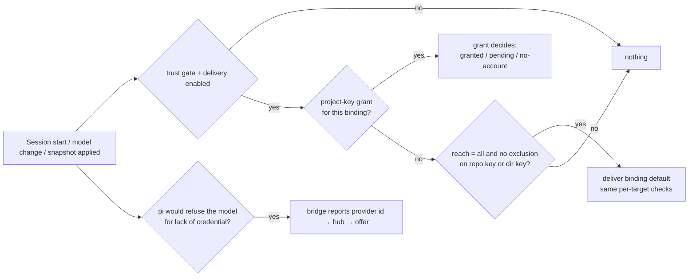

## Context

Today the vault is default-deny per project key:
- `applicableGrants` matches exactly one subject: `repo:<key>` when the session has a repository key, else `dir:<device>:<path>` (`packages/server/src/vault/vault-grants.ts:82-85`).
- `resolveBindings` delivers only those grants: `blocked-name` for reserved names (`:105-107`), `pending-confirmation` for an unconfirmed repository key (`:109-111`), otherwise `granted` or `no-account` without fallback (`:113-114`).
- Other subject types are preserved and never deliver (`:12-14`). `createGrant` accepts only `repo:` / `dir:` (`:187`).

A new folder therefore gets nothing, and a user who never opened Settings → Vault has no way to learn why. On the hub, pi's own login usually covers this. Where no login exists, pi refuses the prompt (`pi-coding-agent/dist/core/agent-session.js:1653-1662`): an OAuth provider gets "Authentication failed… Run '/login'" (`:1655-1660`), others get "No API key for …" (`:1662`).

**Remote delivery is off today.** The trust gate admits a paired device only over proven TLS, which the hub cannot verify, so `isTls` defaults to false (`packages/server/src/vault/vault-delivery-hub.ts:10-13,211`). This change is therefore **hub-first**: the reach and the offer work for hub sessions now, and reach paired devices automatically once the prerequisite change `prove-vault-bridge-tls` lets the gate admit them. No code here depends on it.

**Builds on:**
- `add-credential-vault` and `retro-ux-credential-vault` (archived);
- `add-vault-llm-delivery`: `llm` bindings, its per-target changes to `accountFor` / `resolveBindings` / `ungrantedBindings` (all `target === "env"` today, `vault-grants.ts:71,94,104`), the lease-verified list, and the Providers integration (U11).

This change's `credential-vault` delta is written on top of that change's text, so it **archives after** `add-vault-llm-delivery` (task 0.1 gates it). Approved board: `mockups/reach.html`, decisions U13–U16 (`mockups/ui-plan.md`).

## Goals / Non-Goals

**Goals**
- A new folder works without visiting the vault.
- The reach is decided once, when an account is added.
- Per-project exceptions.
- A session asks for a model credential only when pi would refuse.
- Downgrade fails closed.

**Non-goals**
- Folder-subtree inheritance (rejected: the user has no parent folder to set).
- Enabling remote delivery (`prove-vault-bridge-tls`).
- Onboarding / `credential-detection` (follow-up named in `add-vault-llm-delivery`).
- Offers for env variables: there is no failure signal for a missing env key.
- A per-device reach (open question).

## Decisions

### D1: Reach as grant subject `all`; exclusions in their own array

- **Reach.** "All my projects" is a grant `{ subject: "all", bindingName }` with no `accountId` (`createGrant` refuses one with `invalid_grant`, via the existing `assertGrantable`, `vault-grants.ts:166-181`); its absence means "Only projects I choose".
  - An older hub never matches `all`, because `applicableGrants` compares the subject with the session's single key (`vault-grants.ts:82-85`). The reach is inert after a downgrade.
  - `createGrant` (`:187`, today `/^(repo|dir):.+/`) is changed to also accept `all`, with no `accountId`.
- **Exclusions.** `doc.reachExclusions: [{ subject, bindingName }]`, never grants. The store keeps unknown top-level fields (`vault-store.ts` header comment and `VaultDocument`, `:9-11,59-63`), so an older hub preserves them and never reads them.
  - Encoding an opt-out as a grant flag was rejected: an older hub would read it as a positive grant and deliver the default, which widens access on downgrade.
- **Exclusion match.** An exclusion matches when its subject equals the session's `dir:<device>:<path>` subject (always computed, even when the session has a repository key) or its `repo:` subject.
  - "Turn off here" stores the `dir:` subject only. That keeps it to one checkout, and stable when a remote is added, changed or removed.
  - A `repo:` exclusion, which covers every checkout because `repoSubject` has no device part (`vault-grants.ts:23`), is created only from the binding card, which says "all checkouts".
  - A moved folder is a new project.
- **Account exceptions** are ordinary project-key grants with `accountId`, on `single` bindings only. A pool is never chosen per project (`add-vault-llm-delivery/design.md:104`).
- **Resolution** in `resolveBindings`:
  1. Project-key grants exactly as today (or as `add-vault-llm-delivery` extends them). Any state, including `pending-confirmation` and `no-account`, **claims** the binding, so the reach never overrides a project's explicit choice and never falls back (fail closed).
  2. For each `all` grant whose binding was not claimed in step 1 and has no matching exclusion, the binding's default (or pool order) is used, through the **same per-target checks** as step 1: `isDeliverableEnvName` for env; the account-kind and delivery rules of `add-vault-llm-delivery` for llm. The state is `granted` or `no-account`, with no confirmation step. A new `source: "reach" | "grant"` on `BindingResolution` feeds the session view.
- **`buildDeliverySnapshot`** (`:126-147`) consumes resolutions unchanged. **`ungrantedBindings`** (`:91-96`) counts a binding reached via `all` (not excluded) as granted.
- **Reach to "chosen"** deletes the `all` grant; project-key grants and exclusions stay (exclusions become dormant and apply again on re-widening). **Deleting a binding** deletes its `all` grant and exclusions with its grants.
- **Delivery checks** in step 2 are the step-1 checks, including any per-account check another capability adds (e.g. `too-short` from `absorb-service-secrets-into-vault`). The reach never changes a binding's delivery mode, pool order or failover opt-in (pools stay proxy-only and opt-in, `add-vault-llm-delivery`). For `llm` bindings, local precedence and no-restart application are `add-vault-llm-delivery`'s ("Local LLM credentials take precedence", "LLM credential changes notify sessions").
- **Service subjects and plugins.** `service:<id>` reads (`absorb-service-secrets-into-vault`) resolve only their own grants. Plugin reads return a declared binding's default regardless of grants (`vault-plugin-read.ts`, per its DOX row). The reach changes neither; it is for sessions only.
- **Revoked default.** `revokeAccount` clears the default (`vault-grants.ts:229-255`). Every project reached through that binding is then `no-account`, and nothing falls back.

### D2: Same trust gate; delivery switch first

The reach adds no trust path: `compute()` refuses on the delivery switch (`vault-delivery-hub.ts:208`), then on trust (`:211-212`), before the document is read. When `prove-vault-bridge-tls` lets `decideVaultTrust` (`:36-42`) admit paired devices, they are reached with no change here. Until then, a remote session's view shows its existing `transport-insecure` outcome with the hub-first explanation (board `session-remote-off`). Pairing revocation follows whatever withdrawal `prove-vault-bridge-tls` defines for remote sessions; this change claims no bound for it.

### D3: Missing-credential detection (bridge → hub)

- **Bridge predicate.** pi's pre-prompt gate is `runtime.hasConfiguredAuth(provider) || await runtime.checkAuth(provider)` (`agent-session.js:1653-1654`; `model-runtime.js:310-311,366-368`). The runtime is not public, and `ModelRegistry` exposes no `checkAuth` (`dist/core/model-registry.d.ts`). The bridge therefore uses:
  1. a sync pre-filter: `ctx.model !== undefined && !modelRegistry.hasConfiguredAuth(model) && !modelRegistry.getProviderAuthStatus(model.provider).configured` (`model-registry.d.ts:32,34`; status covers runtime keys, stored, configured providers and the env snapshot, `model-runtime.js:441-451`);
  2. only when stage 1 says missing, `(await modelRegistry.getProviderAuth(model.provider)) === undefined` (`model-registry.js:102-104` → `getAuth`). With no credential there is nothing to refresh. With one, it may refresh, which pi's own first prompt would do anyway.
  - **Equivalence with pi's gate is unverified.** Task T0 compares the predicate with a real `prompt()` refusal for `auth.json`, env (including env set after the snapshot), `models.json`, `providers.json`, vault env delivery (`process.env`, `packages/extension/src/vault-delivery.ts:199-234`) and vault `llm` overrides, on pi `>=1.1.0` and the installed 1.3.0.
  - **Fallback if T0 finds a divergence:** report only after pi actually refuses a prompt with its no-credential error (observed by the bridge on the failed turn). The offer then appears under the error only, not at session start.
  - `ctx.model` may be undefined at `session_start`; the first `model_select` then reports. The OAuth-expired branch (`agent-session.js:1655-1660`) is out of scope.
- **Wire.** A new message `vault_missing_provider { sessionId, provider: string | null }`, sent independently of `vault_report`: today `applySnapshot` sends nothing when no value changed (`packages/extension/src/vault-delivery.ts:259-263`), which is exactly the no-binding case.
  - It is sent on `session_start`, on `model_select` (`dist/core/extensions/types.d.ts:886`), and after each snapshot application (debounced 500 ms) when the result changed.
  - It is also sent **unconditionally with every vault sync request**, so a hub restart or reconnect always receives the current state.
  - One WebSocket keeps messages ordered, so the hub keeps the latest; no sequence number. An older hub drops the unknown message type.
- **Hub.**
  - `rec.missingProvider` holds the latest report. It is cleared on `handleSyncRequest` (`vault-delivery-hub.ts:254`), and the bridge re-sends it with every sync request.
  - The offer is computed only when delivery is enabled and `rec.outcome` is delivered, not `untrusted` / `transport-insecure` / `disabled` / `vault-unavailable` (`:208-216`).
  - It goes through `resolveBindings` for the session's project, so a project grant or exclusion that claims the binding yields `{ provider, claimedBy: { state, subjectKind } }` (repair, no widening) instead of account choices.
  - Otherwise it yields `{ provider, binding?: { name, defaultLabel, reach }, accounts: [{ id, label, identityMasked? }], reachedDevices: [{ id, label }] }`. Names only. `reachedDevices` is the hub, plus the paired devices once the gate admits them.
- **Route.** `GET /api/session/:id/vault-bindings` (`vault-routes.ts:254-261`) today returns `states`, plus `ungranted` for managers. New:
  - every caller gets `missingProvider` (session state, not vault state);
  - managers also get `offer`;
  - non-managers get no vault-derived field (no existence oracle).
- **Client.** One `useSessionVaultState(sessionId)` hook owns the single 2.5 s poll, moved out of `VaultBindingsChip` (`packages/client/src/components/session/VaultBindingsChip.tsx:31,198-215`), with a per-session subscriber cache so the chip and the banner share one request. The banner does not depend on the chip's early return for an empty session (`:217`).

### D4: Offer actions and Undo

- **Accept.** `POST /api/vault/offer/accept { sessionId, provider, accountId?, scope: "all" | "project" }` is one **synchronous** mutator inside a single `store.update` (the callback may not be async, `vault-store.ts:113`). It composes sync cores refactored out of their `update` wrappers: the `llm` binding creation of `add-vault-llm-delivery` (name, provider, kind and delivery rules; not the env-only `createBinding`) and `createGrant` with the `all` subject. No validator is copied. It refuses when the offer is `claimedBy`. It is idempotent: an existing `all` grant or identical project grant is a no-op with no new undo token.
  - **No binding** for `provider`: it creates an `llm` binding named exactly the provider id (never a clone), with `accountId` as default and the delivery `add-vault-llm-delivery` prescribes: lease when the provider is on the lease-verified list, `key` for a key account, else refuse with the reason. The lease-verified list is a static set (`add-vault-llm-delivery` design D3), so no network work runs inside the lock. An env binding is never created by the offer.
  - **Existing binding**: its default is kept, and `accountId` must be absent or equal to the default.
  - `scope: all` adds `{ subject: "all" }`. `scope: project` adds the session project's key grant; for a repository key the response says `pending-confirmation`, and the existing chip confirmation applies.
- **Undo.**
  - The accept response returns `{ undo: { sessionId, provider, expiresAt }, hubEpoch }`: a non-secret handle, no token.
  - The hub keeps at most one undo record per `(sessionId, provider)`, `{ prior entries (names only), written entries, expiresAt }`. It is replaced by a newer accept, dropped after 10 minutes or when the session ends, and lost on restart. Memory is bounded by live sessions; there is no LRU eviction.
  - The client hides Undo past `expiresAt`, or when the polled `hubEpoch` changes.
  - `POST /api/vault/offer/undo { sessionId, provider }` requires `canManageVault`, restores the prior entries in one `store.update`, and refuses with `gone` (no record) or `conflict` (the written entries changed since). Any manager may undo, as any manager may make the same edit directly.
- **"Not now"** is client-side `sessionStorage` keyed `pi-dashboard:vault-offer-dismissed:<sessionId>:<provider>`, cleared when the session reports a different provider (C1).
- **Authority.** All routes use `canManageVault` (`vault-routes.ts`, foundation D11). Every write fires `store.onChange` → `schedulePush`.

### D5: UI (approved board)

- **Reach control.** A shared `VaultReachChoice` (U13) in Providers "Another account" / "Link to vault" (`add-vault-llm-delivery` U11) and Vault "Add key". The UI preselects "All my projects"; the API default stays narrow and the API docs say so.
- **Card.** `VaultVariableCard` "Who can use it" (U14):
  - all-projects line: devices, and the number of projects with an open session receiving it (`listOpenProjects`, `vault-delivery-hub.ts`);
  - exceptions only (account exceptions on single bindings, exclusions on all);
  - "Make it available to all my projects" behind `ConfirmImpact` listing devices and the cloned-repository risk.
- **Session.**
  - `VaultMissingCredentialBanner` at the top of the session detail view, above the message list (render site located by task 4.1). It is session-scoped, unlike the app-wide `MissingRequiredBanner`, which renders in the list panel (`packages/client/src/App.tsx:3212-3216`). Before "Use in all my projects", its body states `reachedDevices`, "and devices you pair later, once remote delivery is on", that code in any reached project (cloned repositories too) can use it, and, for a `key` account, that the key is copied into every reached session. This satisfies the widening confirmation.
  - Adding an account exception shows "until confirmed, this project gets nothing from <binding>" for repository keys.
  - An inline variant under the session's "No API key" error; its render site is located by task 4.1.
  - Chip rows show `source`; "Turn off here" appears on reach rows only (U15, U16).
- **Import** creates bindings with reach "Only projects I choose"; its done step links to widening (same `ConfirmImpact`).
- **Pairing.** `PairingApprovalHost`'s dialog, used for both QR and LAN-knock pending devices (`lan-knock-pairing`), (`packages/client/src/components/pairing-approval/PairingApprovalHost.tsx`) lists the reach bindings with a link to Vault. The wording depends on whether the trust gate admits remote sessions: "will get once remote delivery is on" vs "will get". Names come from the vault overview (operate authority, which approval already requires).

### D6: Observability

Each reach change, exception change and offer accept / decline / undo emits `{ at, kind, bindingName, subjectKind, sessionId?, outcome }` beside the `credential-delivery` events. There is no value and no directory path (paths carry user names).

## Risks / Trade-offs

- **Cloned repositories get the account.** That is the cost of "no setup". Code run in any reached checkout (repository scripts, project-local extensions) can use the delivered credential; redaction covers only output.
  - Mitigations: explicit choice with that warning; per-project "Turn off here"; the widening confirmation; local precedence; `proxy` delivery, which never puts a token in the session and revokes immediately.
  - The trust gate is not a mitigation here: it authenticates the device, not the repository.
  - **Key accounts are copied to every reached session** (`key` delivery puts the secret in the session). Only `lease` / `proxy` keep the long-lived secret on the hub. The reach control's warning says so for key accounts.
- **No checkout confirmation under the reach.** This deliberately voids the shipped scenario "Spoofed origin in an unconfirmed checkout" for reached bindings: under the reach every project is in scope, so a spoofed origin gains nothing more. Project grants and account exceptions on repository keys keep their confirmation, because the override account may be reachable nowhere else.
- **An explicit project grant blocks the reach while pending or broken (deny-first exceptions).** This is intended and matches the shipped rule that a revoked override never falls back (`vault-grants.ts:4-8`). It fails closed; the chip and the offer show the grant's state and repair. Falling back to the reach on `no-account` was considered and rejected, because it would widen silently.
- **Pairing widens the reach** once remote delivery exists; the pairing dialog disclosure covers it.
- **Downgrade.**
  - `all` grants and exclusions are inert, and sessions that relied on the reach lose access. This fails closed.
  - An older hub's grant list (`listGrantStates`, `vault-grants.ts:157-164`) shows the `all` grant as an `ok` row with subject `all`. It is cosmetic and delivers nothing.
  - An older hub's `deleteBinding` removes the `all` grant with the other grants of that name, but leaves `reachExclusions` behind. They stay inert, and the newer hub ignores exclusions whose binding no longer exists.
  - Values delivered through the reach are withdrawn by the older hub's next snapshot, within the existing offline-grace rules.
- **Detection is pre-flight only.** A configured but upstream-rejected login (expired) gets no offer. Accepted.

## Migration Plan

- No data migration: an absent `all` grant means today's behaviour.
- Rollback: set each binding to "Only projects I choose" (deletes `all` grants and exclusions), or downgrade (inert, D1).
- Archive after `add-vault-llm-delivery`.

## Open Questions

- A per-device reach ("this dashboard only")? It matters once `prove-vault-bridge-tls` lands; revisit with that change.
