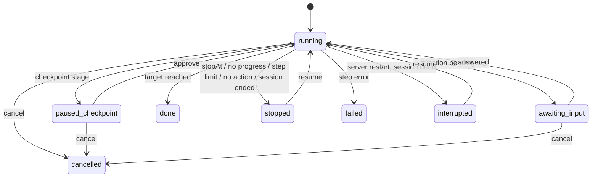

## Context

- `add-project-workflows` provides stages, primary-action selection, executors
  and trust in `packages/workflows-plugin`.
- `add-pending-question-stack` provides server-side question records per
  session (used for `awaiting-input`).
- Goal supervisor pattern (`packages/goal-plugin/src/server/goal-supervisor.ts`):
  persist `inFlightSpawn` before launch, `reconcileOnBoot`, progress-gated
  respawn, crash-loop breaker, cumulative budget.
- Headless sessions survive server restart (keeper process); pending prompts are
  re-sent on reconnect.

## Goals / Non-Goals

**Goals:** safe unattended chaining with explicit stop conditions; restart
safety; no new step syntax (reuse actions).

**Non-Goals:** automatic respawn of a crashed step (v1 stops; user resumes);
parallel runs per change; triggers other than the user/REST (e.g. on-commit) —
automation can call the REST route later; answer timeouts.

## Decisions

**D1 — Reconciler, not a step pointer.** The record stores target, step count,
approved checkpoints, current step handle `{ actionId, sessionIds, automationRunId?,
goalId? }`. Decisions are re-derived from the stage each time. Safe because the
skills are idempotent and stage facts are filesystem-derived.

**D2 — Completion tracking per executor.** Prompt/spawn: the step session's
`agent_end` after the delivered prompt (correlated by session id + delivery
timestamp). Automation: `runInline` completion callback. Goal: terminal-status
callback. Flow: the flow's completion event. Combined: action complete when all
tracked handles complete.

**D3 — Fresh facts at decision points.** After completion, bypass the bash-gate
TTL cache and wait for the next OpenSpec poll tick (or force a single-change
refresh) before recomputing — avoids "no progress" false positives from stale
poll data.

**D4 — Store.** `~/.pi/dashboard/workflow-runs/<repoHash>.json`, atomic writes,
per-repo mutex; terminal runs retained 30 days. One active run per
(repoRoot, change).

**D5 — Boot reconcile** mirrors the goal supervisor: live session → re-attach;
dead → `interrupted`. No automatic restart after boot (user decision point).

**D6 — Confirmation and REST.** UI requires a confirm per run; REST `operate`
tier is the confirmation. Workflow trust is still required in both.

## Risks / Trade-offs

- **Irreversible steps unattended** (ship-change squash-merge). Mitigation:
  projects declare checkpoints; ship-change's own archive+sync gate remains the
  hard gate; this repo's example declares `checkpoints: [planned]`.
- **Long waits** (CI, CodeRabbit) hold no resources beyond the step session.
- **False "no progress"** from stale facts — D3.
- **Rollback:** disable auto-advance in the plugin; records remain readable;
  buttons from `add-project-workflows` unaffected.
