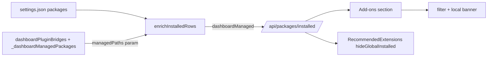

## Context

See proposal.md › Why. Current surfaces:

- Settings ▸ Packages = `ElectronRuntimeUpdates` + `UnifiedPackagesSection` + `GlobalPackagesBrowseAndDialogs` (`packages/client/src/components/settings/SettingsPanel.tsx:2427-2433`). The browse part mounts `PackageBrowser` with `showInstalledSection={false}` (`SettingsPanel.tsx:3901-3907`), and `PackageBrowser` always mounts `RecommendedExtensions` (`packages/client/src/components/packages/PackageBrowser.tsx:164`), which renders installed entries again as Active/Remove cards.
- Plugin bridges reach `packages[]` as plain path strings. The dashboard records them twice in the same file: `dashboardPluginBridges["dashboard-<id>"] = <path>` and the ownership map `_dashboardManagedPackages[<path>] = <id>` (`packages/shared/src/plugin-bridge-register.ts:9-20,43`). Readers: `listManagedBridges()` / `listManagedPackageOwnership()` (`plugin-bridge-register.ts:366-383`), both resolving the file via `getSettingsPath(homedir)`.
- Installed rows: `GET /api/packages/installed` → `packageManagerWrapper.listInstalled(scope, cwd)` → pure `enrichInstalledRows(rows)` (`packages/server/src/routes/package-routes.ts:80-81`; enricher `packages/server/src/package/installed-package-enricher.ts`, IO injected).
- Settings page ids: shared `VALID_SETTINGS_TABS` (`packages/shared/src/dashboard-plugin/slot-types.ts:227`); aliases `SETTINGS_PAGE_ALIASES` (`SettingsPanel.tsx:471-474`) are already applied to route params and replace-navigated (`SettingsPanel.tsx:703-712`). Reserved rail labels: `packages/client/src/lib/settings-promotions.ts:50-86`.
- Folder settings page ids live in TWO whitelists: the live shell `packages/client/src/components/shell/ShellContent.tsx:37-45,126-130` and `packages/client/src/App.tsx:574-580`, plus the `DirectorySettingsPage` union (`packages/client/src/components/DirectorySettings/DirectorySettings.tsx:33`) and the pi-resources redirect target (`App.tsx:~2394`).

## Goals / Non-Goals

**Goals:** fewer rows, each item once, plain words, old links keep working.

**Non-Goals:** new endpoints, per-feature row merging, folder effective view (follow-up changes); visual redesign of `PackageRow` beyond the source-line change; resolving the stale `pi-resources-view` spec (its Installed/Packages-tab requirements describe a `PiResourcesView` that no longer exists; already contradicted by the shipped `directory-settings-page` before this change) — left for a spec-cleanup change.

## Decisions

**D1 — Bridge detection on the server from the dashboard's own records.** A global row is `dashboardManaged` when its resolved path is a value of `dashboardPluginBridges` OR a key of `_dashboardManagedPackages` (union: either record alone is enough, so a partially-healed file still hides bridges). For `scope=global` requests (rows with wire scope `user`) the route computes the managed path set once (`listManagedBridges` + `listManagedPackageOwnership`) and passes it as a new third parameter, `enrichInstalledRows(rows, resourcesPath, { managedPaths })` — `resourcesPath` keeps its default and meaning (bundled status), so existing callers are untouched (`installed-package-enricher.ts:237-243`). Paths are canonicalised on both sides: `~` expansion, `path.resolve`, then `fs.realpathSync.native` when the file exists (handles symlinked homes and macOS case), falling back to the resolved path. Project-scope rows are never flagged. Both readers resolve the same file today (`package-manager-wrapper.ts:285` `AGENT_DIR = ~/.pi/agent`; `plugin-bridge-register.ts:46-49`); when the registry lists bridge paths but none matches an installed row, the route logs one warning line so a future divergence (e.g. `$HOME` ≠ `os.homedir()`) is visible. If the registrar's settings path differs from the file the package manager lists (custom agent dir), nothing is flagged — the bridges are then not in that list either. Rejected: a client `/src/bridge/index.ts$/` heuristic (hides user entries, breaks bundled Electron paths).

Trade-off: an ownership-map key alone flags a row. A stale key (bridge gone, key left) could hide a user entry at the identical absolute path; the registrar writes and removes both records together and a user reusing a bridge file's exact path is implausible, so this is accepted.

**D2 — Hide, don't remove.** `dashboardManaged` rows stay in `packages[]` and keep loading; only display and counts change. Removing them is plugin-loader territory.

**D3 — Page id `add-ons`, alias `packages`.** Replace `packages` with `add-ons` in `VALID_SETTINGS_TABS` and the `SettingsTab` union (no deprecated member: `claim.tab` no longer drives placement; `packages/dashboard-plugin-runtime/src/manifest-validator.ts:285,336` only checks it is a string and casts it, so JSON manifests with `tab: "packages"` keep loading; a workspace-wide `tsc` run proves no in-repo TypeScript consumer breaks; external TypeScript that names the literal is the documented break). Add `packages: "add-ons"` to `SETTINGS_PAGE_ALIASES`; the existing route-alias effect already replace-navigates. Folder: replace `packages` with `add-ons` in `ShellContent.tsx` (live path) and `App.tsx` whitelists, their defaults and the union; retarget BOTH pi-resources redirects (`App.tsx:~2394` and `renderPiResourcesRedirect` at `App.tsx:~2793`, the live shell path); map a `packages` segment to `add-ons` with `replace` in the shell before rendering. `ShellContent.tsx` also lacks `cards` today (the Session cards page falls back to the default on the live path) — added in the same edit because it is the same whitelist. In-app links move to the new path directly.

**D4 — Recommended-once by global install state.** `RecommendedExtensions` gets `hideGlobalInstalled` (true on the global Add-ons page) that drops recommended entries whose `installed?.scope === "global"` AND `activeInPi` (an on-disk-but-inactive global entry has no installed row, so it keeps its Activate card) (the recommended-route type, `packages/shared/src/recommended-extensions.ts:104` — not `InstalledPackage.scope`, which is `user|project`). Not `activeInPi`: that flag is also true for installs found in the server-cwd local settings, so a folder-only install would vanish from the page. Folder scope keeps current behaviour.

**D5 — Local override = badge + menu, version stays visible.** `PackageRow` drops the second source line and the inline `↺ Reset to npm`; the `local` badge's accessible description names `publishedVariantSource` + `publishedVariantVersion`, and the `⋮` item label reads "Reset to published version (<version>)" so the version is visible without hover. Confirm dialog and `disabled={busy || locked}` on the menu item (`PackageRow.tsx:391-392`) unchanged.

**D6 — Filter is client-side over displayed rows.** Rows are fetched once; one shared helper (`lib/package/installed-list-helpers.ts`) drops `dashboardManaged` rows and provides the local-source predicate (`classifySource` ∈ {local, git}), used by every list, count, chip and the banner. The banner's `Show` resets the other filters before enabling the chip. While no filter is active every sub-group renders (empty hint included); with a filter active, empty sub-groups hide.

**D7 — Explainer and rail state in localStorage.** Keys `dashboard:addons-explainer-dismissed` and `dashboard:settings-plugins-expanded`. Auto-expand on an active child is derived at render, never written. Copy lives in i18n (en/hu/zh), no "spawn" wording.

**D8 — Explainer example is static copy.** Goal: the extension `@ricoyudog/pi-goal-hermes` is a recommended entry (`packages/shared/src/recommended-extensions.ts:309`) and the dashboard part is the bundled `goal-plugin`, whose manifest requires it (`packages/goal-plugin/package.json:84` `requires.piExtensions`). The manifest entry has no `dashboardPlugin` field; the pairing comes from the plugin side. Data-driven selection arrives with the feature catalog.

**D9 — Reserved labels.** Add the new `ADD-ONS` group label and `Add-ons` item label (all shipped locales) to `RESERVED_SETTINGS_LABELS` sources in `settings-promotions.ts`; keep `Extensions` reserved (Resources › Extensions still exists).

## Risks / Trade-offs

- [External bookmarks / e2e `goto` targets use `/settings/packages` or `/folder/<cwd>/settings/packages`] → redirects kept indefinitely; sweep `packages/`, `tests/e2e/`, `qa/`, `docker/`, `docs/`, `README.md` and update in-repo targets to the canonical path.
- [Hidden bridge row hides a real problem, e.g. a stale bridge path] → `add-package-health-cleanup` sees raw `packages[]`; `dashboardManaged` only affects rendering.
- [Inline reset link removed — one more click] → accepted; version stays visible in the menu label; banner + filter make local rows findable.
- [Old i18n keys] → keys that become unused are removed only as the i18n orphan test requires; existing hu/zh values of kept keys are unchanged.
- [Plugin/third-party code importing `SettingsTab` with `"packages"`] → compile-time break for external TypeScript only; the value never resolved at runtime after this change anyway. Called out in the changelog.

## Migration Plan

No data migration. Deploy = client build + server restart (route passes `managedPaths`). Rollback = revert; orphaned localStorage keys are harmless.
