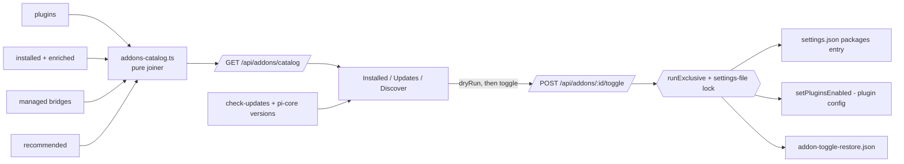

## Context

See proposal.md › Why. Inputs already exist server-side:

| Input | Source |
|---|---|
| installed packages (global) | `listConfiguredPackages` + `installed-package-enricher.ts` (incl. `dashboardManaged`, `publishedVariantSource`) |
| plugins | `discoverPlugins()` (`packages/dashboard-plugin-runtime/src/server/loader.ts:118`) → `DiscoveredPlugin` (`loader.ts:35-50`): `manifest` (`id`, `requires.piExtensions`, `dependsOn`), `packageDir`, `packageName`, `bridgeEntryPath`; enabled/status/`missingRequirements` as computed for `GET /api/plugins` (`packages/server/src/routes/plugin-activation-routes.ts:~170-215`) |
| first-party plugin | `isFirstPartyPluginPackage(packageName)` (`packages/dashboard-plugin-runtime/src/server/first-party.ts:16`) |
| bridges | `listManagedBridges()` (`packages/shared/src/plugin-bridge-register.ts:366`); boot-time sync deregisters bridges of disabled plugins (`packages/server/src/server.ts:4477-4501`) |
| recommended | `RECOMMENDED_EXTENSIONS` (`dashboardPlugin` link) |
| package identity | `packageIdentity(source, baseDir)` (`packages/server/src/pi/resource-origin.ts:177`) |
| contents | `packages/shared/src/pi-package-resolver.ts` (package `pi` manifest / convention dirs) |
| known folders | `directoryService.knownDirectories()` (`packages/server/src/directory-service.ts:143`) |
| package-op lock | `PackageManagerWrapper.runExclusive` (`packages/server/src/package/package-manager-wrapper.ts:321`) |
| update flags | client-side: existing `POST /api/packages/check-updates` results + `usePiCoreVersions` (no server cache exists; the catalog does not carry update flags) |

## Goals / Non-Goals

**Goals:** a pure, unit-testable joiner; one locked write path for the combined toggle; no new persisted dashboard config other than restore records.

**Non-Goals:** a server-side update cache; folder-scope toggling (`addons-hub-folder-view`); changing the folder Add-ons page (it keeps today's row list).

## Decisions

**D1 — Pure joiner + thin route.** `addons-catalog.ts` takes the inputs as plain data and returns `AddonFeature[]`; the route only gathers inputs. Alternative: client-side joining over three fetches — rejected: duplicates server identity rules (`packageIdentity`, bridge resolution) in the browser.

**D2 — Package identity and join precedence.** Identity = `packageIdentity` (npm name, git URL without ref, resolved path); a local/git package also matches a plugin by its `package.json` name. `core:dashboard-bridge` = the package named `@blackbelt-technology/pi-dashboard-extension`, claimed first. Then, a package once claimed is never re-claimed:
1. plugin's own package (name = `DiscoveredPlugin.packageName`);
2. managed bridge (path = `bridgeEntryPath`);
3. package required by ≥ 2 plugins → own `pkg:` feature with `requiredBy` (checked before the manifest link so D3 holds);
4. recommended `dashboardPlugin` link;
5. package required by exactly one plugin → joins it;
6. rest → own `pkg:` feature.
A requirement on a package already claimed elsewhere is listed under the requiring feature's `requires` (reference, not owned). `requires.piExtensions` is advisory for plugin *activation* (web-access, blackhole) but is still the join signal — `pi-web-access` joins `plugin:web-access`. A `dashboardManaged` row matching no plugin's bridge is excluded and logged once per catalog build.

**D3 — Shared required package becomes its own feature.** Attaching it to one plugin would make that plugin's toggle silently affect another. Own row + `requiredBy` keeps the toggle honest. Turning that `pkg:` feature off filters the package only; the requiring plugins are named in the confirmation, not toggled.

**D4 — "Off" for a pi package = all-empty object filter, not uninstall.** pi documents `[]` as "load none of that type" (pi `docs/packages.md` filter section); pi iterates all four resource types, so the off form sets `extensions`, `skills`, `prompts`, `themes` to `[]`. The package stays installed, so turning it back on needs no network. The global entry is replaced in place at its array index. The previous entry (string or object) and the filtered value written go to a new machine-local file `~/.pi/dashboard/addon-toggle-restore.json` (module `packages/server/src/addons/addon-toggle-restore.ts`, atomic tmp+rename like `resource-entry-ownership.ts` `save()`), keyed by settings path + package identity. Separate file, not a section of `resource-entry-ownership.json`: that map is `projectPath → type → string[]` (`packages/server/src/pi/resource-entry-ownership.ts:27-30`) and cannot hold whole entries. A malformed restore file reads as empty and is logged; D12 still recovers. Equality = JSON-value equality (the JSON writer does not preserve formatting). More than one global entry with the same identity → 409 `duplicate-entries`, nothing written; the health panel resolves duplicates. Alternative: `autoload: false` — rejected: meaningful only for project deltas.

**D5 — Locks, write ordering, rollback.** The module-private `serializeWrite` / `settingsWriteLocks` (`resource-activation-routes.ts:58-67`) becomes a shared `withSettingsWriteLock(key, task)`. The plugin toggle's cascade + config write (`toggleImpactFor` / `toggleFlips` / `applyToggleFlips`, `plugin-activation-routes.ts:59-120,229-285`) plus its `plugin_config_update` broadcast and WS-route teardown becomes `setPluginsEnabled(id, enabled, { dryRun })` returning flips/blockers (the `dashboard-plugin-loader` toggle contract — write, broadcast, 200 `restartRequired`, 404 — is unchanged); `POST /api/plugins/:id/toggle` calls it under a plugin-config lock key, so it serialises with the hub (today it has no lock). The hub toggle runs under `PackageManagerWrapper.runExclusive` (409 busy while a package op runs), then the settings-file lock, then the plugin-config lock:
- **Off:** parse settings (409 if unparseable) → write restore records → write filtered entries → `setPluginsEnabled(false)`. Plugin failure: restore entries, delete new records, 500.
- **On:** `setPluginsEnabled(true)` (409 blockers unchanged) → restore entries (incl. cascaded features) → delete records. Restore failure: `setPluginsEnabled(false)` for flipped ids, 500.
- A failing compensating write keeps the records, logs, and returns 500 `consistent: false`. No journal: records persist and every state is recoverable by the next toggle — crash after records, before entries → feature still `on` with a record; the next off re-records (entry unfiltered, so not the no-op case). Crash after entries, before plugin flip → `partial`; next off completes. Crash after restore, before record delete → next on sees entry = recorded original and deletes the record (D12).

**D6 — Hub toggle vs Plugins index toggle; partial state.** Only the hub switch is combined. The Plugins index keeps plugin-only semantics (its spec is unchanged). A feature can be `partial` from (a) a Plugins-index toggle, (b) a package kept on for another enabled plugin (`keptOn`), or (c) an interrupted operation. The hub never leaves a half-off feature outside (b), and (b) is named in the confirmation. The control is a switch-styled `role="checkbox"` because ARIA `switch` has no `mixed` value; partial → `aria-checked="mixed"` + visible "partly on". Activating a partial control opens the off confirmation.

**D7 — Feature state.** `on` = plugin (if any) enabled and no owned entry in the all-empty filter form; `off` = plugin (if any) disabled and every owned entry in that form; `partial` otherwise. A user's own narrower filter (e.g. only `extensions: []`) counts as on. `keptOn` = owned packages required by an *enabled* plugin outside the operation.

**D8 — Origin is derived.** A part is first-party when its plugin passes `isFirstPartyPluginPackage(packageName)` or its package `package.json` name is in the `@blackbelt-technology/` scope. `first-party` = all parts first-party; `mixed` = ≥ 1 first-party and ≥ 1 non-first-party part (either direction); `community` = none; `upstream` = `core:pi`. Author label of the non-first-party part: npm scope; else unscoped npm name; git → `<owner>/<repo>`; local → `package.json` name. `kind`: `core` for `core:*`; plugin + ≥ 1 pi package → `agent-and-dashboard`; plugin without package (a bridge alone does not count) → `dashboard-only`; no plugin → `agent-only`.

**D9 — Contents are static counts.** From `pi-package-resolver` (extensions, skills, prompts, themes). Tools are registered at runtime; omitted (the `addons-hub` legend drops `tools`).

**D10 — Cascade at feature level.** Off: `setPluginsEnabled(..., { dryRun: true })` gives the dependent cascade; every feature owning a cascaded plugin is turned off fully in the same locked operation (packages filtered, subject to `keptOn`). On: cascades to the features of required plugins and restores their recorded entries. Response `cascaded: featureId[]`.

**D11 — Folders that keep loading.** pi lets a project `packages[]` entry replace the global one in that folder (pi `docs/packages.md`). The toggle (and its dry run) reads `.pi/settings.json` of each `knownDirectories()` entry, read-only, computing identities with that folder's `.pi` dir as `baseDir`, skipping unparseable files and `autoload: false` entries (those are filtering deltas over the now-empty global entry). Matches → `stillLoadedIn: { source, folders[] }[]`. Folder toggling stays in `addons-hub-folder-view`.

**D12 — Record rules.** Record + entry = recorded filtered value → restore, delete record. Record + entry = recorded original → delete record (interrupted enable). Record + entry differs from both (hand edit) → unchanged, record kept, `restoreSkipped: edited`. No record + all-empty filter form → unchanged, `restoreSkipped: no-record` — the hub never rewrites a filter it did not write (it may be a deliberate pi-config disable or synced from another machine); the UI points to Resources. Off on an entry already filtered with a record → no-op (record never overwritten). Records whose settings path + identity matches no global entry (uninstall, reset to published, move scope) are deleted on catalog build or toggle.

**D13 — Dry run + confirm token.** `dryRun: true` runs the same computation (cascade, keptOn, requiredBy, stillLoadedIn) without writes or locks and returns `confirmToken` = digest of the report. The confirmed toggle sends the token; the server recomputes under the locks and answers 409 `stale-confirmation` + fresh report on mismatch, so the user never confirms one cascade and gets another.

**D14 — Tabs in the URL.** `?tab=installed|updates|discover` on `/settings/add-ons`; unknown → installed. Grouping/filters stay in component state, matching today.

**D15 — Component continuity.** `UnifiedPackagesSection` keeps its name and mount lifecycle (health fetch, auto-check of updates, Check now, 30-min poll) and renders the feature list; its Core group is the `core:pi` row with today's `usePackageOperations`-driven state and what's-new icon. Requirements in `pi-core-version-ui`, `package-health`, `package-browse` and `package-install` that name it stay true without deltas. The Recommended Extensions panel (and its Install-all-missing action) keeps its component and behaviour; it is mounted in the Discover tab.

**D16 — Auth.** New routes use `preHandler: networkGuard`, as `POST /api/plugins/:id/toggle` (`plugin-activation-routes.ts:~230`).

## Risks / Trade-offs

- [Settings synced between machines while a feature is off] → the other machine has no record; the hub reports `restoreSkipped: no-record` and the user re-enables from Resources (accepted: never rewrite a filter the hub did not record).
- [Plugin with empty `packageName`] → rule 1 skips it and its plugin part is not first-party (origin falls to `community` unless another part is first-party); all bundled plugins ship a package name today.
- [Restore of a version-pinned git entry resurrects the pin] → accepted: restore is exact by design.
- [Bridge keeps loading until server restart] → same as today's plugin toggle (`restartRequired: true`); the boot sync deregisters it.
- [A plugin's `requires.piExtensions` names a package installed only at project scope] → the catalog is global; the requirement shows as missing with today's install pill.
- [`stillLoadedIn` misses folders the dashboard never saw] → bounded to known directories; the copy says "folders the dashboard knows".
- [Two toggle UIs with different semantics] → the hub confirmation names exactly what stops; the Plugins index row links to the hub row.

## Migration Plan

Additive endpoints; client switches to the catalog. Two behaviour-preserving extractions (lock helper, `setPluginsEnabled`) plus a new lock on the plugin toggle route are covered by existing + new route tests. Rollback = revert; any entry still filtered by the hub stays filtered (documented in proposal Impact; visible in Resources).
