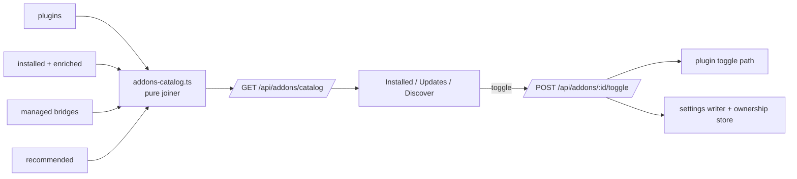

## Context

See proposal.md › Why. Inputs already exist server-side:

| Input | Source |
|---|---|
| installed packages (global) | `listConfiguredPackages` + `installed-package-enricher.ts` (incl. `dashboardManaged` from `addons-hub-declutter`) |
| plugins | discovery data behind `GET /api/plugins` (`firstParty`, `packageDir`, `hasBridge`, `requires.piExtensions`, `dependsOn`, status) |
| bridges | `listManagedBridges()` (`plugin-bridge-register.ts`) |
| recommended | `RECOMMENDED_EXTENSIONS` (`dashboardPlugin` link) |
| contents | package `pi` manifest / convention dirs via `pi-package-resolver` |

## Goals / Non-Goals

**Goals:** a pure, unit-testable joiner; one write path for the combined toggle; no new persisted dashboard config.

**Non-Goals:** caching beyond the existing per-request enrichment; folder scope (`addons-hub-folder-view`).

## Decisions

**D1 — Pure joiner + thin route.** `addons-catalog.ts` takes the five inputs as plain data and returns `AddonFeature[]`; the route only gathers inputs. Alternative: client-side joining over three fetches — rejected: duplicates server identity rules (`packageIdentity`, bridge resolution) in the browser.

**D2 — Package identity = pi's identity.** Reuse the `packageIdentity` helper used by `resource-activation-toggle.ts` (npm name, git URL without ref, resolved path); local checkouts also match plugins by `package.json` name (`local-install-name-resolution`).

**D3 — Shared required package becomes its own feature.** Attaching it to the first plugin would make the toggle of one plugin silently affect another. Own row + `requiredBy` keeps the toggle honest.

**D4 — "Off" for a pi package = all-empty object filter, not uninstall.** pi documents `[]` as "load none of that type"; the package stays installed, so turning it back on needs no network. Global scope mutates the entry in place (pi dedupes same-scope duplicates). The previous entry (string or object) is stored in a new `addon-toggle-restore` section of the existing machine-local ownership file (`resource-entry-ownership.ts` module gains `recordRestore/takeRestore`), keyed by settings path + package identity. Alternative: `autoload: false` — rejected: meaningful only for project deltas.

**D5 — Write ordering.** Settings write first (atomic, via the existing serialised writer), then plugin toggle. If the plugin toggle fails, restore the settings entry and return 500 — no half-off feature. On enable: plugin first, then restore.

**D6 — Hub toggle vs Plugins index toggle.** Only the hub's feature switch is combined. The Plugins index keeps plugin-only semantics (its spec is unchanged); the hub row shows a "partial" state when the plugin is off but its pi part is on (or vice versa), with the switch rendered mixed (`aria-checked="mixed"`).

**D7 — Origin is derived.** First-party = plugin row `firstParty` or bundled discovery root; package = `@blackbelt-technology/` scope by `package.json` name. Author label = npm scope, else package name. No manifest field added.

**D8 — Contents are static counts.** From the package resource resolution (extensions, skills, prompts, themes). Tools are registered at runtime; omitted.

**D9 — Tabs in the URL.** `?tab=installed|updates|discover` on `/settings/add-ons`; unknown → installed.

## Risks / Trade-offs

- [User edits the filtered entry by hand while off] → on enable, if the current entry differs from what we wrote, do not overwrite; report `restoreSkipped` and leave it.
- [A plugin's `requires.piExtensions` names a package installed only at project scope] → the catalog is global; such a requirement shows as missing in the plugin part, not joined.
- [Catalog latency with npm update checks] → update flags come from the existing cached check-updates path, not fetched per catalog request.
- [Two toggle UIs with different semantics] → the hub confirmation copy names exactly what stops; the Plugins index row links to the hub row.

## Migration Plan

Additive endpoints; client switches to the catalog. Rollback = revert; any entry still filtered by the hub stays filtered (documented in proposal Impact; visible in Resources).
