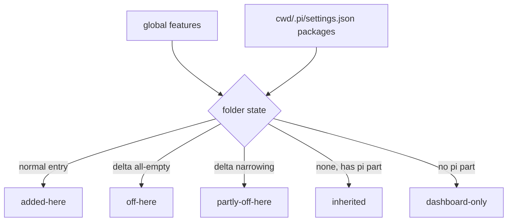

## Context

See proposal.md › Why. Building blocks:

- `addons-catalog.ts` joiner + `POST /api/addons/:id/toggle` (from `addons-hub-feature-catalog`).
- `resource-activation-toggle.ts`: project package delta form (`autoload: false`, identity matching, dedupe rules), `resolveToggleTrust`, ownership via `resource-entry-ownership.ts`.
- Resource scanner (`pi-resource-scanner.ts`) for loose `<cwd>/.pi` counts.
- Plugin rows already carry `missingRequirements` / `error`; `add-package-health-cleanup` plans `GET /api/packages/health` + `PackageHealthPanel`.

## Goals / Non-Goals

**Goals:** one answer per folder; per-folder off with pi-standard deltas only; reuse the existing trust gate and ownership store.

**Non-Goals:** per-folder plugin state; editing narrowing filters; owning the health scanner.

## Decisions

**D1 — Whole-feature off = one all-empty delta per pi package.** pi documents `[]` as "load none of that type" and `autoload: false` makes a project entry a delta over the personal one. Alternative: per-resource `-path` exclusions (the existing Resources toggle form) — rejected for this switch: N writes per feature and new package resources would still load.

**D2 — Folder state is computed by the joiner, not stored.** Derived from the two settings files on each request; nothing new persisted beyond ownership records.

**D3 — Own only what we wrote.** Reuse ownership records (keyed by resolved project path + package identity). Re-enable removes owned deltas only; user deltas are reported `notOwned` and left for Resources.

**D4 — Trust before write.** The folder toggle calls `resolveToggleTrust` exactly like the Resources toggle; the client reuses the existing trust dialog + retry.

**D5 — Issues tab degrades.** Client calls `/api/packages/health`; 404 → plugin issues only. When `add-package-health-cleanup` lands, its panel mounts inside the tab instead of above the installed list (coordinate: that change's "Settings UI SHALL surface health issues in the Packages section" should be re-targeted to the Issues tab; note added to its proposal when this change is applied).

**D6 — Discover in folder scope defaults to folder install.** Reuses `PackageInstallConfirmDialog` with scope radio defaulting to `local` (current behaviour of the folder Packages page).

## Risks / Trade-offs

- [`.pi/settings.json` is git-tracked; a delta affects teammates] → explainer and confirm copy say the setting is stored in the folder and may be committed; that is the documented pi semantics.
- [pi version without delta support] → `autoload: false` is already relied on by `cross-scope-resource-disable`; same floor.
- [Strip counts mislead when a delta only narrows] → `partly-off-here` counts as loaded and the row says "partly off here".
- [Dependency order] → feature-catalog must ship first; tasks gate on its endpoints existing.

## Migration Plan

Additive. Rollback = revert; written deltas remain valid pi config and stay visible/removable in Resources.
