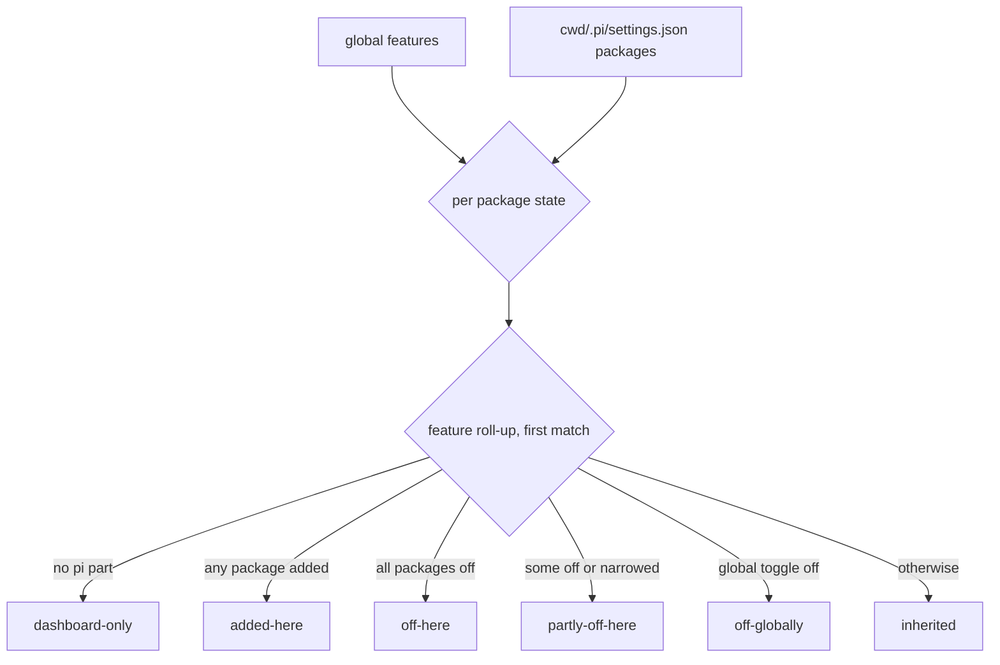

## Context

See proposal.md › Why. Building blocks:

- `addons-catalog.ts` joiner, `addons-routes.ts` `POST /api/addons/:id/toggle`, the shared per-settings-file write lock, and the restore store — all landed with `addons-hub-feature-catalog` (archived). Landed restore-store module: `packages/server/src/addons/addon-toggle-restore.ts` (`readRestoreStore`/`writeRestoreStore`, `getRestore`/`setRestore`/`deleteRestore`, `gcRestore`; keyed settingsPath + identity; callers hold the settings lock). Shared lock helper: `packages/server/src/pi/settings-write-lock.ts` (`withSettingsWriteLock`, `ADDONS_HUB_LOCK_KEY`). This design's `recordRestore` = `setRestore` and `takeRestore` = `getRestore` + `deleteRestore`.
- `packages/server/src/pi/resource-activation-toggle.ts`: project package delta form (`autoload: false`, identity matching, dedupe rules); `packages/server/src/pi/resource-toggle-trust.ts` (`resolveToggleTrust`); ownership via `packages/server/src/pi/resource-entry-ownership.ts`.
- Resource scanner (`packages/server/src/pi/pi-resource-scanner.ts`) for loose `<cwd>/.pi` counts.
- Plugin rows already carry `missingRequirements` / `error`; `GET /api/packages/health` (`packages/server/src/routes/package-health-routes.ts`) and `PackageHealthPanel` ship, imported at `packages/client/src/components/packages/UnifiedPackagesSection.tsx:60`, `Issues (N)` badge at `:385-390`, panel mounted above the installed list at `:450-454`.
- Today's `writePackage` (`resource-activation-toggle.ts:448-500`) records no ownership and splices any filter-less project delta; the folder toggle therefore uses its own whole-package writer (D1) and the feature-catalog restore store (D3), not `writePackage`.

## Goals / Non-Goals

**Goals:** one answer per folder; per-folder off with pi-standard deltas only; reuse the existing trust gate and ownership store.

**Non-Goals:** per-folder plugin state; editing narrowing filters; owning the health scanner.

## Decisions

**D1 — Whole-feature off = one all-empty delta per pi package.** Packages another feature (on or partial) requires are kept on and reported `keptOn` — the global toggle's exact predicate, reused (D10); the toggled feature's own plugin requirement never keeps its package on; all kept on → 200 `changed: false`. Relative local global sources are rebased to absolute before being written into the project file. pi documents `[]` as "load none of that type" and `autoload: false` makes a project entry a delta over the personal one. Alternative: per-resource `-path` exclusions (the existing Resources toggle form) — rejected for this switch: N writes per feature and new package resources would still load.

**D2 — Folder state is computed by the joiner, not stored.** Derived from the two settings files on each request; nothing new persisted beyond restore records (D3).

**D3 — Record-and-restore, never lose a user entry.** Before replacing any existing project entry for the identity (dashboard- or user-written, e.g. a Resources narrowing delta) the exact previous form is stored via feature-catalog's `recordRestore` (never overwriting an existing record; off is idempotent), under the same write lock as the settings flush (records deleted on flush failure), keyed by canonical `realpath` settings path + `packageIdentity` — same canonicalisation as `resource-toggle-trust.ts` so symlinked folders read the record they wrote. Re-enable restores it exactly (or removes the entry when none existed) only when the current entry still is the all-empty delta; an entry edited since is left and reported `notOwned`. An all-empty delta without a record (hand-written, or committed by a teammate — records are machine-local) is left and reported `notOwned`; the UI then offers a confirmed "Remove this folder entry" (`removeUnowned: true`, removes the project `autoload: false` entry for that identity, never a normal entry). This is a deliberate, user-confirmed exception to "remove only what we own" — without it a committed delta is stuck off. Restore key canonicalisation: `canonical()` from `resource-toggle-trust.ts:36` (realpath), not `path.resolve`. Implementation notes (apply): (1) "no previous entry" is stored as `original: null` (a settings entry is never `null`), so re-enable removes the entry. (2) A record is kept when the current entry already is the all-empty delta; when a record exists but the current entry is neither the delta nor all-empty (hand-edited since the record), the record is stale and is replaced by a fresh one capturing the current entry, so the user's newer entry is never lost. (3) The settings write and records use the hub queue lock (`ADDONS_HUB_LOCK_KEY`, so the restore store's read-modify-write never races the global toggle) then the project-path lock. (4) The record key uses `canonical(cwd)` joined with `.pi/settings.json`, not `canonical(settingsPath)`: the file may not exist yet, and realpath of a missing file falls back to the unresolved (symlinked) spelling. (5) The 400 for `off-globally` / `added-here` applies to `enabled:false` only; enabling is lenient (only `core:*` and `dashboard-only` are always 400) so a mixed feature's off packages can still be restored.
Alternative — owning only entries we created — rejected: turning a feature off over an existing narrowing delta would silently lose it.

**D4 — Trust before write.** The folder toggle calls `resolveToggleTrust` exactly like the Resources toggle (`always` proceeds; prompt → 403 + `trustRequired: true`), and registers the outstanding trust challenge (today a module-local `outstandingTrustChallenges` set in `resource-activation-routes.ts:50`, checked by `POST /api/resources/trust` at `:206`) via a shared helper so the existing dialog's decision is accepted. It serialises on the write lock keyed by the project settings path (same key as the Resources toggle), and returns 409 on an unparseable project file; the client reuses the existing trust dialog + retry. Trust outcomes follow `resource-toggle-trust.ts`: recorded-here refusal or `never` → `refused` (403); inherited refusal → `prompt` with the inherited-refusal note (403 + `trustRequired`). The catalog GET is a read: auth-gated, never trust-gated. Both GET and POST require an absolute normalised cwd and pass the shared `admitCwd` guard (`cwd-guard.js`, as `folder-project-routes.ts` does). Request `scope` uses the existing `local` vocabulary (`ToggleScope`).

**D5 — Health panel moves into the Issues tab.** `add-package-health-cleanup` is archived; `PackageHealthPanel` moves from above the installed list into the Issues tab, and its `Issues (N)` header badge becomes the tab count (MODIFIED `package-health` requirement). A failed health request → plugin issues only, no error shown (the tab must not break on a scanner failure). Issue count = plugin issues (enabled plugins with `error` or `missingRequirements`) + `countHealthIssues` (`PackageHealthPanel.tsx:33-35`, each non-ok entry once). The rail badge extends the Add-ons nav item in `packages/client/src/components/settings/SettingsPanel.tsx`.

**D6 — Discover in folder scope defaults to folder install.** Reuses `PackageInstallConfirmDialog` with scope radio defaulting to `local` (current behaviour of the folder Packages page).

**D7 — Folder manage surface stays.** The Added in this folder group keeps today's `PackagesPage.tsx` update/uninstall actions (`usePackageOperations` local scope), satisfying `directory-settings-page` › "Packages page preserves manage surface" without a delta. `dashboardManaged` rows never render as rows there (bridge = a part chip only), so that requirement's "SHALL NOT render" rule holds.

**D8 — Identity matching follows pi's path rule.** Project entries are matched to features with the single source predicate `sourcesMatch` (`packages/shared/src/source-matching.ts:105`, per `package-source-matching`) after rebasing relative local sources from the settings file's directory (`<cwd>/.pi`; pi `docs/packages.md`: "Relative local paths resolve from the settings file that contains them"), not `packageIdentity(source, cwd)` as `writePackage` does — otherwise `".."` in `<cwd>/.pi/settings.json` would miss.

**D9 — Issue count is one shared source.** A shared client hook fetches plugin issues (plugins list) and `/api/packages/health` once, used by both the Issues tab and the Settings rail badge; refreshed on Settings mount, after a cleanup Apply, and after a plugin toggle. Health entries count per non-`ok` entry (a 4-member duplicate group adds 4), matching `countHealthIssues`. The panel's existing sessionStorage collapse key is kept.

**D10 — Composition with `addons-hub-feature-catalog`.** That change's Installed-tab requirement says the health panel keeps rendering above the feature list; this change moves it. Once feature-catalog is archived, add a MODIFIED `addons-feature-catalog` delta for that sentence (task 0.2). Its `keptOn` rule (plugin `requires.piExtensions`) is reused, not redefined.

## Risks / Trade-offs

- [`.pi/settings.json` is git-tracked; a delta affects teammates] → explainer and confirm copy say the setting is stored in the folder and may be committed; that is the documented pi semantics.
- [pi version without delta support] → `autoload: false` is already relied on by `cross-scope-resource-disable`; same floor.
- [Strip counts mislead when a delta only narrows] → `partly-off-here` counts as loaded and the row says "partly off here".
- [Package agents] → pi has no agents filter type, so package-contributed agents keep loading when a feature is off here; the row says so (limitation, not hidden).
- [Mixed feature: one package added here, one inherited] → reports `added-here`; its inherited part can only be turned off per file in Resources (accepted edge case).
- [Feature off globally] → excluded from every strip counter whatever its folder state; switch disabled for `off-globally`; a project delta cannot re-enable a globally-emptied entry.
- [Health request fails] → rail badge shows plugin issues only, no "unknown" marker (accepted; the tab itself still lists plugin issues).
- [Dependency order] → feature-catalog must ship first; tasks gate on its endpoints existing.

## Migration Plan

Additive. Rollback = revert; written deltas remain valid pi config and stay visible/removable in Resources.
