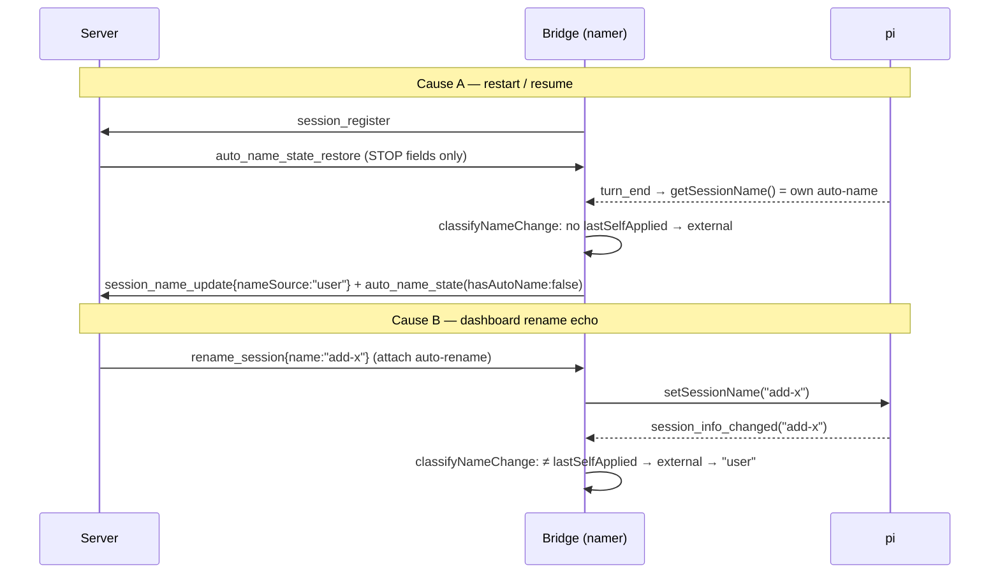

# Design — session-name provenance across restart/resume + `system` renames

## Context

`nameSource` decides the permanent auto-naming lockout. Two causes corrupt it (see
proposal for the measured population):

Verified code facts:

- In-process reload already carries the full namer state, provenance included —
  `prev.namerState` (`packages/extension/src/bridge.ts:431`, written in `persistState` at
  `:2301-2303`; `exportState` includes `nameSource`/`hasAutoName`/`lastSelfApplied`,
  `packages/extension/src/auto-session-namer.ts:501-506`).
- Session switch/resume drops it: `autoNamer = undefined; namerState = undefined;
  prev.namerState = undefined` (`bridge.ts:4037-4039`), relying on the server re-push.
- The server's re-push strips provenance by explicit projection and is sent only when
  `autoNamerState` exists (`packages/server/src/event-wiring.ts:576-597`).
- The bridge adopter forces `hasAutoName: false` and omits `nameSource`/`lastSelfApplied`
  (`auto-session-namer.ts:442-458`); the handler applies it only when no namer exists yet
  (`bridge.ts:1423-1429`). A namer is created lazily by ANY observation —
  `getAutoNamer()` from the turn-end path (`bridge.ts:2322-2323`) and from
  `session_info_changed` (`bridge.ts:2983-2990`) — so a restore arriving after either is
  silently dropped today.
- `seed()` exists (`auto-session-namer.ts:733-741`) but has no production caller.
- `classifyNameChange` is binary self/external (`auto-session-namer.ts:188-197`);
  `onObservedName` ignores empty names, latches `user` + `hardStopped` + persists on
  external (`:722-731`).
- `rename_session` handling in the bridge: `pi.setSessionName(msg.name)` then returns a
  `session_name_update` WITHOUT `nameSource` (`packages/extension/src/command-handler.ts:1078-1084`).
- A plain name poll also sends `session_name_update` without `nameSource` on any name
  change (`packages/extension/src/model-tracker.ts:33-43`), so the server can learn a new
  name BEFORE the bridge's provenance classification of it arrives.
- Server applies `session_name_update.nameSource` only when present
  (`event-wiring.ts:2551-2559`); browser rename tags `user` server-side
  (`packages/server/src/browser-handlers/session-meta-handler.ts:39`); REST rename does
  NOT (`packages/server/src/session/session-api.ts:253-256`).
- Detach revert fires on the `name === attachedProposal` witness regardless of
  provenance (`packages/server/src/openspec/proposal-attach-naming.ts:43-47`).

`rename_session` senders, classified:

| Sender | Origin |
|---|---|
| Browser rename — `session-meta-handler.ts:42` | user (already tagged server-side) |
| REST `POST /api/session/:id/rename` — `session/session-api.ts:256` | user (newly tagged server-side, D2) |
| REST attach auto-rename — `session-api.ts:664` | **system** |
| REST detach auto-revert (`name: ""`) — `session-api.ts:692` | **system** |
| Auto-attach on detected change — `event-wiring.ts:1329` | **system** |
| Browser attach — `session-meta-handler.ts:197` (`applyAttachProposal`) | **system** |
| Browser detach revert — `session-meta-handler.ts:302` | **system** |
| Trusted plugin `renameSession` — `packages/server/src/server.ts:3392` | **system** |

## Goals / Non-Goals

**Goals:** provenance survives process restart and session resume; dashboard
programmatic renames never latch `user`; the existing "Seed provenance on reconnect"
scenario holds in production; persisted provenance is correct even against an older
bridge or a register→restore race.

**Non-Goals:** migrating existing `user` rows (decided: forward-only); gating
`session_info_changed` on the toggle; client UI (no client code reads `nameSource` —
`rg nameSource packages/client/src` is empty).

## Decisions

### D1 — Provenance lattice `auto | system | user`; `user` is terminal

`nameSource` widens to `"auto" | "user" | "system"` in `shared/src/types.ts:24,165`,
`shared/src/session-meta.ts:25`, `shared/src/protocol.ts:544`, and the namer's unions
(`auto-session-namer.ts:159,421,472,486`). Server and bridge apply the same lattice
(server authoritative for persistence):

| Current | Event | Next |
|---|---|---|
| ≠ `user` | system rename, non-empty N | `system`, witness N; not auto-named, `lastSelfApplied` cleared (system supersedes an auto-name) |
| ≠ `user` | system rename to `""` (detach revert) | absent, witness cleared, not auto-named → eligible again |
| `user` | system rename (any) | `user` (name may change; detach never clears it, D2) |
| any | user rename incl. clear to `""` (browser / REST / in-pi) | `user`, witness + `lastSystemApplied` cleared (today's lockout semantics kept) |
| absent / `auto` | `auto` claim for T | `auto`, witness T |
| `system` / `user` | `auto` claim (race: bridge named just before the server's rename reached it) | whole claim dropped — name AND provenance (server); the server's own rename then converges pi |

Comparisons use pi's sanitization. `sanitizeSessionName` (`auto-session-namer.ts:176`)
moves to `packages/shared/src/session-name.ts` (re-exported from `auto-session-namer.ts`
so existing imports, e.g. `auto-session-namer.test.ts`, keep working) so the server guard
(D2) uses the identical function.

Eligibility: `maybeName` gains a PRE-call branch — `nameSource === "system"` reports
`already-named` with a system-specific reason and makes no model call (today only `user`
and `hasAutoName` are checked pre-call, `auto-session-namer.ts:625-632`; `isEligible` runs
only post-await, `:705`). The post-await recheck likewise reports `already-named` (system
reason) when a system rename landed mid-flight — not `locked-out`, which would pollute the
user-lockout signal. No new outcome value; `auto_name_outcome` unchanged. `system` never
sets `hardStopped`, so `maybeClearStop`'s `user` guard (`:588`) is unaffected.

*Rejected:* system-as-`auto` — conflates the `auto` success metric this change exists to
make truthful.

### D2 — Server is authoritative: tags at the sender, owns a witness, guards bridge claims

- `RenameSessionExtensionMessage` (`protocol.ts:1218-1222`) gains optional
  `origin?: "system"`. The six system senders set it and apply the D1 lattice in the same
  `sessionManager.update`. Browser→server `rename_session` (`browser-protocol.ts:1503`) is
  untouched — browsers cannot claim `system`.
- REST rename (`session-api.ts:253`) tags `user` like the browser path
  (`session-meta-handler.ts:39`); both clear the witness.
- Detach revert (`detachShouldClearName`, `proposal-attach-naming.ts:43-47`) additionally
  requires provenance ≠ `user`: a user-owned name equal to the slug is never cleared.
  A revert clears provenance + witness whatever the non-`user` provenance was. Attach
  re-track (`attachRenameTarget`, `:24-36`) is unchanged (pre-existing asymmetry, kept to
  avoid contradicting the `openspec-attach-combo` attach requirements); it never
  downgrades `user`. The trusted
  plugin `renameSession` keeps overwriting the name (explicit plugin intent) but never
  downgrades `user`.
- Witness: `nameSourceFor?: string` on `SessionMeta` AND `DashboardSession`
  (`shared/src/types.ts:165`), enumerated in the full-overwrite save
  (`packages/server/src/session/session-to-meta.ts:21`) and the scanner
  (`session-scanner.ts:168`), and added to `CORE_RESERVED_REF_KEYS`
  (`packages/server/src/pending/pending-plugin-ref-registry.ts:27-46`, next to `nameSource`)
  so a plugin ref body cannot forge it. Set with `auto`/`system`; cleared whenever provenance becomes
  `user` or absent. A plain provenance-less name update (`model-tracker.ts:33-43`) leaves
  it untouched — the witness records what the provenance was recorded FOR.
- Guard in the bridge→server `session_name_update` handler (`event-wiring.ts:2551-2559`):
  (a) a `user` claim whose sanitized name equals the witness while provenance is
  `auto`/`system` keeps the provenance (the name equals the witness, so applying it is a
  no-op); (b) an `auto` claim while provenance is `system`/`user` is dropped entirely —
  neither name nor provenance — so server name and witness never diverge. (a) repairs the
  old-bridge echo and the restart relabel; (b) closes the race where a bridge applies an
  auto title just before the server's rename reaches it.

### D3 — Bridge applies the system rename to the namer BEFORE pi, synchronously

`command-handler.ts` `rename_session` (`:1078-1084`):
- `origin === "system"` → option hook `onSystemRename(name)` →
  `namer.noteSystemRename(name)` applies the D1 lattice synchronously (incl. the `""`
  clear — empty observations are dropped at `auto-session-namer.ts:723` and
  `bridge.ts:2986`, so the clear cannot ride the echo), records `lastSystemApplied`,
  persists, and syncs `lastSessionName` (as `applyName` does, `bridge.ts:2284`) to avoid a
  redundant poll send. If `pi.setSessionName` throws, the namer's prior provenance and
  `lastSystemApplied` are restored and re-persisted (spec scenario), so a failed apply
  cannot later latch `user` on the old name.
- no origin → `lastSystemApplied` is cleared first, so the echo of a user rename is
  classified external (`user`). Against an old server (never sends origin) this is a no-op:
  today's behaviour.

`classifyNameChange(observed, lastSelfApplied, lastSystemApplied)` →
`"self" | "system" | "external"`; `onObservedName` treats `system` as a no-op. The
returned `session_name_update` stays without `nameSource` (the server already tagged it).

### D4 — Restore carries server-owned provenance; applied even to a live namer

The register-time `auto_name_state_restore` (`event-wiring.ts:576-597`) is sent whenever
the session has `autoNamerState` OR `nameSource`, adding `nameSource` and `nameSourceFor`
from the SESSION — never from the bridge-persisted `autoNamerState` provenance fields,
which an older bridge may have overwritten. The send condition widens from
`if (restoredNamerState)` (`event-wiring.ts:577`) to "`autoNamerState` OR `nameSource`".

Witness-less `auto`/`system` row (rollback→roll-forward drops `nameSourceFor` via the old
full-overwrite save; pre-change rows): **provisional trust** — the bridge adopts the
FIRST observed name as the witness (self/system), latching nothing; only a later,
different name is external. Rejected: classifying the first observation external — it
mandates the very relabel this change removes. Accepted cost: a rename made while
the session was offline is absorbed as the witness — benign, because an `auto`/`system`
session is not eligible for naming anyway and detach only clears a name equal to the
attached slug.

Bridge mapping: `auto` → auto-named, `lastSelfApplied = witness`; `system` →
`lastSystemApplied = witness`; `user` → lockout. Unknown `nameSource` values are ignored.
Stop state from a `user` latch carries no `stopCause` (`auto-session-namer.ts:725-729`), so
when restored provenance is not `user`, a stop WITHOUT `stopCause` is cleared both in the
server projection and in the bridge — otherwise a raced or old-bridge `user` latch leaves
the session stopped forever. Budget/role/registry/credential/other stops (which always set
`stopCause`) are untouched.

Applying it: no namer yet → as today (`namerState = adopted`). Namer already exists (an
observation raced ahead, `bridge.ts:1425` drops it today) → `namer.restoreProvenance(...)`
(supersedes the unused `seed()`). It replaces a live `user` ONLY when the live pi name
(`pi.getSessionName()`) equals the restored witness — i.e. the latch was the wrong
classification of the bridge's own/system name — and then clears the `stopCause`-less
stop. A live `user` latched on a DIFFERENT name is a genuine rename and is kept, as is its
stop. Session switch/resume needs no
extra path: the server re-pushes on the incoming session's `session_register`.

`PersistedNamerState` gains `lastSystemApplied?`. No arming gate: observation and naming
timing are unchanged, so the terminal-turn trigger, outcome contract, and offline-session
behaviour are unchanged.

*Rejected:* an arming gate deferring observation until the restore — it contradicted the
terminal-turn trigger and outcome requirements, stalled dashboard-offline sessions, and
needed a fallback for servers that never send the restore.

### D5 — No migration

Existing `user` rows stay locked out; the evidence to separate genuine renames is
erased (`hasAutoName` overwritten). Population is recorded in the proposal.

### D6 — Specs aligned with shipped detach behaviour

The code reverts an attach-set name on detach (`proposal-attach-naming.ts:43-47`;
`openspec/specs/openspec-attach-combo/spec.md` "Idempotent auto-rename revert on detach");
`session-rename` "Auto-name from attached proposal" and `proposal-attachment` "Auto-name
session on attach" / "Manual detach via browser" still say it does not. This change's
detach semantics depend on the revert, so those are REMOVED/MODIFIED to match shipped
behaviour (plus the `user` skip from D2). `dashboard-server` "Session rename REST
endpoint" is MODIFIED for the provenance tag.

## Risks / Trade-offs

- **Rollback** → a reverted build reads `system` as "not user" and may auto-name over a
  dashboard-set name (a visible rename of an attach-named session). No data loss beyond
  the name; accepted.
- **Mixed versions** → new bridge + old server: no `origin`, no provenance in the restore
  → today's behaviour (relabel persists). Old bridge + new server: the D2 guard rejects
  the old bridge's stale `user` claims for witnessed names, so persisted provenance stays
  correct; the old bridge's in-process lockout is today's behaviour.
- **Witness collision** → an IN-PI rename back to exactly the witnessed name is not
  treated as a user rename (same as `classifyNameChange`'s existing self-match).
  Dashboard user renames are unaffected: they set `user` server-side directly, not via
  the guard.
- **Plugin renames now `system`** → no longer lock out auto-naming, but are not
  overwritten. Intended.

## Migration Plan

None (D5). `nameSourceFor` is optional; absent on existing rows (D4: provisional trust).
Deploy order free. Rollback = revert; a later roll-forward meets witness-less rows, which
D4's provisional trust handles without relabelling.

## Open Questions

None.
