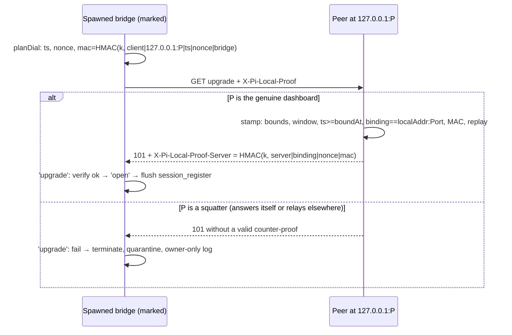

## Context

See proposal.md (Why + the 11 constraints from the failed D7 review). Facts
checked against code (doubt-review cycle 1 corrected the citations):

- Raw-token **senders**: bridge (`extension/src/local-token-header.ts`, used at
  `bridge.ts:1245,1251,2088`); CLI (`server/src/cli.ts:686,711,757,826` and
  `localTokenHeader()` at `:780`, used by `restart` `:597` and the service verbs
  `:1014` → `services/cli-service.ts:129` `authHeaders()` — one header set
  reused across requests; all dial `http://localhost:<port>`); Electron main
  (`packages/electron/src/lib/local-proof-bootstrap.ts:16-45`,
  `packages/electron/src/lib/server-lifecycle.ts:517,557`,
  `packages/electron/src/lib/runtime-overlay-main.ts:233`); `scripts/reload-all.sh:63-64`.
- Raw-token **verifiers** (`verifyLocalToken(headers, token)`):
  `auth-plugin.ts:437,533,628`, `localhost-guard.ts:407`, `local-proof.ts:74`
  (`hasLocalProof`, reached through `isLocallyTrusted` — 19 header-only call
  sites), `pairing-routes.ts:115`, `user-routes.ts:74` (passkey genuine-local),
  `local-proof-routes.ts:28` (`POST /api/local-proof`), `server.ts:1946`
  (identity-floor break-glass → local operator), `server.ts:2014`
  (`POST /api/identity/local-code`), and the gateway via
  `bridgeAuth.verifyLocalToken` (`server.ts:1123`).
- Default config is NOT strict: `isLocallyTrusted` returns `isGenuinelyLocal`
  without any credential when `requireLocalProof` is off
  (`localhost-guard.ts:88-95`, default `shared/src/config.ts:1343`). The local
  credential matters for strict mode and for forwarded/tunnelled requests.
- `ws` lets the caller supply the TCP socket: `opts.createConnection` is used
  when given (`websocket.js:752-753`).
- Edges where a request first appears: Fastify `onRequest` hooks (the earliest
  registration is the `rateLimit` plugin, `server.ts:1637`), the main server's
  `fastify.server.on("upgrade")` (`server.ts:3667`), the gateway's
  `verifyClient` (`pi-gateway.ts:1060-1095`).
- Fastify 5.12.1 `request.headers` returns `raw.headers`, or an
  `Object.assign({}, raw.headers, additionalHeaders)` copy
  (`node_modules/fastify/lib/request.js:277-283`) — `Object.assign` copies
  enumerable Symbol-keyed properties.
- `ws@8.21.3`: client emits `'upgrade'` and returns early unless still
  CONNECTING (`websocket.js:939-945`); server `verifyClient` and
  `completeUpgrade` see the same `req`, and `'headers'(headers, req)` fires
  before the 101 is written (`websocket-server.js:426`).
- `ConnectionManager.openSocket` reuses construction-time `this.headers`
  (`connection.ts:864-867`); `credentialsFor` re-derives only on re-target
  (`connection.ts:830-835`); buffered frames flush in every `onopen`
  (`connection.ts:900-905`).
- `transportDiagnostics` is attached with `send: (m) => connection.send(m)`
  (`bridge.ts:3531-3534`), and `connection` is REBOUND by `/dashboard-connect`
  moves — so anything buffered there follows the session to another dashboard.
- Spawn: `PI_DASHBOARD_URL=ws://localhost:<piPort>` (`127.0.0.1` only after a
  fallback), set/cleared only inside `if (spawnDashboardPiPort != null)`
  (`process-manager.ts:363-376`); tmux `-e` built from `SpawnEndpointPin
  {url, socket}` (`process-manager.ts:566-574, 590-593`); `wsl-tmux` runs
  the pane in WSL (`process-manager.ts:874-885`) — another kernel, network
  namespace and HOME (so another token); the gateway bind host
  (`config.host`, `server.ts:1712,1738`) does not reach the spawner
  (`SpawnGatewayTransport`, `process-manager.ts:110-113`).
- The tokenless loopback grace is hardcoded open (`server.ts:1119`,
  `bridge-upgrade-auth.ts:157`), including the Windows primary listener; the
  POSIX fallback has none (`pi-gateway.ts:1079,1225`). Unix-socket upgrades are
  marked (`unixUpgrades.add`, `pi-gateway.ts:1209`) before `handleUpgrade`,
  and `verifyClient` still runs for them but returns early
  (`pi-gateway.ts:1064-1068`).

## Goals / Non-Goals

**Goals:**
- The raw token never leaves a current-version process.
- A proof observed by another user earns no credentialed admission anywhere.
- A MARKED bridge (D7: spawned by the dashboard on its own OS at a loopback
  endpoint) never sends a frame to, nor acts on a frame from, a peer that
  cannot prove the credential at its marked endpoint. Unmarked bridges get only
  the first goal.
- One verdict per request, stamped at the listener edge, read everywhere.
- Old bridges/CLIs keep working until the 1.0.0 horizon.

**Non-Goals:**
- Counter-proof enforcement for unmarked bridges: manual `pi`, rendezvous,
  legacy `ws://localhost:<piPort>`, `wsl-tmux` panes, spawns made before the
  server knows its piPort (null path), and non-loopback binds. They stop
  leaking the token, but a squatter can still receive them, silently, even as a
  transparent MITM to the real dashboard (constraint 7 residual).
- The pre-existing D10b tokenless grace, which lets ANY local OS user register
  a bridge on a grace listener (Windows primary, opt-in TCP), and the default
  non-strict HTTP trust of genuinely-local callers. This change protects the
  credential; it does not change those admission policies, which the 1.0.0
  change and `requireLocalProof` own.
- Closing the D10b grace, flipping the legacy switch, rotating the token —
  all owned by the 1.0.0 change.
- CLI/Electron verification of server RESPONSES.
- Same-OS-user attackers (they can read the token file).
- Changing instance-identity verification against the rendezvous record —
  unchanged and orthogonal. The counter-proof proves "holds this HOME's token"
  (every same-HOME instance does). The record check proves "which instance".

## Decisions

### D1 — Proof format (constraint 9: units, bounds, key bytes)

Shared pure module `packages/shared/src/local-credential-proof.ts` (node
`crypto` only; used by extension, server, CLI, Electron), also exporting
`canonicalBinding`, `localDialHost` and `isLoopbackLiteral`.

- Key: `k = HMAC-SHA256(key = UTF-8 bytes of the trimmed token string,
  msg = "pi-dashboard/local-credential-proof/v1")`. It uses a different label
  from the cookie key (`local-proof.ts:33`, `".../local-proof/v1"`).
- Client header `X-Pi-Local-Proof: v1.<ts>.<nonce>.<mac>`
  - `ts`: integer ms since epoch, `/^\d{13}$/`.
  - `nonce`: 16 random bytes base64url, `/^[A-Za-z0-9_-]{22}$/`.
  - `mac`: base64url(HMAC(k, "pi-lcp/v1/client\n" + binding + "\n" + ts +
    "\n" + nonce + "\n" + purpose)), `/^[A-Za-z0-9_-]{43}$/`.
  - Anything else is `malformed`, rejected before any HMAC.
- `purpose`: `"bridge"` on the pi gateway; `"http <METHOD> <request-target>"`
  on the main server (HTTP and its WS upgrades; target = raw `req.url`, i.e.
  exactly the request-target the client wrote, before any router
  normalisation). The listener fixes the purpose, so no request is ever judged
  under two purposes. Consequence: a proof is good for ONE request; clients
  mint per request (D10). The body is not MAC-bound — a captured proof is
  unusable anyway (binding + floor + cache), so binding it adds nothing.
- Server counter-proof `X-Pi-Local-Proof-Server: v1.<smac>`,
  `smac = HMAC(k, "pi-lcp/v1/server\n" + binding + "\n" + nonce + "\n" + mac)`.
  It is unique per dial.
- `binding = canonical "<addr>:<port>"`: IPv4 dotted; IPv4-mapped IPv6 →
  IPv4; IPv6 lowercase in brackets (`[::1]:9999`). Never a host name.

Alternatives rejected:
- Signatures with `identity.key`: every caller would need the public key before
  dialling, for the same same-user guarantee.
- A server-chosen challenge: needs an HTTP round trip on a gateway with no HTTP
  routes, and the challenge fetch itself lands on the squatter. Endpoint
  binding is what defeats the relay.

### D2 — Endpoint binding against the arriving socket (constraints 1, 2)

The expected binding is the held connection's `req.socket.localAddress` and
`localPort`. It is never taken from a configured address or from `Host`.

A squatter holding `127.0.0.1:P` can reach the genuine dashboard only at some
other `(address, port)`: `[::1]:P`, a LAN address on a wildcard bind, or
another port. The relayed proof is therefore `binding-mismatch`, which means:
- no credentialed admission,
- no counter-proof (D5), so a marked bridge refuses the squatter.

What a relayed upgrade CAN still get on a grace listener is the tokenless D10b
admission. For a marked bridge that is worthless: the squatter cannot supply
the counter-proof, so the bridge aborts before sending anything. For an
UNMARKED bridge it lets the squatter sit as a transparent MITM of that
session, which is the stated constraint-7 residual. On no-grace listeners the
relayed upgrade gets a 401.

Assumption: two listeners cannot hold the same `addr:port` across OS users.
This is true on Linux and macOS without `SO_REUSEPORT`. Windows bind semantics
are unverified and get a manual QA row; even where co-binding is possible, the
counter-proof still requires the token.

Unix-socket upgrades are never stamped: `verifyClient` returns early for them
(`pi-gateway.ts:1064-1068`), and another user cannot open a `0600` socket.

### D3 — Freshness, bind floor, replay cache (constraints 2, 9, minors)

`createLocalCredentialVerifier({ token, now, acceptLegacyToken, log,
maxNonces })` lives in `server/src/auth/local-credential.ts`. The clock and the
cache are injected.

Each listener registers its own `boundAt`: a timestamp taken immediately
BEFORE the bind call that succeeds. A squatter's capture precedes its release,
which precedes that successful bind, and a legitimate dial cannot complete
until after it.

Order per request:
1. Parse and bounds-check.
2. `|now − ts| ≤ 30 s`, else `stale`.
3. `ts ≥ boundAt` of the receiving listener, with zero tolerance, else
   `before-start`.
4. Binding equality, else `binding-mismatch`.
5. Constant-time MAC check, else `bad-mac`.
6. Replay cache, else `replayed`. Insert only here, after the MAC.

Why the floor is exact:
- A proof captured by a squatter was minted while the squatter held the port,
  i.e. strictly before the genuine listener could bind. So a restarted
  server's empty cache is harmless, on grace and no-grace listeners alike.
- A legitimate client mints just before connecting, which can only succeed
  after `boundAt`. The only exception is a millisecond-scale race (D8 covers
  it).

Replay cache:
- `Map<nonce, expiresAt>`, TTL 61 s. A proof is fresh only while
  `ts ∈ [now−30 s, now+30 s]`, so it cannot outlive insert + 60 s.
  Future-dated proofs are harmless without the key.
- Expired entries are swept on insert.
- Cap 10 000. When the cache is full of unexpired entries, the verifier
  rejects (`replay-cache-full`) rather than evict.
- Key = nonce string (charset-bounded, so string ≡ bytes).

Clock steps:
- Skew and steps under 30 s either way are absorbed.
- A backward step right after bind, or a forward step just before it, yields
  `before-start` refusals until the clock passes `boundAt`. Logged with cause;
  accepted.
- Marked bridges always share the server's kernel and clock (D7 excludes
  `wsl-tmux`), so cross-kernel drift only reaches unmarked bridges, where
  invalid ≡ absent (D5).

### D4 — Stamp at the edge, read everywhere (constraint 10)

`verifier.stamp(req, listener)` runs exactly once per request, at its edge:
- a Fastify `onRequest` hook registered before every other hook, including
  the `rateLimit` plugin (`server.ts:1637`),
- the main server's `upgrade` handler, as its first statement after `scope`,
- the gateway's `verifyClient`.

It writes the verdict under a module-private, enumerable `Symbol` key on the
`IncomingMessage`'s own `headers` object: `request.raw.headers` in Fastify,
`req.headers` on upgrades. Fastify's `request.headers` returns that same
object, or an `Object.assign` copy of it, and both expose the key:
- Enumerable, so Fastify's `Object.assign` copy keeps it.
- `JSON`, `Object.entries` and header forwarding ignore Symbol keys, so it is
  never serialized or proxied.
- A client cannot set a Symbol key over HTTP.

Verdict: `{ kind: "proof", binding, nonce, mac } | { kind: "legacy" } |
{ kind: "absent" } | { kind: "invalid", cause }`.

`hasLocalCredential(headers)` is true for `proof` and `legacy`; unstamped
headers count as `absent` (fail closed). It replaces `verifyLocalToken(...)` at
every site listed in Context; `hasLocalProof` uses it internally, so there is
one source of truth. Because the parameter stays `headers`, the callers of
`isLocallyTrusted`/`hasLocalProof` (`route-tier-gate.ts`,
`bridge-ticket-eligibility.ts`, `services/routes.ts`, `localhost-guard.ts`,
`auth-plugin.ts`, `pairing-routes.ts`) need no signature change. No path in
`packages/server/src` rebuilds a header object before these helpers (checked in
review: no `request.headers =` setter, no JSON/`fromEntries` copies), and a
rebuilt object fails closed.

Multi-valued `X-Pi-Local-Proof`/`X-Pi-Local-Token` headers: only the first
value is evaluated, as today (`local-token.ts:68`).

`legacy` means a raw `X-Pi-Local-Token` that matches in constant time while
`acceptLegacyToken` is set. It is logged as deprecated, rate-limited to at most one line per caller kind
(bridge / http) per 60 s; the next emitted line carries the count suppressed
since the previous one. `replay-cache-full` uses the same limiter. A request carrying both headers is judged on the proof
alone. Refusals keep today's fixed response bodies, so the sub-cause is never
an oracle.

Alternative rejected: threading `IncomingMessage` through every helper
(≈30 signature changes, the same result).

### D5 — Gateway: pure decision, impure edge (constraints 4, 8)

The stamped verdict reaches `decideBridgeUpgrade` as `localCredential: "valid"
| "legacy" | "absent" | "invalid"` (+ `invalidCause`). This replaces the
injected `verifyLocalToken` callback. The function stays as pure as today: its
only side effect remains the injected `consumeTicket`.

Decision order:
1. unix → allow.
2. `Origin` present → refuse.
3. Ticket → allow.
4. `valid`/`legacy` on genuine loopback → allow (`legacy` flagged deprecated).
5. Otherwise `invalid` is treated as `absent`: grace where the listener grants
   it (deprecated), else refuse with `local-proof-invalid`. The sub-cause goes
   to the server log only; the client sees 401.

Why invalid ≡ absent (constraint 8): refusing would break wrong-HOME bridges,
cross-kernel clock drift and NAT'd loopback on listeners that admit them
tokenlessly today. Safety does not depend on refusal. It depends on the token
never being sent and on marked bridges demanding a counter-proof, which an
invalid proof never earns.

Counter-proof:
- `verifyClient` records `WeakMap<req, {binding, nonce, mac}>` only for a
  `valid` admission.
- `startTcp` attaches `wss.on("headers", …)` to the `WebSocketServer` it
  creates — the only one serving TCP. The handler appends
  `X-Pi-Local-Proof-Server` iff the map has `req` and `!unixUpgrades.has(req)`.
- Without `bridgeAuth` there is no verdict and no counter-proof, so marked
  bridges refuse (fail closed; production always wires `bridgeAuth`).

### D6 — Per-dial plan in ConnectionManager (constraint 3)

```ts
interface DialPlan {
  url?: string;                         // per-dial override (ticket)
  headers?: Record<string, string>;     // fresh proof per dial
  createConnection?: () => net.Socket;  // the pre-connected TCP socket the proof is bound to
  verifyUpgrade?: (res: { headers: Record<string, string | string[] | undefined> })
    => { ok: true } | { ok: false; cause: "server-proof-missing" | "server-proof-invalid" };
}
planDial?: (baseUrl: string) => Promise<DialPlan | undefined>;
```

- `planDial` merges `prepareConnect` and the static headers.
- `credentialsFor(url)` returns `{ planDial }`.
- `openSocket` calls `planDial` on every attempt, constructs
  `new WS(dialUrl, { headers, createConnection })`, and registers
  `ws.on("upgrade")` when
  `verifyUpgrade` is set. A failure calls `terminate()`, which emits
  `error`/`close` (handled by `handleDisconnect`), and marks the attempt as an
  identity failure (D8).
- A WS implementation without `on("upgrade")` fails closed when `verifyUpgrade`
  is required. The `WebSocketImpl` seam stays (fakes emit `upgrade`), and so
  does the static `headers` option.

Binding a name-addressed dial (constraint 1, "never `localhost`"): for a
loopback TCP dial, `planDial` first opens the TCP connection itself with
`net.connect({ host, port })`. That is Node's default resolution and
happy-eyeballs, exactly what `ws` would do (`websocket.js:1071-1073`). The plan
then binds the proof to `canonicalBinding(socket.remoteAddress,
socket.remotePort)` and hands the connected socket to `ws` via
`createConnection`.

Consequences:
- The proof always names the address actually reached, so name-addressed dials
  need no host rewriting, candidate list or alternation.
- Which server a `localhost` dial reaches is unchanged from today, which keeps
  `pi-gateway-transport`'s pinned-endpoint rule intact.
- macOS `localhost` → `::1`-first resolution keeps working against a
  `127.0.0.1`-bound server.
- A pre-connect failure goes through the existing `onPrepareFailed` →
  transient backoff.
- The connector is injectable (default `net.connect`), alongside
  `WebSocketImpl`.

### D7 — Enforcement marker, scoped per endpoint (constraint 6)

The spawner receives the server's `bindHost` (`config.host`, the host the TCP
gateway binds; `server.ts:1712,1738`) through the same setter that already
supplies the piPort. It does not introspect the gateway: a socket-only gateway
has no TCP address. `localDialHost(bindHost)` maps it to a dial literal:
- wildcard (`0.0.0.0`, `::`) or `localhost` → `127.0.0.1`,
- `::1` → `[::1]`,
- a specific address → itself.

Only a loopback result (`isLoopbackLiteral`) carries a marker. A non-loopback
bind keeps today's spawn URL, with no marker.

Whenever the spawner sets a loopback `PI_DASHBOARD_URL` (now that literal) for
a mechanism that runs on the server's own OS (headless, tmux, wt), it also sets
`PI_DASHBOARD_REQUIRE_SERVER_PROOF` to the same URL. `wsl-tmux` is NEVER
marked: its pane runs in another kernel and HOME, so it holds another token and
would quarantine forever.

The marker is always deleted from the inherited env first. On the null-port
path that deletion is NEW behaviour: today that path touches neither
`PI_DASHBOARD_URL` nor `PI_DASHBOARD_SOCKET` (`process-manager.ts:363-376`),
and only the marker is removed there; the URL is left as today.

The inline `{url, socket}` pin returned for tmux (`process-manager.ts:590-593`)
gains `marker`. tmux always receives `-e PI_DASHBOARD_REQUIRE_SERVER_PROOF=<url
or empty>`; the empty value cancels a value inherited from the tmux server's
global env, following the existing `PI_DASHBOARD_SOCKET=` convention. `wt`
passes the spawn env through as it does for `PI_DASHBOARD_URL`; a test pins
it.

Enforcement:
- An EMPTY or absent marker means unmarked.
- The bridge enforces when the parsed dial endpoint equals the parsed marker:
  host compared case-insensitively as an address literal, ports compared after
  applying the default. Path, trailing slash and case are ignored. It is not a
  string compare.
- A non-empty marker that cannot be parsed enforces on every loopback TCP dial
  (fail closed).

Consequences, mapped to constraint 6:
- (a) tmux is covered by `-e`.
- (b) Descendants enforce only against that same endpoint.
- (c) `/dashboard-connect`, rendezvous, mDNS and remote targets are different
  endpoints, so they are not enforced.
- Rollback is only PARTIALLY met: a pre-proof server at the same endpoint is
  indistinguishable from a squatter by design, so marked sessions quarantine
  against it. Accepted; see the Migration Plan.

Alternative rejected: an owner-only rendezvous-record flag. The record can be
absent or stale in exactly the post-exit window the squatter exploits.

### D8 — Identity failure: quarantine + same-endpoint report (constraint 5)

When a dial fails `verifyUpgrade`:
1. `terminate()` runs inside `'upgrade'`, so `'open'` never fires, nothing
   flushes (including `session_register`) and nothing is dispatched.
2. `handleDisconnect` sees the identity flag and schedules the next dial on a
   quarantine backoff: 5 s, then 30 s doubling, capped at 5 min. The first
   verified open clears it. The short first step absorbs the ms race in D3
   and a genuine restart.
3. Report:
   - Only a marked dial can fail identity, and a process has one marker, so
     there is ONE report slot: `pendingIdentityReports: Report[]` in the
     ConnectionManager that dialled the marked endpoint (bounded at 20, oldest
     dropped). It does NOT go through `transportDiagnostics`, because that
     sink follows the rebound `connection` to whichever dashboard a move
     targets (`bridge.ts:3531-3534`).
   - It is flushed as a `bridge_diagnostic` frame only on that manager's next
     open whose `verifyUpgrade` succeeded; a dial to any other endpoint has no
     `verifyUpgrade` and never flushes it.
   - One JSON line (`{ts, pid, endpoint, cause}`, cause `server-proof-missing`
     | `server-proof-invalid`) also goes to owner-only
     `~/.pi/dashboard/local/bridge-identity.log` (`0600`, rotated to `.1`
     past 256 KiB), so the failure is visible even if the genuine dashboard
     never returns. Windows: it lives in the same `local/` directory as the
     token and gets the same owner-only treatment. stdout is not a channel: it
     is discarded under the default `capturePiOutput:false`
     (`bridge.ts:1140-1141`).

Alternative rejected: making it terminal. The session could then never recover
after the squatter leaves.

### D9 — Legacy window (constraint 11)

`acceptLegacyToken` is a single server option, `true` here, wired next to
`requireTicketOnLoopback` (`server.ts:1119`). Current-version clients never
send the raw header, with no fallback.

Stated residual: a token already harvested from a legacy client remains a valid
proof key — it can forge proofs for any binding — until the token is rotated.
The 1.0.0 change that closes the window MUST rotate the token in the same step.
Until then, upgrading every client stops new harvests but not use of old ones.
Owner: this change files a stub change, `close-loopback-legacy-window`, which
flips `acceptLegacyToken` and `requireTicketOnLoopback`, rotates the token,
and amends the specs listed under Spec collateral (task 8.6).

### D10 — HTTP callers (constraint 10)

CLI, Electron main and `reload-all.sh`:
- mint `X-Pi-Local-Proof` PER REQUEST with purpose `http <METHOD> <target>`,
  where target = `pathname + search` of the WHATWG `URL` the request is made
  with. That is byte-for-byte what `fetch`/`ws` write as the request-target,
  and the server's raw `req.url` reads it back. The header factory takes
  `(method, target)`:
  `localTokenHeader()` (`cli.ts:780`) becomes `localCredentialHeaders(method,
  target)`, and `cli-service`'s `authHeaders()` gains the same parameters;
  `reload-all.sh` mints separately for its `/ws` upgrade and each `fetch`;
- dial `localDialHost(bindHost)` instead of `localhost`. The proof binds that
  literal, and the server sees it as the arriving local address, so a LAN-IP
  bind also works.

`reload-all.sh` (inline node) carries a ~15-line copy of the mint pointing at
the shared module, guarded by the shared test vector.

### Spec collateral (owned by the 1.0.0 change)

Several specs name the raw header as admitting:
- `trust-and-credential-boundaries` :74
- `bearer-device-auth` :28,215
- `qr-device-pairing` :89

They stay true here because `acceptLegacyToken` remains on. The change that
turns it off must modify them.

### Constraint map

| # | Constraint | Answer |
|---|---|---|
| 1 | Relay/MITM | D2 binding vs arriving socket; literal dials (D6/D7) |
| 2 | Client-proof replay | D2 binding + D3 cache + exact bind floor |
| 3 | Per-dial headers | D6 `planDial` |
| 4 | Verification hooks | D4 edge stamp; D5 `verifyClient`→WeakMap→`'headers'` on the TCP wss; D6 client `'upgrade'`; unix excluded |
| 5 | Terminal identity failure | D8 quarantine + same-endpoint report + owner-only log |
| 6 | Marker lifecycle | D7 parsed endpoint-scoped marker, tmux `-e` (empty cancels), wsl excluded, null-path cleanup; rollback partial (accepted) |
| 7 | Unmarked bridges | Non-goal residual (no token leak; silent receipt possible) |
| 8 | D10b grace interplay | D5 invalid ≡ absent; no counter-proof |
| 9 | Replay cache details | D1 bounds/units/key bytes; D3 TTL 61 s, fail-closed cap, injected clock |
| 10 | CLI HTTP path | D4 + D10 (all 10 verifier sites; per-request minting at every sender) |
| 11 | Legacy acceptance | D9 switch + stated harvested-token residual + rotation at 1.0.0 |



## Risks / Trade-offs

- [Harvested legacy token] Stays a valid proof key until rotation → D9; the
  stub change `close-loopback-legacy-window` owns rotation.
- [Unmarked bridges] A squatter can receive them silently, or MITM them
  transparently (D2) → no token harvest any more. Enforcement via a rendezvous
  flag is a possible follow-up.
- [Old clients keep leaking until upgraded] Window ends at 1.0.0; the
  deprecation log names the caller kind.
- [`/dashboard-connect` from a pinned session] A user-initiated move goes to an
  unmarked target, so frames go to whoever answers there. This is the user's
  explicit choice, unchanged here.
- [Report never delivered] If a session never again verifies at its marked
  endpoint (moved or ended), its pending wire report is dropped; the owner-only
  log keeps it.
- [NAT'd/proxied local callers] Docker port publishing (`docker/compose.yml:24`)
  and tunnels change the arriving binding, so a CURRENT client's proof is
  invalid there and treated as absent; new clients send no raw token.
  Admission then falls to the other rules: genuine-local trust (absent for
  NAT, since the peer is not loopback), login session, or pairing. Only OLD
  clients can lean on the legacy token. → BREAKING for `pi-dashboard
  login --local`/`open`/`token create` through a published port; use them
  inside the container, or log in.
- [Windows bind semantics] Exclusive `addr:port` across users is assumed (D2),
  not verified on Windows → manual QA row; the counter-proof still needs the
  token.
- [New bridge vs pre-proof no-grace fallback] Refused → visible 401; upgrade
  that dashboard.
- [Connect race / restart / clock step around bind] Transient `before-start`.
  A marked bridge on a grace listener quarantines for 5 s first.
- [Replay cache memory] ≤ 10 000 × ~60 B; fail-closed when full, logged.
- [Global WebSocket bridges] Cannot send headers → today's behaviour; fail
  closed when marked.
- [`trusted-networks` "relayed loopback never trusted"] Not affected: the proof
  is a credential, not an address rule, and a relayed proof is
  `binding-mismatch`.

## Migration Plan

- No persisted-format change. `local/token` is unchanged; `bridge-identity.log`
  is new.
- Deploy the server FIRST: `curl -X POST :8000/api/restart`. Old bridges and
  CLIs keep working via legacy acceptance. THEN run `npm run reload`. The
  reverse order sends proof-only bridges to a pre-proof server, which refuses
  them on no-grace fallbacks and quarantines marked sessions.
- Rollback: revert.
  - Sessions spawned by the new server carry the marker and quarantine against
    a reverted server at the same endpoint (their log says
    `server-proof-missing`) → restart those sessions.
  - New CLI/Electron builds against a reverted server send only a proof it
    ignores. In default non-strict config, genuine-local trust still admits
    them. Under `requireLocalProof`, and on `/api/identity/local-code` and
    `/api/local-proof`, they are refused → roll the CLI back too.
  - Unmarked sessions and old clients are unaffected.
- Docs: `docs/architecture.md` Auth model + FAQ entry (DocScribe); AGENTS.md
  rows for touched files.
