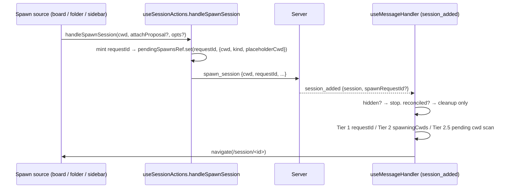

## Context

Spawn → focus today (see proposal.md — Why):

- All board spawns funnel through two `App.tsx` wirings: `renderOpenSpecBoardView`'s `onSpawnSession={handleSpawnSession}` (`packages/client/src/App.tsx:2158`; card `+ Session` at `components/openspec/OpenSpecBoardView.tsx:1111`, New-proposal plain at `:640`) and the board `WorktreeSpawnDialog.onSpawn` (`App.tsx:3373-3388`; card `New worktree` at `OpenSpecBoardView.tsx:1124` → `App.tsx:2159`, New-proposal worktree at `OpenSpecBoardView.tsx:638`), which calls `handleSpawnSession(path, attachProposal, {...opts, placeholderCwd})` (`App.tsx:3384`).
- `handleSpawnSession` mints the requestId and records the pending entry (`packages/client/src/hooks/useSessionActions.ts:394-443`, record at `:425`).
- The pending-spawn entry type `{ cwd; kind: "spawn" | "resume"; placeholderCwd? }` is declared inline in three places: `App.tsx:746` (`pendingSpawnsRef`), `useSessionActions.ts:41` deps, `useMessageHandler.ts:249` deps.
- `session_added` correlation cascade: `packages/client/src/hooks/useMessageHandler.ts:551-603` — hidden gate `:551`, reconciled branch `:552-563` (never navigates), Tier 1 `:564-575`, Tier 2 `:576-582` (navigates from `spawningCwdsRef` alone, no pending-entry lookup), Tier 2.5 `:583-602`.
- Server echoes `spawnRequestId` whenever the registering bridge presents a spawn token that resolves a live correlation (`packages/server/src/event-wiring.ts:1839-1841`, broadcast `:1932`); Tier 2 / 2.5 are fallbacks for an absent echo.

## Goals / Non-Goals

**Goals:**
- Board-originated spawns never auto-navigate, on every correlation tier.
- Zero behavior change for every other spawn source.

**Non-Goals:**
- No toast / "Open" affordance after a no-focus spawn — the new session already shows on its proposal card. Can be added later without spec change to correlation.
- No user setting for global "focus new sessions"; no change to fork/resume focus.
- No server or protocol change (`spawn_session` unchanged; intent is client-local).

## Decisions

### D1 — Per-spawn intent on the pending entry, not route inspection
Add optional `focus?: boolean` to the pending-spawn entry and to `handleSpawnSession`'s opts. Store `focus: false` on the entry only when `opts.focus === false`, so default entries stay byte-identical. Gate on `entry.focus !== false`.

*Alternative:* in `session_added`, skip navigate when the current location matches `/folder/*/openspec`. Rejected — wrong for a sidebar spawn made while the board is open, and wrong when the user left the board before registration (spec scenarios "Non-board spawn while board is open still focuses", "No-focus intent is honored after the user leaves the originating view").

### D2 — Gate only the `navigate()` call; keep cleanup identical
In each tier the existing cleanup (delete entry, `clearSpawningCwd(placeholderCwd ?? cwd)`) runs unchanged; `navigate(...)` becomes conditional on `entry.focus !== false`. The `reconciled` branch already never navigates — untouched. The `hidden` gate stays outermost — untouched.

### D3 — Cwd fallback tiers: one key, unanimous no-focus
Tier 2 (`useMessageHandler.ts:576-582`) today navigates from `spawningCwdsRef.has(session.cwd)` alone, reading no pending entry; Tier 2.5 (`:583-602`) scans entries by `pathKey(entry.cwd)`. Both run only when `spawnRequestId` is absent (old server, or a register without a resolvable token).

- **Key:** both tiers match pending `kind: "spawn"` entries on `pathKey(entry.cwd) === pathKey(session.cwd)` (session identity). `placeholderCwd` is used only for clearing — never for matching — so a plain parent-cwd session cannot consume a worktree entry whose `placeholderCwd` is that parent.
- **Gate (Tier 2):** Tier 2 still enters only when `spawningCwdsRef.has(session.cwd)` — unchanged.
- **Decision:** collect all matching entries. Withhold only when there is ≥1 match and *every* match has `focus === false`; zero matches or mixed → navigate as today. Mixed or no-focus-free → navigate as today. This keeps the intent from suppressing a concurrent default spawn (spec "Mixed fallback match still focuses").
- **Cleanup:** unchanged first-match-wins consumption (delete one entry, `clearSpawningCwd(placeholderCwd ?? cwd)`); in Tier 2 with no matching entry, behave exactly as today.
- **Reconciled branch** (`:552-563`) is untouched: it never navigates and consumes only on exact `spawnRequestId` match.

*Alternative:* leave Tier 2 as-is. Rejected — a plain board spawn with no echo would focus, violating the board spec.

### D4 — Extract the entry type once
Introduce a single exported `PendingSpawnEntry` type (in `useSessionActions.ts` or a tiny shared client module) and reference it from the three inline sites, so the new field cannot drift. Minimal, type-only.

### D5 — Board wiring
- **Direct board spawns** (card `+ Session` `OpenSpecBoardView.tsx:1111`, New-proposal plain `:640`): `OpenSpecBoardView` itself passes `{ focus: false }` as the third `onSpawnSession` argument (widen the prop type at `:112`/`:1049` to include `focus?: boolean`). Testable in the existing `components/__tests__/OpenSpecBoardView.test.tsx`; App wiring (`App.tsx:2158`) stays `onSpawnSession={handleSpawnSession}`.
- **Board worktree spawns** (card `New worktree`, New-proposal worktree → `setBoardWorktreeForChange` → `App.tsx:3373-3388`): the board `WorktreeSpawnDialog.onSpawn` calls `handleSpawnSession(path, opts?.attachProposal, { ...opts, placeholderCwd, focus: false })` — `focus: false` LAST so nothing in `opts` can override it. This dialog instance is board-only (state `boardWorktreeForChange`), so no non-board worktree spawn is affected.

## Risks / Trade-offs

- [User expects to land on the session after a board spawn (habit)] → Spec makes stay-on-board explicit; the session is one click away on its proposal card via existing `onNavigateToSession`.
- [Fallback-tier ambiguity: with no `spawnRequestId` echo, a board spawn sharing a cwd with a concurrent default spawn may still be focused] → Accepted: the unanimous rule (D3) errs toward focusing — the pre-existing behavior — whenever entries are mixed. Tier 1 (`spawnRequestId`) is the normal path and is exact.
- [Stale pending entries are never garbage-collected — the 30 s timer (`useSessionActions.ts:413-418`) clears only the placeholder] → Pre-existing. A stale *no-focus* entry can only withhold navigation, i.e. degrade to natural-arrival behavior; it can never cause an unwanted focus. Out of scope.
- [Concurrent spawns in one group cwd share one placeholder + timer (`App.tsx:1010-1041`)] → Pre-existing for every same-cwd spawn; board fan-out across different changes in the same folder inherits it unchanged. Out of scope.
- [Entry type extraction touches three files] → Type-only; covered by `tsc`.

## Migration Plan

Client-only, additive optional field. Deploy = `npm run build` + `/api/restart`. Rollback = revert the commit; no persisted state involved.
