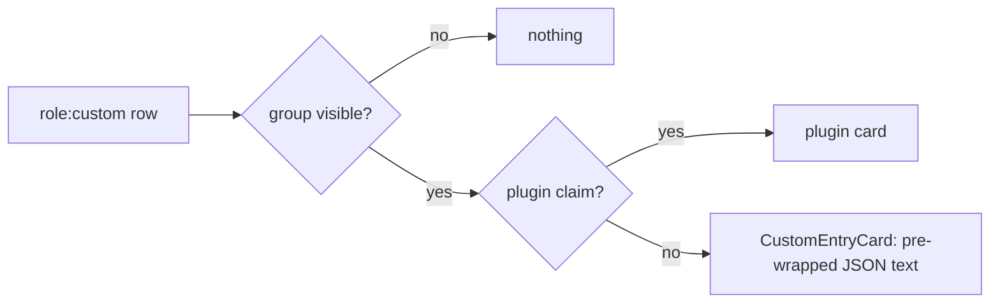

## Context

How a custom row gets rendered today (see `custom-entry-rendering`):

**How the row body is built.** It reaches the client in two lossy stages:

1. **Server ingest** (`packages/server/src/persistence/memory-event-store.ts:785`,
   `truncateStrings`, root = `event.data`):
   - strings over 4 000 chars are head+tail capped with `…[N chars hidden]…`;
   - arrays over 20 items become the string `"[array truncated]"`;
   - objects nested more than 4 levels deep become `"[truncated: deep]"`.

   - over the per-event ceiling (`DEFAULT_MAX_EVENT_DATA_SIZE` = 256 KiB), the whole
     `event.data` is replaced with a `{__truncated:true,…}` placeholder.

   For a `custom_entry`, `event.data.data.queries[i].results[j]` sits at depth 5. So every
   web-search *result object* in the body is the string `"[truncated: deep]"`. The body still
   parses as valid JSON, but its contents are partial.
2. **Client row creation** (`packages/client/src/lib/chat/event-reducer.ts:1169-1232`):
   - `extractCustomEntryBody` passes strings through and runs objects through
     `JSON.stringify(x,null,2)`;
   - `truncateOutputForDisplay` keeps the last 200 lines and prefixes them with
     `/^«\d+ earlier lines hidden»\n/`;
   - the `CUSTOM_BODY_MAX_CHARS` = 64 000 tail slice adds no marker.

**Full payload.** `useCustomEntryPayload` fetches the untruncated entry from the session JSONL
(`packages/server/src/session/session-file-reader.ts:176`). It does this only on expand, and only
when the row has an `entryId`. Rows built from `message_end` have no `entryId`.

**Reference card.** `OmEntryCard` (`packages/blackhole-plugin/src/client/OmEntryCard.tsx`) counts
only from a body that parses, and falls back to the stored body when the payload is unavailable.

**Groups.**
- `SHIPPED_CUSTOM_EVENT_GROUPS` lives in `packages/shared/src/custom-event-groups.ts:55`.
- The upgrade-merge appends shipped ids missing from `seenShippedIds`, after the user's groups
  (`custom-event-groups-store.ts`).
- The store keeps every valid entry (`custom-event-groups-store.ts:44`).
- The `search` group already covers `web-search-results` (`custom-event-groups.ts:57`).

**Plugin requirements.** `requires.piExtensions` is probed and reported (`missingRequirements` in
`GET /api/plugins`). It does not deactivate claims.

## Goals / Non-Goals

**Goals:**
- No raw JSON dump for the two observed unclaimed types.
- A better default for future unknown types, without loosening the plain-text safety rule.

**Non-Goals:**
- Changing the bridge, the durable refusal record, event-store ingest truncation, replay, or any
  reducer behavior. The only reducer edit is adding `export` to `CUSTOM_BODY_MAX_CHARS`.
- Bounding the payload route's response size. The route is shared with blackhole and is outside
  this change; the client render caps below bound what gets shown.
- A raw/structured toggle on the generic card.
- Rendering the `answer` markdown from `pi-web-access`. It stays plain text (untrusted input).
- Re-fetching the `fetchCache` content.
- Changing the existing `subagents` group's pattern.

## Decisions

**D1 — Hide refusals with a new shipped group `diagnostics` (default hidden). Don't widen
`subagents`.**
The merge only adds ids that are new to a user, so an edited `subagents` pattern would never reach
existing configs. A new id does reach them. It also keeps refusals out of the user-facing
"Subagents" toggle. The pattern is anchored to an exact match, so it cannot overlap another
shipped group.
*Trade-off (user decision):*
- The durable record carries more than the failed tool card shows (`cause`, `inFlight`, `cap`,
  `at`).
- Hidden by default means a user debugging a crash has to enable `diagnostics`.
- The record stays on disk and in the event stream, so nothing is lost. Visibility is one toggle
  away.

*Alternative:* filter it out in the reducer. Rejected: there would be no way to show it again,
and it would add a second hard-coded exclusion next to `flow-event`.

**D2 — The `web-search-results` card is a new client-only plugin, `packages/web-access-plugin`
(id `web-access`).**
- **Why a plugin:** this was the user's choice. It keeps third-party-specific knowledge out of
  core, matches the blackhole/`om.*` precedent, and gets the enable/disable toggle for free.
- **Manifest:** only a `client` entry. `server` is optional in `PluginManifest`
  (`packages/shared/src/dashboard-plugin/manifest-types.ts:215`). Task 3.1 confirms that a
  client-only manifest validates and that the generated registry picks it up before any other
  work.
- **`requires.piExtensions: ["pi-web-access"]`:** advisory only. The claim stays active, so
  `web-search-results` rows in historical sessions still render with the card.
- *Alternative:* a built-in renderer tier inside core. Rejected (user decision).
- *Cost:* the full new-package checklist, captured in tasks.

**D3 — Web-access card.**
- **Collapsed** — derived from the body only; no fetch is issued.
  - `JSON.parse(body)` inside a catch-all. Bodies carrying the line-truncation marker and
    bodies at the 64 000 cap are rejected outright.
  - Search: show "N queries" only when `queries` is an array. Show "M results" only when
    `queries` is an array AND every query is an object whose `results` is an array; M is the sum
    of their lengths.
  - Fetch: show "N URLs" only when `urlMetadata` is an array, or otherwise when `urls` is an
    array (the older shape).
  - `research` or any other subtype: label only.
  - Under-reporting is safe; over-reporting is not.
  - **Why the counts hold whatever the ingest caps are configured to:** every count requires
    `Array.isArray`. Ingest either keeps an array whole (its length is exact, even if its items
    became placeholder strings) or replaces it with a string, which disqualifies the count. Only
    the string-length cap is configurable (`memoryLimits.maxStringFieldSize`); the >20-items
    rule and the depth rule are hard-coded (`memory-event-store.ts:786-790`).
- **Expanded** — from the payload only, never from the body. The body's nested data has already
  been replaced with ingest placeholders (see Context), so a structured view of it would be
  silently partial.
  - Payload present and recognized (`search` / `fetch`): render the typed view.
  - Payload present but `research` or unrecognized: render the payload as plain text
    (`JSON.stringify`, inside the parse catch-all), bounded with the same last-200-lines /
    64 000-char display form.
  - Fetch view: read `urlMetadata[]` (`url`, `title`, `contentLength`, `error`) or `urls[]`
    (`url`, `title`, size = `content.length`).
  - Search view: render `providers[]` (joined) when present, else `provider`.
  - Ignored fields: `fetchCache`, `artifact`.
  - No `entryId`: no expand affordance at all, matching `OmEntryCard`'s `entryId &&` gate and
    the existing "Row without an entry id offers no expand affordance" scenario.
  - Payload unavailable after a fetch attempt: render the stored body as plain text, exactly as
    the existing "Payload unavailability SHALL degrade to the stored body" requirement says,
    plus `payloadError` when it is defined.
  - While loading: show a loading line.
- **Parsing** — one pure module, `parse-web-search.ts`, with a catch-all that never throws.
  - `parseWebSearchPayload(unknown) → SearchView | FetchView | null`.
  - Malformed items are skipped and counted, and the view shows "N items could not be
    displayed".
- **Bounds:**
  - `MAX_QUERIES = 20`, `MAX_RESULTS_PER_QUERY = 20` and `MAX_FETCH_URLS = 50`, each followed
    by "+N more".
  - The collapsed parse is memoized on `body` (`useMemo`). The marker and length checks run
    before `JSON.parse`.
  - Answer and snippet get a line clamp, plus a `max-h` scroll region on the expanded body.
  - The full payload is not size-capped server-side, so these client bounds are the only
    protection.
- **Links** — `safeHttpUrl(raw): string | null`:
  - `new URL(raw)` inside try/catch;
  - require `protocol ∈ {http:, https:}`;
  - reject URLs with a non-empty `username` or `password` (the `https://trusted@evil` style of
    phishing);
  - return `url.href`.
  - Rendered as `<a href={href} target="_blank" rel="noopener noreferrer">{raw}</a>`: the target
    is normalized, the visible text is the original string. Otherwise the URL is plain text.
  - Electron's `setWindowOpenHandler` (`packages/electron/src/main.ts:512`) already routes
    `_blank` links to the system browser.
- **Burst absorption:** a claimed `customType` is transparent to `group-tool-bursts.ts`, so
  web-search rows become part of a burst instead of splitting it. They must render identically
  inside an expanded burst. Existing contract: "absorbed row still renders when its group is
  visible".

**D4 — Structured generic fallback: pure `parseFallbackObject(body)` + render in
`CustomEntryCard`.**
- **Returns:** `{ entries: [key, display][], omitted: number } | null`.
- **Returns `null` when:**
  - the body matches `/^«\d+ earlier lines hidden»\n/` (the exact marker from
    `truncateOutputForDisplay`);
  - `body.length >= CUSTOM_BODY_MAX_CHARS`. The tail-sliced body has no marker, and a string
    body's tail could itself be valid JSON, so length is the only reliable signal.
    - A body that is naturally exactly 64 000 chars also falls back to plain text. That is a
      conservative false positive and is accepted.
    - The reducer gains only an `export` on the constant;
  - `JSON.parse` throws;
  - the parsed value is not a plain object, or is an empty object `{}`.
- **Never throws:** the whole function is wrapped in a catch-all that returns `null`. All
  formatting, including every nested `JSON.stringify`, happens INSIDE it, so the render step
  only maps `[string, string][]` to text nodes and has nothing left that can throw. This matters
  because the fallback card has no row-level boundary of its own: `CustomEntryRow.tsx` returns it
  bare for unclaimed rows and uses it as the boundary's fallback for claimed rows. As a second
  line of defence, `CustomEntryCard` wraps the structured `<dl>` in an `ErrorBoundary` whose
  fallback is the plain `<pre>{body}</pre>`, so a throw at render time still never reaches the
  chat-level boundary.
- **Event-ceiling placeholder:** a `{__truncated:true,…}` body is a complete object, so it
  renders as key/value text. That is truthful: it shows what the store kept.
- **Values:**
  - Scalars show as `String(v)`. Nested values show as compact `JSON.stringify(v)`, wrapped with
    `break-all`.
  - Ingest placeholders (`…[N chars hidden]…`, `[array truncated]`, `[truncated: deep]`) appear
    verbatim, exactly as in today's raw view, so no information is hidden or invented.
- **Key bound:** `MAX_FALLBACK_KEYS = 50`, then "N more keys".
- **Rendering:** a `<dl>` inside the existing `max-h-[240px]` region; React text nodes only;
  memoized on `body`.

## Risks / Trade-offs

- **[Risk] A user relied on seeing refusals.**
  → They re-enable `diagnostics`. The CHANGELOG calls out the behavior change, mirroring
  `memory`'s precedent.
- **[Risk] A user group that matches earlier keeps claiming refusals** (first-match-wins).
  → Intended. User rules outrank shipped ones.
- **[Risk] Rollback leaves `diagnostics` hidden.**
  → Documented in Migration and in the CHANGELOG.
- **[Risk] `pi-web-access` changes its payload shape.**
  → The parser skips malformed items and reports how many it skipped. An unknown `type` shows
  the label only, and the expanded view falls back to the plain body.
- **[Risk] Adding a package bloats the cold client entry chunk** (mdi-chunk-size cap).
  → The card is small, with per-icon `@mdi/js` imports. Measure against origin/develop;
  lazy-load the expanded detail only if the cap trips.
- **[Risk] A URL scheme bypass.**
  → `new URL()` normalizes the scheme and strips C0/whitespace, and only `href` is emitted. Tests
  cover `JAVASCRIPT:`, leading whitespace or tab, `data:`, `//host`, and garbage.
- **[Pre-existing, out of scope] Bursts ignore group visibility.** `transparentCustomTypes`
  (`ChatView.tsx` ~1009) is built from claims alone, so a hidden claimed row still takes part in
  burst grouping. This already affects `om.*` rows, which are claimed and hidden by default.
  Making `web-search-results` claimed widens the same behaviour; it does not introduce it.
  Follow-up candidate.
- **[Trade-off] A body that is naturally exactly 64 000 chars renders as plain text**
  (length-based truncation detection). Conservative, so accepted.
- **[Trade-off] The structured fallback hides exact JSON formatting.**
  → Values are still verbatim text.

## Migration Plan

- **Deploy:**
  - The server seeds or merges `diagnostics` on next start.
  - The client build picks up the plugin through the generated registry.
  - Electron and npm-global installs bundle it through `BUNDLED_PLUGINS` / the publish allowlist.
- **Rollback:**
  - Revert the commit.
  - The plugin disappears from the registry, and the generic fallback (pre-change form) renders
    web-search rows again.
  - The `diagnostics` group persists in `custom-event-groups.json`, still hidden. The CHANGELOG
    tells users to enable it, or delete the entry, to see refusals again.
