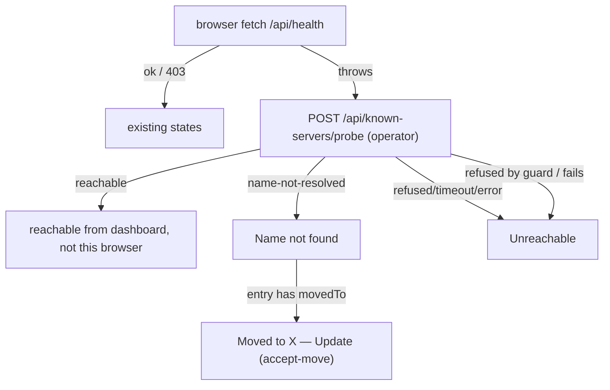

## Context

See `proposal.md` (Why) for the observed drift and its evidence. Current shape:

- `packages/shared/src/mdns-discovery.ts:122-153` — synchronous `advertiseDashboard(port, piPort, {bindHost, publish?})` calls `bonjour.publish({name: "pi-dashboard-${os.hostname()}-${port}", type, port, txt})`. With no `host`, `Service` uses `os.hostname()` (`node_modules/bonjour-service/dist/lib/service.js:32`) and `records()` (`service.js:38-67`) emits `A`/`AAAA` for **every** non-internal interface under that name. `bonjour-service` is pinned `1.4.2` (`pnpm-workspace.yaml` overrides).
- Record lifecycle: `registry.publish` probes asynchronously when `probe` is true (`registry.js:17-40`); on a name conflict it stops the service and logs (`registry.js:27-33`). `announce` calls `service.records()` once and registers that packet (`registry.js:94-97`); queries are answered from registered records (`mdns-server.js:18-60`); teardown sends `records()` with TTL 0 (`registry.js:~121`).
- Browser: emits `up` for new fqdns, `down` only on goodbye packets (`browser.js:153-157`), `srv-update`/`txt-update` only when SRV name/host/port or TXT change (`browser.js:109-140`); `expire()` exists but nothing calls it (`browser.js:88-100`). Addresses are captured from A/AAAA matching the SRV target at first sight (`browser.js:200-201`).
- Version: `mdns-discovery.ts:134-140` reads `../../package.json` from `packages/shared/src` → missing → `0.0.0`. The server owns the real version (`packages/server/src/server.ts:1271-1273`).
- Identity: `ensureServerIdentity()` (`packages/server/src/auth/identity.ts`, `server.ts:573`) → `{fingerprint: "sha256:<b64url>"}`. `POST /api/pair/challenge {nonce}` → `{fingerprint, publicKey, signature}` (`packages/server/src/routes/pairing-routes.ts:194-212`), public.
- `packages/shared/src/server-pinning.ts:103-157` — `decidePinnedIdentity` recomputes the fingerprint from the presented key, then verifies the signature; `challengePinnedServer` fails closed without a pin, follows redirects, has no response-size cap, and is used by the bridge's remote-registration gate (`packages/extension/src/remote-registration-gate.ts:61`).
- `createBrowser` (`mdns-discovery.ts:344-365`) keys `up` by `pickBestHost` and `down` by `service.host`; `isLocalService` (`:171-184`) is address-overlap based. `server.ts:4142-4155` keeps `peerServers` keyed `host:port`, excludes self by `isLocal && port`. `server.ts:1274-1292` sends a `selfServer` entry with `os.hostname()`.
- Known servers: `parseKnownServers` (`packages/shared/src/config.ts:1874-1884`) keeps only `host/port/label/addedAt`; routes (`packages/server/src/routes/known-servers-routes.ts`) all use `networkGuard` (admits loopback, trusted networks, authenticated — `auth/localhost-guard.ts:436-438`); writes use whole-file `writeConfigPartial` (`config-api.ts:180-188`). `createOperatorGuard` (`pairing-routes.ts:95-125`) admits operator credentials and genuinely-local loopback requests (`auth/localhost-guard.ts:78-96`) unless strict local proof is on — never bare network trust or a paired device.
- Bridge auto-start probes the resolved port on localhost first, uses mDNS only when that is silent, then verifies each local candidate at its `host` via `http://${host}:${port}` (`packages/extension/src/server-auto-start.ts:369-385`, `packages/shared/src/server-identity.ts:108`).
- `ServerSelector.tsx:150-189` probes known entries from the browser; `.catch()` + `isLanHost` → `cors-blocked`.

## Goals / Non-Goals

**Goals:**
- Stop contesting the OS hostname; keep advertising otherwise compatible.
- Give discovery a verifiable identity and keep peer state fresh.
- Let a renamed server be repaired with one verified click, never silently.
- Make the selector's failure labels true without an SSRF/port-scan surface.

**Non-Goals:**
- Pairing, credentials, or who may *view* a server (→ `add-lan-knock-pairing`, `retire-trusted-networks-bypass`).
- Electron-side discovery (→ `add-electron-server-windows`).
- Replacing `bonjour-service` or using the OS responder.
- The bridge's lexical-loopback endpoint classification (`packages/extension/src/endpoint-resolution.ts:85-101`) and its address-overlap `isLocal` in `discoverDashboard` — pre-existing, unchanged.
- Identity checks on switch (selector) and on bridge adoption — `reachable` means "a dashboard answers"; pinned-identity enforcement on use belongs to `add-electron-server-windows`. Advertised `piPort` is published as today (gateway listener is opt-in, `gateway-transport-policy.ts:19-21`).
- The `neutral-shell-server-connect` nonce-size wording (24 vs 32 bytes, `server-pinning.ts:141`) — pre-existing drift, untouched (`challengePinnedServer` is not modified).

## Decisions

### D1 — Identity-derived instance name and hostname
`<id12>` = first 12 lowercase hex chars of SHA-256 over the UTF-8 bytes of the fingerprint string (`"sha256:…"`). Instance `pi-dashboard-<id12>-<port>`, hostname `pi-dashboard-<id12>-<port>.local`. Stable across OS renames (same fqdn → no up/down churn); the port separates dev/prod sharing one `identity.key`; hex keeps labels DNS-safe.
- *Alt: keep `os.hostname()`, filter addresses* — still two responders for one unique name. *OS responder* — per-OS process management. *Random per-run name* — breaks origin stability needed by `add-electron-server-windows`.

### D2 — Address set computed by the server, installed before the first announce
The server resolves the advertised address list **before** calling `advertiseDashboard` (startup is already async), and passes `{host, addresses, fingerprint, version, name}`; `advertiseDashboard` stays synchronous. It publishes with `probe: true` explicitly and replaces the returned `Service` instance's `records()` with a wrapper that keeps PTR/SRV/TXT and substitutes the given addresses; because probing defers `announce`, the override is in place for the first registered packet and for teardown. Address list:
- specific IP `bindHost` → that address;
- hostname `bindHost` → `dns.lookup(all)` results that are local interface addresses; none or lookup failure → do not advertise (logged);
- all-interfaces → non-internal interface addresses except IPv6 link-local (`fe80::/10`) and container/virtual bridge interfaces (`docker*`, `br-*`, `veth*`, `virbr*`, `cni*`, `flannel*`), whose addresses (e.g. `172.17.0.1`) are reused across machines;
- loopback-only → no advertisement (`shouldAdvertise`, unchanged).
If the returned service has already announced when the override would be installed (`service.published`), the server unpublishes it and does not advertise (fail closed, logged). **Probe conflict** (name in use — restart overlap with the old process, or a copied `identity.key`): detected when `service.published` is still false 3 s after publish; up to 3 attempts total, 5 s apart, then a warning naming the instance and the remediation ("regenerate `identity.key` on cloned machines"). **Address changes:** each refresh sweep (D4) re-resolves the advertised address list; when it differs, the server unpublishes and republishes, so local peers never keep a stale literal. Unit tests assert the registered packet and the TTL-0 teardown packet; the version pin stays.

### D3 — TXT `fp`, `name`, real `version`
`fp` = full fingerprint; `name` = the operator's `dashboardName` when configured, else `os.hostname()` minus `.local` (display only; may carry an existing macOS suffix). `name` is re-read on each republish (D2) and otherwise stale after an OS rename until restart — accepted. `version` comes from the server's `pkgVersion`.

### D4 — Peer records, keying and freshness
`DiscoveredServer` gains `fingerprint?`, `name?`, `addresses[]`. Peer key = service fqdn, used identically for `up`/`down` (`down` carries the stored service) and in `server.ts` `peerServers`; `srv-update`/`txt-update` refresh the peer. Because `bonjour-service` never expires peers and never reports address-only changes, the continuous browser runs a **refresh sweep** every 60 s (interval, browse window and browse factory injectable for tests): a one-shot browse (3 s, two queries 1 s apart) whose results update each peer's host/addresses/TXT; a peer absent from 3 consecutive sweeps is removed with `server-down`. Each sweep also re-evaluates move suggestions (D6) and the server's own advertised address list (D2).
`host` selection: for local peers, the first advertised address that is a local interface address, IPv4 preferred, else IPv6 — always an IP literal (consistent with `pi-gateway-auth` "A local dial host is always an IP literal"). Remote peers keep the advertised name. A new dependency-free `packages/shared/src/host-port.ts` exports `formatHostPort` (brackets IPv6) and `normalizeHostKey` (lowercase, trailing dot and brackets stripped); every URL builder that can receive a discovered host uses it — the new probe/challenge/accept code, the client selector probe (`ServerSelector.tsx:157`), and the existing builders `server-identity.ts:108` and `bridge-handlers/lifecycle.ts:759,788`. Locality for the bridge stays address-overlap (`isLocalService`, unchanged; container-bridge addresses are no longer advertised). `server.ts` excludes itself only when `isLocal && fingerprint === own && port === config.port`; peers without `fp` use today's rule. A machine running a copy of this server's `identity.key` is therefore listed, not hidden. `selfServer` carries `fingerprint`/`name`.

### D5 — `proveServerIdentity(baseUrl, {timeoutMs})`
New, alongside the unchanged `challengePinnedServer`: fresh nonce → `POST /api/pair/challenge` with `redirect: "manual"`, response read with a 4 KiB cap → fingerprint recomputed from the presented key → signature verified → `{proven: fingerprint}` or refusal. Callers compare the proven fingerprint with the pinned one; no `ServerPin` with a public key is needed. `challengePinnedServer` and its redirect behaviour are untouched (the remote-registration gate relies on them).

### D6 — Pinning, uniqueness, move suggestions
- All known-server **mutations** (`POST`/`DELETE /api/known-servers`, accept-move) and the probe add `operatorGuard` after the existing `networkGuard` preHandler (`preHandler: [networkGuard, operatorGuard]` — the universal guard and per-route defense-in-depth of `trusted-networks` are unchanged); `GET` stays on `networkGuard` and returns `canManage` (the operator predicate evaluated side-effect-free on the same request) so Settings and the selector hide controls the caller cannot use. **Breaking for non-operator LAN-trusted browsers**, which can still list entries.
- Uniqueness key `(fingerprint, port)`. `parseKnownServers` passes through `sha256:`-prefixed fingerprints and merges duplicates on load (first entry wins; later entries' hosts dropped, logged).
- **Add**: challenge `http://formatHostPort(host,port)` (2 s) **outside** the write queue, then enqueue the write, which re-reads config and re-validates. Proven F with no conflict → pinned. F+port held by another entry: if that entry's stored address still proves F → `409 already_known {host, port}` (nothing written — never silently rewrite a working entry); if it no longer proves F → that entry's host updated (label replaced only when a non-empty label is supplied, `addedAt` kept), response `{updated: true}`. Target entry pinned to G ≠ F → `409 identity_changed {expected, proven}`. An add never clears or replaces an existing fingerprint; a failed challenge on an existing pinned entry keeps the pin.
- **Backfill**: when the operator probe (D7) reports `reachable` for an unpinned entry, challenge it at its stored address; a proven F is pinned. If another entry already holds `(F, port)`, the just-verified entry is kept (its address works), the other is merged into it (label kept when the verified entry has none) and removed, and the dropped host is logged. Load-time collapse (no network) keeps the first entry.
- **Move suggestion** (replaces silent healing): on `up`/`srv-update`/sweep for a peer whose `(fp, port)` matches a pinned entry at a different host, and at most once per `(fp, port)` per 60 s: challenge the stored address; if it still proves F, nothing. Otherwise challenge the peer's address — only if it is on-link (inside the subnet of one of the server's interfaces, or the IPv6 prefix of one) and not loopback, link-local, unspecified or multicast; other targets are skipped and logged. If it proves F, record an in-memory suggestion `{entry, host, port, verifiedAt}` (not persisted). `GET /api/known-servers` returns each entry's current suggestion (`movedTo`). The suggestion is dropped when the stored address proves F again, the peer disappears, or it is older than 10 min without re-verification.
- **Accept**: `POST /api/known-servers/accept-move {host, port}` (operator) re-verifies (stored address still fails, suggested address still proves F), then rewrites the entry's host/port, preserving label/fp/`addedAt`, and logs `[known-servers] moved fp=<fp without prefix, 16 chars> <old> -> <new>`.
- Every suggestion recorded or withdrawn is logged (`[known-servers] move-suggested|move-withdrawn fp=… <old> -> <new>`).
- All known-server writes (add, delete, backfill, accept) go through **one module-level** serialized queue (owned by `known-servers-routes.ts`, shared with the move unit). Challenges run before enqueueing; each write re-reads config, re-validates, and aborts if the target entry is gone. In-flight dedupe keys use `normalizeHostKey`.

### D7 — Operator-only server-side probe: `POST /api/known-servers/probe {host, port}`
Refuses unless `normalizeHostKey(host):port` matches a persisted entry. Fixed `GET http://formatHostPort(host,port)/api/health`, `redirect: "manual"`, 2 s timeout, one in-flight probe per entry. The probe resolves the name first (`dns.lookup`, own 6 s budget — measured negative `.local` answers take ~4 s in the Docker harness and ~5 s via mDNSResponder, so a slow negative lookup is not reported as an HTTP timeout): `ENOTFOUND`/`EAI_NONAME` → `name-not-resolved`, lookup timeout or `EAI_AGAIN` → `timeout`. Then HTTP: `err.name === "AbortError"`/`TimeoutError` → `timeout`; `ECONNREFUSED` (`err.cause.code`) → `refused`; a 2xx JSON body with `ok: true` → `reachable`; any other response (3xx, 4xx, non-dashboard) or error → `error`. Non-operator browsers get a refusal and render "Unreachable" (accepted: they cannot act on the entry either).

All non-available states disable switching, as today; the Update action is the only control offered on a moved entry.

## Risks / Trade-offs

- [LAN relay: a host advertising fp F can relay `/api/pair/challenge` to the real server and pass the proof, so a verified move suggestion may point at a relay] → plain-HTTP LAN has no channel binding. Suggestions are only made when the stored address no longer proves F, are never applied without an operator click, show the new address, and every accept is logged. TLS (`add-lan-knock-pairing` follow-up) is the real fix. Accepted.
- [Move-suggestion challenges go to advertiser-chosen addresses] → only for peers matching a pinned `(fp, port)`, only after the stored address fails, fixed path, no redirects, 4 KiB cap, once per `(fp, port)` per 60 s.
- [Cloned `identity.key` on two machines, same port] → identical names; the second server fails its probe and stays silent after 3 attempts, with a warning naming the remediation. Release note: never copy `identity.key`.
- [Container-bridge filter is name-based] → unusual bridge names still advertise as today; locality misfire only if a remote peer shares such an address.
- [Backfill pins on first use at the stored address (a different dashboard may have taken the IP)] → requires a successful challenge; entries are operator-created. Accepted.
- [Non-operator LAN-trusted browsers lose add/remove of known servers] → breaking, noted in the release note; list stays available.
- [Old Linux bridges without `nss-mdns` (mixed-version window) take the new DNS-safe name for a local server on a non-resolved port] → the resolved-port localhost probe runs first; bridge and server normally upgrade together. Release note.
- [Mixed-version LAN shows an old-version peer and its upgraded advert as two rows until the old advert expires] → transient; the sweep removes vanished peers.
- [`records()` override depends on `bonjour-service` internals] → version pinned; test asserts the registered packet; failure mode is "advertises the unfiltered set under the new name".
- [Refresh sweep adds multicast traffic] → one query per 60 s per server, bounded.
- [Existing stale entries (no fp, dead host) cannot get a suggestion] → one-time manual re-add; release note.

## Migration Plan

1. Ship; servers advertise the new instance name/hostname + TXT. Older peers interoperate (SRV target resolves where mDNS name resolution exists; extra TXT keys ignored).
2. Entries gain fingerprints on operator add or backfill; renames surface as one-click move suggestions.
3. macOS hosts stop accruing conflict suffixes; existing suffixed OS names stay and keep resolving.
4. Rollback: revert. Older `parseKnownServers` drops `fingerprint` on the next write (harmless). Entries whose move was accepted to a `pi-dashboard-<id12>-<port>.local` host stop resolving under the reverted server, which no longer publishes that name — the release note tells operators to re-add them.
