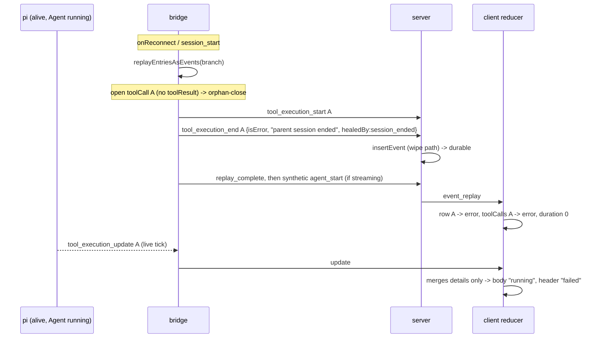

## Context

See proposal.md — Why. Current flow:

`replayEntriesAsEvents` (`packages/shared/src/state-replay.ts:36`) callers:

| Caller | Process alive? |
|---|---|
| `packages/extension/src/session-sync.ts:220` `replaySessionEntries`, called from `bridge.ts:1335` (onReconnect), `bridge-handlers/lifecycle.ts:603` (session_start), `session-sync.ts:302` (`handleSessionChange`) | yes |
| `packages/server/src/session/session-load-worker.ts:105` (disk + retained raw) | no |

The orphan-close is at `state-replay.ts:250-283`. Skip-wipe (`event-wiring.ts:1606`, `:1089`) drops replayed events, so the fabricated end becomes durable only when entries changed or the store is empty (restart). That explains why the bug is intermittent.

The server live heal `findOpenToolCalls` (`packages/server/src/session/open-tool-calls.ts:47`) walks back and **stops at the most recent `agent_start`**. Its own KNOWN GAP note (`:40-45`) says the bridge's synthetic reconnect `agent_start` (`bridge.ts:1352`, `lifecycle.ts:609-611`) is indistinguishable from a real one. Both are sent AFTER the replay, so every replayed start sits before it.

## Goals / Non-Goals

**Goals:**
- No fabricated terminal end for calls in flight in a live process.
- Keep the capability Purpose: a call left open by a live replay still goes terminal when the session really ends.
- Repair cards whose store already holds a fabricated end, for tools that tick.

**Non-Goals:**
- Recovering subagent timeline entries lost by the store wipe (resync covers it).
- Changing the `superseded` / `turn_settled` / `subagent_stopped` / `result_evicted` heals.
- Fixing non-ticking tools on OLD bridges (they stay mislabeled until the real end, which overwrites the heal).

## Decisions

### D1 — Option on `replayEntriesAsEvents`, not a separate function

Add `opts?: { liveTailOpen?: boolean }` as the 4th param (`knownContextWindow` stays 3rd). When set, the orphan-close skips open ids that belong to the LAST assistant message in `entries`. The default `false` leaves cold callers byte-identical (worker parity test `packages/server/src/__tests__/session-load-worker.test.ts` stays green).

Alternatives: strip ends in the bridge after the call (couples the bridge to the marker shape); never orphan-close in the bridge (dead earlier orphans would spin forever). Both rejected.

### D2 — "Live tail" = open calls of the last assistant message

pi persists the assistant message with its `toolCall`s before executing them and writes a `toolResult` as each finishes. The next assistant message appears only after all results. So a running turn's in-flight calls are always in the newest assistant message. Earlier-message orphans can only come from a killed run, so they stay closed. Track `lastAssistantToolCallIds` during the loop (reset on each assistant message).

### D3 — Liveness decided by the caller, threaded through the wrapper

Today both live sites call the same zero-arg wrapper: `bridge.ts:1335` calls the local `replaySessionEntries()` (`bridge.ts:1856` → `_replaySessionEntries(syncBc())`), and `lifecycle.ts:603` calls `inst.replaySessionEntries()` (typed `() => void` at `bridge-handlers/instance.ts:194`). Change:

- `session-sync.ts` `replaySessionEntries(bc, opts?: { liveTailOpen?: boolean })` forwards `opts` to `replayEntriesAsEvents`.
- The wrapper and `instance.ts:194` become `(opts?: { liveTailOpen?: boolean }) => void`.
- `onReconnect` (`bridge.ts:1335`) passes `{ liveTailOpen: isLive(inst.cachedCtx, getBridgeState().isAgentStreaming) }`.
- session_start (`lifecycle.ts:603`) passes `{ liveTailOpen: isLive(ctx, inst.shared.isAgentStreaming) }` with the handler's own `ctx` (which `inst.cachedCtx` also holds by then, `lifecycle.ts:237`).
- `handleSessionChange` (`session-sync.ts:302`) passes nothing (= closed). A new, fork or resume session has no turn in flight, and `bc.cachedCtx` there is still the OUTGOING session's ctx (`lifecycle.ts:235` runs before `:237`).

`isLive(ctx, flag)` (exported from `session-sync.ts`) = `flag === true || notIdle(ctx)`, where `notIdle` is `ctx.isIdle() === false` when `isIdle` is a function, and `false` if it is missing or throws. Either signal alone means "possibly running" (conservative OR):

- `shared.isAgentStreaming` is cleared on `session_shutdown` (`lifecycle.ts:963`), so it is false right after a `/reload`.
- `ctx.isIdle()` (pi `types.d.ts:236`) survives reload but lags `agent_end` by up to ~2s (`bridge.ts:655-668`). In that window the turn has ended, so its calls already have `toolResult`s and the lag changes nothing.

A wrong "live" leaves a call open, and D4 guarantees it closes on real death. The `isIdle` lag (`__tests__/bridge-followup-queue-drain.test.ts:14-17`) is a same-tick window after `agent_end`. A reconnect or `session_start` landing inside it with an aborted turn's orphan would leave that orphan open until session death or cold hydration. This is accepted as negligible.

AND (both signals) was rejected because it defeats the `/reload` case, where `isAgentStreaming` is known false. That `isIdle()` stays false across a mid-turn reload is pi-runtime behaviour (`agent-session.js` `isIdle = !_isAgentRunActive && !isCompacting`, the run spanning `_runAgentPrompt`). Cycle-1 review checked it against the installed pi. Task 4.2 verifies it end-to-end.

D2 assumption (pi-runtime, not repo-verifiable): pi starts no new assistant message while a call of the previous one is executing (steer/follow-up messages are delivered between turns). If that ever breaks, the earlier live call gets today's fabricated end. That is no worse than today.

### D4 — Synthetic reconnect `agent_start` is marked; the server heal walks past it

The bridge sends the reconnect `agent_start` as `{ type: "agent_start", synthetic: true }` at both sites. `mapEventToProtocol` forwards the field unchanged (`event-forwarder.ts:25-39`). `findOpenToolCalls` treats an `agent_start` with `data.synthetic === true` as transparent and keeps walking to the previous real `agent_start` (or the stream start). The scan also dedupes open starts by `toolCallId` (defensive: the wipe path deletes first, `event-wiring.ts:1609-1612`, and skip-wipe drops replayed events, `:1089`, so duplicates are not expected today). The replayed tail calls are then inside the scope again: if the process really dies, `onEnded` closes them. This also closes the documented KNOWN GAP. Dead earlier orphans in the replay already carry their replay-synthesized end, so they are not re-healed. Old bridges send no marker and keep today's behaviour. New bridge + OLD server (not a supported pairing in this monorepo, which ships them together): the scan still stops at the unmarked-to-it start, so a tail call left open is healed only by the next cold hydration, not live. Documented, not mitigated.

The client reducer and server status extraction ignore unknown `agent_start` fields (no `synthetic` read anywhere today), so the marker has no other effect.

Alternative: send the synthetic `agent_start` BEFORE the replay. Rejected: it reorders run status relative to the replayed history in the reducer and server status extractor (larger blast radius).

### D5 — Subagent heal marker

Add optional `healedBy?: string` to `SubagentState` (`packages/subagents-plugin/src/client/types.ts:36`). It is a client-only, never-sent field: the type is shared with the external producer, the producer never sets it, and the reducer is the only writer of subagent terminal status (the resync reply no-ops for finished agents, `server/src/browser-handlers/session-action-handler.ts:1227`).

The two merge sites filter `undefined` out of their patch and spread the existing state (`event-reducer.ts:2636` live hydration, `:2883` Agent backfill), so "pass `healedBy: undefined`" cannot clear it. Rule:

- Heal writes set it: the `subagent_completed/failed` arm when `data.healedBy` is set (`:3167`), and the Agent backfill when the end's `healedBy` is set.
- Every OTHER write deletes it AFTER building the merged object (`delete merged.healedBy`): the backfill for a real end, live hydration, `subagent_started` (`:3158`), `subagent_entry`, `subagent_delta`, and the real `subagent_completed/failed`.

Tests cover a real terminal following a healed one, and a healed row whose subagent failed for real.

No magic-string comparison against `"parent session ended"`.

### D6 — Reducer reopen on a live tick (defense in depth)

In the `tool_execution_update` arm (`event-reducer.ts:2571`), after the nested-event early return (`:2572`) and inside the `partialResult` branch: when the target row (snapshot `priorRow`, captured at `:2587`) has `toolStatus !== "running"` and `toolDetails?.healedBy === "session_ended"`, the reopen:

1. sets the row's `toolStatus: "running"` and clears `duration`;
2. sets the `toolCalls` entry to `running`;
3. for `Agent`, resets the linked subagent to `running` (deleting `error` and `healedBy`) when its `healedBy === "session_ended"`. This happens BEFORE the live-hydration block, so that block's `isTerminal` guard (`:2620`) sees a running subagent and merges normally.

The row's heal markers are dropped by the existing merge, which replaces `toolDetails` wholesale with the update's `details` (`:2599`). The "finished card is not reopened" branch (`:2641`) already exempts `session_ended` rows (`:2650-2654`); its comment claims such a row "stays reopenable by a live tick", which was only half true (`toolStatus` was never reset) and is corrected as part of this change. Other heals and real terminals are untouched.

Ordering: the server broadcasts and replays in store seq order, so a tick stored BEFORE a real `onEnded` heal reduces before it and cannot reopen a really-dead card. A dead process sends no later ticks.\n\nLimit: a page load reduces the stored fabricated end after the retained updates (seq order, update collapse in `in-memory-event-buffer`), so a poisoned card renders failed until the next live tick, unless a retained update has a higher seq than the end. With D1 in place no new fabricated ends are stored.

### D7 — Tool-result route does not serve a `session_ended` end for a live session

`useStaleToolReconcile` (`packages/client/src/hooks/useStaleToolReconcile.ts:225-250`) polls `GET /api/sessions/:id/tool-result/:toolCallId` for rows running >25s. On `200` it reduces a heal-less end. The route returns ANY stored end (`findToolEndEvent`, `packages/server/src/persistence/memory-event-store.ts:1854`; route `packages/server/src/routes/session-routes.ts:228`). After D6 reopens a poisoned row, the reconcile would re-finalize it as a real error, and with the marker gone D6 could never fire again.

Fix: `findToolEndEvent` gains an option `skipHealedBy?: "session_ended"`. The route passes it only when the session is resident AND not ended: `sessionManager.get(id)` exists and its `status !== "ended"`. A non-resident session (archived or removed, `memory-session-manager.ts:488`; `session-routes.ts:403-404`) cannot be alive, so it is served as today. The route then falls through to its existing `410`/`202`/`404` ladder (`404` keeps the row running and only feeds the supersede counter). For an ended session the heal is truthful and is served as today. With D1 in place no new fabricated ends are stored, so this only repairs already-poisoned stores and old bridges.

Alternative: skip `healedBy` rows in the client reconcile scan. Rejected: a reopened row has lost its marker (D6 strips it), so the scan cannot tell.

### D8 — chat-view spec scenario wording

The `chat-view` scenario "Pending ask_user (post-restart replay)" has a GIVEN that the replay synthesized an end, so `toolStatus` is `complete`. After D1, a live reconnect leaves the call `running`. The behaviour (hide regardless of status) is unchanged, so the GIVEN is widened to `complete` or `running` via a MODIFIED delta.

## Risks / Trade-offs

- [Bridge misjudges liveness as busy] → the tail call stays `running`, and D4 guarantees the server `onEnded` heal closes it on real death. A cold reload also closes it (the cold path still orphan-closes).
- [Synthetic marker missing (old bridge)] → server heal keeps today's turn scope, and the old bridge also still fabricates the end (no D1), so the two stay consistent.
- [Sibling change `preserve-agent-lifecycle-across-replay-gaps`] → it also edits `chat-view` (a different requirement) and may carry an `agent_start` across a replay window. A carried `synthetic:true` start is still transparent to D4, and it reaches no client logic. The two apply sequentially; whichever lands second rebases its delta.
- [`docs/architecture.md:906` says reconnect replay orphan-closes running calls] → now true only for cold replays; updated in task 4.3.

## Migration Plan

No data migration. Ship shared + extension + server (route, open-tool-calls) + client + subagents-plugin types together. Rebuild: `npm run reload` (extension), `/api/restart` (server/shared), `npm run build` + restart (client).
