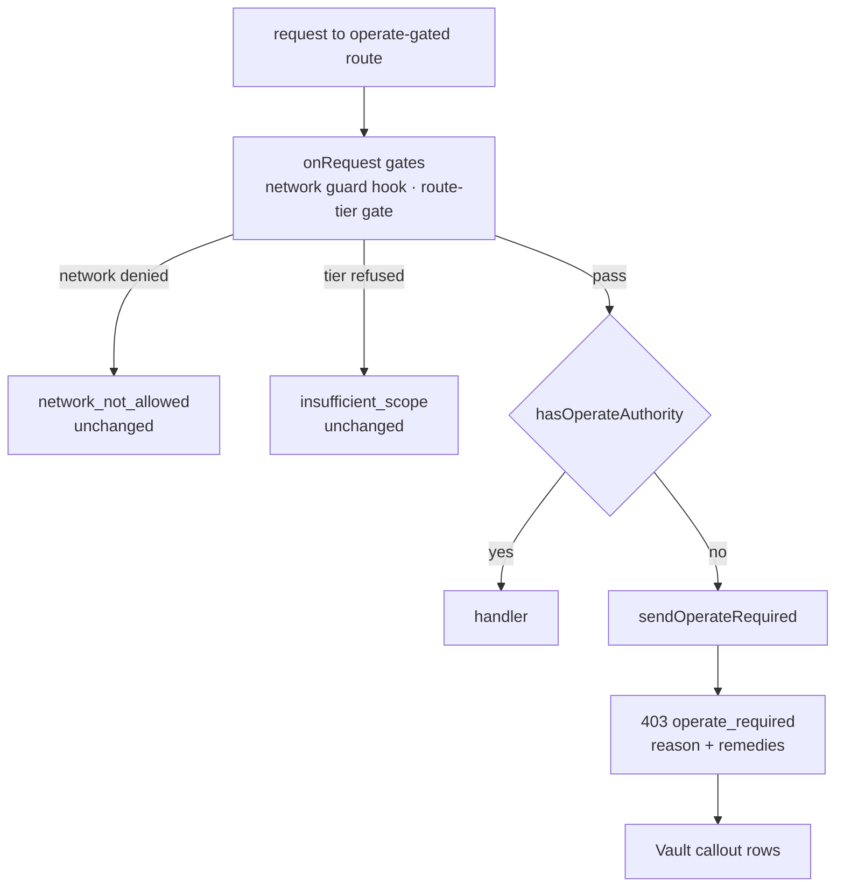

## Context

Two routes gate on `operate` authority with textually identical private
predicates: `canManageVault` (`packages/server/src/vault/vault-routes.ts:84-89`)
and `canMutateServices` (`packages/server/src/services/routes.ts:37-42`). Both
accept a paired-device bearer whose `principalTier` is `operate` (markers set only
after a successful verify at `packages/server/src/auth/bearer-auth.ts:70-81`), any
`authVia` of `session` (`packages/server/src/auth/auth-plugin.ts:474`) or
`principal` (`packages/server/src/identity/resolver-hook.ts:80,119`), or
`isLocallyTrusted` (`packages/server/src/auth/localhost-guard.ts:89`), and refuse
with `{success:false, error:"operate_required", message}`
(`vault-routes.ts:104-106`, `services/routes.ts:62-70`). These are the only two
`operate_required` emitters. The session binding-state read
(`GET /api/session/:id/vault-bindings`) sits behind the network guard only and is
not affected.

Earlier gates decide who reaches that refusal:
- the network guard denies non-local, non-trusted, unauthenticated callers with
  `network_not_allowed`; under `requireLocalProof` it also denies a bare loopback
  request to any non-`observe` route, with a hint to use `pi-dashboard open` or the
  desktop app (`localhost-guard.ts:350-358`; `trust-and-credential-boundaries`);
- the route-tier gate (`packages/server/src/auth/route-tier-gate.ts:76-97`,
  `onRequest`) refuses a tiered credential (device or session) below the route's
  tier with `insufficient_scope`, unless the caller is locally trusted (`:84`) or a
  trusted source (`:85`). `/api/vault` and service mutations are `operate` in
  `packages/shared/src/route-tiers.ts`.

So `operate_required` is reached by: credential-less trusted-network callers;
below-`operate` devices from a trusted-network address or from loopback outside
strict mode. A strict-mode host browser without proof never reaches it.

Client: `packages/client/src/lib/vault/vault-api.ts:84-91` folds the envelope
(`Envelope` has only `success/data/error/message`) into
`error: env.message ?? env.error`, dropping the code; `VaultSection.tsx:22-29,56-58`
renders it as "Couldn't load the vault: {error}".

Diagnosed 2026-10-13 with a names-only log line on the vault refusal:
`ip=192.168.16.220 authVia=- isAuth=false strict=false fwd=[]` — a LAN browser
admitted by `auth.bypassHosts`, carrying no credential.

## Goals / Non-Goals

Goals: name the cause and the way out, as data, without changing who is admitted.

Non-goals: loosening the gate; the `network_not_allowed` and `insufficient_scope`
bodies; pairing or knock changes; a `request-access` remedy; a Services web UI;
MCP exposure (`/api/vault` and `/api/services` are MCP-denylisted,
`packages/mcp-server-plugin/src/server/tools.denylist.ts`).

## Decisions

### D1 — One shared module for the predicate and the refusal

`packages/server/src/auth/operate-required.ts` exports `hasOperateAuthority(request,
localTrust?)` (the existing predicate, moved verbatim) and
`sendOperateRequired(request, reply, { route, loginAvailable })`. Both routes
import it. This unifies the last gate layer only; the earlier gates are untouched.
Alternative — add remedies in each route — rejected: two copies of the disclosure
rule drift.

### D2 — `reason` and remedies from markers already on the request

`authVia === "device"` with `principalTier !== "operate"` → `tier-too-low`; else
`no-credential` (a revoked or unknown bearer sets no markers, so it lands here).
`use-host` is withheld when `isGenuinelyLocal(ip, headers)`
(`localhost-guard.ts:78`) holds — that caller is already on the host (e.g. an
`observe` bearer on loopback, which the tier gate exempts and the predicate
refuses). `sendOperateRequired` reads `ip`, headers and auth markers to derive
these values and never emits them.

Reachable combinations: (`no-credential`, not local) and (`tier-too-low`, local or
not), each with `loginAvailable` true or false.

### D3 — `sign-in` availability is a live composed accessor

`loginAvailable: () => boolean` is called inside `sendOperateRequired` on every
refusal, never captured as a boolean. Sources:
- OAuth: `registerAuthPlugin` exposes a live accessor over
  `authState.providerRegistry` (closure-local, `auth-plugin.ts:191-208`) counting
  providers with a non-empty `clientId` (`auth.ts:99` builds providers without
  checking it). The accessor is created **before** the early return at
  `auth-plugin.ts:208-211`, so a provider-less install still gets a function (it
  reads 0, and stays 0 after a config write because that path installs no reload
  hook); when the plugin is not registered at all (`server.ts:2050`) the composer
  receives `null`;
- passkeys: `passkeyService` (`server.ts:2041,2046`) — enabled when present and
  enabled;
- identity: `identityEnforced()` and `browserLoginConfigRegistry.list()`
  (`server.ts:600,607,2085`).

An exported `buildLoginAvailable(oauthAccessor | null, passkeyService, identity)`
composes them in `server.ts` and is passed into `VaultRoutesDeps` /
`ServiceRoutesDeps` (`server.ts:2457-2471`); route deps always receive a function.

### D4 — Disclosure: only the caller's own position

Disclosed: whether the caller presented a valid credential and its own tier (it
holds the credential); and — the one stated configuration exception — whether a
usable login method exists. `/auth/login` and `/api/identity/login-config`
(`server.ts:2080-2085`) already publish every configured method; `sign-in` narrows
that to usable ones (an empty-`clientId` provider is listed there but cannot
complete a login). Nothing else — fixed key set, fixed messages
(spec table), no host, address, device or posture output. `request-access` is
excluded: knock eligibility depends on `pairing.acceptLanRequests` and per-address
knock state, posture a credential-less caller may not learn under
`canDiscloseAccessPosture` (`localhost-guard.ts:106-111`). `add-lan-knock-pairing`
owns that remedy and its disclosure analysis, via a MODIFIED delta of this
capability.

### D5 — Client: typed result, callout only with remedies

`vault-api.ts`: `Envelope` gains `remedies?`; `VaultResult` gains `code?` (from
`error`) and `remedies?`. `VaultSection` renders `OperateRequiredCallout` when
`code === "operate_required"` and `remedies` is an array; otherwise the existing
line (older servers keep today's behaviour). Unknown values are dropped. The
client keys on `remedies` alone; `reason` is for API callers.

Copy, test ids and layout decisions live in `mockups/ui-plan.md` (approved
board `mockups/operate-callout.html`): info severity with `role="status"`, title
"This device can't open the vault", one-line reason, a labelled "What you can do"
list in server order, a "Sign in" link to `/auth/login` on the `sign-in` row, and
a "Try again" control that re-runs `fetchVault`. Test ids:
`vault-operate-required`, `vault-operate-remedy` (`data-remedy`),
`vault-operate-signin`, `vault-operate-retry`.

## Risks / Trade-offs

- Pre-existing, preserved but not asserted: at this layer the predicate admits any
  `session` / `principal` regardless of tier, so a lower-tier session from a
  trusted-network address reaches the vault — at odds with `credential-vault`'s
  "only `operate` authority". This change neither pins nor alters it; a separate
  change should fix it.
- Value window: once `retire-trusted-networks-bypass` flips, credential-less LAN
  callers get `network_not_allowed` and never reach this refusal; it then matters
  for `tier-too-low` only. Retire must re-read the `no-credential` scenarios.
- `re-pair` copy follows `bearer-device-auth` (tier fixed at issuance; change =
  revoke + new token) and `qr-device-pairing` (HTTPS-only); if either rule
  changes, the copy goes stale.

## Migration Plan

None. Additive body fields; status, `error`, the `no-credential` message and
admission unchanged. Rollback: revert.
