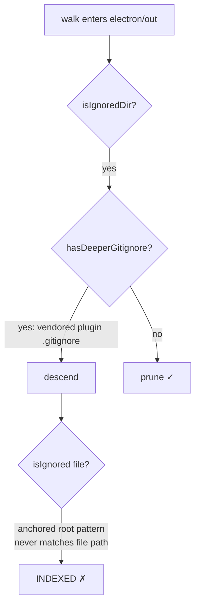

# Design — kb gitignore: excluded parent wins

## Context

`loadGitignoreMatcher(walkRoot, { cwd, prune })` (packages/kb/src/gitignore.ts) seeds ancestor `.gitignore` files by up-walk, then pre-loads every nested `.gitignore` under the walk root. `verdictFor(rel, dirMode)` runs last-match-wins over all sets whose base contains `rel`. Walks call `isIgnoredDir(dir) && !hasDeeperGitignore(dir)` to prune and `isIgnored(file)` per file.

Evidence (this repo, walk root `packages/`):

| probe | result |
|---|---|
| `isIgnoredDir("electron/out")` | `true` |
| `hasDeeperGitignore("electron/out")` | `true` (vendored plugin `.gitignore`s) |
| `isIgnored("electron/out/PI-Dashboard-darwin-arm64/x.md")` | `false` ← bug |
| `git check-ignore --stdin` over all ≈3,450 indexed paths | 576 ignored, all under the two Electron trees |

## Decisions

### D1 — Ancestor-excluded check inside the verdict

`verdictFor(rel, dirMode)` first checks each ancestor dir of `rel` (shallow → deep) with the dir-mode verdict; the first ignored ancestor makes `rel` ignored, short-circuit. Otherwise last-match-wins applies to `rel` itself.

- **Ancestors span above the walk root.** The ancestor chain runs from the shallowest loaded set base (repo root / `cwd` boundary) down to `rel`'s parent — computed on absolute paths, not `ancestorsOf(rel)` (walk-root-relative today, `gitignore.ts:112`). A walk root that is itself inside an ignored dir (e.g. walk root `packages/electron/out/app`, root pattern `packages/electron/out`) yields every file ignored, as git does (`indexer.ts:88-99` never tests the walk root itself).
- **File mode matches the file path only.** `matches(pat, rel, false)` becomes `pat.dirOnly ? false : pat.re.test(rel)` — a dir-only pattern (`out/`, `!*/`) never matches a file; both ancestor extensions (`gitignore.ts:131` dirOnly, `:134` unanchored) go. Merely deleting the two branches is WRONG: `!*/` compiles to a regex that matches `docs/x.md` itself. Directory exclusion is owned by the ancestor rule above. Today's extension diverges from git: root `*` + `!*/` (or `*` + `!foo`) → matcher `isIgnored("docs/x.md")` false, `git check-ignore` ignored. After D1 the dir `docs` is not ignored (`!*/` wins in dir mode), then `*` matches `docs/x.md` itself → ignored. Dir mode (`pat.re.test(rel)`) is unchanged.
- **`patternMatches` keeps its E16 meaning.** The exported single-pattern helper (`gitignore.ts:45`, E16 decision table in `gitignore.test.ts`) answers "does a `.gitignore` holding only this pattern exclude `rel`": any ancestor of `rel` matches in dir mode, OR `rel` matches in (new, path-only) file mode. Every E16 row (`out/` → `out/sub/x.md`, `**/node_modules` → `a/node_modules/x.js`, `Out/` → `Out/x.md`, …) keeps its expected value; the table is not edited.
- **E13's `!skills/openspec-shared/` line becomes prune-only.** File-level `!dir/` no longer re-includes files (git agrees: `foo/**` + `!foo/` leaves `foo/x.md` ignored); it keeps `isIgnoredDir` false so the walk descends, while `!skills/openspec-shared/**` re-includes the files. Neither line is redundant.
- **Oracle.** Dir verdicts compare to slashless `git check-ignore -q <dir>`; file verdicts to `-q <file>` or plain `--stdin`. Never `-v` (prints negation matches and exits 0 for them) and never `<dir>/` (applies the dir's own `.gitignore` to itself); `git status` collapses fully-ignored dirs and is not a dir oracle.
- **Separator normalization.** Ancestor paths are normalized to `/` before pattern tests (same as the current `p` in `verdictFor`, `gitignore.ts:200`); Windows-native `relative()` output never reaches `matches`.

- Puts git's rule in the matcher, so every caller (`isIgnored`, `isIgnoredDir`, future users) is correct without relying on walk-order pruning.
- Ancestor verdicts use only sets whose base is at or above that ancestor — sets loaded from inside an excluded dir never participate (see D3).
- Cost: O(depth × patterns) per path; memoize dir verdicts in a `Map<string, boolean>` per matcher (walk visits each dir once anyway). Indexer walk is not on a latency budget.

Alternative rejected: fix only the file-match of anchored non-dirOnly patterns against ancestors. Still wrong for the negation case (E15) and leaves `hasDeeperGitignore` descents loading nested patterns git ignores.

### D2 — Walks prune unconditionally

Replace `isIgnoredDir(rel) && !hasDeeperGitignore(rel)` with `isIgnoredDir(rel)` at all four sites (indexer `walk`; dox.ts L269, L350, L579). Negations that legitimately keep a directory (`!skills/openspec-shared/`) already make `isIgnoredDir` false (last-match-wins at that dir), so E13 is unaffected. Content-only patterns (`skills/openspec-*/**`) never match the dir itself, so the walk still descends and filters files — unchanged.

`hasDeeperGitignore` loses its callers; drop it from `GitignoreMatcher` and its test assertions (`nestedBases` goes with it) unless a non-walk caller is found during apply.

### D3 — Descend phase skips excluded directories (performance only)

The loader's `scan` currently pre-loads every nested `.gitignore` (minus `prune`). It SHALL not descend into a directory already ignored by the sets loaded so far (evaluated with D1). Pre-order scan guarantees a dir's own and ancestors' `.gitignore` files are loaded before the dir is tested.

- **Verdict-neutral.** Under D1 every path below an excluded dir short-circuits on the ancestor, so a set loaded from inside it can never change a verdict. D3 is purely a load-time saving (loader stops walking the full Electron bundles); no test can observe it through `isIgnored`/`isIgnoredDir`, so none is required.
- **Check before parse.** A dir is tested in its parent's `scan` loop before `scan(dir)` runs, so an excluded dir's own `.gitignore` is never parsed.
- **Ordering hazard.** `scan(walkRoot)` runs at `gitignore.ts:194`, before `const verdictFor` at `:196`. Consulting the verdict inside `scan` without moving `verdictFor` (+ its memo) above the call throws `ReferenceError` (TDZ) at load; `tsc` does not flag it. Move the definitions first.
- **Memo validity.** Dir verdicts memoized during `scan` use the sets loaded so far. Pre-order guarantees a later-loaded set is based strictly below an already-tested dir, so it cannot change that dir's verdict — memo stays valid.

### D4 — No migration

`indexSource` deletes every stored path not in `live` (orphan removal, kb-indexing-pipeline). Newly-ignored files drop out on the next incremental index. `kb reindex` not required.

## Risks / Trade-offs

- **[Reverses archived D3/E15]** → E15 was a stated design intent, not an accident. Justification: it diverged from git, and the project's spec requirement is phrased as "files ignored by git". Mitigation: the new test asserts parity with real `git check-ignore` semantics in a temp repo-shaped fixture; doubt-driven-review before merge.
- **[Repo relying on re-include under an ignored dir]** → such a file is untracked by git anyway; losing it from kb matches the "absent from a fresh clone" rationale. None exist here (audited negation-bearing `.gitignore` files).
- **[Tracked-file override]** git keeps tracking files committed before being ignored; still a Non-Goal (unchanged from fix-dox-lint-blind-rows).

## Verification

- Unit + integration tests (tasks §1).
- On this checkout after apply: reindex, then `sqlite3 .pi/dashboard/kb/index.db "select root||'/'||path from files" | git check-ignore --no-index --stdin | wc -l` → `0` (labels here equal repo-relative dirs: `packages`, `docs`, `openspec`, `.pi`; a label ≠ dir needs mapping through config); chunk count drops by ≈1,522 vs a baseline captured on the same checkout before reindex.
