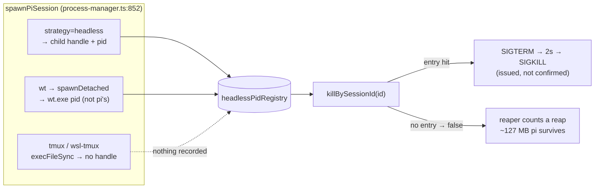

# Design — one terminator for every server-initiated kill

## Context

`fix-tmux-session-shutdown-leak` (archived 2026-08-11) fixed the *attended* half
of #452: `shutdownSession` now escalates to `session.pid` with the shared
`killProcess` ladder and reports an unconfirmed kill
(`packages/server/src/browser-handlers/session-action-handler.ts:1070-1098`). Its
task 3.8 deferred the unattended half; #459 is that half.

What is actually on disk today:

| Path | Terminator | Code |
|---|---|---|
| browser `shutdown` + REST shutdown | registry → marker scan → `session.pid` ladder → confirm | `session-action-handler.ts:1032-1101` |
| `force_kill` | `session.pid` ladder, then registry | `session-action-handler.ts:1347-1351` |
| reaper gear 1 `idle` / gear 3 `phantom` | registry only | `idle-reaper.ts:119` ← `server.ts:2406` |
| caps reclaim | injected `reclaim`, documented as registry kill | `caps.ts:41,84` |
| automation stop / run completion | registry by sessionId, token fallback (registry-only) | `server.ts:3533-3545` |

The bottom three are the leak. The registry holds an entry only when a spawn
returned a child handle — every `register` call site is guarded by
`spawnResult.process && spawnResult.pid`
(`session-action-handler.ts:461,896`, `server.ts:3467`) — and `spawnTmux` /
`spawnWslTmux` are `execFileSync` calls that return
`{ success: true, dashboardSpawned: true }` with neither field
(`process-manager.ts:918-924`, `:944-946`). So `killBySessionId` →
`findBySessionId` → `undefined` → `false` (`headless-pid-registry.ts:518-521`).

**Correction vs the first draft (reviewer B-F6, re-verified):** `spawnWt` is NOT
in that set. It goes through `spawnDetached` and returns `pid` + `process`
(`process-manager.ts:1003-1004`), so a `wt` spawn IS registered. What the
registry then holds is the **`wt.exe` launcher** pid, not pi's — Windows Terminal
hosts pi in a window it owns. Whether killing the launcher reaches pi is NOT
verified by this change, and nothing here depends on it: the `session.pid` rung
is what makes `wt` safe, exactly as it does for tmux. The design no longer
claims `wt` is untracked.



Two aggravating facts make this reachable in production rather than theoretical:

1. tmux is the DEFAULT. `chooseMechanism` picks headless only for an explicit
   `strategy: "headless"`, Electron mode, or an ACP child
   (`process-manager.ts:803-812`).
2. The sessions the reaper governs are exactly the ones that do not ask for
   headless: automation spawns stamp `lifecyclePolicy: "ephemeral"` and pass no
   `strategy` (`packages/automation-plugin/src/server/engine.ts:703-736`).

## Goals

- One termination primitive behind every *unattended* server-initiated kill plus
  `shutdownSession`, strategy-agnostic by construction (keyed on the identity the
  server already holds), not by enumerating strategies.
- Termination that is **confirmed**, not merely issued, before it is reported.
- An unattended kill that fails is loud: diagnostic + counter, bounded retry, and
  never counted as a reap.

## Non-goals

- Changing reap eligibility (`decideReap`) or cap *selection/arithmetic*.
  Untouched. (The caps *admission decision on a failed reclaim* does change — D8.)
- Addressing tmux windows/panes. D6 of the archived change settled this: the pane
  is downstream of `pi`.
- Rewiring `handleForceKill` (D9).
- Wiring the embed front's caps gate (`createCapsAdmission` has no production
  call site — `rg createCapsAdmission packages` matches only `caps.ts` and its
  test).

## Decisions

### D1 — Extract the ladder into `session-terminator.ts`, do not re-inline it

**Decision:** add `packages/server/src/spawn-process/session-terminator.ts`
exporting `createSessionTerminator({ sessionManager, headlessPidRegistry })` →

```ts
terminate(
  sessionId,
  { graceMs?, spawnToken?, verifyIdentity?, stampManualClose? },
): Promise<TerminateResult>

type TerminateResult = {
  outcome: "confirmed-dead" | "unconfirmed" | "refused-identity" | "no-identity";
  terminated: boolean;   // === outcome === "confirmed-dead"
  pid?: number;
};
```

`verifyIdentity` and `stampManualClose` are `true` for every UNATTENDED caller
(reaper, caps, `abortSpawnedRun`) and `false` for the operator
`shutdownSession`, whose signalling stays what `fix-tmux-session-shutdown-leak`
shipped (D7) and which stamps its own close reason.

Liveness inside the terminator is the errno-aware `signalZero`
(`platform/process.ts:152-168`), never `isProcessAlive`: only `"esrch"` means
gone; `"alive"` and `"other-errno"` (EPERM — a live process we may not signal)
both mean alive. `isProcessAlive` (`process.ts:89-96`, catch-all → `false`) is
NOT modified — see "Rejected" below.

Ladder:

0. `stampManualClose` only (D10): if the record exists, is not `ended` and has
   no `closedReason`, `sessionManager.update(id, { closedReason: "manual" })`
   BEFORE any signal. Undone at the end (see 8).
1. `registryPid = headlessPidRegistry.getPid(id)` (captured BEFORE the kill,
   because `killEntry` deletes the entry — `headless-pid-registry.ts:341-355`),
   then `await headlessPidRegistry.killBySessionId(id)`. Its `true` means the
   kill was **issued** for a known entry, NOT that the process is gone
   (`headless-pid-registry.ts:341-355,518-521`; `killProcess` returns `{ok:false}`
   for an already-dead pid, `process.ts:196`). It is an *attempt* flag only.
2. `pid = sessionManager.get(id)?.pid ?? registryPid`. A registry entry's pid is
   used for confirmation when the session record holds none (reviewer B-F2).
   - No pid at all → `spawnToken` rung (D6) if given, else
     `outcome: "no-identity"`, `terminated: false`.
3. **Already gone?** `signalZero(pid) === "esrch"` → `confirmed-dead`, no signal
   sent (reviewer A-F3: liveness BEFORE identity, so a dead pid is never
   misreported as `refused-identity`).
4. `graceMs > 0` → poll `signalZero` up to `graceMs` (shutdown only; it has sent
   the advisory `{type:"shutdown"}` first). Exited → `confirmed-dead`.
5. **Identity guard (`verifyIdentity` only, and only for `session.pid`)** — see
   *Identity* below. Unverified → do NOT signal. Re-probe once: `"esrch"` →
   `confirmed-dead` (the pid died between steps 3 and 5); otherwise
   `outcome: "refused-identity"` with a diagnostic naming the reason
   (`pid reused` vs `identity unverifiable on <platform>`).
6. `await killProcess(pid, { timeoutMs: 2000 })`. For an EPERM-live pid it
   early-outs through `isProcessAlive` (catch-all "dead") and returns
   `{ok:false}` WITHOUT signalling (`platform/process.ts:196`); no kill-primitive
   change.
7. Confirm by liveness only: `terminated = signalZero(pid) === "esrch"`, else
   `unconfirmed`. `killProcess`'s `ok` is never read as a verdict, so the
   EPERM case of step 6 lands here as `unconfirmed` (`signalZero` →
   `"other-errno"` = alive), matching the spec scenario *A liveness probe the
   server may not perform does not mean dead*.
8. If step 0 stamped and the outcome is not `confirmed-dead` and the record is
   still not `ended`, withdraw the stamp (`update(id, { closedReason:
   undefined })` — explicit `undefined` is honoured by `update`,
   `memory-session-manager.ts:549-559`).

**Identity — process start time, not command-line match (reviewer B-F5, B-F4,
A-F2).** The only command-line helper on disk, `isProcessLikePi`
(`process-identify.ts:194-210`), matches `\bpi\b|\bnode\b`
(`process-identify.ts:38-40`) — any node process passes — and returns `true`
unconditionally on win32. It also has NO production caller today (`rg isProcessLikePi packages` → only
its definition and a comment; `forceKillSession` calls `killProcess` directly,
`session-action-handler.ts:1347`): the main spec's *PID safety check before
SIGKILL* is not implemented on any path, so there is no existing guard to
"reuse". It is too weak for an unattended kill and is not used. The delta
MODIFIES *PID safety check before SIGKILL*: on unattended paths the start-time
guard IS the safety check (runs before the first signal, rejects a reused pid
that a `pi|node` match would accept); the command-line scenario stays scoped to
the operator force-kill path, where its pre-existing non-implementation is
unchanged by this change (Risks).

Instead the guard is NEW and keyed on time: when the server stores a session's
`pid` (`memory-session-manager.ts:469`, every `session_register`/re-register),
it also stamps a server-only `pidRecordedAt = Date.now()` (additive optional
field on the in-memory record; no protocol message changes). The pid is the
session's process iff

```
started = processStartedAt(pid)        // platform/process.ts, existing
started !== null && started <= pidRecordedAt + 2000
```

The real `pi` started before it registered; a process that reused the pid
started after the original died, i.e. after registration. `processStartedAt`
already exists (`/proc` on Linux, `ps -o lstart=` elsewhere, built for
`fix-gateway-socket-stale-owner`) and returns `null` on win32 and on any read
failure. **`null` → refuse** (conservative principle: unverifiable ⇒ do not
signal). Consequences, stated rather than hidden:

- **win32 server** (native `wt`, and `wsl-tmux`, whose `session.pid` is a
  WSL-namespace pid a native `taskkill /F /T` would resolve against the Windows
  pid space — reviewer B-F4): the `session.pid` rung never signals unattended;
  it reports `refused-identity` (unverifiable) and the reaper gives up at once
  (D4). The registry rung still works for headless spawns. Unattended
  reclamation of non-headless sessions on Windows is therefore NOT delivered by
  this change — it is diagnosed instead of guessed.
- A record with no `pidRecordedAt` (should not occur after this change; e.g. a
  test fixture) is unverifiable → refused.

Scope of the guard (reviewer A-F1): it applies to `session.pid` — a pid the
dashboard did NOT spawn. It does not wrap rung 1: a registry entry created by
`register()` holds the live `ChildProcess` and is deleted on its `exit` event
(`headless-pid-registry.ts:406-409`), so within one server lifetime its pid
cannot be recycled while the entry exists (the kernel keeps the pid until Node
reaps the child). The exception — entries restored by `cleanupOrphans` after a
restart with a dummy handle (`headless-pid-registry.ts:646-680`) — is
pre-existing behaviour of today's reaper. It is now carved out EXPLICITLY in the
identity requirement's delta (registry-reached processes, restored entries
included, are signalled as today without a start-time check) and recorded under
Risks. Guarding restored entries is possible in principle — the registry
persists `spawnedAt` per entry (`headless-pid-registry.ts:102,365,643`) — but
rung 1 kills inside `killBySessionId`, keeper entries signal `piPid` (which
starts after the keeper's `spawnedAt`) before `keeperPid`, and on win32 such a
guard would refuse every restored headless entry reclaimed today. That is a
registry change, not a terminator change: follow-up. The token rung (D6) is identity-safe by construction: it matches
the server-minted token in the process environment AND narrows to processes
named `pi` (`process-identify.ts:100-150`).

Rejected alternatives:

- **Change `isProcessAlive` to report `true` on EPERM** (cycle-1 draft). It has
  ~15 production callers (`home-lock`, `tunnel-core`, `keeper-manager`,
  `server-pid`, `cli`, `boot-parent-liveness`, `classify-dashboard-port`,
  `autostart-lock`, `native-driver`, …) and would contradict the documented split
  that `signalZero` is THE errno-aware probe for kill decisions
  (`process.ts:152-161` doc comment). Using `signalZero` inside the terminator
  gets the same honesty with zero shared blast radius (reviewer B-F1).
- **`isProcessLikePi` as the guard.** See *Identity*: matches any `node`, void
  on win32.
- **Fix only the `server.ts:2406` closure.** Smallest diff, worst outcome: a
  third copy of the ladder next to the two that already exist
  (`session-action-handler.ts:1079`, `:1347`), with caps and `abortSpawnedRun`
  still broken. The archived change's own "one body, two callers, no third
  divergence" note (`session-action-handler.ts:1025-1030`) is about precisely
  this failure mode.
- **Record tmux spawns in `headlessPidRegistry`.** There is nothing to record:
  `execFileSync` returns tmux's exit, not pi's pid, and pi mints the session id
  later. This was D5 of the archived change and was retired by D6.
- **Export `shutdownSession` and call it from the reaper.** It unregisters the
  session and broadcasts `session_removed` — see D4; reap and shutdown are not the
  same operation. It would also make `embed-lifecycle/` import
  `browser-handlers/`, inverting the layering.

Placement in `spawn-process/` (beside `headless-pid-registry.ts` and
`spawn-register-watchdog.ts`) keeps the dependency direction
`browser-handlers → spawn-process` and `embed-lifecycle → spawn-process` (via the
injected closure in `server.ts`, so `embed-lifecycle` gains no new import at all).

### D2 — The reaper needs no advisory message, only the ladder

**Decision:** the reaper injection passes `graceMs: 0`.

`killProcess` is itself SIGTERM → 2 s → SIGKILL (`platform/process.ts:187`),
which is exactly what a headless reap gets today through `killBySessionId`
(`headless-pid-registry.ts:518` → `killEntry`). So gear 1's "graceful kill path,
resume intact" and gear 3's "NOT a bare SIGKILL" guarantees (`idle-reaper.ts:8-12`,
spec *Phantom-liveness escape hatch*) are preserved without inventing a shutdown
handshake for the reaper.

Rejected: send `{type:"shutdown"}` first and wait `SHUTDOWN_GRACE_MS`. It adds
1.5 s × N to every sweep, and the reaper has already established the session is at
rest.

### D3 — Report a failed reclaim; do not count it

**Decision:** `ReaperDeps.killBySessionId` becomes
`terminate(sessionId) => Promise<TerminateResult>` (the injection passes
`verifyIdentity: true`). Two explicit counting rules (reviewer A-F6):

- **Rule K (kill gears 1 `idle` / 3 `phantom`):** `deps.onReap` fires ONLY when
  `result.terminated`. Otherwise log `[embed-lifecycle] reclaim(<id>, <reason>):
  <outcome>, process <pid|unknown> survived` and call
  `deps.onReclaimFailed(sessionId, reason, result)`, which feeds the D4 give-up
  tracker.
- **Rule L (latch gear 2 `stop-after-turn`):** it terminates nothing, so it does
  not go through the terminator and "confirmed termination" does not apply. It
  is counted on **delivery** of the latch: `piGateway.sendToSession` returns
  `false` when the bridge WS is not OPEN (`pi/pi-gateway.ts:1367-1373`), so
  `sendStopAfterTurn` widens from `=> void` to `=> boolean`; `onReap` fires only
  on `true`. An undeliverable latch logs a `warn`, increments `failedReclaims`
  with reason `stop-after-turn`, and is simply re-attempted on the next sweep
  while the session stays eligible. It is NOT fed into the D4 give-up tracker
  (reviewer B-F6): an undelivered latch is a transient transport state that a
  bridge reconnect fixes, not a wedged process, and giving up on it would
  silently stop gear 2 for a session that recovers.

Both counters are per-ATTEMPT. `decideReap` re-selects gear 2 on every sweep
while the session stays idle-trending (`quiescence.ts:136-139`), so the
`stop-after-turn` reaped counter already increments per sweep today; that is
pre-existing and unchanged (Non-goal: reap eligibility). The new failed-reclaim
counter follows the same per-attempt semantics.

- **`terminate()` throwing is a failed reclaim, not a skipped one** (reviewer
  A-F11). `reapOne` wraps the terminator call in its own try/catch and maps a
  throw to `outcome: "unconfirmed"` + the same `onReclaimFailed` path, so the
  sweep-level catch (`idle-reaper.ts:139`) stops being the only handler and the
  pid is not lost.

`onReclaimFailed` is wired to `metrics.recordReclaimFailure()`; the
snapshot gains `failedReclaims: number` next to `reaped` and `capacityRejections`
(`lifecycle-metrics.ts:15-27`), surfaced through `/api/health`. **Decision R2:**
`failedReclaims` is ONE scalar — not broken down by reason (the log line carries
the reason) — and given-up sessions are log-only: no `unreclaimableSessions`
(or similar) health field. The `error`-level give-up line plus a non-zero
`failedReclaims` is the operator signal.

**Naming (reviewer A-F12):** one term throughout — *failed reclaim*. Dep
`onReclaimFailed`, metric method `recordReclaimFailure`, snapshot field
`failedReclaims`, spec prose "failed-reclaim count". `reapFailures` is retired.

Rejected: throw on failure. `sweepOnce` catches per-session and logs a generic
warning (`idle-reaper.ts:137-141`); an exception would be indistinguishable from a
probe failure and would lose the pid.

### D4 — A failed kill-reclaim keeps the record, retries a bounded number of times, then gives up — for the reaper AND the caps gate

**Decision (resolves old open Q2, reviewer A-F5 / B-F10, cycle-2 B-F3 / A-F5):**
the reaper does NOT unregister or broadcast `session_orphaned`, and retry is
bounded by ONE give-up tracker shared by the reaper and the caps gate.

The issue text says "the session record goes, the ~127 MB pi stays". That is the
SHUTDOWN behaviour (`session-action-handler.ts:1100-1101`), not the reaper's: the
reaper only kills and lets the bridge's `session_unregister` retire the record.
`session_orphaned` would also be a lie while the record still exists.

"Retry every sweep forever" is a log-spam and signal-loss bug of its own, and
the `no-identity` case can never succeed by retrying: the spawn-register watchdog
is **not** a fallback for a session that HAS a record, because
`session_register` clears the watch (`spawn-register-watchdog.ts:193-227`
`clearByToken`/`clearByPid`/`clearByCwd`).

Tracker: `createReclaimGiveUpTracker()` in `embed-lifecycle/`, created once by
`createEmbedLifecycleController` and injected into both the reaper and
`createCapsAdmission`:

- `recordFailure(id, outcome)` — increments a per-session consecutive count;
  marks the session **given-up** at N = 3, or immediately for
  `no-identity` / `refused-identity` (neither changes without new information);
  returns whether this call crossed into given-up (so exactly one `error`-level
  diagnostic is emitted, naming session id, reason, outcome and pid).
- `isGivenUp(id)`, `clear(id)` — `clear` on a confirmed termination; the reaper
  also prunes ids no longer in `listSessions()` each sweep.
- **Reset rule (Decision R3):** the consecutive count resets ONLY on a confirmed
  termination (`clear`) or when the session leaves `listSessions()` (prune). A
  sweep that makes NO attempt for the session (it is temporarily ineligible,
  e.g. a browser subscribed) does NOT reset it; neither does a Rule-L latch
  outcome. "Consecutive" therefore means consecutive failed ATTEMPTS, not
  consecutive sweeps.
- Only Rule-K kill failures and caps reclaim failures are recorded; Rule-L latch
  failures are not (D3).

Consumers:

- **Reaper:** skips a given-up session in `reapOne` (no further attempt, no
  per-sweep diagnostic). It stays listed and visible.
- **Caps (D8):** a given-up session is excluded from VICTIM selection, so
  `admit` never re-picks the same wedged victim on every acquire (the permanent
  `CapacityError` loop reviewers found). It STILL COUNTS toward the caps: it is
  a resident process, and the global cap is the host-resource security bound —
  under-counting it would let the host exceed the cap. If every quiescent
  candidate is given up, `admit` takes the existing all-busy branch
  (`CapacityError`).

Clearing a given-up session is an operator action (force-kill / shutdown), which
is the honest contract.

### D5 — The guarantee is strategy-agnostic, not per-strategy

**Decision:** specs say "for every spawn strategy", enumerate none.

The requirement is keyed on the identity the server already holds
(`session.pid` from `session_register`), so a strategy added tomorrow is covered
without editing the spec. Enumeration also mis-states the present: the first
draft of this design listed `wt` as untracked and was wrong
(`process-manager.ts:1003-1004`) — a spec sentence that had enumerated
`tmux`/`wsl-tmux`/`wt` would have shipped that error. The `force-kill-handler`
spec already carries the "strategy-agnostic by construction rather than by
enumerating strategies" wording; this change extends that requirement's reach to
the unattended callers instead of restating it.

### D6 — `abortSpawnedRun` is in scope, including the pre-register window

**Decision:** route `server.ts:3533-3545` through the terminator, and fix the two
holes reviewers found (A-F3, B-F2, B-F7):

1. The `graceful && sessionId` branch today sends the hint and `return`s
   `reg.killBySessionId(sessionId)` with **no** pid escalation and **no** token
   fallback (`server.ts:3534-3537`). Both branches collapse into one call:
   `terminate(sessionId, { spawnToken, verifyIdentity: true })`, with the
   `{type:"shutdown"}` hint sent first only when `graceful`.
2. The pre-register window (spawn launched, `session_register` not yet received →
   no session record, no `session.pid`, no registry entry for a tmux spawn) is a
   real leak that `killByToken` cannot close, because `killByToken` is
   registry-only (`headless-pid-registry.ts:524-529`). The terminator therefore
   takes an optional `spawnToken` and, when the pid rung finds no identity, runs
   the **same reclaim the watchdog uses**: `findPidsBySpawnToken(token)` →
   `killProcess` per pid → confirm by liveness
   (`platform/process-identify.ts:115-150`, `spawn-register-watchdog.ts:37,133`).
   That helper narrows to processes actually named `pi`, which is load-bearing —
   the token is inherited by the tmux server, the pane shell and the dashboard
   itself. It returns `[]` on win32, so on Windows this rung is a no-op and the
   outcome stays `no-identity` (honest, not silent).

3. **Outcome report (Decision R1).** `abortSpawnedRun` keeps its `boolean`
   return. When the terminator's outcome is not `confirmed-dead` (`unconfirmed`,
   `refused-identity` — e.g. a win32 non-headless run — or `no-identity`,
   including an unresolvable spawn token), it returns `false`, logs ONE
   `console.warn` naming the run's session id (or the spawn token when no
   session is known), the outcome and the pid when held, AND increments the
   embed-lifecycle `failedReclaims` counter (`embedLifecycle.metrics`, which the
   server constructs unconditionally — dormant config does not hide it). It
   does NOT feed the D4 give-up tracker: a run is terminated once, not swept.
   `confirmed-dead` returns `true`. This is what the automation-run-lifecycle
   delta means by "reported as not confirmed" / "no termination SHALL be
   reported". The closure body moves into a small factory
   (`createAbortSpawnedRun(deps)`, `spawn-process/abort-spawned-run.ts`) so the
   report contract is unit-testable; `server.ts` keeps only the trust gate and
   the binding.

Its own comment claims it mirrors `handleShutdown` — "`graceful` sends a clean-
exit hint AND escalates via the kill ladder" (`server.ts:3523-3527`) — but it
escalates only through the registry, so it is false for a tmux run today.

Rejected: defer to a fourth change. The terminator is the whole fix here; the
call site is a handful of lines.

### D7 — What `shutdownSession` delegates, and what stays in it

**Decision (resolves old open Q3, reviewer A-F8 / B-F9):** `shutdownSession`
delegates ONLY the kill ladder. Everything that makes shutdown *shutdown* stays
in the caller, in this order (`session-action-handler.ts:1032-1101`):

| Step | Stays in `shutdownSession` | Moves into `terminate()` |
|---|---|---|
| `metaPersistence.setLiveness(file, {live:false, closedReason:"manual"})` | ✅ | |
| in-memory `update(id, {closedReason:"manual"})` | ✅ | |
| advisory `{type:"shutdown"}` send | ✅ | |
| `headlessPidRegistry.killBySessionId` | | ✅ (rung 1) |
| `killHeadlessBySessionId` marker scan (`findPidByMarker`) | ✅ (caller only) | ❌ |
| `waitForExit(pid, SHUTDOWN_GRACE_MS)` | | ✅ (as `graceMs`) |
| `killProcess(pid, {timeoutMs:2000})` + liveness confirm | | ✅ |
| orphan `console.error` + `session_orphaned` broadcast | ✅ | |
| `sessionManager.unregister` + `session_removed` broadcast | ✅ | |

Shutdown calls `terminate(id, { graceMs: SHUTDOWN_GRACE_MS, verifyIdentity:
false })`: it is operator-initiated, and the D1 identity guard would otherwise
regress it on win32 (where `processStartedAt` is `null`). Its signalling is
exactly what `fix-tmux-session-shutdown-leak` shipped. Liveness moves from
`isProcessAlive` to `signalZero`, so an EPERM-live pid now reports as orphaned
instead of silently "gone" — the honest direction.

**Outcome → report (reviewer A-F7).** Today the orphan block sits inside
`if (pid !== undefined)` (`session-action-handler.ts:1072-1101`), so a session
with no identity is released silently. After delegation the caller branches on
`outcome`:

| `outcome` | Report |
|---|---|
| `confirmed-dead` | none (clean removal) |
| `unconfirmed` / `refused-identity` (has `pid`) | `console.error` + `session_orphaned {sessionId, pid}` (unchanged) |
| `no-identity` | `console.warn` naming the session: "no process identity held; termination NOT verified". No `session_orphaned` — its `pid` field is required (`browser-protocol.ts:198-203`) and a pid-less variant would be a protocol change, out of scope. |

This satisfies the main spec's no-pid scenario ("reporting that rather than
claiming a kill") with a server diagnostic; the record is still released, as
today. It does NOT satisfy the unmodified *A removal SHALL never imply a
termination the server did not verify*, which demands an orphan signal whenever
termination is unconfirmed — so the delta MODIFIES that requirement: with no
pid held, a log-only diagnostic ("termination NOT verified") replaces the orphan
signal, because the signal's payload is the surviving pid and a pid-less variant
is a protocol change. No health counter is added for the shutdown path:
`failedReclaims` is an embed-lifecycle metric and shutdown is operator-attended
(the operator sees the record go and the log names it).

The marker scan stays where it is: it is a documented no-op for tmux and
redundant once the pid rung runs, but it is also the only rung that can catch a
headless sibling the registry lost, and moving it would change reaper behaviour
(an extra `ps` per sweep per session) for no gain.

### D8 — The caps reclaim contract

**Decision (reviewer A-F6 / B-F8):** `CapsDeps.reclaim` changes from
`(sessionId) => Promise<void>` (`caps.ts:41`) to
`(sessionId) => Promise<TerminateResult>`, and `admit` stops proceeding
regardless of the result (`caps.ts:84-87`):

- `terminated: true` → admit (today's intended behaviour).
- otherwise → the victim's slot was NOT freed. `admit` throws `CapacityError`
  (`code: "EMBED_CAPACITY"`, `caps.ts:20-26`) — the same structured error the
  all-busy path already throws, so no new error shape reaches the acquire caller.
  The message distinguishes the cause ("reclaim of <id> could not be confirmed").
- **No victim re-pick.** `admit` attempts exactly ONE reclaim per call. Looping to
  the next-oldest candidate is how a host with one wedged process turns a single
  admission into a sweep that kills every quiescent session; refusing is both
  cheaper and the behaviour a caller can retry safely. This is the live-lock
  avoidance.
- **Given-up victims are not selectable (cycle-2 B-F3 / A-F5).** The caps
  `reclaim` dep is `terminate(id, { verifyIdentity: true, stampManualClose: true })`; a non-confirmed
  result is recorded in the shared D4 tracker, and the victim filter becomes
  `s.quiescent && !tracker.isGivenUp(s.sessionId)`. Without this, `admit`
  re-picked the same wedged victim on every acquire forever. Given-up sessions
  still count toward the caps (D4).
- `reclaimGuard` handling is unchanged — the `finally` already releases the
  victim (`caps.ts:86-88`).

Reconciliation with the Non-goal: cap *counting and selection* are untouched
(`listEphemeralActive`, the over-global/over-visitor predicates and the
oldest-quiescent sort are byte-identical). What changes is the admission decision
in the failure branch, which today admits on an unverified kill, and the
exclusion of given-up sessions from the victim pool. That is a
behaviour change and is stated as such, not hidden under "arithmetic untouched".

### D9 — Scope of "one shared terminator": the unattended paths + shutdown, not force-kill

**Decision (reviewer B-F11):** the spec sentence is scoped to the paths this
change actually wires — the three unattended reclaims and `shutdownSession`.
`handleForceKill` is NOT rewired.

Its ladder runs in the opposite order deliberately: `killProcess(session.pid)`
FIRST, then `headlessPidRegistry.killBySessionId` (`session-action-handler.ts:
1347-1351`), and it has a distinct no-pid branch that still force-closes the
bridge WS and marks the session `ended`. Flipping it to registry-first inside the
terminator would change the keeper-mode signal order on an operator-facing path
for no benefit in this change's scope. Claiming "each path resolves through the
one shared terminator" while that path does not would be an overclaim; the spec
now says what is true, and converging force-kill is left as explicitly future
work.

Spec consequence: the main *Ending a session SHALL terminate its process for
every spawn strategy* requirement says "Termination SHALL use one shared
escalation ladder" for shutdown AND force-kill. Force-kill does use the shared
ladder primitive (`killProcess`, `session-action-handler.ts:1347`) — just not
through the terminator. The delta MODIFIES that requirement to say so
explicitly (ladder = `killProcess`; shutdown + unattended via the terminator;
force-kill pid-first by design, with the reason above) instead of leaving the
reader to infer it. *Ending a session SHALL have one implementation*
(main spec :285-300) is NOT contradicted: it binds only the browser `shutdown`
message and the REST route to one path, and both still go through
`shutdownSession`.

The same MODIFIED requirement's scenario *A session whose PID was never
recorded* names the spawn-register watchdog as the reclaimer. That holds only
before registration: `session_register` clears the watch
(`spawn-register-watchdog.ts:193-227`), so a registered session that holds no
pid has no reclaimer. The scenario is narrowed accordingly rather than adding a
spawn-token rung for the reaper/caps (they do not carry the token; D6 covers the
one caller that does, `abortSpawnedRun`).

### D10 — An unattended reclaim is an intentional close for recovery purposes

**Decision (cycle-3 A-F6 / B-F2):** the terminator, when called with
`stampManualClose: true` (all unattended callers), stamps the in-memory
`closedReason: "manual"` before the first signal (D1 step 0) and withdraws it
when the outcome is not confirmed and the record has not ended (step 8).

Why: SIGTERM makes pi's bridge send `session_unregister`; `unregister()` keeps a
pre-set reason (`memory-session-manager.ts:509-511`) and the end write persists
`liveEpoch` only when `closedReason === "unknown"` AND the ending was a bridge
unregister (`event-wiring.ts:633-638`). With no stamp, every reaped session
(tmux now, headless already) ends `unknown` + `liveEpoch` and becomes a
shutdown-window recovery candidate (shutdown-session-recovery spec:28-30). This
is the SAME mechanism `shutdownSession` uses for the same race
(`session-action-handler.ts:1045-1050`, change
`fix-recovery-pi-signal-unregister` D2). No disk `setLiveness` pre-write is
needed: the end write carries the in-memory reason. A pre-write would also
leave `live:false` on disk for a session whose reclaim then fails.

Value: `"manual"`, the existing intentional-close value — no new
`ClosedReason` member. `process_gone` is a carrier-loss attribution and would
lie; `unknown` is the bug. The shutdown-session-recovery requirement is
MODIFIED to list server-initiated reclaims among intentional closes.

Rejected: a new `"reaped"` reason. Truer label, but it extends the
`ClosedReason` vocabulary, its persistence and its card rendering
(session-death-attribution) — wider than this fix needs.

## Risks / Trade-offs

- **Killing a PID the registry does not own.** An unattended kill of
  `session.pid` is gated by the D1 start-time guard; unverifiable ⇒ refused.
  Residuals: (a) Linux `processStartedAt` derives from second-truncated `btime`
  plus the 2 s tolerance, so a pid recycled within ~3 s of the ORIGINAL pi's
  registration would pass — that requires the registered pi to have died within
  seconds of registering and its pid to be reused immediately; accepted.
  (b) Wall-clock steps (NTP jump backwards after registration) can make a
  genuine pi look "started after" → refused; that is the safe direction.
  Blast radius is further bounded by `isEphemeral` (`idle-reaper.ts:127`).
- **Windows gets diagnosis, not reclamation, for non-headless sessions.**
  `processStartedAt` is `null` on win32, so `wt` / `wsl-tmux` sessions are
  refused at once with an `identity unverifiable` diagnostic and given up.
  Delivering Windows reclamation needs a real identity check (e.g. process
  creation time via a Win32 API, and WSL-namespace resolution for `wsl-tmux`) —
  follow-up, not guessed here (Decision R5: refused + diagnosed; follow-up
  GitHub issue #913, task 8.5).
- **Restored registry entries are trusted (pre-existing, now declared).**
  Entries reloaded by `cleanupOrphans` after a server restart carry a dummy
  handle (`headless-pid-registry.ts:646-680`) and only an `isProcessAlive`
  check, so rung 1 can signal a recycled pid for them — exactly as today's
  reaper and shutdown already do. The identity delta now exempts them by name
  rather than by omission. Not widened by this change; a `spawnedAt`-based guard
  in the registry is a follow-up (D1 *Scope of the guard*; Decision R7:
  exempted by name, follow-up GitHub issue #914, task 8.6).
- **Command-line PID safety check is unimplemented on force-kill
  (pre-existing).** `isProcessLikePi` has no caller; the MODIFIED *PID safety
  check before SIGKILL* keeps that scenario scoped to force-kill and does not
  implement it here. Unattended paths get the stronger start-time guard.
- **No unattended kill is group-scoped — on any path (A-F10, corrected per
  cycle-2 A-F9).** `killProcess` sends SIGTERM/SIGKILL to ONE pid on Unix
  (`platform/process.ts:208,219`) and tree-kills only on Windows
  (`taskkill /F /T`). That includes today's headless path: `killEntry` calls the
  same single-pid `killProcess` (`headless-pid-registry.ts:348`). The cycle-1
  claim that headless reaps escalate to the process group was wrong. A pi's own
  children (an MCP server, a long `bash` tool call) can therefore outlive it for
  every strategy, so the terminator is no regression versus any existing path.
  The headless-spawn spec's `process.kill(-pid)` mandate and force-kill's
  "entire process subtree" wording are already unmet by the code on Unix — a
  pre-existing gap, out of scope here. The deltas therefore say "the session's
  `pi` process" and claim nothing about descendants; a GitHub issue for the gap
  is #912 (task 8.4).
- **Reaped sessions are labelled `manual` (D10, resolves cycle-2 A-F8 /
  cycle-3 A-F6).** Reaps no longer become shutdown-window recovery candidates;
  the price is that the card shows the intentional-close reason for a server
  reap of an `ephemeral` session rather than a reap-specific one. Accepted: the
  reaper acts only on `ephemeral` sessions, and a new reason widens the
  vocabulary. If pi exits between the terminator's last probe and D1 step 8, the
  record is `ended` and the stamp stays — correct, the close happened.
- **Headless reclaim is NOT byte-identical (cycle-3 B-F7).** Earlier drafts
  claimed a headless reclaim is unchanged. It is not: after the unchanged
  registry kill, the terminator probes liveness and may signal again (below),
  and the registry's own 2 s SIGKILL timer may still be armed. What IS
  preserved: the registry rung and keeper escalation run first, unchanged, and a
  process already gone is never signalled again. The spec scenario now says
  exactly that.
- **Double ladder on the headless path (B-F12).** A headless reap now runs the
  registry kill and then a liveness probe (and, if the registry's kill was issued
  but the process lingers, a second `killProcess`). Cost is one `process.kill(pid,0)`
  per reap plus, in the rare lingering case, a duplicate SIGTERM to an already
  SIGTERM'd pid — harmless (the signal is idempotent) and the price of confirming
  rather than assuming. The alternative — trusting the registry's "issued" flag —
  is the bug this change exists to fix.
- **Gear-1 double-signal race (B-F13).** With `graceMs: 0` the terminator can
  send its own SIGTERM while the registry's 2 s SIGKILL timer for the same pid is
  still armed (`headless-pid-registry.ts:322-327`). Both target the same process
  with the same intent; the loser is a no-op on a dead pid. No ordering guarantee
  is claimed or needed.
- **EPERM-live pid vs `killProcess`.** `killProcess` still early-outs through
  `isProcessAlive` (`process.ts:196`), so for an EPERM-live pid it returns
  `{ok:false}` without signalling; the terminator's `signalZero` confirm then
  reports `unconfirmed`. Honest, and no shared primitive changes.
- **Shared give-up tracker couples reaper and caps.** One small in-memory
  module; acceptable for a bound that must hold on both paths.
- **A new counter in `/api/health`.** Additive field; clients that do not read it
  are unaffected.
- **Test reach.** `reclamation-soak.test.ts` and `idle-reaper.test.ts` inject
  `killBySessionId`; the dep rename touches every reaper test's fake, and
  `sendStopAfterTurn`'s widened return type touches the gear-2 fakes. Mechanical,
  but it is the bulk of the diff.

## Resolved Questions (human-approved decisions R1–R7)

- **R1** — `abortSpawnedRun` non-confirmed outcome → returns `false` + one
  `console.warn` naming run/session/outcome + increments `failedReclaims` (D6 item 3).
- **R2** — `failedReclaims` is a single scalar; given-up sessions are log-only,
  no health field (D3). Resolves former Open Questions 1 and 2.
- **R3** — give-up count resets only on confirmed termination or the session
  leaving `listSessions()`; ineligible sweeps do not reset it (D4).
- **R4** — no sweep/acquire latency requirement. The only cost bound is that a
  given-up session receives no further kill attempts (D4).
- **R5** — Windows non-headless (`wt` / `wsl-tmux`) unattended reclaim is refused
  and diagnosed; a real Windows identity check is a follow-up issue (task 8.5).
- **R6** — reaped sessions are stamped `closedReason: "manual"`; no new
  `"reaped"` value (D10).
- **R7** — restored registry entries keep no identity check, exempted by name in
  the identity delta; a registry-side guard is a follow-up issue (task 8.6).
