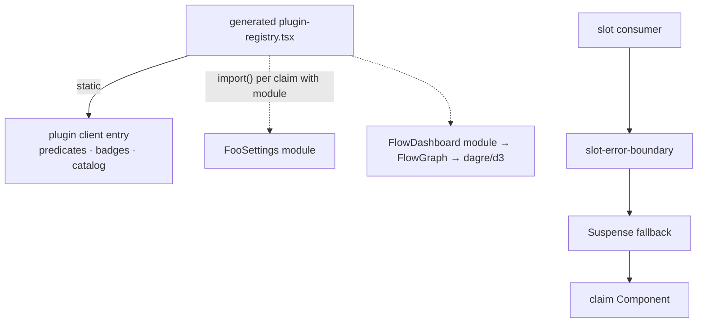

# Design — lazily-loaded plugin claim modules

## Context

`generateRegistryContent` (dashboard-plugin-runtime/src/vite-plugin/index.ts) emits, per plugin, one `import { A, B, isX, catalog as id_catalog } from "<pkg>"` from the plugin's single client entry, then `claims: [{ …, Component: A }]`. The registry is imported by the shell eagerly, so every claimed component and its dependency graph lands in `index`.

Measured share (source map, entry chunk): plugin packages ~560 KB raw / ~170 KB gz; top: flows 82, blackhole 60, automation 61, mcp-client 55, system-one 50, kb 46, goal 44 KB raw; plus FlowGraph's dagre/d3/lodash ~95 KB raw.



## Decisions

### D1 — Per-claim `module`, not a second "lazy entry" per plugin

`PluginClaim.module?: string`, package-relative (`"./src/client/FooSettings.tsx"`). Per-claim granularity lets one plugin's settings page and its board load independently and keeps the manifest self-describing.

Rejected:
- *Generator wraps the existing entry in `lazy()`* — the entry is also statically imported, so no split (Rollup warning; precedent: `shrink-client-index-chunk` / `@mdi/js`).
- *One `clientLazy` entry per plugin* — coarser; opening one lazy surface pulls all of a plugin's lazy surfaces.
- *Slot-level policy (all `settings-section` lazy)* — still needs a separate module to split, and couples a perf decision to slot ids.

### D2 — Import specifier resolution

Same two-tier chain as the main entry: if the plugin's `package.json#exports` maps a subpath to the module, emit `"<pkg>/<subpath>"`; else emit the path relative to the generated file (extension stripped). The validator resolves the file on disk in both cases.

### D3 — Generator validation

Fail generation (error names plugin, slot, component, module) when:
1. the module file is missing;
2. `readNamedExports(module)` lacks `component` (reuses the existing export scanner);
3. `readNamedExports(mainEntry)` contains `component` — a static path would pin the module.

`predicate` / `shouldRender` / `labelComponent` must still be exported by the main entry (existing rule unchanged). `module` is included in `pluginRegistryHash` so a stale bundle is detected.

### D4 — Runtime: `lazyClaim` + Suspense in consumers

```ts
export function lazyClaim(load: () => Promise<Record<string, unknown>>, name: string): React.ComponentType<any>
// React.lazy(() => load().then(m => ({ default: m[name] as React.ComponentType<any> }))), memoized by (load, name)
```

`slot-consumers.tsx` renders every claim `Component` as `<SlotErrorBoundary><Suspense fallback={fallback ?? null}><Component …/></Suspense></SlotErrorBoundary>`. Eager components never suspend, so the wrapper is free for them. Slots that need a visible placeholder (overlay routes, content views) pass a skeleton fallback; inline slots default to `null`.

### D5 — Which first-party claims go lazy

Rule: lazy when the surface is (a) opened on demand (settings, overlay routes, content views, editor tabs, command routes) or (b) ≥ 10 KB raw incl. exclusive deps — decided by a per-claim measurement table produced during apply. Stay eager: `session-card-badge`, `session-card-*` subcards on the hot list, `composer-*`, predicates, catalogs. Tool/custom-entry renderers: lazy only when heavy (e.g. `FlowWriteToolRenderer` → mermaid/yaml), since they render in chat history and a suspense gap is visible.

### D6 — Compatibility / version floor

Additive field: plugins without `module` behave exactly as today. A plugin that adopts `module` must stop exporting the component from its main entry (D3.3), so it requires a dashboard that understands `module`. The validator in older dashboards ignores unknown claim keys → the static import fails at build with "does not export" — a loud failure, not silent breakage. Document: adopt `module` only with `engines`/peer floor on the dashboard version that ships this change.

## Risks / Trade-offs

- **[Public contract]** `module` becomes API for third-party plugins → doubt-driven-review before merge; keep the field name/semantics minimal (path + same `component`).
- **[Suspense gaps in chat]** lazy tool/custom renderers would flash on history load → D5 keeps them eager unless measurably heavy, with a sized skeleton.
- **[Dev HMR]** lazy modules are ordinary Vite modules; manifest edits already regenerate the registry. No change expected; covered by existing HMR scenario.
- **[Barrel churn]** moving exports out of plugin barrels can break plugin-internal imports/tests → per-plugin task runs that plugin's tests.

## Measurement

Same protocol as `shrink-client-entry-lazy-islands`: entry gz and landing-graph total before/after; cap lowered to measured rounded up to 10 KiB.
